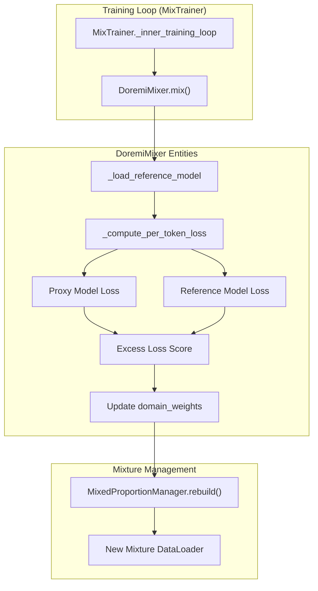

<!-- source: DeepWiki mcp.deepwiki.com · repo OpenDCAI/DataFlex · page 5.2 DoReMi Mixer · fetched 2026-11-02 -->

# DoReMi Mixer

<details>
<summary>Relevant source files</summary>

The following files were used as context for generating this wiki page:

- [examples/train_full/mixers/doremi_step1_static_qwen_pt_full.yaml](examples/train_full/mixers/doremi_step1_static_qwen_pt_full.yaml)
- [examples/train_full/mixers/doremi_step2_dynamic_qwen_pt_full.yaml](examples/train_full/mixers/doremi_step2_dynamic_qwen_pt_full.yaml)
- [examples/train_full/mixers/doremi_step3_static_qwen_pt_full.yaml](examples/train_full/mixers/doremi_step3_static_qwen_pt_full.yaml)
- [src/dataflex/configs/components.yaml](src/dataflex/configs/components.yaml)
- [src/dataflex/train/mixer/doremi_mixer.py](src/dataflex/train/mixer/doremi_mixer.py)

</details>


The `DoremiMixer` implements the Domain Reweighting with Minimax Optimization (DoReMi) algorithm. It is designed to optimize data mixture proportions by minimizing the excess loss of a proxy model relative to a reference model across multiple data domains.

### DoReMi Workflow

DataFlex implements the standard three-step DoReMi workflow as described in the original research. This process moves from establishing a baseline to dynamic reweighting, and finally to production training.

| Step | Purpose | Component Used | Model |
| :--- | :--- | :--- | :--- |
| **Step 1** | Train Reference Model | `static` mixer | Small Reference Model |
| **Step 2** | Optimize Domain Weights | `doremi` mixer | Small Proxy Model |
| **Step 3** | Final Training | `static` mixer | Large Target Model |

#### Step 1: Reference Model Training
A small reference model is trained on a baseline mixture (usually uniform or a known heuristic) to establish a "lower bound" loss for each domain.
*   **Config Example:** [examples/train_full/mixers/doremi_step1_static_qwen_pt_full.yaml:53-59]()

#### Step 2: Proxy Model Training (Dynamic Reweighting)
The `DoremiMixer` is active during this phase. It loads the reference model from Step 1 and trains a proxy model (of the same size). It dynamically updates domain weights based on "excess loss": the difference between the proxy model's loss and the reference model's loss.
*   **Config Example:** [examples/train_full/mixers/doremi_step2_dynamic_qwen_pt_full.yaml:53-61]()

#### Step 3: Final Static-Mix Training
The final domain weights optimized at the end of Step 2 are extracted and used to train the actual large-scale target model using a fixed (static) mixture.
*   **Config Example:** [examples/train_full/mixers/doremi_step3_static_qwen_pt_full.yaml:53-59]()

**Sources:** [src/dataflex/train/mixer/doremi_mixer.py:10-12](), [examples/train_full/mixers/doremi_step1_static_qwen_pt_full.yaml:1-80](), [examples/train_full/mixers/doremi_step2_dynamic_qwen_pt_full.yaml:1-80](), [examples/train_full/mixers/doremi_step3_static_qwen_pt_full.yaml:1-80]()

---

### Implementation Detail: DoremiMixer

The `DoremiMixer` class ([src/dataflex/train/mixer/doremi_mixer.py:10]()) manages the state of domain weights and performs the reweighting calculations during Step 2.

#### Logic Flow: Excess Loss Calculation
The mixer calculates the score for each domain $d$ using the excess loss formula:
$$Score_d = \text{Loss}_{\text{proxy}} - \text{Loss}_{\text{reference}}$$

#### Data Flow and Entity Mapping

The following diagram shows how the `DoremiMixer` interacts with the training loop and models to update domain proportions.

**DoReMi Mixer Data Flow**


**Sources:** [src/dataflex/train/mixer/doremi_mixer.py:49-80](), [src/dataflex/train/mixer/doremi_mixer.py:117-156]()

---

### Key Parameters

The behavior of the mixer is controlled via the `components.yaml` file.

| Parameter | Type | Description |
| :--- | :--- | :--- |
| `reference_model_path` | `str` | Path to the checkpoint generated in Step 1. [src/dataflex/configs/components.yaml:89-90]() |
| `reweight_eta` | `float` | Learning rate ($\eta$) for the domain weight updates. Higher values make the mixture more volatile. [src/dataflex/configs/components.yaml:94]() |
| `reweight_eps` | `float` | Smoothing parameter ($\epsilon$) for domain weights to prevent any domain weight from reaching zero. [src/dataflex/configs/components.yaml:95]() |

**Sources:** [src/dataflex/configs/components.yaml:85-96](), [src/dataflex/train/mixer/doremi_mixer.py:11-16]()

---

### DeepSpeed ZeRO-3 Compatibility

Training with DeepSpeed ZeRO-3 requires special handling because model parameters are partitioned across GPUs. The `DoremiMixer` includes logic to detect and handle this environment.

*   **Detection:** The mixer checks `accelerator.state.deepspeed_plugin.zero_stage` during initialization. [src/dataflex/train/mixer/doremi_mixer.py:33-38]()
*   **Parameter Gathering:** When calculating per-token loss for reweighting, the mixer uses `deepspeed.zero.GatheredParameters` to ensure the full model weights are available for the forward pass. [src/dataflex/train/mixer/doremi_mixer.py:94-100]()
*   **Performance Note:** ZeRO-3 evaluation is significantly slower due to the overhead of gathering parameters. For Step 2 (Proxy Training), using **ZeRO-2** or **LoRA** is recommended for better throughput. [src/dataflex/train/mixer/doremi_mixer.py:39-45]()

**Sources:** [src/dataflex/train/mixer/doremi_mixer.py:31-46](), [src/dataflex/train/mixer/doremi_mixer.py:81-115]()

---

### Configuration Example (Step 2)

The following YAML snippet demonstrates how to configure the proxy training phase in DataFlex.

```yaml
### dynamic_train - DoReMi Step 2
train_type: dynamic_mix
component_name: doremi
components_cfg_file: src/dataflex/configs/components.yaml
mixture_sample_rule: mixture
init_mixture_proportions: [0.5, 0.5]
warmup_step: 100
update_step: 200
update_times: 3
```

**Reference in `components.yaml`:**
```yaml
doremi:
  name: doremi
  params:
    reference_model_path: /path/to/step1/checkpoint
    reweight_eta: 0.1
    reweight_eps: 0.01
```

**Sources:** [examples/train_full/mixers/doremi_step2_dynamic_qwen_pt_full.yaml:53-61](), [src/dataflex/configs/components.yaml:85-96]()

---

