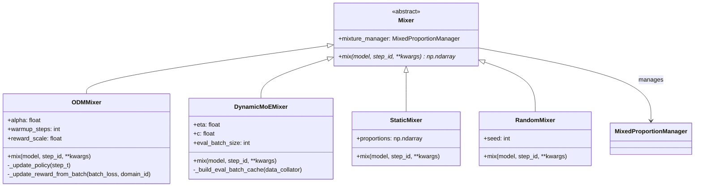
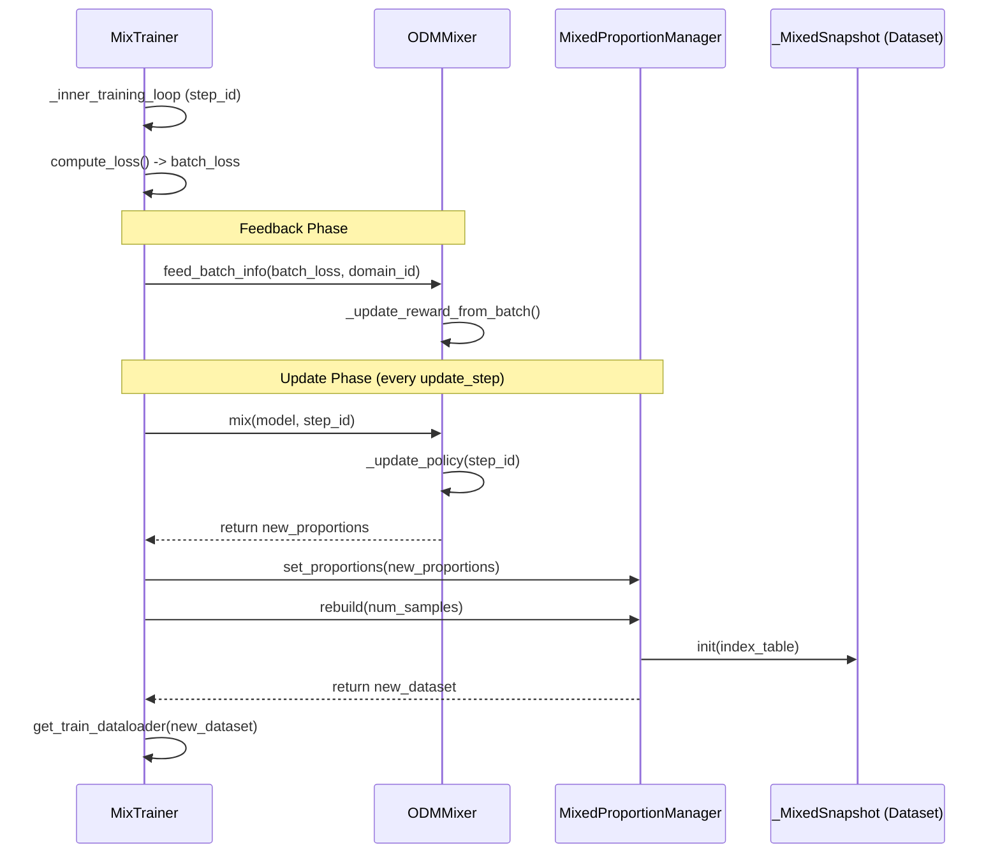

<!-- source: DeepWiki mcp.deepwiki.com · repo OpenDCAI/DataFlex · page 5.3 ODM & Other Mixers (Online Data Mixing, Static, Random, Dynamic MoE) · fetched 2026-11-02 -->

# ODM & Other Mixers (Online Data Mixing, Static, Random, Dynamic MoE)

<details>
<summary>Relevant source files</summary>

The following files were used as context for generating this wiki page:

- [.gitignore](.gitignore)
- [examples/train_full/mixers/odm_dynamic_qwen_pt_full.yaml](examples/train_full/mixers/odm_dynamic_qwen_pt_full.yaml)
- [examples/train_lora/mixers/random.yaml](examples/train_lora/mixers/random.yaml)
- [src/dataflex/train/data/loader.py](src/dataflex/train/data/loader.py)
- [src/dataflex/train/dataset/mixed_proportion_manager.py](src/dataflex/train/dataset/mixed_proportion_manager.py)
- [src/dataflex/train/hparams/dynamic_data_params.py](src/dataflex/train/hparams/dynamic_data_params.py)
- [src/dataflex/train/mixer/__init__.py](src/dataflex/train/mixer/__init__.py)
- [src/dataflex/train/mixer/base_mixer.py](src/dataflex/train/mixer/base_mixer.py)
- [src/dataflex/train/mixer/dynamic_moe_mixer.py](src/dataflex/train/mixer/dynamic_moe_mixer.py)
- [src/dataflex/train/mixer/odm_mixer.py](src/dataflex/train/mixer/odm_mixer.py)
- [src/dataflex/train/mixer/random_mixer.py](src/dataflex/train/mixer/random_mixer.py)
- [src/dataflex/train/mixer/static_mixer.py](src/dataflex/train/mixer/static_mixer.py)
- [src/dataflex/utils/load_component.py](src/dataflex/utils/load_component.py)

</details>


This page covers the variety of data mixing algorithms available in DataFlex. These components implement the `Mixer` interface and are responsible for calculating the proportions (weights) of different data sources during `dynamic_mix` training. This includes the sophisticated Online Data Mixing (ODM) bandit-based algorithm, the Mixture-of-Experts (MoE) gate-load-based mixer, and baseline static/random mixers.

## Mixer Architecture

All mixers inherit from the `Mixer` base class and interact with the `MixedProportionManager` to influence the data distribution for the next training cycle.

### Class Relationship Diagram
This diagram shows how the different Mixer implementations relate to the core system.


**Sources:** [src/dataflex/train/mixer/base_mixer.py:4-21](), [src/dataflex/train/mixer/odm_mixer.py:9-28](), [src/dataflex/train/mixer/dynamic_moe_mixer.py:28-47](), [src/dataflex/train/mixer/static_mixer.py:7-9](), [src/dataflex/train/mixer/random_mixer.py:7-11]()

---

## ODMMixer (Online Data Mixing)

The `ODMMixer` implements the **Online Data Mixing** algorithm using the **Multi-Armed Bandit Exp3** framework. Unlike standard Exp3 which uses cumulative rewards, ODM uses a **Moving Average** to adjust domain weights, making it more responsive to the evolving state of the model during training [src/dataflex/train/mixer/odm_mixer.py:10-17]().

### Key Mechanism
1.  **Reward Computation**: The mixer receives feedback from the trainer via `prev_batch_info` (containing `batch_loss` and `domain_id`). The reward is calculated as:
    $R_t = \text{batch\_loss} \times \text{reward\_scale}$ [src/dataflex/train/mixer/odm_mixer.py:139-152]().
2.  **Moving Average Update**: The estimated reward for a domain is updated using:
    $\hat{R}_t = \alpha \hat{R}_{t-1} + (1-\alpha) \frac{R_t}{\pi_{t-1}}$ [src/dataflex/train/mixer/odm_mixer.py:17]().
3.  **Policy Update**: The sampling policy $\pi_t$ is updated using the Exp3 formula with an exploration rate $\epsilon_t$ to ensure the algorithm doesn't prematurely converge on a single domain [src/dataflex/train/mixer/odm_mixer.py:92-128]().

### Configuration Parameters
| Parameter | Type | Default | Description |
| :--- | :--- | :--- | :--- |
| `alpha` | float | 0.90 | Smoothing factor for the moving average. |
| `warmup_steps` | int | 2000 | Steps to use initial proportions before starting bandit updates. |
| `reward_scale` | float | 15.0 | Multiplier for loss values to amplify the signal for the bandit. |
| `min_exploration_rate` | float | 0.03 | Lower bound for $\epsilon_t$ to maintain algorithm sensitivity. |

**Sources:** [src/dataflex/train/mixer/odm_mixer.py:11-40](), [src/dataflex/train/mixer/odm_mixer.py:80-90]()

---

## Dynamic MoE Mixer

The `DynamicMoEMixer` is designed for Mixture-of-Experts models. It adjusts data proportions based on the **gate load** (utilization) of experts across different domains [src/dataflex/train/mixer/dynamic_moe_mixer.py:2-9]().

### Optimization & Implementation
*   **Eval Batch Cache**: To minimize overhead, the mixer pre-collates evaluation batches for each domain once and caches them as CPU tensors [src/dataflex/train/mixer/dynamic_moe_mixer.py:121-164]().
*   **Independent Eval Sets**: It prefers independent evaluation datasets (specified via `mixer_eval_dataset` in `DataArguments`) to estimate gate loads. If not provided, it splits a portion from the training data [src/dataflex/train/mixer/dynamic_moe_mixer.py:63-117](), [src/dataflex/train/hparams/dynamic_data_params.py:149-152]().
*   **Inference Mode**: Uses `torch.inference_mode()` during load estimation to reduce memory and compute overhead [src/dataflex/train/mixer/dynamic_moe_mixer.py:7]().

**Sources:** [src/dataflex/train/mixer/dynamic_moe_mixer.py:28-61](), [src/dataflex/train/data/loader.py:137-152]()

---

## Static and Random Mixers

These serve as baselines or for scenarios where fixed ratios are required.

### StaticMixer
Used for training with fixed proportions that do not change over time. It validates that the provided `proportions` list matches the number of data sources and normalizes them to sum to 1.0 [src/dataflex/train/mixer/static_mixer.py:15-37]().

### RandomMixer
Generates a new set of random proportions at every `mix()` call. It uses a fixed seed for reproducibility within a single run but produces a uniform-random distribution across the available domains [src/dataflex/train/mixer/random_mixer.py:13-26]().

**Sources:** [src/dataflex/train/mixer/static_mixer.py:9-48](), [src/dataflex/train/mixer/random_mixer.py:8-28]()

---

## Data Flow: Mixer Feedback Loop

The following diagram illustrates how the `MixTrainer` provides feedback to the `Mixer` (specifically `ODMMixer`) and how the `MixedProportionManager` updates the dataset.



**Sources:** [src/dataflex/train/mixer/odm_mixer.py:139-160](), [src/dataflex/train/dataset/mixed_proportion_manager.py:60-83](), [src/dataflex/train/dataset/mixed_proportion_manager.py:108-167]()

## Configuration Example (ODM)

A typical YAML configuration for `dynamic_mix` using the `odm` component:

```yaml
train_type: dynamic_mix
component_name: odm
mixture_sample_rule: mixture 
init_mixture_proportions: [0.5, 0.5]
warmup_step: 10
update_step: 10
update_times: -1 # Continuous update
```

**Sources:** [examples/train_full/mixers/odm_dynamic_qwen_pt_full.yaml:57-64]()

---

