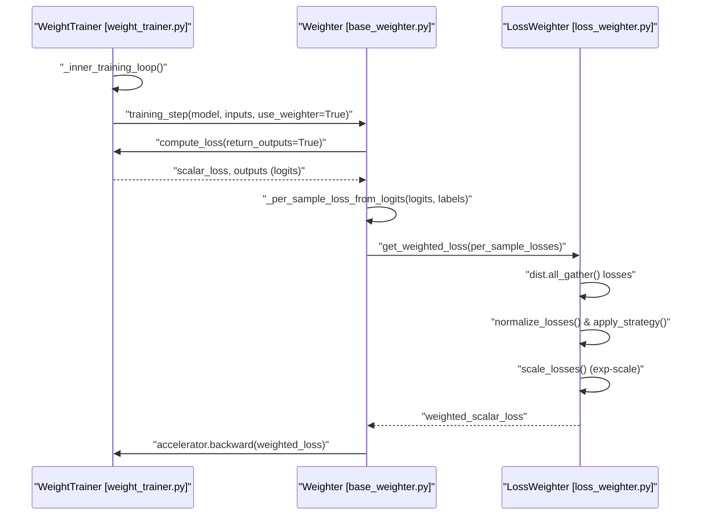
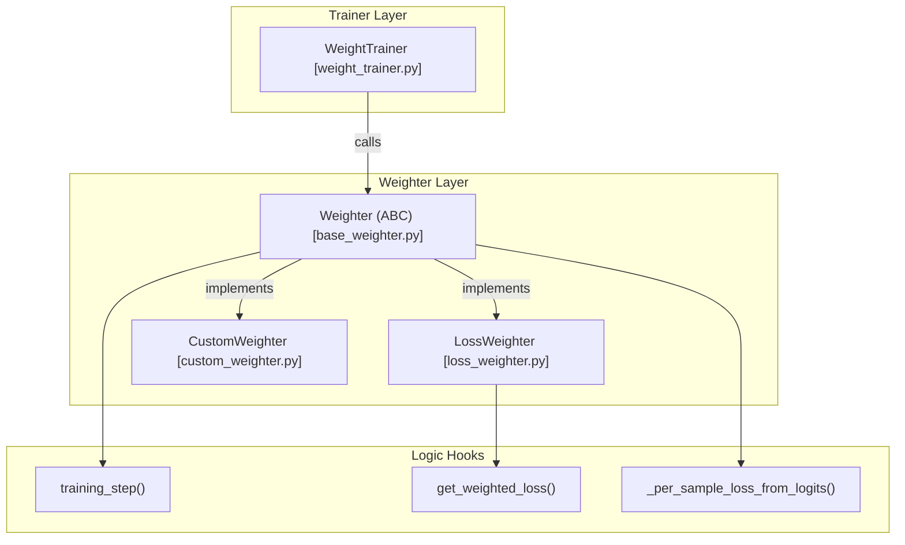

<!-- source: DeepWiki mcp.deepwiki.com · repo OpenDCAI/DataFlex · page 6 Dynamic Sample Reweighting · fetched 2026-11-02 -->

# Dynamic Sample Reweighting

<details>
<summary>Relevant source files</summary>

The following files were used as context for generating this wiki page:

- [src/dataflex/train/trainer/weight_trainer.py](src/dataflex/train/trainer/weight_trainer.py)
- [src/dataflex/train/weighter/__init__.py](src/dataflex/train/weighter/__init__.py)
- [src/dataflex/train/weighter/base_weighter.py](src/dataflex/train/weighter/base_weighter.py)
- [src/dataflex/train/weighter/loss_weighter.py](src/dataflex/train/weighter/loss_weighter.py)

</details>


The `dynamic_weight` training mode in DataFlex implements importance sampling by reweighting the contribution of individual samples to the total batch loss. Unlike selection (which discards data) or mixing (which adjusts source proportions), reweighting operates at the granularity of individual training instances within a batch.

This system intercepts the standard training loop to compute per-sample losses, gathers them across distributed processes, and applies a weighting strategy before performing the backward pass.

## High-Level Architecture

The reweighting subsystem consists of two primary code entities: the `WeightTrainer`, which manages the training loop orchestration, and the `Weighter`, which encapsulates the mathematical logic for calculating importance weights.

### Interaction Workflow

The following diagram illustrates how `WeightTrainer` delegates the loss calculation and weighting logic to a `Weighter` component.

**Diagram: Reweighting Execution Flow**

**Sources:** [src/dataflex/train/trainer/weight_trainer.py:1-160](), [src/dataflex/train/weighter/base_weighter.py:67-147](), [src/dataflex/train/weighter/loss_weighter.py:71-133]()

## Key Components

### WeightTrainer
The `WeightTrainer` inherits from LLaMA-Factory's `CustomSeq2SeqTrainer` and overrides the core training loop. It is responsible for:
*   **Warmup Gating**: Delaying the application of weights until a specified `warmup_step` is reached.
*   **Manual Synchronization**: Managing gradient synchronization across GPUs via `gradient_state._set_sync_gradients` to ensure weights are applied correctly during gradient accumulation.
*   **Step Orchestration**: Invoking the `weighter.training_step` which wraps the forward and backward passes.

For more details, see [WeightTrainer](#6.1).

### Weighter & LossWeighter
The `Weighter` is an abstract base class defining the interface for all reweighting algorithms. Its primary implementation, `LossWeighter`, implements the algorithm described in "Dynamic Loss-Based Sample Reweighting for Improved Large Language Model Pretraining" (ICLR 2025).

The `LossWeighter` follows a multi-stage normalization pipeline:
1.  **Gather**: Collects losses from all ranks using `dist.all_gather` [src/dataflex/train/weighter/loss_weighter.py:103-110]().
2.  **Normalize**: Maps losses to a range defined by `delta` [src/dataflex/train/weighter/loss_weighter.py:43-47]().
3.  **Strategy**: Applies a transformation function (e.g., `linupper`, `quadratic`) [src/dataflex/train/weighter/loss_weighter.py:49-60]().
4.  **Scale**: Performs exponential scaling for numerical stability [src/dataflex/train/weighter/loss_weighter.py:38-40]().

For more details, see [LossWeighter & Custom Weighters](#6.2).

## Natural Language to Code Mapping

The following table and diagram map high-level reweighting concepts to specific classes and methods within the DataFlex codebase.

| Concept | Code Entity | File Path |
| :--- | :--- | :--- |
| **Training Mode** | `dynamic_weight` | Config-driven |
| **Trainer Orchestrator** | `WeightTrainer` | [src/dataflex/train/trainer/weight_trainer.py:47-48]() |
| **Weight Logic Interface** | `Weighter` | [src/dataflex/train/weighter/base_weighter.py:7-10]() |
| **Loss-based Strategy** | `LossWeighter` | [src/dataflex/train/weighter/loss_weighter.py:16-20]() |
| **Strategy Registration** | `@register_weighter('loss')` | [src/dataflex/train/weighter/loss_weighter.py:15-15]() |

**Diagram: System Entity Map**

**Sources:** [src/dataflex/train/trainer/weight_trainer.py:1-160](), [src/dataflex/train/weighter/base_weighter.py:1-148](), [src/dataflex/train/weighter/loss_weighter.py:1-133]()

## Configuration Overview

Reweighting is enabled by setting `train_type: dynamic_weight` in the YAML configuration. The specific algorithm and its parameters are defined under the `component_name` and `component_args` fields.

```yaml
train_type: dynamic_weight
component_name: loss
warmup_step: 100
component_args:
  strategy: linupper
  delta: 1.0
```

*   `strategy`: Determines the shape of the weighting function (e.g., `linupper`, `uniform`, `quadratic`, `extremes`) [src/dataflex/train/weighter/loss_weighter.py:28-31]().
*   `delta`: A hyperparameter controlling the intensity of the reweighting [src/dataflex/train/weighter/loss_weighter.py:33-33]().

**Sources:** [src/dataflex/train/weighter/loss_weighter.py:21-35]()

---

