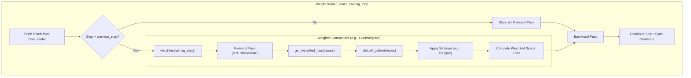

<!-- source: DeepWiki mcp.deepwiki.com · repo OpenDCAI/DataFlex · page 6.1 WeightTrainer · fetched 2026-11-02 -->

# WeightTrainer

<details>
<summary>Relevant source files</summary>

The following files were used as context for generating this wiki page:

- [src/dataflex/train/trainer/__init__.py](src/dataflex/train/trainer/__init__.py)
- [src/dataflex/train/trainer/weight_trainer.py](src/dataflex/train/trainer/weight_trainer.py)
- [src/dataflex/train/weighter/__init__.py](src/dataflex/train/weighter/__init__.py)
- [src/dataflex/train/weighter/loss_weighter.py](src/dataflex/train/weighter/loss_weighter.py)

</details>


The `WeightTrainer` is the orchestration engine for the `dynamic_weight` training mode in DataFlex. Unlike `SelectTrainer` (which filters data) or `MixTrainer` (which adjusts dataset proportions), `WeightTrainer` performs **Dynamic Sample Reweighting**. It intercepts the standard loss computation during the training loop and applies a weighting factor to each sample within a batch before the backward pass.

## Purpose and Design

The primary goal of `WeightTrainer` is to implement algorithms that treat samples with different importance levels (e.g., based on loss magnitude or training dynamics). It inherits from `CustomSeq2SeqTrainer` [src/dataflex/train/trainer/weight_trainer.py:47-47]() and overrides the core training loop to provide fine-grained control over gradient synchronization and sample weighting.

Key features include:
- **Warmup Gating**: Training begins with standard uniform weighting for a configurable number of steps.
- **Manual Gradient Sync**: Uses `accelerator.gradient_state._set_sync_gradients` to manage accumulation boundaries manually.
- **Weighter Integration**: Delegates the actual weight calculation to a `Weighter` component (e.g., `LossWeighter`).

## System Architecture

The following diagram illustrates how `WeightTrainer` bridges the high-level training logic with the specific weighting algorithms.

### WeightTrainer Entity Map
| Logic Layer | Code Entity | File Path |
| :--- | :--- | :--- |
| **Trainer Engine** | `WeightTrainer` | [src/dataflex/train/trainer/weight_trainer.py:199-199]() |
| **Algorithm Base** | `Weighter` | [src/dataflex/train/weighter/base_weighter.py:12-12]() |
| **Concrete Algorithm** | `LossWeighter` | [src/dataflex/train/weighter/loss_weighter.py:16-16]() |
| **Component Loader** | `load_component` | [src/dataflex/utils/load_component.py:5-5]() |

### Data Flow: Training Step with Reweighting
This diagram shows the lifecycle of a single training step within the `_inner_training_loop`.


Sources: [src/dataflex/train/trainer/weight_trainer.py:343-440](), [src/dataflex/train/weighter/loss_weighter.py:71-133]()

## Implementation Details

### The Custom Training Loop
The `WeightTrainer` overrides `_inner_training_loop` [src/dataflex/train/trainer/weight_trainer.py:343-343]() to handle manual gradient synchronization. This is necessary because DataFlex needs to control exactly when gradients are averaged across GPUs, especially when the `Weighter` performs its own internal distributed communication.

The trainer uses `self.accelerator.gradient_state._set_sync_gradients(False)` [src/dataflex/train/trainer/weight_trainer.py:440-440]() to prevent automatic synchronization during accumulation steps, ensuring that the weighted loss is correctly aggregated before the final update.

### Warmup Gating
The reweighting logic is gated by the `warmup_step` parameter.
- **Before Warmup**: The trainer executes a standard forward pass [src/dataflex/train/trainer/weight_trainer.py:476-476]().
- **After Warmup**: The trainer calls `self.weighter.training_step` [src/dataflex/train/trainer/weight_trainer.py:465-465]().

### Loss Reweighting Workflow
When `LossWeighter` is active, it follows a multi-stage normalization pipeline to ensure numerical stability and effective gradient scaling:

1.  **Gathering**: It collects per-sample losses from all ranks using `dist.all_gather_into_tensor` or `dist.all_gather` [src/dataflex/train/weighter/loss_weighter.py:105-110]().
2.  **Normalization**: Losses are scaled to a range defined by `delta` using `normalize_losses` [src/dataflex/train/weighter/loss_weighter.py:43-47]().
3.  **Strategy Application**: Applies one of the predefined strategies (`linupper`, `uniform`, `quadratic`, `extremes`) [src/dataflex/train/weighter/loss_weighter.py:49-60]().
4.  **Exponential Scaling**: Computes `exp(loss / r)` for the final weights [src/dataflex/train/weighter/loss_weighter.py:38-40]().
5.  **Local Extraction**: Each rank extracts its relevant portion of the global weight vector [src/dataflex/train/weighter/loss_weighter.py:130-130]().

### Weighting Strategies in LossWeighter
| Strategy | Implementation | Logic |
| :--- | :--- | :--- |
| `linupper` | `torch.minimum(losses + delta, delta)` | Caps the influence of high-loss samples. |
| `uniform` | `losses` | Linear mapping of loss to weight. |
| `quadratic` | `1 - (losses^2 / delta^2)` | Penalizes very high and very low losses. |
| `extremes` | `torch.abs(losses)` | Focuses on samples at the edges of the distribution. |

Sources: [src/dataflex/train/weighter/loss_weighter.py:49-60]()

## Key Classes and Functions

### `WeightTrainer` Class
- **`__init__`**: Loads the `Weighter` component via `load_component` [src/dataflex/train/trainer/weight_trainer.py:215-215]().
- **`_inner_training_loop`**: The main loop managing data fetching, warmup logic, and gradient synchronization [src/dataflex/train/trainer/weight_trainer.py:343-580]().

### `LossWeighter` Class
- **`get_weighted_loss`**: The core algorithm that performs distributed gathering and weight calculation [src/dataflex/train/weighter/loss_weighter.py:71-133]().
- **`scale_losses`**: Static method for exponential scaling [src/dataflex/train/weighter/loss_weighter.py:38-40]().

### Component Loading
The `WeightTrainer` uses the `REGISTRY` to instantiate the appropriate weighting algorithm based on the configuration:
```python
self.weighter = load_component(
    component_name=dataflex_args.component_name,
    component_type="weighter",
    # ... runtime args
)
```
Sources: [src/dataflex/train/trainer/weight_trainer.py:215-224]()

## Distributed Considerations
The `WeightTrainer` is designed for multi-GPU environments. It ensures that:
1.  **Loss Consistency**: `LossWeighter` gathers losses from all GPUs so that the weighting distribution is calculated globally rather than per-rank [src/dataflex/train/weighter/loss_weighter.py:103-110]().
2.  **Gradient Scaling**: The final weighted loss is multiplied by `world_size` [src/dataflex/train/weighter/loss_weighter.py:133-133]() to maintain gradient magnitude consistency with standard distributed training.

Sources: [src/dataflex/train/trainer/weight_trainer.py:1-600](), [src/dataflex/train/weighter/loss_weighter.py:1-133]()

---

