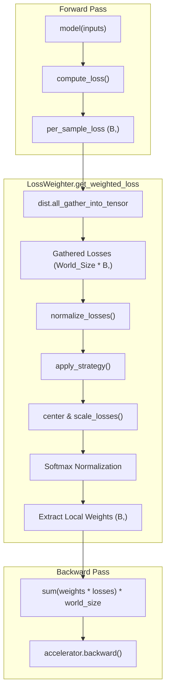
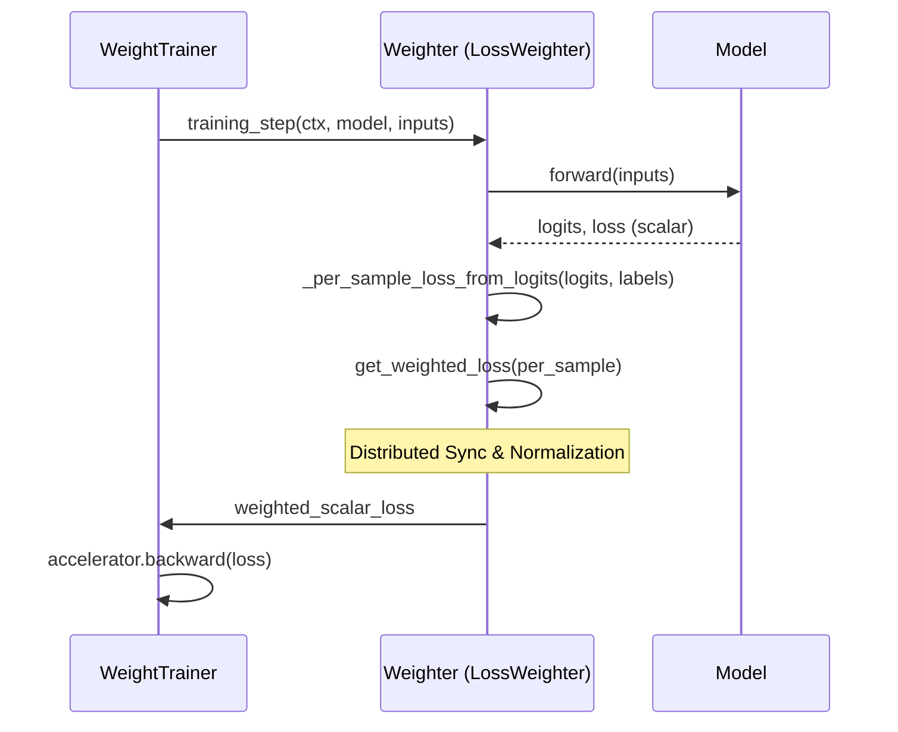

<!-- source: DeepWiki mcp.deepwiki.com · repo OpenDCAI/DataFlex · page 6.2 LossWeighter & Custom Weighters · fetched 2026-11-02 -->

# LossWeighter & Custom Weighters

<details>
<summary>Relevant source files</summary>

The following files were used as context for generating this wiki page:

- [examples/train_lora/weighters/custom.yaml](examples/train_lora/weighters/custom.yaml)
- [examples/train_lora/weighters/loss.yaml](examples/train_lora/weighters/loss.yaml)
- [src/dataflex/train/trainer/weight_trainer.py](src/dataflex/train/trainer/weight_trainer.py)
- [src/dataflex/train/weighter/__init__.py](src/dataflex/train/weighter/__init__.py)
- [src/dataflex/train/weighter/base_weighter.py](src/dataflex/train/weighter/base_weighter.py)
- [src/dataflex/train/weighter/custom_weighter.py](src/dataflex/train/weighter/custom_weighter.py)
- [src/dataflex/train/weighter/loss_weighter.py](src/dataflex/train/weighter/loss_weighter.py)

</details>


The `dynamic_weight` training mode in DataFlex relies on **Weighters** to perform per-sample loss reweighting. Unlike standard training which treats every sample in a batch equally, Weighters dynamically adjust the contribution of each sample to the total loss based on metrics like the current loss value, sample difficulty, or custom heuristics. This system is primarily implemented in the `src/dataflex/train/weighter/` directory.

### The Weighter Lifecycle

The `WeightTrainer` delegates the core training logic to the `Weighter.training_step` method. This method handles the forward pass, extracts per-sample losses, applies the weighting algorithm across the distributed setup, and performs the backward pass.

#### Weighter Data Flow
The following diagram illustrates how raw losses are transformed into a weighted scalar loss across a distributed environment.

**Loss Reweighting Pipeline**

Sources: [src/dataflex/train/weighter/base_weighter.py:67-147](), [src/dataflex/train/weighter/loss_weighter.py:71-133]()

---

### LossWeighter Implementation

The `LossWeighter` implements the algorithm described in *"Dynamic Loss-Based Sample Reweighting for Improved Large Language Model Pretraining" (ICLR 2025)*. It gathers losses from all GPUs to build a global view of the batch difficulty before calculating weights.

#### 1. Distributed Gathering
The weighter uses `dist.all_gather_into_tensor` (or `dist.all_gather` as a fallback) to synchronize per-sample losses across all ranks. This ensures that the normalization statistics (min/max) are global, preventing rank-specific bias [src/dataflex/train/weighter/loss_weighter.py:103-112]().

#### 2. Normalization & Strategies
Losses are normalized to a range defined by the `delta` hyperparameter using `normalize_losses` [src/dataflex/train/weighter/loss_weighter.py:43-47](). Once normalized, one of four strategies is applied:

| Strategy | Logic | Purpose |
| :--- | :--- | :--- |
| `linupper` | `min(loss + delta, delta)` | Linear weighting with an upper cap. |
| `uniform` | `loss` | Standard linear weighting based on loss magnitude. |
| `quadratic` | `1 - (loss^2 / delta^2)` | Penalizes high-loss samples (focuses on "easy" samples). |
| `extremes` | `abs(loss)` | Highlights samples with extreme loss values. |

Sources: [src/dataflex/train/weighter/loss_weighter.py:49-60]()

#### 3. Numerical Stability & Scaling
To prevent gradient explosion or vanishing during exponential scaling, the weighter performs "centering" by subtracting the maximum reweighted value before applying `exp(loss / r)` [src/dataflex/train/weighter/loss_weighter.py:126-127]().

---

### Custom Weighter Development

Developers can implement custom weighting logic by inheriting from the `Weighter` base class and using the `@register_weighter` decorator.

#### Base Class Interface: `Weighter`
The base class provides a utility method `_per_sample_loss_from_logits` which calculates the CrossEntropy loss for each sample in a batch, handling the shifting of logits and labels automatically [src/dataflex/train/weighter/base_weighter.py:22-42]().

**Code Entity Mapping: Weighter Architecture**
```mermaid
classDiagram
    class Weighter {
        <<abstract>>
        +training_step(ctx, model, inputs)
        +get_weighted_loss(losses, ctx, model, inputs)*
        #_per_sample_loss_from_logits(logits, labels)
    }
    class LossWeighter {
        +strategy: str
        +delta: float
        +get_weighted_loss()
        +normalize_losses()
        +scale_losses()
    }
    class CustomWeighter {
        +strategy: str
        +get_weighted_loss()
    }

    Weighter <|-- LossWeighter
    Weighter <|-- CustomWeighter
    
    style Weighter font-weight:bold
```
Sources: [src/dataflex/train/weighter/base_weighter.py:7-65](), [src/dataflex/train/weighter/loss_weighter.py:16-20](), [src/dataflex/train/weighter/custom_weighter.py:9-10]()

#### Implementation Steps
1.  **Define Class**: Inherit from `dataflex.train.weighter.base_weighter.Weighter`.
2.  **Register**: Apply `@register_weighter("my_name")`.
3.  **Implement `get_weighted_loss`**: This method must accept a `(B,)` tensor of losses and return a scalar tensor.

```python
@register_weighter("custom")
class CustomWeighter(Weighter):
    def get_weighted_loss(self, losses, **kwargs):
        # Example: Simple mean (uniform weighting)
        weights = torch.ones_like(losses) / losses.numel()
        return torch.sum(weights * losses)
```
Sources: [src/dataflex/train/weighter/custom_weighter.py:8-52]()

---

### Configuration & Hyperparameters

Weighters are configured in the `components.yaml` file and referenced in the main training YAML via `component_name`.

#### LossWeighter Parameters
*   **`strategy`**: The mathematical mapping function (`linupper`, `uniform`, `quadratic`, `extremes`).
*   **`delta`**: Scaling factor for normalization (default: `1.0`).
*   **`r`**: Temperature parameter for exponential scaling (default: `1`).

#### Example YAML Configuration
To use the `LossWeighter` with a `quadratic` strategy:

```yaml
train_type: dynamic_weight
component_name: loss
# Inside components.yaml
# loss:
#   class: loss
#   args:
#     strategy: "quadratic"
#     delta: 1.5
```
Sources: [examples/train_lora/weighters/loss.yaml:52-60](), [src/dataflex/train/weighter/loss_weighter.py:21-34]()

### System Integration Map

The following diagram shows how the `WeightTrainer` interacts with the `Weighter` components during the training loop.

**Trainer-Weighter Interaction**

Sources: [src/dataflex/train/weighter/base_weighter.py:67-147](), [src/dataflex/train/weighter/loss_weighter.py:71-133]()

---

