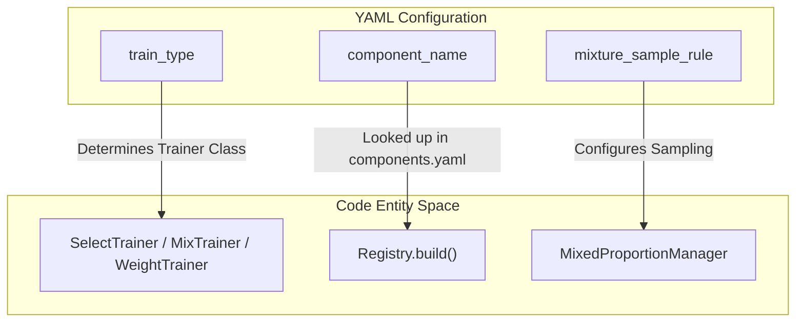
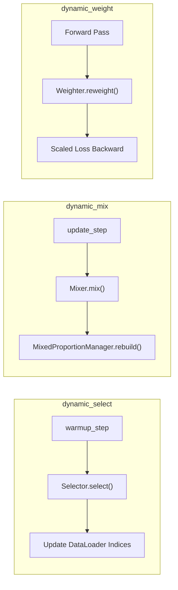

<!-- source: DeepWiki mcp.deepwiki.com · repo OpenDCAI/DataFlex · page 7 Examples & Recipes · fetched 2026-11-02 -->

# Examples & Recipes

Relevant source files

The following files were used as context for generating this wiki page:

- [examples/README.md](examples/README.md)
- [examples/README_zh.md](examples/README_zh.md)
- [examples/merge_lora/llama3_lora_sft.yaml](examples/merge_lora/llama3_lora_sft.yaml)
- [examples/merge_lora/qwen2_5_lora_sft.yaml](examples/merge_lora/qwen2_5_lora_sft.yaml)
- [examples/test/test_mix.yaml](examples/test/test_mix.yaml)
- [examples/test/test_select.yaml](examples/test/test_select.yaml)
- [examples/test/test_static_mix.yaml](examples/test/test_static_mix.yaml)
- [examples/test/test_weight.yaml](examples/test/test_weight.yaml)
- [examples/train_full/mixers/doremi_step1_static_qwen_pt_full.yaml](examples/train_full/mixers/doremi_step1_static_qwen_pt_full.yaml)
- [examples/train_full/mixers/doremi_step2_dynamic_qwen_pt_full.yaml](examples/train_full/mixers/doremi_step2_dynamic_qwen_pt_full.yaml)
- [examples/train_full/mixers/doremi_step3_static_qwen_pt_full.yaml](examples/train_full/mixers/doremi_step3_static_qwen_pt_full.yaml)
- [examples/train_lora/selectors/near.yaml](examples/train_lora/selectors/near.yaml)

The `examples/` directory serves as the primary resource for implementing data-centric training workflows with DataFlex. This page provides a high-level guide to the provided YAML configurations, covering LoRA and full-parameter fine-tuning, the multi-step DoReMi recipe, and distributed training configurations.

## Directory Structure Overview

The examples are organized by fine-tuning method and training mode:
- `examples/train_lora/`: Focuses on Parameter-Efficient Fine-Tuning (PEFT) using LoRA, primarily demonstrating `dynamic_select` and `dynamic_weight` modes.
- `examples/train_full/`: Focuses on full-parameter training, often used for `dynamic_mix` (e.g., DoReMi) and large-scale pre-training.
- `examples/merge_lora/`: Configurations for exporting and merging LoRA adapters into base models [examples/merge_lora/llama3_lora_sft.yaml:1-15]().
- `examples/test/`: Minimal configurations designed for CI validation and quick smoke tests [examples/test/test_select.yaml:1-63]().

## Training Modes & Recipes

DataFlex extends standard training with three specialized modes, each illustrated through specific examples.

### Selector Examples (LoRA Fine-Tuning)
The `dynamic_select` mode is used to prune or prioritize specific samples from a dataset during training. Examples under `examples/train_lora/selectors/` demonstrate algorithms like `LESS`, `NICE`, and `Loss-based` selection. These configs typically define a `warmup_step` to collect initial statistics and an `update_step` to trigger the selection logic [examples/train_lora/selectors/near.yaml:51-60]().

For details on adapting these to new models, see [Selector Examples (LoRA Fine-Tuning)](#7.1).

### Mixer & Weighter Examples
The `dynamic_mix` and `dynamic_weight` modes handle multi-dataset proportions and per-sample importance, respectively.
- **Mixing:** Examples show how to use `static` proportions or dynamic algorithms like `ODM` (Online Data Mixing) [examples/test/test_mix.yaml:45-56]().
- **Weighting:** Demonstrates reweighting the loss function dynamically based on sample difficulty [examples/test/test_weight.yaml:54-62]().

For details on DeepSpeed ZeRO-3 integration and algorithm-specific fields, see [Mixer & Weighter Examples](#7.2).

## DoReMi Three-Step Recipe
DataFlex provides a complete implementation of the DoReMi (Domain Reweighting with Mini-models) workflow via `dynamic_mix`.

| Step | Purpose | Configuration Example | Key Parameters |
| :--- | :--- | :--- | :--- |
| **1** | Reference Model | `doremi_step1_static_qwen_pt_full.yaml` | `static_mix: true`, `init_mixture_proportions` [examples/train_full/mixers/doremi_step1_static_qwen_pt_full.yaml:53-59]() |
| **2** | Proxy Training | `doremi_step2_dynamic_qwen_pt_full.yaml` | `component_name: doremi`, `train_type: dynamic_mix` [examples/train_full/mixers/doremi_step2_dynamic_qwen_pt_full.yaml:53-56]() |
| **3** | Large Model | `doremi_step3_static_qwen_pt_full.yaml` | Optimized proportions from Step 2 [examples/train_full/mixers/doremi_step3_static_qwen_pt_full.yaml:53-58]() |

## Distributed Training & CI

### Distributed Execution
Most examples support distributed training via `torchrun`. For multi-node setups, users must set `FORCE_TORCHRUN=1` and specify node ranks [examples/README.md:102-107](). DeepSpeed configurations (ZeRO-2/ZeRO-3) are referenced directly in the YAML files to enable sharding across GPUs [examples/train_full/mixers/doremi_step2_dynamic_qwen_pt_full.yaml:10-12]().

### CI Validation (Test Configs)
The `examples/test/` directory contains "smoke test" configurations with minimal steps and small batch sizes. These are used to ensure that the patching mechanism and core trainers (`SelectTrainer`, `MixTrainer`, `WeightTrainer`) function correctly across different hardware environments [examples/test/test_select.yaml:61-63]().

### Entity Mapping: Configuration to Logic
The following diagram maps YAML configuration keys to the internal DataFlex system components.

**DataFlex Config Mapping**

**Training Mode Workflow**

Sources: [examples/train_lora/selectors/near.yaml:51-60](), [examples/train_full/mixers/doremi_step2_dynamic_qwen_pt_full.yaml:53-62](), [examples/test/test_weight.yaml:54-62](), [examples/README.md:102-113]().

---

