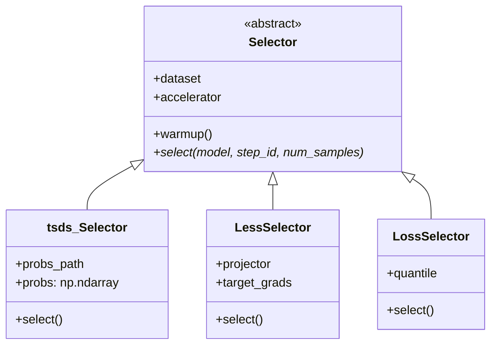

<!-- source: DeepWiki mcp.deepwiki.com · repo OpenDCAI/DataFlex · page 7.1 Selector Examples (LoRA Fine-Tuning) · fetched 2026-11-02 -->

# Selector Examples (LoRA Fine-Tuning)

<details>
<summary>Relevant source files</summary>

The following files were used as context for generating this wiki page:

- [examples/train_lora/selectors/custom.yaml](examples/train_lora/selectors/custom.yaml)
- [examples/train_lora/selectors/delta_loss.yaml](examples/train_lora/selectors/delta_loss.yaml)
- [examples/train_lora/selectors/less.yaml](examples/train_lora/selectors/less.yaml)
- [examples/train_lora/selectors/loss.yaml](examples/train_lora/selectors/loss.yaml)
- [examples/train_lora/selectors/nice.yaml](examples/train_lora/selectors/nice.yaml)
- [examples/train_lora/selectors/random.yaml](examples/train_lora/selectors/random.yaml)
- [examples/train_lora/selectors/tsds.yaml](examples/train_lora/selectors/tsds.yaml)
- [src/dataflex/train/selector/tsds_selector.py](src/dataflex/train/selector/tsds_selector.py)

</details>


This page provides a technical walkthrough of the configuration examples for the `dynamic_select` training mode. These examples demonstrate how to apply various data selection algorithms—ranging from gradient-based methods to loss-based and distribution-based approaches—specifically for Low-Rank Adaptation (LoRA) fine-tuning.

## Overview of Selector Configurations

All selector examples in `examples/train_lora/selectors/` share a common structure designed to work with the `SelectTrainer`. The core logic is driven by the `Dataflex args` section, which bridges the YAML configuration to the `Registry` and the underlying Python implementation.

### Common Configuration Fields

| Field | Description | Example Value |
| :--- | :--- | :--- |
| `train_type` | Specifies the training mode. Must be `dynamic_select` for selectors. | `dynamic_select` |
| `components_cfg_file` | Path to the registry definition for algorithm parameters. | `src/dataflex/configs/components.yaml` |
| `component_name` | The unique identifier of the algorithm in the registry. | `less`, `loss`, `tsds` |
| `warmup_step` | Steps to train on initial data before the first selection. | `10` |
| `update_step` | Interval (in steps) between subsequent data selections. | `10` |
| `update_times` | Total number of selection cycles to perform. | `2` |

**Sources:** [examples/train_lora/selectors/less.yaml:50-60](), [examples/train_lora/selectors/tsds.yaml:50-60]()

---

## Gradient-Based Selectors

### LESS (Low-rank Estimation of Similarity Scores)
The `less.yaml` example configures the `LessSelector`. It uses gradient projections to identify training samples that are most similar to the validation/target distribution.

*   **Implementation:** `LessSelector` (registered as `less`).
*   **Key Logic:** It computes projected gradients for both the training set and a target set, then uses cosine similarity to score samples.
*   **LoRA Specifics:** In the YAML, `finetuning_type: lora` and `lora_target: all` ensure that gradients are tracked for the LoRA adapters [examples/train_lora/selectors/less.yaml:8-9]().

### NICE
The `nice.yaml` example configures the `NICESelector`. This is an evolution of gradient-based selection that incorporates Reinforcement Learning (RL) principles, often used for alignment stages.

**Sources:** [examples/train_lora/selectors/less.yaml:57](), [examples/train_lora/selectors/nice.yaml:57]()

---

## Loss-Based Selectors

These selectors use the model's current performance (loss) on specific samples to determine their utility for future training steps.

### Loss Selector
Configured in `loss.yaml`, this selector targets samples based on their raw loss values. It typically uses a quantile-based approach to focus on "hard" samples (high loss) or "easy" samples depending on the configuration in `components.yaml`.

### Delta Loss Selector
Configured in `delta_loss.yaml`, this selector measures the *change* in loss over time. This helps identify samples where the model is currently learning the most (high "learnability").

**Sources:** [examples/train_lora/selectors/loss.yaml:57](), [examples/train_lora/selectors/delta_loss.yaml:57]()

---

## Distribution & Offline Selectors

### TSDS (Target-aware Data Selection)
The `tsds.yaml` example demonstrates how to use pre-computed probabilities for selection. This is useful when the selection logic is computationally expensive and performed offline.

*   **Data Flow:** The `tsds_Selector` loads a `.npy` file containing sample probabilities [src/dataflex/train/selector/tsds_selector.py:23]().
*   **Validation:** The selector ensures the probability array length matches the dataset size [src/dataflex/train/selector/tsds_selector.py:27-30]().
*   **Selection:** It uses `np.random.choice` with the loaded probabilities `p=self.probs` to select the next batch of indices [src/dataflex/train/selector/tsds_selector.py:38-43]().

### NEAR (Neighbor-Enhanced Abstract Representation)
Similar to TSDS, `near.yaml` utilizes pre-computed embedding similarities. It typically relies on a FAISS index or pre-calculated distance matrices to select samples that are "near" the target distribution in embedding space.

**Sources:** [src/dataflex/train/selector/tsds_selector.py:7-45](), [examples/train_lora/selectors/tsds.yaml:57]()

---

## System Architecture: Configuration to Code

The following diagram illustrates how the YAML configuration fields map to the internal Python classes and the execution flow within the `SelectTrainer`.

### Selector Execution Flow
```mermaid
graph TD
    subgraph "YAML Configuration Space"
        YAML["selector.yaml"]
        CN["component_name: 'tsds'"]
        TT["train_type: 'dynamic_select'"]
    end

    subgraph "DataFlex Core (Code Entity Space)"
        REG["Registry (src/dataflex/core/registry.py)"]
        ST["SelectTrainer (src/dataflex/train/trainer/select_trainer.py)"]
        TSDS["tsds_Selector (src/dataflex/train/selector/tsds_selector.py)"]
    end

    YAML -->|Parsed by OmegaConf| ST
    CN -->|Looked up in| REG
    REG -->|Instantiates| TSDS
    ST -->|Calls warmup()| TSDS
    ST -->|Triggers update_step| TSDS
    TSDS -->|Returns indices| ST
    ST -->|rebuilds| DataLoader["DataLoader (via get_train_dataloader)"]
```
**Sources:** [src/dataflex/core/registry.py:1-50](), [src/dataflex/train/selector/tsds_selector.py:7-18](), [examples/train_lora/selectors/tsds.yaml:51-60]()

---

## Baseline & Custom Selectors

### Random Selector
Configured in `random.yaml`, this serves as a control baseline. It selects a subset of data randomly at every `update_step`. It is useful for verifying that dynamic selection algorithms are actually providing a "selection gain" over naive shuffling.

### Custom Selector
The `custom.yaml` example shows how to hook into a user-defined selection algorithm.
1.  **Implementation:** Create a class inheriting from `Selector` in `src/dataflex/train/selector/custom_selector.py`.
2.  **Registration:** Use `@register_selector("custom")`.
3.  **Configuration:** Set `component_name: custom` in the YAML [examples/train_lora/selectors/custom.yaml:57]().

**Sources:** [examples/train_lora/selectors/random.yaml:57](), [examples/train_lora/selectors/custom.yaml:57]()

---

## Adapting for New Models

To adapt these examples for a different model (e.g., switching from Llama-3 to Qwen):

1.  **Model Path:** Update `model_name_or_path` [examples/train_lora/selectors/tsds.yaml:2]().
2.  **Template:** Update `template` to match the model's chat template (e.g., `qwen`, `llama3`) [examples/train_lora/selectors/tsds.yaml:15]().
3.  **LoRA Targets:** Ensure `lora_target` matches the target modules of the new architecture (using `all` is generally safe for most models) [examples/train_lora/selectors/tsds.yaml:9]().
4.  **Hardware Adjustments:** If the new model is larger, adjust `per_device_train_batch_size` and `gradient_accumulation_steps` to fit into VRAM [examples/train_lora/selectors/tsds.yaml:41-42]().

### Selector Component Hierarchy

**Sources:** [src/dataflex/train/selector/tsds_selector.py:8-18](), [src/dataflex/train/selector/base_selector.py:1-20]() (implied by inheritance)

---

