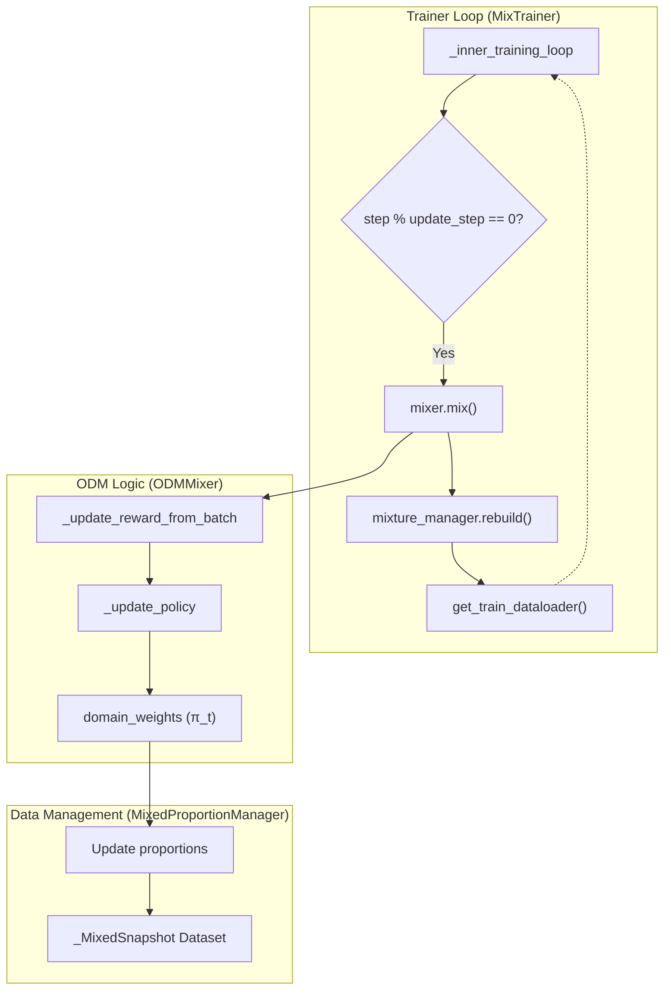
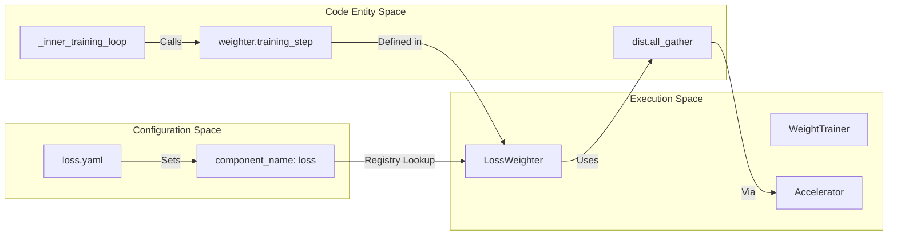

<!-- source: DeepWiki mcp.deepwiki.com · repo OpenDCAI/DataFlex · page 7.2 Mixer & Weighter Examples · fetched 2026-11-02 -->

# Mixer & Weighter Examples

Relevant source files

The following files were used as context for generating this wiki page:

- [examples/accelerate/fsdp_config.yaml](examples/accelerate/fsdp_config.yaml)
- [examples/deepspeed/ds_z3_config.json](examples/deepspeed/ds_z3_config.json)
- [examples/train_full/mixers/doremi_step1_static_qwen_pt_full.yaml](examples/train_full/mixers/doremi_step1_static_qwen_pt_full.yaml)
- [examples/train_full/mixers/doremi_step2_dynamic_qwen_pt_full.yaml](examples/train_full/mixers/doremi_step2_dynamic_qwen_pt_full.yaml)
- [examples/train_full/mixers/doremi_step3_static_qwen_pt_full.yaml](examples/train_full/mixers/doremi_step3_static_qwen_pt_full.yaml)
- [examples/train_full/mixers/odm_dynamic_qwen_pt_full.yaml](examples/train_full/mixers/odm_dynamic_qwen_pt_full.yaml)
- [examples/train_lora/weighters/custom.yaml](examples/train_lora/weighters/custom.yaml)
- [examples/train_lora/weighters/loss.yaml](examples/train_lora/weighters/loss.yaml)
- [src/dataflex/train/mixer/odm_mixer.py](src/dataflex/train/mixer/odm_mixer.py)

This page provides a detailed walkthrough of configuration examples for **Dynamic Data Mixing** (`dynamic_mix`) and **Dynamic Sample Reweighting** (`dynamic_weight`). These examples cover full-parameter pre-training (PT) and LoRA fine-tuning (SFT) scenarios, highlighting the integration with distributed backends like DeepSpeed ZeRO-3.

## Dynamic Mixing Examples (`dynamic_mix`)

Dynamic mixing involves adjusting the proportions of different datasets (domains) during the training process. This is primarily orchestrated by the `MixTrainer` and the `MixedProportionManager`.

### DoReMi Three-Step Recipe
The DoReMi (Domain Reweighting with Minimax Optimization) algorithm is implemented as a three-step workflow to optimize domain weights for a large target model using a smaller proxy model.

#### Step 1: Reference Model Training
A small reference model is trained on a fixed (usually uniform) distribution to establish a baseline loss per domain.
- **Config**: `examples/train_full/mixers/doremi_step1_static_qwen_pt_full.yaml`
- **Key Fields**:
    - `component_name: static` [examples/train_full/mixers/doremi_step1_static_qwen_pt_full.yaml:56]()
    - `static_mix: true` [examples/train_full/mixers/doremi_step1_static_qwen_pt_full.yaml:59]()
    - `init_mixture_proportions: [0.5, 0.5]` [examples/train_full/mixers/doremi_step1_static_qwen_pt_full.yaml:58]()

#### Step 2: Proxy Model Training (Dynamic)
The proxy model (same size as reference) is trained using the `doremi` mixer. It calculates "excess loss" (current loss minus reference loss) to update domain weights.
- **Config**: `examples/train_full/mixers/doremi_step2_dynamic_qwen_pt_full.yaml`
- **Key Fields**:
    - `train_type: dynamic_mix` [examples/train_full/mixers/doremi_step2_dynamic_qwen_pt_full.yaml:54]()
    - `component_name: doremi` [examples/train_full/mixers/doremi_step2_dynamic_qwen_pt_full.yaml:56]()
    - `update_step: 200` [examples/train_full/mixers/doremi_step2_dynamic_qwen_pt_full.yaml:60]() (Frequency of weight updates).

#### Step 3: Large Model Training
The optimized weights from Step 2 are applied to the large target model as a static mixture.
- **Config**: `examples/train_full/mixers/doremi_step3_static_qwen_pt_full.yaml`
- **Key Fields**:
    - `init_mixture_proportions: [0.3, 0.7]` [examples/train_full/mixers/doremi_step3_static_qwen_pt_full.yaml:58]() (Weights derived from Step 2).

### Online Data Mixing (ODM)
ODM uses the Multi-Armed Bandit algorithm (Exp3) with a moving average to adjust domain weights based on the training loss signal.

**ODM Implementation Flow**
The `ODMMixer` computes rewards based on batch loss and updates a sampling policy $\pi_t$.

| Component | Logic | Code Reference |
| :--- | :--- | :--- |
| **Reward Scaling** | Amplifies loss signal (default 15.0) | [src/dataflex/train/mixer/odm_mixer.py:36]() |
| **Exploration** | Prevents "freezing" with `min_exploration_rate` | [src/dataflex/train/mixer/odm_mixer.py:39]() |
| **Policy Update** | Exp3 formula: $\pi_t \propto \exp(\epsilon R) $ | [src/dataflex/train/mixer/odm_mixer.py:92-127]() |

**Example Config**: `examples/train_full/mixers/odm_dynamic_qwen_pt_full.yaml`
- `component_name: odm` [examples/train_full/mixers/odm_dynamic_qwen_pt_full.yaml:59]()
- `update_times: -1` [examples/train_full/mixers/odm_dynamic_qwen_pt_full.yaml:64]() (Continuous updates until end of training).

**Sources**: [src/dataflex/train/mixer/odm_mixer.py](), [examples/train_full/mixers/odm_dynamic_qwen_pt_full.yaml](), [examples/train_full/mixers/doremi_step2_dynamic_qwen_pt_full.yaml]()

---

## Dynamic Reweighting Examples (`dynamic_weight`)

In `dynamic_weight` mode, the `WeightTrainer` intercepts the loss calculation. Unlike mixing (which changes the *count* of samples from a domain), reweighting changes the *importance* of individual samples within a batch.

### Loss-Based Reweighting
The `LossWeighter` calculates weights based on the relative magnitude of sample losses within a distributed environment.

**Example Config**: `examples/train_lora/weighters/loss.yaml`
- `train_type: dynamic_weight` [examples/train_lora/weighters/loss.yaml:52]()
- `component_name: loss` [examples/train_lora/weighters/loss.yaml:58]()
- `warmup_step: 100` [examples/train_lora/weighters/loss.yaml:59]()

### Custom Weighter Integration
Users can define custom logic by inheriting from `BaseWeighter`. The example configuration points to a `custom` component defined in `components.yaml`.

**Example Config**: `examples/train_lora/weighters/custom.yaml`
- `component_name: custom` [examples/train_lora/weighters/custom.yaml:58]()

**Sources**: [examples/train_lora/weighters/loss.yaml](), [examples/train_lora/weighters/custom.yaml]()

---

## DeepSpeed ZeRO-3 Integration

For full-parameter pre-training (PT) of models like Qwen2.5, DataFlex integrates with DeepSpeed ZeRO-3 to handle model sharding across multiple GPUs.

**Config Pattern**:
- `deepspeed: examples/deepspeed/ds_z3_config.json` [examples/train_full/mixers/odm_dynamic_qwen_pt_full.yaml:12]()
- `finetuning_type: full` [examples/train_full/mixers/odm_dynamic_qwen_pt_full.yaml:11]()

The ZeRO-3 configuration ensures that even when parameters are partitioned, DataFlex components (like the `DoremiMixer` or `LossWeighter`) can correctly access necessary gradients or loss values by utilizing `accelerator.gather` or DeepSpeed-specific synchronization hooks.

**DeepSpeed ZeRO-3 Configuration Highlights**:
- `stage: 3` [examples/deepspeed/ds_z3_config.json:19]()
- `stage3_gather_16bit_weights_on_model_save: true` [examples/deepspeed/ds_z3_config.json:28]()

**Sources**: [examples/deepspeed/ds_z3_config.json](), [examples/train_full/mixers/odm_dynamic_qwen_pt_full.yaml]()

---

## System Architecture: Mixer Data Flow

The following diagram illustrates how the `MixTrainer` interacts with the `ODMMixer` and the `MixedProportionManager` to update data distributions.

**Title: Mixer Update Lifecycle**

**Sources**: [src/dataflex/train/mixer/odm_mixer.py:92-139](), [examples/train_full/mixers/odm_dynamic_qwen_pt_full.yaml:63]()

---

## Code Entity Map: Weighter Workflow

This diagram maps the natural language concept of "Sample Reweighting" to the specific classes and methods in the `dynamic_weight` pipeline.

**Title: Weighting Entity Mapping**

**Sources**: [examples/train_lora/weighters/loss.yaml:52-58](), [src/dataflex/train/mixer/odm_mixer.py:9-10]() (Registry example pattern).

---

