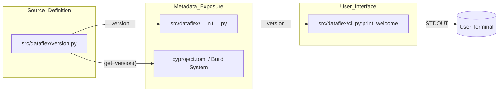

<!-- source: DeepWiki mcp.deepwiki.com · repo OpenDCAI/DataFlex · page 8 CI/CD & Project Tooling · fetched 2026-11-02 -->

# CI/CD & Project Tooling

<details>
<summary>Relevant source files</summary>

The following files were used as context for generating this wiki page:

- [.github/workflows/python-publish.yml](.github/workflows/python-publish.yml)
- [.github/workflows/test.yml](.github/workflows/test.yml)
- [LICENSE](LICENSE)
- [MANIFEST.in](MANIFEST.in)
- [src/dataflex/__init__.py](src/dataflex/__init__.py)
- [src/dataflex/cli.py](src/dataflex/cli.py)
- [src/dataflex/version.py](src/dataflex/version.py)

</details>


This section describes the automated infrastructure and development tooling that ensures the stability, reproducibility, and distributability of the DataFlex codebase. It details the GitHub Actions workflows for continuous integration and delivery, the dependency management strategy using `uv`, and the internal versioning and packaging mechanisms.

## Continuous Integration (CI)

DataFlex utilizes GitHub Actions to validate code changes across a matrix of environments. The primary workflow is defined in `.github/workflows/test.yml`, which triggers on pushes and pull requests to the `main` branch when Python files, requirement specifications, or workflow definitions are modified [.github/workflows/test.yml:3-17]().

### Multi-Platform Matrix Testing
The CI suite runs on a matrix covering three major operating systems and three Python versions to ensure broad compatibility [.github/workflows/test.yml:21-26]():
*   **OS**: `ubuntu-latest`, `macos-latest`, `windows-latest`
*   **Python**: `3.10`, `3.11`, `3.12`

### CI Execution Flow
The workflow performs a sequence of steps to verify the environment and core functionality:
1.  **Environment Setup**: Initializes Python and installs the `uv` package manager [.github/workflows/test.yml:35-52]().
2.  **Dependency Installation**: Installs core requirements and the package in editable mode with development extras [.github/workflows/test.yml:54-60]().
3.  **Smoke Tests**: Validates that the CLI entry points (`dataflex-cli`) and the underlying `llamafactory-cli` are correctly registered and responsive [.github/workflows/test.yml:62-69]().
4.  **Import Verification**: Ensures that critical internal modules, including the `Registry`, training components, and dataset managers, can be imported without circular dependencies or missing requirements [.github/workflows/test.yml:71-78]().

**CI Logic to Code Entity Mapping**
The following diagram maps the CI workflow steps to the specific code entities and commands they validate.

Title: CI Validation Mapping
```mermaid
graph TD
    subgraph "GitHub_Actions_Workflow"
        "test.yml" --> "Install_Dependencies"
        "test.yml" --> "Smoke_Test_CLI"
        "test.yml" --> "Import_Check"
    end

    subgraph "Code_Entities_Validated"
        "Install_Dependencies" --> "requirements.txt"
        "Install_Dependencies" --> "pyproject.toml"
        
        "Smoke_Test_CLI" --> "src/dataflex/cli.py:main"
        "Smoke_Test_CLI" --> "dataflex-cli"
        
        "Import_Check" --> "src/dataflex/core/registry.py:Registry"
        "Import_Check" --> "src/dataflex/train/dataset.py:MixedProportionManager"
        "Import_Check" --> "src/dataflex/version.py:__version__"
    end
```
Sources: [.github/workflows/test.yml:1-84](), [src/dataflex/cli.py:157-196](), [src/dataflex/version.py:1-22]()

## Continuous Delivery (CD) & Release

The release process is automated via `.github/workflows/python-publish.yml`, which is triggered when a new GitHub Release is published [.github/workflows/python-publish.yml:3-5]().

### Packaging Workflow
The CD pipeline consists of two primary jobs:
1.  **release-build**:
    *   Installs `build` and `twine` [.github/workflows/python-publish.yml:21]().
    *   Generates the source distribution (`sdist`) and the binary wheel (`wheel`) using `python -m build` [.github/workflows/python-publish.yml:24]().
    *   Performs a `twine check` to ensure the metadata is valid for PyPI [.github/workflows/python-publish.yml:27]().
2.  **pypi-publish**:
    *   Downloads the artifacts from the build job [.github/workflows/python-publish.yml:44-48]().
    *   Publishes the package to PyPI using Trusted Publishers (OIDC) [.github/workflows/python-publish.yml:50-54]().

### Manifest and Packaging Rules
The `MANIFEST.in` file ensures that non-Python assets required for runtime (such as default configurations and shell scripts) are included in the distributed package:
*   Includes all `.yaml` and `.json` files within the `src/dataflex` tree [.MANIFEST.in:2-3]().
*   Includes `requirements.txt` and the `LICENSE` [.MANIFEST.in:8-9]().
*   Excludes compiled artifacts (`.pyc`, `.so`) and cache directories [.MANIFEST.in:11-14]().

Sources: [.github/workflows/python-publish.yml:1-54](), [MANIFEST.in:1-15]()

## Dependency Management with uv

DataFlex utilizes `uv` for high-performance dependency resolution and installation. 

| Tool/File | Purpose | Implementation Detail |
| :--- | :--- | :--- |
| `uv` | Package Management | Used in CI with `astral-sh/setup-uv` for caching and speed [.github/workflows/test.yml:50-52](). |
| `requirements.txt` | Core Dependencies | Lists runtime requirements like `llamafactory`, `omegaconf`, and `torch` [.github/workflows/test.yml:58](). |
| `pyproject.toml` | Build System | Defines the `dataflex-cli` entry point and development extras (`[dev]`) [.github/workflows/test.yml:59](). |

In the CI environment, the system Python is utilized by setting `UV_SYSTEM_PYTHON: "1"` to ensure compatibility with the pre-installed GitHub Actions environment [.github/workflows/test.yml:55-56]().

Sources: [.github/workflows/test.yml:49-61]()

## Versioning System

DataFlex maintains a centralized versioning system in `src/dataflex/version.py`. This version is used for both the package metadata and the CLI's `version` command.

### Version Components
*   **`__version__`**: A string (e.g., `"1.0.0"`) representing the current release [.src/dataflex/version.py:1]().
*   **`version_info`**: A tuple generated by `parse_version_info` that allows for programmatic version comparisons (e.g., `(1, 0, 0)`) [.src/dataflex/version.py:21]().

### Version Logic
The `parse_version_info` function handles standard semantic versioning and release candidates (`rc`) by splitting the string and converting numeric segments to integers [.src/dataflex/version.py:9-18](). The `cli.py` module consumes this information via `importlib.metadata` to display the "Welcome" banner when the user runs `dataflex-cli version` [src/dataflex/cli.py:137-162]().

**Versioning Data Flow**
Title: Versioning Information Flow

Sources: [src/dataflex/version.py:1-22](), [src/dataflex/__init__.py:1-4](), [src/dataflex/cli.py:137-162]()

---

