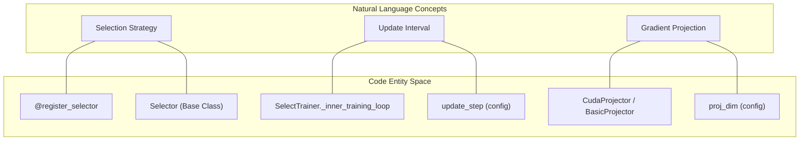
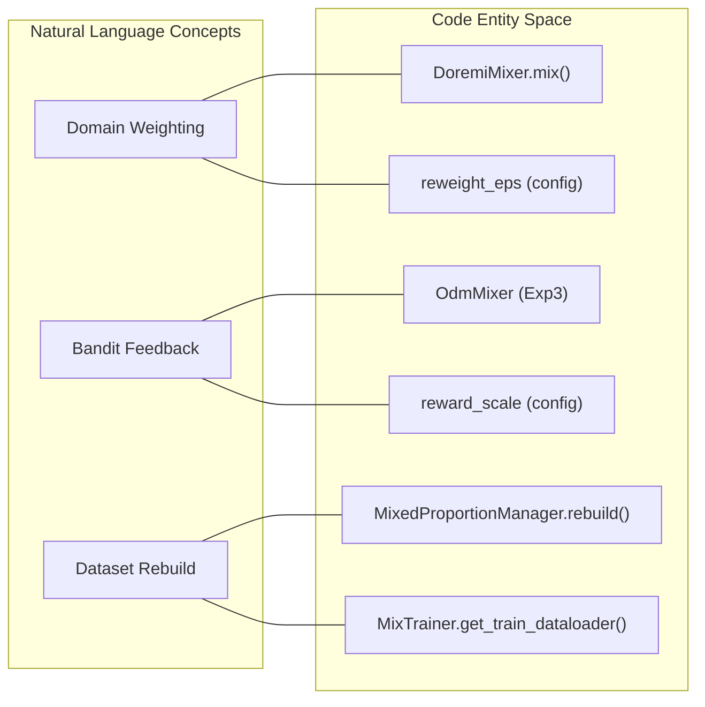

<!-- source: DeepWiki mcp.deepwiki.com · repo OpenDCAI/DataFlex · page 9 Glossary · fetched 2026-11-02 -->

# Glossary

Relevant source files

The following files were used as context for generating this wiki page:

- [README-zh.md](README-zh.md)
- [README.md](README.md)
- [examples/train_full/mixers/odm_dynamic_qwen_pt_full.yaml](examples/train_full/mixers/odm_dynamic_qwen_pt_full.yaml)
- [skills/how_to_add_algorithm.md](skills/how_to_add_algorithm.md)
- [skills/how_to_use.md](skills/how_to_use.md)
- [src/dataflex/configs/components.yaml](src/dataflex/configs/components.yaml)
- [src/dataflex/offline_selector/offline_near_selector.py](src/dataflex/offline_selector/offline_near_selector.py)
- [src/dataflex/offline_selector/offline_tsds_selector.py](src/dataflex/offline_selector/offline_tsds_selector.py)
- [src/dataflex/train/hparams/dynamic_params.py](src/dataflex/train/hparams/dynamic_params.py)
- [src/dataflex/train/mixer/doremi_mixer.py](src/dataflex/train/mixer/doremi_mixer.py)
- [src/dataflex/train/mixer/odm_mixer.py](src/dataflex/train/mixer/odm_mixer.py)
- [src/dataflex/train/selector/less_selector.py](src/dataflex/train/selector/less_selector.py)
- [src/dataflex/train/selector/near_selector.py](src/dataflex/train/selector/near_selector.py)
- [src/dataflex/train/selector/nice_selector.py](src/dataflex/train/selector/nice_selector.py)
- [src/dataflex/train/trainer/mix_trainer.py](src/dataflex/train/trainer/mix_trainer.py)
- [src/dataflex/train/trainer/weight_trainer.py](src/dataflex/train/trainer/weight_trainer.py)
- [src/dataflex/train/weighter/__init__.py](src/dataflex/train/weighter/__init__.py)
- [src/dataflex/train/weighter/loss_weighter.py](src/dataflex/train/weighter/loss_weighter.py)

This glossary defines technical terms, abbreviations, and configuration keys specific to the DataFlex codebase. DataFlex is a dynamic data-centric training framework built on top of LLaMA-Factory, introducing three primary training modes: **Selection**, **Mixing**, and **Reweighting**.

---

## Core Concepts & Terms

### Model-in-the-Loop
A training paradigm where the model's current state (loss, gradients, or internal activations) is used to influence the data it will see in subsequent steps [README.md:35-38](). Most DataFlex algorithms are "Model-in-the-Loop," meaning they require an active feedback loop between the trainer and the data scheduler.

### Training Types (`train_type`)
A mandatory configuration field that determines which `CustomTrainer` subclass is instantiated.
*   `dynamic_select`: Uses `SelectTrainer` to filter the dataset at specific intervals [src/dataflex/train/trainer/select_trainer.py]().
*   `dynamic_mix`: Uses `MixTrainer` to adjust the sampling proportions from multiple data sources [src/dataflex/train/trainer/mix_trainer.py]().
*   `dynamic_weight`: Uses `WeightTrainer` to modify the per-sample loss during the backward pass [src/dataflex/train/trainer/weight_trainer.py]().

### Registry
A centralized system for managing components. Decorators like `@register_selector`, `@register_mixer`, and `@register_weighter` allow new algorithms to be added without modifying the core trainer logic [src/dataflex/core/registry.py:1-40]().

---

## Data Selection Terms

| Term | Definition | File Pointer |
| :--- | :--- | :--- |
| **Warmup Step** | The initial steps where data is sampled normally before the selector begins filtering. | `warmup_step` in YAML |
| **Update Step** | The frequency (in training steps) at which the selector re-evaluates and selects a new data subset. | `update_step` in YAML |
| **LESS** | Low-rank Gradient Similarity. Selects data by projecting gradients and calculating similarity to a validation set. | [src/dataflex/train/selector/less_selector.py:27]() |
| **NICE** | Next-generation Instruction Selection. Uses RL-style gradient computation with policy and reward models. | [src/dataflex/train/selector/nice_selector.py:60]() |
| **TRAK Projector** | Used in LESS/NICE to project high-dimensional gradients into a lower-dimensional space (e.g., 4096 or 8192). | [src/dataflex/train/selector/less_selector.py:143-156]() |

### Natural Language to Code Entity Space: Selection
The following diagram maps the logical data selection process to specific code classes and configuration keys.

**Sources:** [src/dataflex/core/registry.py:1-10](), [src/dataflex/train/selector/less_selector.py:10-156](), [src/dataflex/configs/components.yaml:2-77]()

---

## Data Mixing Terms

| Term | Definition | File Pointer |
| :--- | :--- | :--- |
| **DoReMi** | Domain Reweighting with Minimax Optimization. Adjusts domain weights based on excess loss relative to a reference model. | [src/dataflex/train/mixer/doremi_mixer.py]() |
| **ODM** | Online Data Mixing. Uses a Multi-Armed Bandit (Exp3) algorithm to dynamically find optimal mixing ratios. | [src/dataflex/train/mixer/odm_mixer.py]() |
| **MixedProportionManager** | The utility responsible for calculating and rebuilding the dataset mixture based on mixer output. | `MixedProportionManager` |
| **Reweight Eta** | The learning rate for updating domain weights in DoReMi. | `reweight_eta` [src/dataflex/configs/components.yaml:94]() |

### Natural Language to Code Entity Space: Mixing
This diagram bridges the conceptual domain mixing with the implementation details in `MixTrainer`.

**Sources:** [src/dataflex/train/trainer/mix_trainer.py:1-143](), [src/dataflex/configs/components.yaml:78-139]()

---

## Data Reweighting Terms

### Loss Reweighting
A technique implemented in `LossWeighter` that scales the importance of samples based on their current loss value [src/dataflex/train/weighter/loss_weighter.py:15-20]().

*   **Strategies**:
    *   `linupper`: Linear upper bound on losses [src/dataflex/train/weighter/loss_weighter.py:51]().
    *   `quadratic`: Quadratic scaling relative to a threshold [src/dataflex/train/weighter/loss_weighter.py:55]().
    *   `extremes`: Focuses on very high or very low loss samples [src/dataflex/train/weighter/loss_weighter.py:57]().

---

## Implementation Details

### Distributed Synchronization
DataFlex uses `torch.distributed` and `accelerator` primitives to ensure data consistency across multi-GPU setups.
*   **Gradient Gathering**: In DeepSpeed ZeRO-3, gradients are partitioned. DataFlex uses `safe_get_full_grad` to gather full vectors for selection algorithms [src/dataflex/train/selector/less_selector.py:107-114]().
*   **Loss Gathering**: `LossWeighter` uses `dist.all_gather_into_tensor` to collect per-sample losses from all ranks to calculate global normalization statistics [src/dataflex/train/weighter/loss_weighter.py:103-110]().

### Configuration Keys Reference
| Key | Type | Description |
| :--- | :--- | :--- |
| `component_name` | String | The name registered in `REGISTRY` (e.g., `less`, `doremi`, `loss`). |
| `update_times` | Integer | Total number of times the selection/mixing logic should trigger. |
| `gradient_type` | String | Type of gradient to use for selection (e.g., `adam`, `sgd`). [src/dataflex/configs/components.yaml:8]() |
| `cache_dir` | Path | Directory for storing intermediate gradients, scores, or indices. [src/dataflex/configs/components.yaml:7]() |

**Sources:** [src/dataflex/train/hparams/dynamic_params.py:1-204](), [src/dataflex/configs/components.yaml:1-152](), [src/dataflex/train/trainer/weight_trainer.py:1-196]()