# Page: DataFlex Overview

# DataFlex Overview

<details>
<summary>Relevant source files</summary>

The following files were used as context for generating this wiki page:

- [README-zh.md](README-zh.md)
- [README.md](README.md)
- [pyproject.toml](pyproject.toml)
- [requirements.txt](requirements.txt)
- [skills/how_to_add_algorithm.md](skills/how_to_add_algorithm.md)
- [skills/how_to_use.md](skills/how_to_use.md)
- [src/dataflex/__init__.py](src/dataflex/__init__.py)
- [src/dataflex/version.py](src/dataflex/version.py)

</details>


DataFlex is a data-centric training framework designed to enhance Large Language Model (LLM) optimization by intelligently scheduling training data. Built as a non-invasive extension of [LLaMA-Factory](https://github.com/hiyouga/LLaMA-Factory), DataFlex enables researchers to implement and utilize complex data selection, mixing, and reweighting strategies directly within the training loop [README.md:32-38]().

The system integrates several state-of-the-art algorithms that are typically difficult to reproduce, providing a unified interface for data-centric AI experiments [README.md:35-37]().

## Core Capabilities

DataFlex operates across three primary dimensions of data control:

| Mode | Description | Key Algorithms |
| :--- | :--- | :--- |
| **Dynamic Selection** | Picks specific samples based on model state (e.g., "hard" samples). | LESS, NICE, Loss, Delta Loss, TSDS, NEAR [README.md:44-58]() |
| **Dynamic Mixing** | Adjusts ratios between different data domains (e.g., Wiki vs. Code). | DoReMi, ODM [README.md:62-71]() |
| **Dynamic Reweighting** | Adjusts per-sample loss weights during backpropagation. | Loss Reweighting [README.md:73-81]() |

For a deep dive into the underlying mechanics of these modes, see [Architecture & Design Principles](#1.1).

## Ecosystem Integration

DataFlex is designed as a drop-in wrapper for LLaMA-Factory. It utilizes runtime monkey-patching to inject data-centric logic without requiring permanent modifications to the LLaMA-Factory source code [skills/how_to_add_algorithm.md:7-12]().

### System Workflow: Natural Language to Code Entities
The following diagram illustrates how a user's high-level intent (Natural Language Space) translates into specific code entities and execution flows within DataFlex (Code Entity Space).

**Diagram: Intent to Execution Mapping**
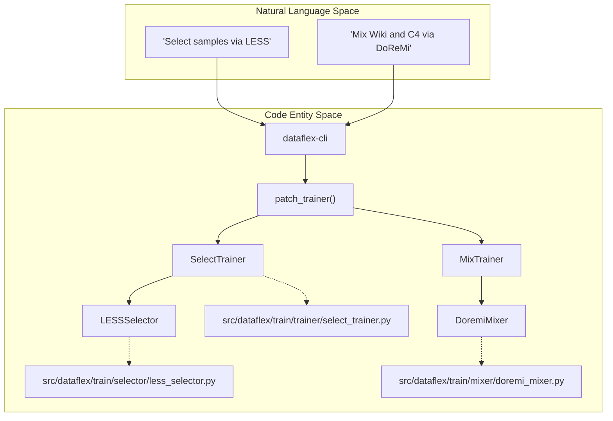
Sources: [skills/how_to_add_algorithm.md:14-26](), [src/dataflex/train/selector/less_selector.py](), [src/dataflex/train/mixer/doremi_mixer.py]()

## Major Subsystems

DataFlex is organized into modular components managed by a central `Registry` [skills/how_to_add_algorithm.md:83-86]().

*   **CLI & Patching Layer**: Handled by `src/dataflex/cli.py`, this layer intercepts LLaMA-Factory's entry points to inject `DynamicFinetuningArguments` and specialized trainers [skills/how_to_add_algorithm.md:34-50]().
*   **Trainers**: Custom trainer classes (e.g., `SelectTrainer`, `MixTrainer`, `WeightTrainer`) that manage the "Model-in-the-Loop" lifecycle, including warmup and update steps [skills/how_to_use.md:75-151]().
*   **Components**: Specialized logic for algorithms.
    *   **Selectors**: Inherit from `BaseSelector` to return sample indices [skills/how_to_add_algorithm.md:112-124]().
    *   **Mixers**: Inherit from `BaseMixer` to return domain proportions [skills/how_to_add_algorithm.md:131-140]().
    *   **Weighters**: Inherit from `BaseWeighter` to modify the backward pass [skills/how_to_add_algorithm.md:147-160]().

### Data Flow & Component Interaction
This diagram bridges the conceptual "Training Loop" with the specific Python classes and files responsible for data movement.

**Diagram: Data Lifecycle in DataFlex**
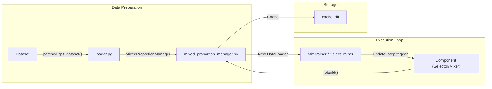
Sources: [src/dataflex/train/data/loader.py](), [src/dataflex/train/dataset/mixed_proportion_manager.py](), [skills/how_to_add_algorithm.md:43-69]()

## Getting Started

DataFlex requires Python 3.10+ and can be installed via `pip` [README.md:89-101]().

```bash
pip install dataflex
# Or from source
pip install -e .
```

Training is invoked using `dataflex-cli`, which accepts standard LLaMA-Factory YAML configurations augmented with DataFlex-specific keys like `train_type` and `component_name` [skills/how_to_use.md:14-64]().

For detailed setup instructions, including NPU support and optional backends, see [Installation & Dependencies](#1.2).

---

# Page: Architecture & Design Principles

# Architecture & Design Principles

<details>
<summary>Relevant source files</summary>

The following files were used as context for generating this wiki page:

- [.github/workflows/test.yml](.github/workflows/test.yml)
- [README-zh.md](README-zh.md)
- [README.md](README.md)
- [skills/how_to_add_algorithm.md](skills/how_to_add_algorithm.md)
- [skills/how_to_use.md](skills/how_to_use.md)
- [src/dataflex/cli.py](src/dataflex/cli.py)

</details>


DataFlex is a data-centric training framework designed to orchestrate data selection, mixture, and reweighting directly within the LLM training loop. It operates as a high-level wrapper around [LLaMA-Factory](https://github.com/hiyouga/LLaMA-Factory), extending its capabilities without requiring permanent modifications to the underlying library.

## Monkey-Patching Architecture

DataFlex utilizes a runtime monkey-patching strategy to inject custom logic into the LLaMA-Factory execution flow. This approach allows DataFlex to remain fully compatible with LLaMA-Factory's feature set (e.g., LoRA, DeepSpeed, FSDP) while intercepting critical points in the training lifecycle.

The patching process is managed by `src/dataflex/cli.py` and occurs in three primary stages before training begins:

1.  **Argument Patching**: `patch_finetune_params()` replaces LLaMA-Factory's `FinetuningArguments` and `DataArguments` with `DynamicFinetuningArguments` and `DataArguments` from DataFlex. This enables the system to recognize DataFlex-specific YAML fields like `train_type` and `component_name` `[src/dataflex/cli.py:41-49]()`.
2.  **Trainer Patching**: `patch_trainer()` identifies the `train_type` (e.g., `dynamic_select`) and replaces the standard `CustomSeq2SeqTrainer` or `CustomTrainer` in the `llamafactory.train` modules with a specialized DataFlex trainer class `[src/dataflex/cli.py:50-96]()`.
3.  **Data Loader Patching**: For `dynamic_mix` modes, `patch_get_dataset()` replaces the default LLaMA-Factory `get_dataset` function with a version that supports multi-source mixture management `[src/dataflex/cli.py:98-124]()`.

### DataFlex Initialization Flow
The following diagram illustrates how the `dataflex-cli` intercepts the standard training flow to apply patches.

"DataFlex Initialization Flow"
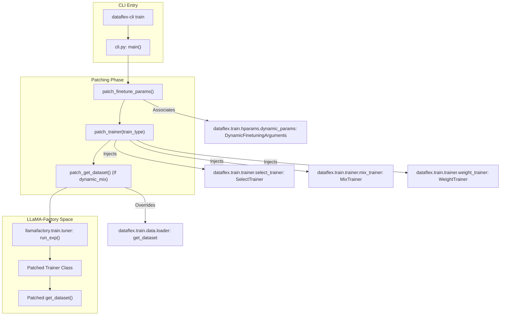
Sources: `[src/dataflex/cli.py:41-124]()`, `[skills/how_to_add_algorithm.md:7-26]()`.

## Training Modes & Model-in-the-Loop

DataFlex introduces three primary training modes that implement the "Model-in-the-Loop" concept. This means the model's current state (gradients, loss, or weights) is used to inform data scheduling decisions in real-time.

### 1. Dynamic Data Selection (`dynamic_select`)
Orchestrated by `SelectTrainer`, this mode implements a "Warmup-Update" cycle. Training begins with a random subset for `warmup_step` steps, after which the `Selector` component is invoked to select a new subset of indices based on criteria like gradient similarity (`LESS`) or loss distribution `[skills/how_to_use.md:75-91]()`.

*   **Key Class**: `SelectTrainer` `[src/dataflex/train/trainer/select_trainer.py]()`.
*   **Workflow**: The trainer triggers `selector.select()` at every `update_step`. It then calls `get_train_dataloader(indices)` to refresh the data stream without restarting the process `[skills/how_to_use.md:88-91]()`.

### 2. Dynamic Data Mixture (`dynamic_mix`)
Managed by `MixTrainer`, this mode adjusts the sampling proportions from multiple datasets (domains) during training. It is used for algorithms like `DoReMi` and `ODM` `[skills/how_to_use.md:98-113]()`.

*   **Key Class**: `MixTrainer` `[src/dataflex/train/trainer/mix_trainer.py]()`.
*   **Workflow**: The `MixedProportionManager` tracks domain-specific performance. The `Mixer` component calculates new weights, and the manager's `rebuild()` method updates the sampling distribution `[skills/how_to_use.md:111-113]()`.

### 3. Dynamic Data Reweighting (`dynamic_weight`)
Handled by `WeightTrainer`, this mode does not change the samples seen by the model but instead modifies the contribution of each sample to the total loss during the backward pass `[skills/how_to_use.md:132-143]()`.

*   **Key Class**: `WeightTrainer` `[src/dataflex/train/trainer/weight_trainer.py]()`.
*   **Workflow**: The trainer overrides the training step to allow a `Weighter` component to intercept the per-sample loss vector and apply a weighting strategy (e.g., emphasizing high-loss "hard" samples) `[skills/how_to_add_algorithm.md:147-162]()`.

## System Design & Component Registry

DataFlex uses a `Registry` system to decouple trainer logic from specific algorithm implementations. This allows users to add new selectors, mixers, or weighters by simply using a decorator.

"Code Entity Mapping: Registry & Components"
```mermaid
classDiagram
    class Registry {
        +dict _module_dict
        +register(category, name)
        +build(category, name, runtime, cfg)
    }

    class Selector {
        <<abstract>>
        +warmup()
        +select(model, step_id, num_samples)
    }

    class Mixer {
        <<abstract>>
        +mix(model, step_id)
    }

    class Weighter {
        <<abstract>>
        +get_weighted_loss(losses)
        +training_step()
    }

    Registry ..> Selector : builds
    Registry ..> Mixer : builds
    Registry ..> Weighter : builds

    style Selector font-style:italic
    style Mixer font-style:italic
    style Weighter font-style:italic
```
Sources: `[src/dataflex/core/registry.py:1-91]()`, `[skills/how_to_add_algorithm.md:81-105]()`.

### Component Loading Logic
1.  **Configuration**: Parameters for algorithms are defined in `src/dataflex/configs/components.yaml` `[skills/how_to_use.md:154-177]()`.
2.  **Registration**: Developers use `@register_selector("name")` to add classes to the `REGISTRY` `[skills/how_to_add_algorithm.md:88-91]()`.
3.  **Instantiation**: The `REGISTRY.build` method merges YAML configuration with runtime parameters (like `accelerator` or `dataset`) and instantiates the class using only the arguments declared in the component's `__init__` signature `[skills/how_to_add_algorithm.md:99-104]()`.

## Data Flow: Multi-Source Mixing
For `dynamic_mix`, DataFlex introduces the `MixedProportionManager` to handle complex sampling rules across disparate datasets.

| Rule | Description | Implementation |
| :--- | :--- | :--- |
| `mixture` | Samples according to specified floating-point proportions. | `MixedProportionManager` |
| `stratified` | Samples proportional to the total size of each source dataset. | `MixedProportionManager` |
| `uniform` | Samples an equal number of items from each source. | `MixedProportionManager` |

Sources: `[skills/how_to_use.md:66-71]()`, `[skills/how_to_add_algorithm.md:46-47]()`.

---

# Page: Installation & Dependencies

# Installation & Dependencies

<details>
<summary>Relevant source files</summary>

The following files were used as context for generating this wiki page:

- [.github/workflows/python-publish.yml](.github/workflows/python-publish.yml)
- [LICENSE](LICENSE)
- [MANIFEST.in](MANIFEST.in)
- [pyproject.toml](pyproject.toml)
- [requirements.txt](requirements.txt)

</details>


This page provides technical details regarding the installation process, dependency management, and optional hardware/software extensions for DataFlex. DataFlex utilizes a modern Python packaging stack centered around `uv` for dependency resolution and `setuptools` for builds, ensuring compatibility with the LLaMA-Factory ecosystem while maintaining its own suite of dynamic data selection tools.

## Core Installation

DataFlex is designed to be installed as a Python package. The installation process resolves core dependencies required for the dynamic training loops and basic model orchestration.

### Dependency Specification
The project defines its primary dependencies in `requirements.txt`, which are then dynamically loaded into the `project` metadata via `pyproject.toml` [pyproject.toml:69-69](). This approach ensures that the standalone requirements file remains the single source of truth for both development and distribution.

| Category | Key Packages | Version Constraints |
| :--- | :--- | :--- |
| **Deep Learning** | `torch`, `accelerate`, `trl`, `peft` | `torch>=2.4.0`, `accelerate>=1.3.0` |
| **Model Hubs** | `transformers`, `datasets` | `transformers>=4.41.2` (varies by Python version) |
| **Infrastructure** | `llamafactory` | `>=0.9.4` |
| **Data/Math** | `numpy`, `pandas`, `scipy`, `traker` | `numpy>=1.24.0`, `traker` (for LESS/NICE) |
| **Config/CLI** | `omegaconf`, `tyro`, `fire` | `omegaconf` (for YAML parsing) |

Sources: [requirements.txt:1-32](), [pyproject.toml:69-69]()

### Build and Distribution
DataFlex uses the `setuptools.build_meta` backend [pyproject.toml:1-3](). The `MANIFEST.in` file ensures that non-Python assets, such as default component configurations (`.yaml`), scripts (`.sh`), and JSON metadata, are included in the source distribution (sdist) and wheel [MANIFEST.in:1-14]().

**Package Distribution Diagram**
This diagram shows how the build system transforms the source tree into a distributable entity.

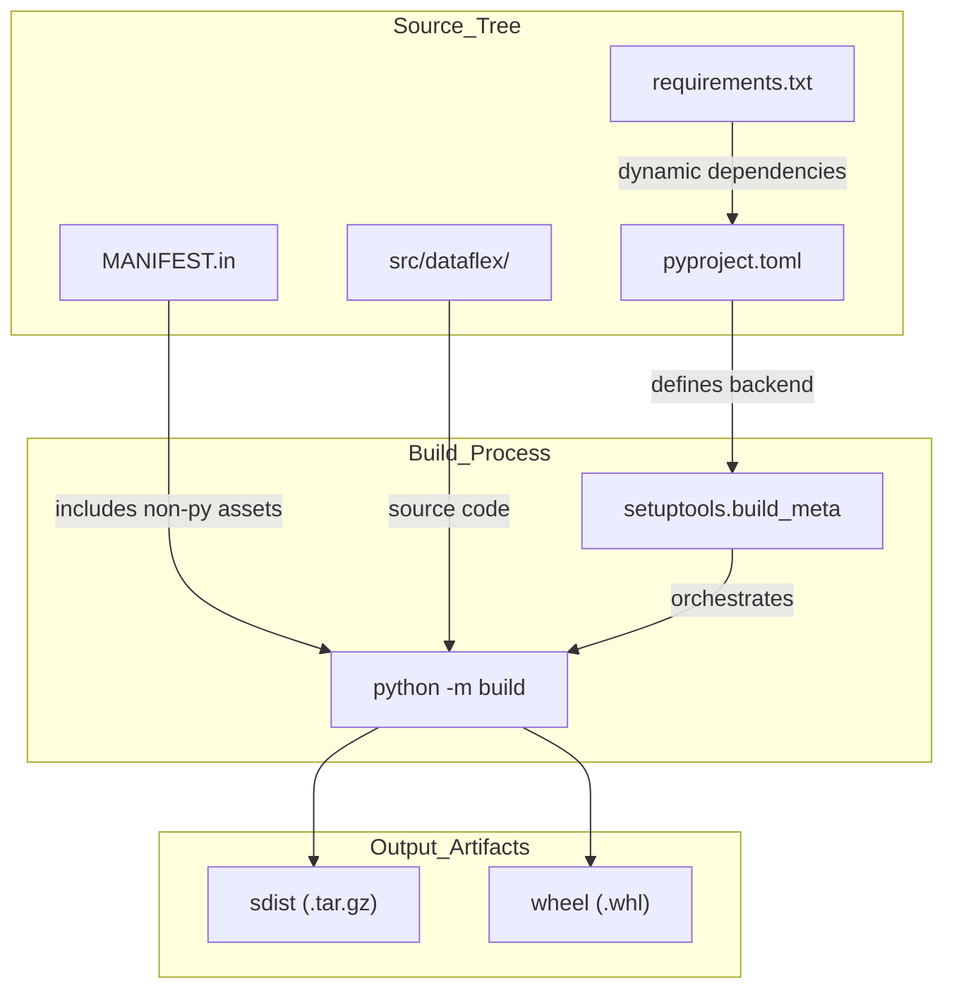
Sources: [pyproject.toml:1-30](), [MANIFEST.in:1-14](), [.github/workflows/python-publish.yml:23-24]()

## Optional Extras

DataFlex provides several "extras" to support specific hardware backends, quantization methods, and optimization kernels. These are defined in the `[project.optional-dependencies]` section of `pyproject.toml` [pyproject.toml:40-60]().

### Hardware & Kernel Support
*   **NPU Support (`torch-npu`)**: Specifically for Huawei Ascend hardware, pinning `torch` and `torch-npu` to `2.4.0` [pyproject.toml:42-42]().
*   **Flash Attention (`flash-attn`)**: High-performance attention kernels [pyproject.toml:44-44]().
*   **Liger Kernel (`liger-kernel`)**: Efficient Triton-based kernels for LLM training [pyproject.toml:45-45]().

### Inference & Quantization
*   **vLLM (`vllm`)**: Used for high-throughput embedding generation in offline selectors like `offline_near_selector.py` [pyproject.toml:51-51]().
*   **Quantization Backends**: Support for `bitsandbytes`, `hqq`, `eetq`, `gptq`, and `aqlm` [pyproject.toml:46-50]().

### Optimization Algorithms
*   **GaLore/Apollo/BAdam**: Low-rank and memory-efficient optimizers [pyproject.toml:52-55]().

Sources: [pyproject.toml:40-60]()

## Environment Conflict Management

Because DataFlex integrates multiple hardware backends and specialized kernels, certain combinations of dependencies are mutually exclusive. These rules are managed via the `[tool.uv]` configuration [pyproject.toml:101-115]().

### Conflict Rules
The `uv` resolver enforces the following constraints to prevent broken environments:
1.  **NPU vs. Specialized Kernels**: `torch-npu` cannot be installed alongside `liger-kernel` [pyproject.toml:107-110]().
2.  **NPU vs. vLLM**: `torch-npu` is incompatible with the standard `vllm` extra [pyproject.toml:111-114]().
3.  **NPU vs. AQLM**: `torch-npu` cannot coexist with `aqlm` quantization [pyproject.toml:103-106]().

**Dependency Resolution Logic**
This diagram maps the relationship between the `pyproject.toml` configuration and the resulting environment state.

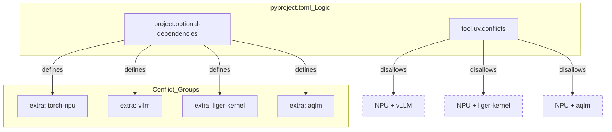
Sources: [pyproject.toml:40-60](), [pyproject.toml:101-115]()

## CI/CD and Versioning

DataFlex uses GitHub Actions for automated building and publishing.

### Versioning System
The package version is dynamically fetched from `src/dataflex/version.py` using the `attr` directive in `setuptools` [pyproject.toml:68-68](). This ensures that the version string remains consistent across the CLI (`dataflex-cli version`) and the PyPI metadata.

### Publishing Workflow
The `python-publish.yml` workflow automates the release process:
1.  **Release Build**: Triggered on a GitHub release. It installs dependencies from `requirements.txt`, then uses the `build` module to create `sdist` and `wheel` [.github/workflows/python-publish.yml:17-24]().
2.  **Validation**: Uses `twine check` to verify the metadata of the generated artifacts [.github/workflows/python-publish.yml:27-27]().
3.  **PyPI Deployment**: Uploads the verified artifacts to PyPI using the official `pypa/gh-action-pypi-publish` action with OpenID Connect (OIDC) permissions [.github/workflows/python-publish.yml:35-54]().

Sources: [pyproject.toml:68-68](), [.github/workflows/python-publish.yml:1-54]()

---

# Page: CLI & Entry Points

# CLI & Entry Points

<details>
<summary>Relevant source files</summary>

The following files were used as context for generating this wiki page:

- [.github/workflows/test.yml](.github/workflows/test.yml)
- [src/dataflex/cli.py](src/dataflex/cli.py)
- [src/dataflex/launcher.py](src/dataflex/launcher.py)

</details>


DataFlex is designed to wrap LLaMA-Factory seamlessly, providing a unified command-line interface (CLI) that manages the lifecycle of monkey-patching and training orchestration. Users interact with DataFlex primarily through the `dataflex-cli` command, which handles configuration merging, environment setup, and distributed execution.

## The `dataflex-cli` Command

The `dataflex-cli` is the primary entry point for all DataFlex operations. It supports subcommands like `train` and `version` [src/dataflex/cli.py:159-164](). When running a training job, the CLI reads YAML configurations and CLI overrides using **OmegaConf**, merges them, and then initiates the patching process before handing control over to the training engine [src/dataflex/cli.py:125-135]().

For multi-GPU or multi-node environments, the CLI automatically detects the device count and wraps the execution in `torchrun` unless Ray is being used [src/dataflex/cli.py:180-184](). Users can also force this behavior by setting the `FORCE_TORCHRUN` environment variable [src/dataflex/cli.py:179]().

For details, see [dataflex-cli Command](#2.1).

### CLI to Code Mapping
The following diagram illustrates how CLI arguments are transformed into internal configuration objects and passed to the launcher.

**Diagram: CLI Execution Flow**
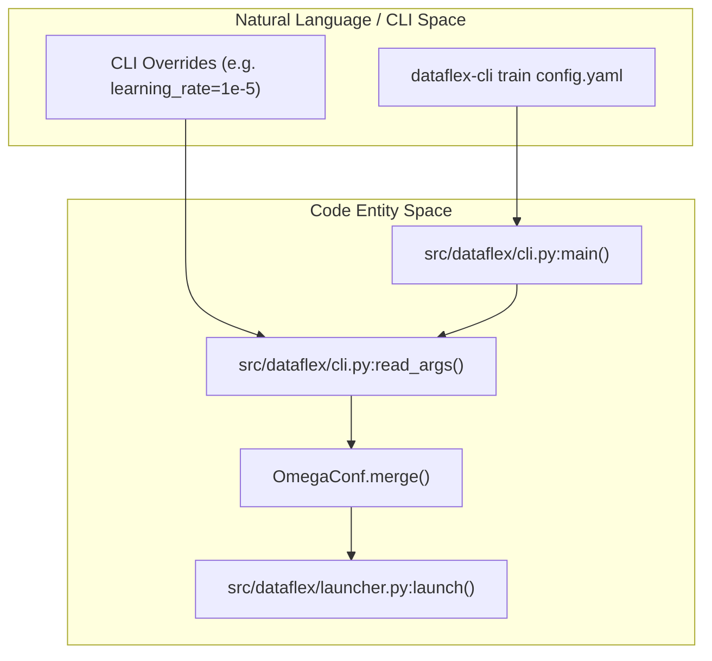
**Sources:** [src/dataflex/cli.py:125-135](), [src/dataflex/cli.py:157-196](), [src/dataflex/launcher.py:134-147]()

---

## Configuration Reference

DataFlex extends the standard LLaMA-Factory configuration schema with specific fields to control dynamic data selection, mixing, and reweighting. Key parameters include `train_type` (which selects the orchestration mode), `warmup_step`, and `update_step` [src/dataflex/cli.py:58-70](). 

Configurations are typically defined in YAML files, but the CLI supports full OmegaConf syntax for overriding nested parameters on the fly. This allows for rapid experimentation without modifying static files.

For details, see [Configuration Reference](#2.2).

---

## Patching Lifecycle

The core innovation of DataFlex is its non-invasive "patching" mechanism. Instead of forking LLaMA-Factory, DataFlex modifies its behavior at runtime by replacing key classes and functions with DataFlex-specific implementations.

The patching occurs in three stages within `src/dataflex/cli.py`:
1.  **Hparams Patching**: Replaces `FinetuningArguments` and `DataArguments` to support DataFlex-specific YAML fields [src/dataflex/cli.py:41-49]().
2.  **Trainer Patching**: Based on the `train_type` in the config, it injects `SelectTrainer`, `MixTrainer`, or `WeightTrainer` into the `llamafactory` namespace [src/dataflex/cli.py:50-95]().
3.  **Data Loader Patching**: Specifically for `dynamic_mix` mode, it replaces the `get_dataset` function to allow for per-domain sampling adjustments [src/dataflex/cli.py:98-124]().

**Diagram: Patching Architecture**
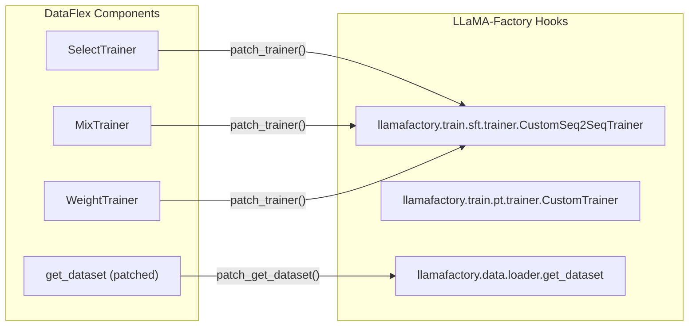
**Sources:** [src/dataflex/cli.py:50-95](), [src/dataflex/cli.py:98-124](), [src/dataflex/launcher.py:47-92]()

---

## Launcher and Distributed Execution

The `src/dataflex/launcher.py` script serves as the target for `torchrun`. When a distributed job is launched, `torchrun` executes `launcher.py` on every rank. The launcher repeats the patching process to ensure the local Python environment on every worker is correctly configured before calling `llamafactory.train.tuner.run_exp()` [src/dataflex/launcher.py:134-143]().

The CLI manages the orchestration of these processes by setting `MASTER_ADDR`, `MASTER_PORT`, and calculating `NPROC_PER_NODE` based on available hardware [src/dataflex/cli.py:181-193]().

**Sources:** [src/dataflex/cli.py:179-196](), [src/dataflex/launcher.py:134-147](), [.github/workflows/test.yml:62-69]()

---

# Page: dataflex-cli Command

# dataflex-cli Command

<details>
<summary>Relevant source files</summary>

The following files were used as context for generating this wiki page:

- [.github/workflows/test.yml](.github/workflows/test.yml)
- [README-zh.md](README-zh.md)
- [skills/how_to_add_algorithm.md](skills/how_to_add_algorithm.md)
- [skills/how_to_use.md](skills/how_to_use.md)
- [src/dataflex/cli.py](src/dataflex/cli.py)
- [src/dataflex/launcher.py](src/dataflex/launcher.py)

</details>


The `dataflex-cli` is the primary entry point for the DataFlex system. It wraps the [LLaMA-Factory](https://github.com/hiyouga/LLaMA-Factory) command-line interface, extending it with dynamic data scheduling capabilities through runtime monkey-patching.

## Command Overview

The CLI provides two primary subcommands: `train` and `version`. The `train` command is the core driver for all dynamic training modes (Selection, Mixing, and Reweighting).

### Subcommands and Syntax

| Subcommand | Usage | Description |
|:---|:---|:---|
| `train` | `dataflex-cli train <config.yaml> [overrides]` | Launches the training process with optional OmegaConf overrides. |
| `version` | `dataflex-cli version` | Displays the installed DataFlex version and welcome message. |

**Source:** [src/dataflex/cli.py:158-164]()

---

## The `train` Subcommand

When `dataflex-cli train` is invoked, the system performs a sequence of initialization steps before handing control over to the LLaMA-Factory execution engine.

### Argument Parsing and OmegaConf Overrides
DataFlex uses `OmegaConf` to manage configurations. It supports loading a base YAML file and applying command-line overrides using the `key=value` syntax [src/dataflex/cli.py:125-135]().

**Example:**
```bash
dataflex-cli train examples/train_lora/selectors/less.yaml learning_rate=5e-5 warmup_step=20
```

### Initialization Workflow
The `main()` function in `cli.py` orchestrates the following lifecycle:
1. **Config Loading**: Merges the YAML file with CLI overrides [src/dataflex/cli.py:165]().
2. **Hparam Patching**: Replaces LLaMA-Factory argument classes with `DynamicFinetuningArguments` and `DataArguments` to support DataFlex-specific fields [src/dataflex/cli.py:41-49]().
3. **Trainer Patching**: Injects a specialized trainer (`SelectTrainer`, `MixTrainer`, or `WeightTrainer`) into the LLaMA-Factory namespace based on the `train_type` field [src/dataflex/cli.py:50-96]().
4. **Dataset Patching**: If `train_type` is `dynamic_mix`, it replaces the standard `get_dataset` function with the DataFlex implementation to support multi-source mixing [src/dataflex/cli.py:98-124]().
5. **Execution**: Hands off the patched environment to `llamafactory.train.tuner.run_exp()` [src/dataflex/cli.py:171]().

**Sources:** [src/dataflex/cli.py:157-171](), [skills/how_to_add_algorithm.md:7-12]()

---

## Distributed Training & `FORCE_TORCHRUN`

DataFlex automatically detects multi-GPU environments. If the device count is greater than 1, or if the environment variable `FORCE_TORCHRUN=1` is set, the CLI transitions from a direct process to a distributed execution via `torchrun` [src/dataflex/cli.py:179-184]().

### Environment Variables
The launcher respects standard distributed training environment variables:
- `NNODES`: Number of nodes (default: 1).
- `NODE_RANK`: Rank of the current node (default: 0).
- `NPROC_PER_NODE`: Number of processes per node (default: device count).
- `MASTER_ADDR`: IP address of the master node (default: 127.0.0.1).
- `MASTER_PORT`: Port for communication (default: random between 20001-29999).

**Sources:** [src/dataflex/cli.py:180-202](), [skills/how_to_use.md:32-36]()

---

## Implementation Architecture

The following diagrams illustrate how the `dataflex-cli` bridges user-level commands to the underlying code entities and patches the LLaMA-Factory framework.

### CLI Execution and Patching Flow
"Natural Language Space" (Commands) to "Code Entity Space" (Classes/Functions).

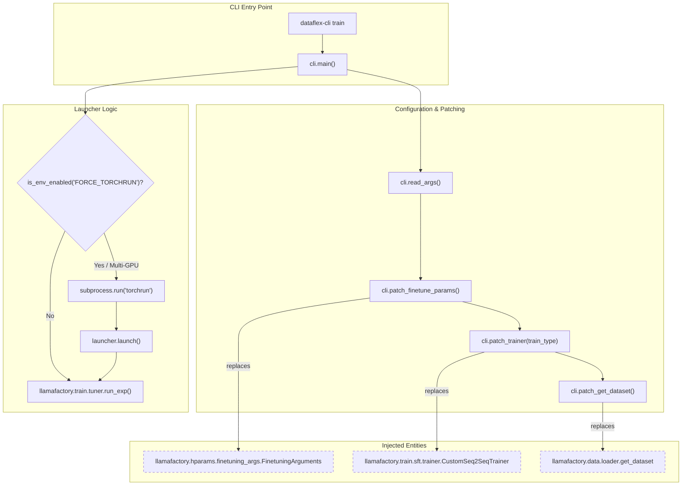
**Sources:** [src/dataflex/cli.py:157-202](), [src/dataflex/launcher.py:134-144](), [skills/how_to_add_algorithm.md:14-26]()

### Trainer Injection Mapping
Detailed mapping of `train_type` configuration to the specific DataFlex Trainer class injected into LLaMA-Factory.

| `train_type` Value | Target Trainer Class | Target LLaMA-Factory Module |
|:---|:---|:---|
| `dynamic_select` | `SelectTrainer` | `llamafactory.train.sft.trainer.CustomSeq2SeqTrainer` |
| `dynamic_mix` | `MixTrainer` | `llamafactory.train.sft.trainer.CustomSeq2SeqTrainer` |
| `dynamic_weight` | `WeightTrainer` | `llamafactory.train.sft.trainer.CustomSeq2SeqTrainer` |
| `static` | `None` (Standard LF) | N/A |

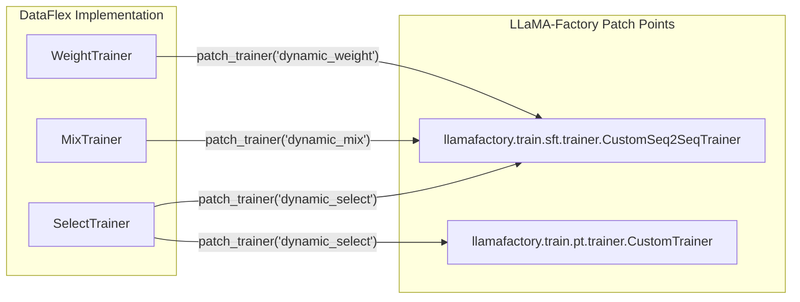
**Sources:** [src/dataflex/cli.py:58-95](), [src/dataflex/launcher.py:47-92]()

---

## The `version` Subcommand

The `version` subcommand provides a simple utility to verify the installation and versioning of the package.

### Version Retrieval
The CLI attempts to retrieve the version using `importlib.metadata`. It prints a welcome banner and the currently installed version string [src/dataflex/cli.py:137-155]().

**Example Output:**
```text
============================================================
 🎉 Welcome to DataFlex, a data-centric training system.
 🚀 Installed version: 0.1.0
============================================================
```

**Sources:** [src/dataflex/cli.py:137-162](), [.github/workflows/test.yml:67-68]()

---

# Page: Configuration Reference

# Configuration Reference

<details>
<summary>Relevant source files</summary>

The following files were used as context for generating this wiki page:

- [src/dataflex/configs/components.yaml](src/dataflex/configs/components.yaml)
- [src/dataflex/train/hparams/__init__.py](src/dataflex/train/hparams/__init__.py)
- [src/dataflex/train/hparams/dynamic_data_params.py](src/dataflex/train/hparams/dynamic_data_params.py)
- [src/dataflex/train/hparams/dynamic_params.py](src/dataflex/train/hparams/dynamic_params.py)
- [src/dataflex/train/mixer/base_mixer.py](src/dataflex/train/mixer/base_mixer.py)
- [src/dataflex/train/mixer/random_mixer.py](src/dataflex/train/mixer/random_mixer.py)
- [src/dataflex/utils/load_component.py](src/dataflex/utils/load_component.py)

</details>


DataFlex utilizes a hierarchical configuration system that merges standard LLaMA-Factory parameters with DataFlex-specific dynamic training arguments and a component-based parameter registry. This page serves as a technical reference for all available configuration fields and the structure of the `components.yaml` file.

## 1. Configuration Architecture

The configuration lifecycle involves three distinct layers:
1.  **Standard Training Arguments**: Fields inherited from LLaMA-Factory for model, data, and training hyper-parameters.
2.  **DataFlex Dynamic Arguments**: Fields defined in `src/dataflex/train/hparams/` that control the behavior of selectors, mixers, and weighers.
3.  **Component Parameters**: Algorithm-specific parameters defined in `src/dataflex/configs/components.yaml` and loaded via the `REGISTRY`.

### Data Flow and Initialization
The following diagram illustrates how configurations are parsed and used to instantiate the training environment.

**Configuration Parsing and Entity Association**
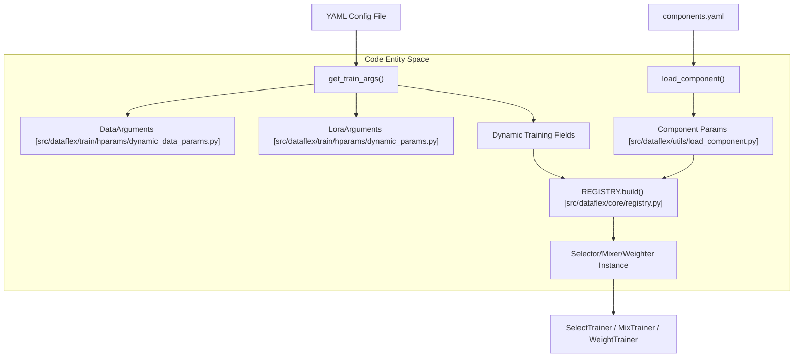
Sources: [src/dataflex/train/hparams/dynamic_data_params.py:22-24](), [src/dataflex/train/hparams/dynamic_params.py:56-58](), [src/dataflex/utils/load_component.py:4-24](), [src/dataflex/core/registry.py:1-40]()

---

## 2. DataFlex-Specific Fields

These fields are added to the standard LLaMA-Factory YAML schema to enable dynamic data orchestration.

### 2.1 Core Orchestration Fields
| Field | Type | Description |
| :--- | :--- | :--- |
| `train_type` | `str` | Determines the training mode: `dynamic_select`, `dynamic_mix`, or `dynamic_weight`. |
| `component_name` | `str` | The name of the algorithm to load from the registry (e.g., `less`, `doremi`, `loss`). |
| `warmup_step` | `int` | Number of initial steps before the dynamic algorithm starts updating proportions or selections. |
| `update_step` | `int` | Frequency (in steps) at which the selector/mixer/weighter is invoked to update data state. |
| `update_times` | `int` | Total number of times the selection/mixing state should be updated during training. |
| `static_mix` | `bool` | If true, uses fixed proportions throughout training (often used in DoReMi Step 1/3). |
| `train_step` | `int` | Used in specific mixers to define total training steps independent of LLaMA-Factory's `max_steps`. |
| `freeze_gate` | `bool` | Specific to MoE models; freezes the router/gate layers during dynamic mixing updates. |

### 2.2 Data Management Fields
Located in `DataArguments` [src/dataflex/train/hparams/dynamic_data_params.py:22-152]():
*   **`mixture_sample_rule`**: Defines how `MixedProportionManager` samples from multiple sources. Choices: `mixture`, `stratified`, `uniform` [src/dataflex/train/hparams/dynamic_data_params.py:141-144]().
*   **`init_mixture_proportions`**: A list of floats representing the starting probability distribution for datasets [src/dataflex/train/hparams/dynamic_data_params.py:145-148]().
*   **`mixer_eval_dataset`**: Separate dataset(s) used by mixers (like `DynamicMoeMixer`) to evaluate gate loads or domain losses [src/dataflex/train/hparams/dynamic_data_params.py:149-152]().

---

## 3. The components.yaml File

The `src/dataflex/configs/components.yaml` file is the central repository for algorithm-specific hyperparameters. It is divided into three top-level keys: `selectors`, `mixers`, and `weighters`.

### 3.1 Selectors Reference
Used when `train_type: dynamic_select`.

| Selector | Key Parameters | Purpose |
| :--- | :--- | :--- |
| **NICE** | `proj_dim`, `mc_samples`, `reward_model_backend` | RL-based selection using gradient similarity to a reward signal [src/dataflex/configs/components.yaml:4-32](). |
| **LESS** | `gradient_type`, `proj_dim` | Influence-based selection using Adam/SGD gradient projections [src/dataflex/configs/components.yaml:34-42](). |
| **Loss** | `focus` (low/medium/high) | Selects samples based on their raw loss value distribution [src/dataflex/configs/components.yaml:43-48](). |
| **Delta Loss**| `window_size` | Curriculum-based selection using the change in loss over time [src/dataflex/configs/components.yaml:49-54](). |

### 3.2 Mixers Reference
Used when `train_type: dynamic_mix`.

| Mixer | Key Parameters | Purpose |
| :--- | :--- | :--- |
| **DoReMi** | `reference_model_path`, `reweight_eta`, `reweight_eps` | Domain reweighting based on excess loss relative to a reference model [src/dataflex/configs/components.yaml:85-95](). |
| **ODM** | `alpha`, `reward_scale`, `min_exploration_rate` | Online Data Mixing using the Exp3 Multi-Armed Bandit algorithm [src/dataflex/configs/components.yaml:106-130](). |
| **Dynamic MoE**| `eta`, `collect_steps`, `eval_samples` | Adjusts mixing proportions based on Mixture-of-Experts gate utilization [src/dataflex/configs/components.yaml:131-139](). |

### 3.3 Weighters Reference
Used when `train_type: dynamic_weight`.

| Weighter | Key Parameters | Purpose |
| :--- | :--- | :--- |
| **Loss** | `strategy` (linupper, uniform, quadratic), `delta` | Per-sample loss reweighting to emphasize specific difficulty levels [src/dataflex/configs/components.yaml:142-147](). |

---

## 4. Implementation Detail: Component Loading

The function `load_component` [src/dataflex/utils/load_component.py:4-24]() is responsible for fetching parameters from the YAML file. It supports **Runtime Variable Substitution**, allowing the use of placeholders like `${output_dir}` which are resolved at training time.

**Component Loading Logic**
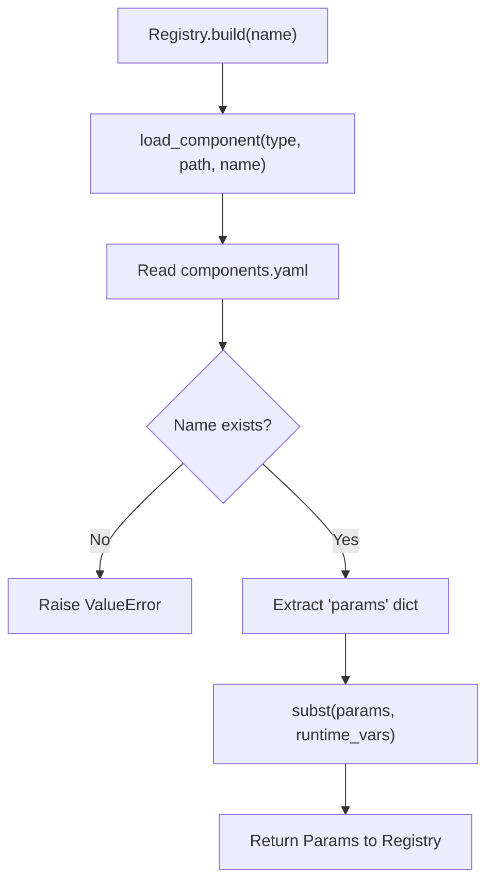
Sources: [src/dataflex/utils/load_component.py:4-24](), [src/dataflex/configs/components.yaml:1-152]()

## 5. Standard LLaMA-Factory Field Extensions

DataFlex inherits and respects standard fields while extending their utility:
*   **LoRA Arguments**: `lora_rank`, `lora_alpha`, and `lora_target` are critical when using selectors like `LESS` or `NICE`, as gradients are typically computed with respect to these adapters [src/dataflex/train/hparams/dynamic_params.py:57-124]().
*   **Freeze Arguments**: `freeze_trainable_layers` allows for partial parameter training, which is compatible with `dynamic_weight` modes [src/dataflex/train/hparams/dynamic_params.py:21-54]().

Sources:
- [src/dataflex/configs/components.yaml:1-152]()
- [src/dataflex/train/hparams/dynamic_data_params.py:22-152]()
- [src/dataflex/train/hparams/dynamic_params.py:21-124]()
- [src/dataflex/utils/load_component.py:4-24]()
- [src/dataflex/train/mixer/random_mixer.py:7-26]()
- [src/dataflex/train/mixer/base_mixer.py:4-21]()

---

# Page: Core Infrastructure

# Core Infrastructure

<details>
<summary>Relevant source files</summary>

The following files were used as context for generating this wiki page:

- [src/dataflex/core/__init__.py](src/dataflex/core/__init__.py)
- [src/dataflex/core/registry.py](src/dataflex/core/registry.py)
- [src/dataflex/train/data/loader.py](src/dataflex/train/data/loader.py)
- [src/dataflex/train/dataset/__init__.py](src/dataflex/train/dataset/__init__.py)
- [src/dataflex/train/dataset/mixed_proportion_manager.py](src/dataflex/train/dataset/mixed_proportion_manager.py)
- [src/dataflex/train/mixer/static_mixer.py](src/dataflex/train/mixer/static_mixer.py)
- [src/dataflex/utils/__init__.py](src/dataflex/utils/__init__.py)

</details>


The Core Infrastructure of DataFlex provides the foundational mechanisms for component management and data handling that enable dynamic training. It bridges the gap between static configuration and the runtime execution of selectors, mixers, and weighters. This layer ensures that regardless of the training mode selected, the system can consistently load datasets, manage proportions, and instantiate the necessary algorithmic components.

## Registry & Component System

The `Registry` is the central authority for managing the lifecycle of DataFlex components. It uses a decorator-based registration pattern to map string identifiers (from YAML configurations) to Python classes. This decoupling allows users to easily plug in custom algorithms without modifying the core trainer logic.

### Component Registration and Instantiation
The system categorizes components into three types: `selector`, `mixer`, and `weighter`. When a trainer is initialized, it uses the `REGISTRY.build` method to instantiate the requested component, merging static configuration parameters with runtime dependencies (like the model or tokenizer).

**Registry Architecture**
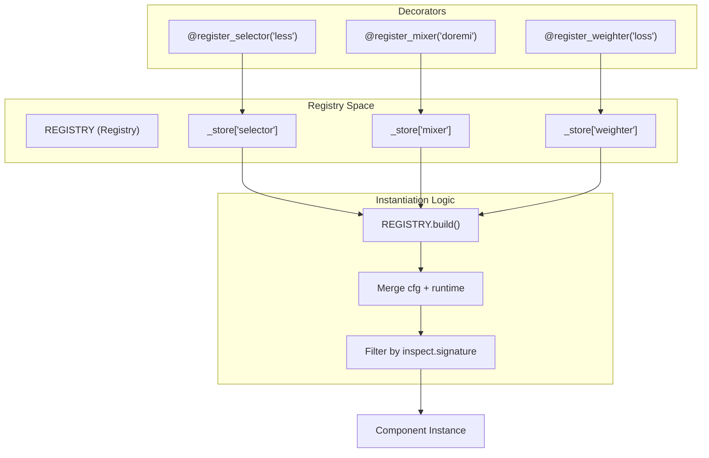

For details on implementing custom components and the internal merging logic, see **[Registry & Component System](#3.1)**.

**Sources:**
- `Registry` class definition: [src/dataflex/core/registry.py:4-28]()
- Registration decorators: [src/dataflex/core/registry.py:30-32]()
- Mixer registration example: [src/dataflex/train/mixer/static_mixer.py:7-8]()

---

## Data Loading & MixedProportionManager

DataFlex extends the standard LLaMA-Factory data pipeline to support multi-source datasets and dynamic resampling. This is primarily achieved through a patched `get_dataset` function and the `MixedProportionManager`, which maintains the state of data mixtures throughout the training process.

### The Loading Lifecycle
1.  **Per-Source Loading**: Unlike standard training which merges all data immediately, DataFlex loads datasets into a `per_source_pp` (preprocessed) dictionary [src/dataflex/train/data/loader.py:114-119]().
2.  **Manager Initialization**: A `MixedProportionManager` is created to wrap these sources, handling the sampling logic based on rules like `mixture`, `stratified`, or `uniform` [src/dataflex/train/dataset/mixed_proportion_manager.py:31-58]().
3.  **Snapshot Generation**: The manager produces `_MixedSnapshot` objects—read-only, index-mapped datasets that the `DataLoader` can consume [src/dataflex/train/dataset/mixed_proportion_manager.py:7-22]().

**Data Flow: From Raw Files to Trainer**
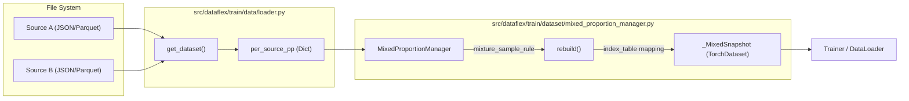

### MixedProportionManager Roles
The manager is responsible for calculating sampling probabilities and generating a global index table. It ensures that even when proportions change (e.g., during a DoReMi update), the resulting dataset remains compatible with the training loop. It also injects a `domain_id` into every sample to facilitate per-source loss tracking [src/dataflex/train/dataset/mixed_proportion_manager.py:18-21]().

For details on sampling rules and the rebuild process, see **[Data Loading & MixedProportionManager](#3.2)**.

**Sources:**
- `get_dataset` implementation: [src/dataflex/train/data/loader.py:42-152]()
- `MixedProportionManager` class: [src/dataflex/train/dataset/mixed_proportion_manager.py:24-107]()
- `_MixedSnapshot` logic: [src/dataflex/train/dataset/mixed_proportion_manager.py:7-22]()
- Sampling rule logic: [src/dataflex/train/dataset/mixed_proportion_manager.py:60-84]()

---

# Page: Registry & Component System

# Registry & Component System

<details>
<summary>Relevant source files</summary>

The following files were used as context for generating this wiki page:

- [src/dataflex/configs/components.yaml](src/dataflex/configs/components.yaml)
- [src/dataflex/core/__init__.py](src/dataflex/core/__init__.py)
- [src/dataflex/core/registry.py](src/dataflex/core/registry.py)
- [src/dataflex/train/hparams/dynamic_data_params.py](src/dataflex/train/hparams/dynamic_data_params.py)
- [src/dataflex/train/mixer/base_mixer.py](src/dataflex/train/mixer/base_mixer.py)
- [src/dataflex/train/mixer/random_mixer.py](src/dataflex/train/mixer/random_mixer.py)
- [src/dataflex/utils/__init__.py](src/dataflex/utils/__init__.py)
- [src/dataflex/utils/load_component.py](src/dataflex/utils/load_component.py)

</details>


The **Registry & Component System** is the central nervous system of DataFlex. It provides a decoupled architecture for managing algorithms across the three primary training modes: Selection, Mixing, and Reweighting. By using a centralized `Registry` class and a YAML-based configuration, DataFlex allows developers to swap complex logic (like `DoremiMixer` or `LessSelector`) without modifying the core trainer loops.

## The Registry Class

The `Registry` class, defined in [src/dataflex/core/registry.py:4-28](), is a singleton-pattern container that maps string identifiers to Python classes. It handles the registration, retrieval, and instantiation (building) of components.

### Internal Storage
The registry uses a nested dictionary `_store` where the first key is the **kind** (e.g., "selector", "mixer", "weighter") and the second key is the **name** of the specific algorithm [src/dataflex/core/registry.py:6-6]().

### Registration Decorators
DataFlex provides three specialized decorators to register new components into the global `REGISTRY` object:
- `@register_selector(name)`: Adds a class to the "selector" bucket [src/dataflex/core/registry.py:30-30]().
- `@register_mixer(name)`: Adds a class to the "mixer" bucket [src/dataflex/core/registry.py:31-31]().
- `@register_weighter(name)`: Adds a class to the "weighter" bucket [src/dataflex/core/registry.py:32-32]().

**Example Implementation:**
[src/dataflex/train/mixer/random_mixer.py:7-8]()
```python
@register_mixer("random")
class RandomMixer(Mixer):
    # Implementation...
```

**Sources:** [src/dataflex/core/registry.py:1-33](), [src/dataflex/train/mixer/random_mixer.py:1-12]()

---

## Component Loading Workflow

The lifecycle of a component involves reading static parameters from a configuration file and merging them with runtime objects (like the model or data manager).

### 1. Static Configuration: `load_component`
The `load_component` function [src/dataflex/utils/load_component.py:4-24]() is responsible for reading `src/dataflex/configs/components.yaml`. 

- **Filtering:** It navigates the YAML tree using the `type` (kind) and `name` [src/dataflex/utils/load_component.py:7-11]().
- **Variable Substitution:** It supports simple placeholder replacement (e.g., `${output_dir}`) if `runtime_vars` are provided [src/dataflex/utils/load_component.py:14-22]().

### 2. Parameter Merging: `REGISTRY.build`
The `build` method [src/dataflex/core/registry.py:20-27]() is the final step of instantiation. It performs a "Smart Merge" between two sources:
1.  **`cfg`**: Static parameters loaded from YAML.
2.  **`runtime`**: Objects created during training (e.g., the `model`, `tokenizer`, or `mixture_manager`).

**Merge Logic:**
- **Priority:** Runtime dependencies override configuration values [src/dataflex/core/registry.py:23-23]().
- **Inspection:** It uses `inspect.signature` to check the `__init__` method of the target class [src/dataflex/core/registry.py:24-25]().
- **Filtering:** It only passes arguments that the class constructor explicitly accepts, preventing `TypeError` from unexpected YAML fields [src/dataflex/core/registry.py:26-27]().

### Diagram: From YAML to Code Entity
The following diagram illustrates how a string name in a YAML configuration is resolved to a specific Python class and instantiated with merged parameters.

**Component Instantiation Flow**
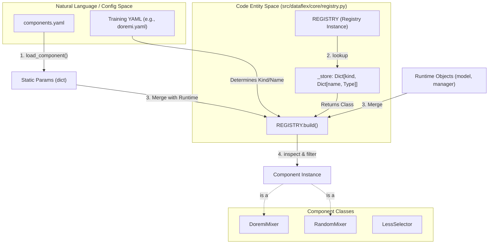
**Sources:** [src/dataflex/core/registry.py:20-27](), [src/dataflex/utils/load_component.py:4-24](), [src/dataflex/configs/components.yaml:1-152]()

---

## Configuration Schema (`components.yaml`)

The `components.yaml` file [src/dataflex/configs/components.yaml:1-152]() acts as a central repository for algorithm-specific hyperparameters.

| Component Type | Examples | Key Parameters |
| :--- | :--- | :--- |
| **Selectors** | `nice`, `less`, `loss` | `cache_dir`, `gradient_type`, `proj_dim`, `mc_samples` |
| **Mixers** | `doremi`, `odm`, `static` | `reweight_eta`, `alpha`, `warmup_steps`, `proportions` |
| **Weighters** | `loss`, `custom` | `strategy`, `delta` |

**Sources:** [src/dataflex/configs/components.yaml:1-152]()

---

## Data Flow: Building a Mixer

This diagram bridges the gap between the `Registry` logic and the actual training execution by showing how a `Mixer` is prepared for a `MixTrainer`.

**Mixer Initialization Sequence**
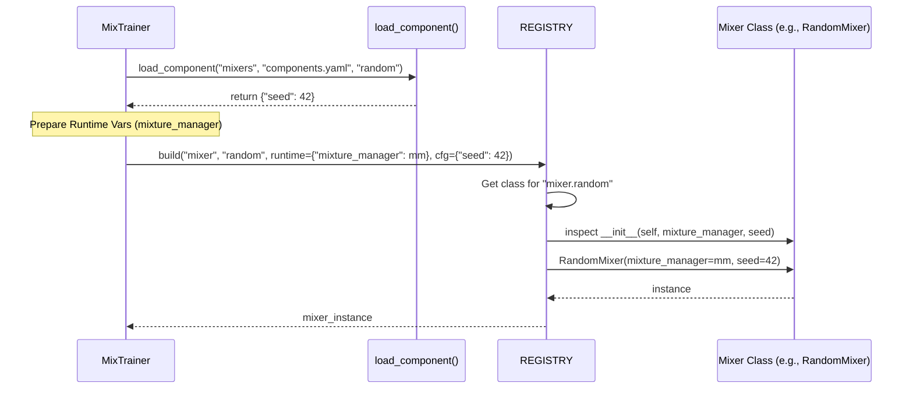

**Sources:** [src/dataflex/core/registry.py:20-27](), [src/dataflex/train/mixer/random_mixer.py:7-11](), [src/dataflex/utils/load_component.py:4-11]()

---

# Page: Data Loading & MixedProportionManager

# Data Loading & MixedProportionManager

<details>
<summary>Relevant source files</summary>

The following files were used as context for generating this wiki page:

- [data/c4_demo.jsonl](data/c4_demo.jsonl)
- [data/dataset_info.json](data/dataset_info.json)
- [data/wiki_demo.jsonl](data/wiki_demo.jsonl)
- [examples/train_lora/mixers/doremi_step2_dynamic_qwen_pt_lora.yaml](examples/train_lora/mixers/doremi_step2_dynamic_qwen_pt_lora.yaml)
- [src/dataflex/train/data/loader.py](src/dataflex/train/data/loader.py)
- [src/dataflex/train/dataset/__init__.py](src/dataflex/train/dataset/__init__.py)
- [src/dataflex/train/dataset/mixed_proportion_manager.py](src/dataflex/train/dataset/mixed_proportion_manager.py)
- [src/dataflex/train/mixer/static_mixer.py](src/dataflex/train/mixer/static_mixer.py)

</details>


This page describes the core data infrastructure of DataFlex. It covers how the library patches standard data loading workflows to support multi-source datasets and how the `MixedProportionManager` dynamically orchestrates data mixtures during training.

## Patched Data Loading: `get_dataset`

DataFlex implements a patched version of the `get_dataset` function in `src/dataflex/train/data/loader.py`. While it maintains compatibility with LLaMA-Factory's standard preprocessing, it introduces logic to handle per-source dataset construction required for dynamic mixing modes.

### Key Implementation Details
*   **Dual Loading Path**: The function first loads the standard merged dataset for baseline operations `[src/dataflex/train/data/loader.py:73-81]()`. Simultaneously, it builds a `per_source_raw` dictionary where each key corresponds to a dataset name defined in the configuration `[src/dataflex/train/data/loader.py:84-88]()`.
*   **Per-Source Preprocessing**: Each individual dataset source is passed through `_get_preprocessed_dataset` independently `[src/dataflex/train/data/loader.py:114-119]()`. This ensures that templates, tokenization, and formatting are applied correctly before the sources are handed to the mixture manager.
*   **Mixer Evaluation Datasets**: It supports loading independent evaluation datasets specifically for mixers (e.g., for monitoring gate loads in MoE-based mixing) `[src/dataflex/train/data/loader.py:137-148]()`.

### Data Flow: From Configuration to Manager
The following diagram illustrates how raw dataset definitions are transformed into a managed mixture.

**Figure 1: Data Transformation Flow**
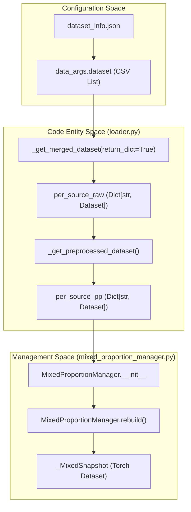
Sources: `[src/dataflex/train/data/loader.py:71-135]()`, `[src/dataflex/train/dataset/mixed_proportion_manager.py:24-39]()`

---

## MixedProportionManager

The `MixedProportionManager` is the central authority for handling data proportions across multiple domains. It encapsulates the logic for sampling from various sources and provides a mechanism to "rebuild" the training set whenever mixing weights are updated by a `Mixer` component.

### Sampling Rules
The manager supports three primary sampling strategies defined in `set_proportions` `[src/dataflex/train/dataset/mixed_proportion_manager.py:60-83]()`:

| Rule | Description | Implementation |
| :--- | :--- | :--- |
| `mixture` | Uses explicit weights provided by the user or a dynamic algorithm. | `probs = proportions / proportions.sum()` |
| `stratified` | Samples based on the natural size of each source dataset. | `probs = sizes / sizes.sum()` |
| `uniform` | Forces equal representation for all data sources. | `probs = 1.0 / k` |

### The Rebuild Process
The `rebuild()` method is called by trainers (like `MixTrainer`) to generate a fresh dataset view `[src/dataflex/train/dataset/mixed_proportion_manager.py:108-167]()`.
1.  **Validation**: It ensures the probability distribution is finite and sums to 1 `[src/dataflex/train/dataset/mixed_proportion_manager.py:116-121]()`.
2.  **Allocation**: It calculates the exact number of samples (`n_per`) to take from each source based on the requested `num_samples` `[src/dataflex/train/dataset/mixed_proportion_manager.py:125-137]()`.
3.  **Indexing**: It performs random sampling with replacement from each source to fulfill the allocation `[src/dataflex/train/dataset/mixed_proportion_manager.py:151-156]()`.
4.  **Snapshot**: It returns a `_MixedSnapshot` object.

Sources: `[src/dataflex/train/dataset/mixed_proportion_manager.py:60-167]()`

---

## _MixedSnapshot Dataset

The `_MixedSnapshot` class is a lightweight PyTorch `Dataset` that acts as a read-only view of the data at a specific point in time `[src/dataflex/train/dataset/mixed_proportion_manager.py:7-22]()`.

### Domain Tracking
A critical feature of `_MixedSnapshot` is the injection of a `domain_id` into each sample. When `__getitem__` is called, the class adds the index of the source dataset to the returned dictionary `[src/dataflex/train/dataset/mixed_proportion_manager.py:14-22]()`. 

This `domain_id` is essential for algorithms like **DoReMi**, which require tracking per-domain losses to update mixture weights in subsequent steps.

**Figure 2: Snapshot Indexing Logic**
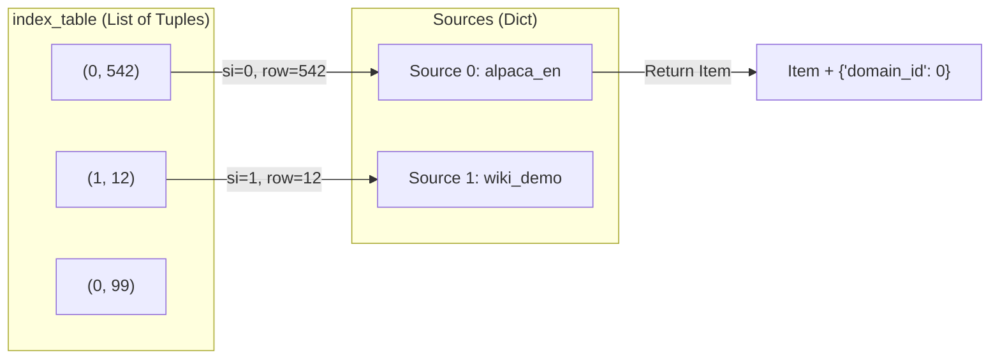
Sources: `[src/dataflex/train/dataset/mixed_proportion_manager.py:7-22]()`

---

## Integration with Mixers

The `MixedProportionManager` is designed to be consumed by components registered via the DataFlex Registry. For example, the `StaticMixer` validates proportions against the manager's domain names during initialization `[src/dataflex/train/mixer/static_mixer.py:7-37]()`.

### Example Configuration
In a `dynamic_mix` scenario, the configuration defines the initial state which the manager then executes:
```yaml
### dynamic_train
train_type: dynamic_mix
mixture_sample_rule: mixture
init_mixture_proportions: [0.5, 0.5] # Corresponds to the order in 'dataset' field
```
Sources: `[examples/train_lora/mixers/doremi_step2_dynamic_qwen_pt_lora.yaml:56-64]()`

---

# Page: Dynamic Data Selection

# Dynamic Data Selection

<details>
<summary>Relevant source files</summary>

The following files were used as context for generating this wiki page:

- [src/dataflex/train/selector/__init__.py](src/dataflex/train/selector/__init__.py)
- [src/dataflex/train/selector/base_selector.py](src/dataflex/train/selector/base_selector.py)
- [src/dataflex/train/selector/custom_selector.py](src/dataflex/train/selector/custom_selector.py)
- [src/dataflex/train/trainer/select_trainer.py](src/dataflex/train/trainer/select_trainer.py)
- [src/dataflex/utils/logging.py](src/dataflex/utils/logging.py)
- [src/dataflex/utils/selector_io.py](src/dataflex/utils/selector_io.py)

</details>


The `dynamic_select` training mode in DataFlex implements a "Model-in-the-Loop" data selection strategy. Instead of training on a static dataset, the system dynamically identifies the most informative samples from a large pool at runtime. This process is orchestrated by the `SelectTrainer`, which manages a cycle of model warmup, sample scoring via a `Selector` component, and DataLoader refreshing.

### System Architecture

The dynamic selection workflow bridges high-level training configurations with low-level data manipulation. The `SelectTrainer` intercepts the standard training loop to trigger selection events based on user-defined intervals.

**Selector System Overview**

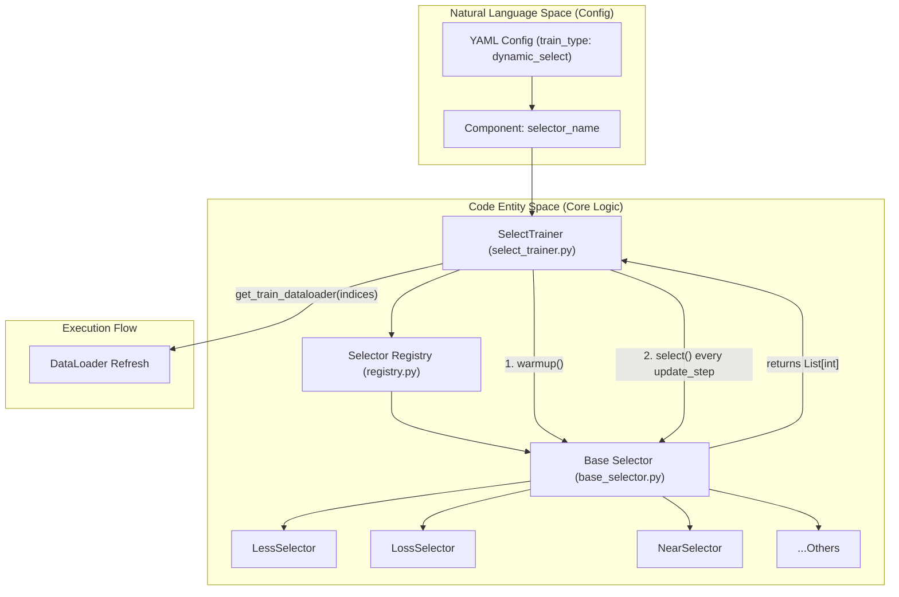

**Sources:**
- [src/dataflex/train/trainer/select_trainer.py:1-163]()
- [src/dataflex/train/selector/base_selector.py:6-56]()
- [src/dataflex/core/registry.py:1-40]()

---

### SelectTrainer Orchestration

The `SelectTrainer` is a specialized subclass of `CustomSeq2SeqTrainer` [src/dataflex/train/trainer/select_trainer.py:47](). It manages the synchronization between the model's current state and the data it consumes.

*   **Warmup Phase**: Before the main selection loop begins, the trainer calls `selector.warmup()` to obtain an initial set of indices, ensuring the model has a baseline state before it starts "choosing" its own data [src/dataflex/train/selector/base_selector.py:14-40]().
*   **Update Cycle**: Every `update_step` (defined in the config), the trainer pauses training, invokes the selector's `select()` method, and broadcasts the resulting indices across all distributed ranks using `dist.broadcast_object_list` [src/dataflex/train/trainer/select_trainer.py:35]().
*   **DataLoader Refresh**: Unlike standard trainers that use a static sampler, `SelectTrainer` re-instantiates the DataLoader mid-training via `get_train_dataloader(indices)` to inject the newly selected subset.

For a deep dive into the synchronization and state management, see [SelectTrainer](#4.1).

---

### Selector Interface

All selection algorithms inherit from the `Selector` abstract base class. This ensures a consistent interface for the `SelectTrainer` to interact with diverse algorithms, ranging from gradient-based similarity to simple random sampling.

| Method | Role | Implementation |
| :--- | :--- | :--- |
| `warmup()` | Provides initial indices for the first training steps. | Default: Random sampling [src/dataflex/train/selector/base_selector.py:14](). |
| `select()` | Core logic: scores samples and returns a list of indices. | Abstract: Must be implemented by child classes [src/dataflex/train/selector/base_selector.py:43](). |

**Sources:**
- [src/dataflex/train/selector/base_selector.py:6-56]()
- [src/dataflex/train/selector/custom_selector.py:5-38]()

---

### Selector Algorithm Families

DataFlex provides several families of selectors, each optimized for different computational budgets and selection signals.

#### Gradient-Based Selectors
These selectors (e.g., `LESS`, `NICE`) use the model's gradients to determine sample influence. They often utilize low-rank projections (like Rademacher) to handle the high dimensionality of LLM gradients.
*   **Key Files**: `less_selector.py`, `nice_selector.py`.
*   **Details**: See [Gradient-Based Selectors (LESS & NICE)](#4.2).

#### Loss-Based Selectors
These selectors (e.g., `Loss`, `DeltaLoss`) use the model's training loss or the change in loss over time as a proxy for "learnability" or "forgetting."
*   **Key Files**: `loss_selector.py`, `delta_loss_selector.py`.
*   **Details**: See [Loss-Based Selectors (Loss & Delta Loss)](#4.3).

#### Distribution & Offline Selectors
These selectors use pre-computed features or embeddings. `NEAR` uses FAISS for vector similarity, while `TSDS` focuses on diversity in the embedding space.
*   **Key Files**: `near_selector.py`, `tsds_selector.py`, `offline_near_selector.py`.
*   **Details**: See [Distribution-Based & Offline Selectors (TSDS, NEAR, Random)](#4.4).

#### Custom Selectors
Users can implement their own logic by extending the `Selector` class and using the `@register_selector` decorator.
*   **Template**: `custom_selector.py`.
*   **Details**: See [Custom Selectors](#4.5).

---

### Data Persistence and I/O

The selection process is integrated with `selector_io.py` to ensure that selected indices and their associated metrics (e.g., scores, losses) are saved to the `cache_dir`. This allows for training resumption and post-hoc analysis of what data the model found most useful at different stages of training.

**Sources:**
- [src/dataflex/utils/selector_io.py:12-45]()
- [src/dataflex/train/selector/base_selector.py:7-12]()

---

# Page: SelectTrainer

# SelectTrainer

<details>
<summary>Relevant source files</summary>

The following files were used as context for generating this wiki page:

- [src/dataflex/train/selector/__init__.py](src/dataflex/train/selector/__init__.py)
- [src/dataflex/train/trainer/select_trainer.py](src/dataflex/train/trainer/select_trainer.py)

</details>


`SelectTrainer` is the core orchestration class for the `dynamic_select` training mode. It extends the `CustomSeq2SeqTrainer` from LLaMA-Factory to implement a "model-in-the-loop" data selection lifecycle. Unlike standard trainers that iterate over a fixed dataset, `SelectTrainer` periodically invokes a `Selector` component to evaluate data samples and refresh the `DataLoader` with a newly selected subset of indices.

## Core Architecture and Lifecycle

The `SelectTrainer` manages the transition between a **warmup phase** (where the model trains on a subset or full data to stabilize) and an **update phase** (where data is re-selected based on model feedback).

### Implementation Details
The trainer overrides the `_inner_training_loop` to inject selection logic. Key configuration parameters include:
*   `warmup_step`: The number of steps to train before the first selection occurs.
*   `update_step`: The frequency (in steps) at which the dataset is re-evaluated and updated.
*   `update_times`: The total number of times the selection process should be triggered.

### System Flow: Selection Loop
The following diagram illustrates the interaction between the `SelectTrainer`, the `Selector` component, and the `DataLoader`.

**Title: SelectTrainer Selection Lifecycle**
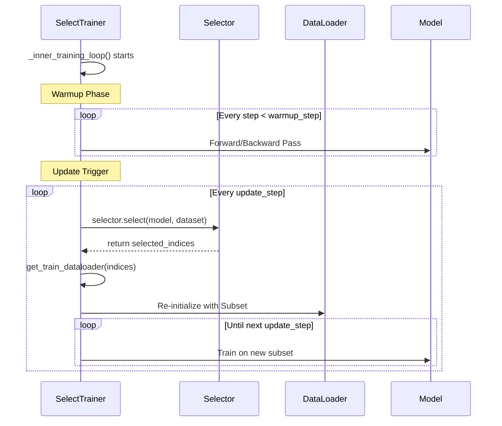
Sources: [src/dataflex/train/trainer/select_trainer.py:417-450](), [src/dataflex/train/trainer/select_trainer.py:530-580]()

---

## Distributed Synchronization

In multi-GPU environments, `SelectTrainer` ensures that all ranks stay synchronized during the selection process. This is critical because selection algorithms (like `LossSelector`) often require gathering metrics from all ranks, but the final index list must be identical across the distributed process group to prevent training divergence.

### Synchronization Mechanisms
1.  **Barrier**: Uses `dist.barrier()` to ensure all ranks have finished their current training steps before starting the selection phase [src/dataflex/train/trainer/select_trainer.py:438-440]().
2.  **Broadcast**: Only the main process (Rank 0) typically performs the final index calculation (especially for offline or CPU-heavy selectors). The resulting `indices` list is then distributed to all other ranks using `dist.broadcast_object_list` [src/dataflex/train/trainer/select_trainer.py:442-448]().

**Title: Distributed Index Synchronization**
```mermaid
graph TD
    subgraph "Rank 0 (Main)"
        R0_S["Selector.select()"] --> R0_I["Indices List"]
    end
    subgraph "Rank N (Worker)"
        RN_W["Wait at dist.barrier()"] --> RN_B["dist.broadcast_object_list()"]
    end
    
    R0_I -->|"broadcast"| RN_B
    RN_B --> RN_DL["Refresh DataLoader"]
    R0_I --> R0_DL["Refresh DataLoader"]
```
Sources: [src/dataflex/train/trainer/select_trainer.py:430-455]()

---

## DataLoader Refreshing

A unique feature of `SelectTrainer` is its ability to refresh the `DataLoader` mid-loop without restarting the training state. This is handled by the `get_train_dataloader` method.

### get_train_dataloader(indices)
When selection occurs, `SelectTrainer` creates a `torch.utils.data.Subset` of the original training dataset using the provided `indices`. It then re-instantiates the `DataLoader` and wraps it with the `accelerator` to handle sharding and prefetching.

*   **Function Signature**: `get_train_dataloader(self, indices: Optional[List[int]] = None)` [src/dataflex/train/trainer/select_trainer.py:1005-1010]()
*   **Logic**:
    1.  If `indices` are provided, it creates a `Subset(self.train_dataset, indices)` [src/dataflex/train/trainer/select_trainer.py:1015-1020]().
    2.  It configures a `RandomSampler` or `SequentialSampler` based on the `training_args` [src/dataflex/train/trainer/select_trainer.py:1040-1055]().
    3.  The new `DataLoader` is passed through `self.accelerator.prepare()`, ensuring it is ready for distributed execution [src/dataflex/train/trainer/select_trainer.py:1080-1085]().

Sources: [src/dataflex/train/trainer/select_trainer.py:1005-1090]()

---

## Manual Gradient Management

For specific selectors (like `LessSelector` or `NICESelector`), the trainer must compute gradients for evaluation purposes without updating the model weights. `SelectTrainer` manages this through manual gradient manipulation.

### Gradient Synchronization Control
The trainer uses `self.accelerator.gradient_state._set_sync_gradients(False)` to prevent the `accelerator` from automatically syncing gradients across GPUs during the evaluation/scoring phase of a selector. This allows each rank to compute its local gradient contribution (e.g., for a specific data batch) which the `Selector` then processes.

### Implementation in _inner_training_loop
Within the selection trigger, the trainer performs the following:
1.  **Switch to Eval/Selection Mode**: Disables weight updates.
2.  **Selector Call**: Calls `self.selector.select(...)`.
3.  **Reset Gradient State**: Ensures the `optimizer` and `accelerator` states are clean before resuming the standard training loop.

Sources: [src/dataflex/train/trainer/select_trainer.py:410-430](), [src/dataflex/train/trainer/select_trainer.py:550-570]()

---

## Component Loading

The `SelectTrainer` initializes the appropriate `Selector` class by looking up the `train_type` and `component_name` in the `REGISTRY`.

### Selector Initialization
During `__init__`, the trainer calls `load_component` to fetch the configuration and class definition:
```python
self.selector = load_component(
    component_type="selector",
    component_name=dataflex_args.component_name,
    # ... runtime parameters
)
```
This enables the trainer to be agnostic of the specific selection algorithm (e.g., `LossSelector` vs `LessSelector`), as they all adhere to the `BaseSelector` interface.

Sources: [src/dataflex/train/trainer/select_trainer.py:230-250](), [src/dataflex/core/registry.py:10-30]()

---

# Page: Gradient-Based Selectors (LESS & NICE)

# Gradient-Based Selectors (LESS & NICE)

<details>
<summary>Relevant source files</summary>

The following files were used as context for generating this wiki page:

- [examples/train_lora/selectors/less.yaml](examples/train_lora/selectors/less.yaml)
- [examples/train_lora/selectors/nice.yaml](examples/train_lora/selectors/nice.yaml)
- [src/dataflex/train/selector/less_selector.py](src/dataflex/train/selector/less_selector.py)
- [src/dataflex/train/selector/nice_selector.py](src/dataflex/train/selector/nice_selector.py)

</details>


This page provides a technical deep dive into the gradient-based selection algorithms implemented in DataFlex: **LESS** (Low-rank Gradient Similarity Search) and **NICE** (Next-Instruction-based Contrastive Evaluation). These selectors utilize projected gradient vectors to estimate the influence of training samples on model performance on a target evaluation set.

## Overview of Gradient Projection

Both `LessSelector` and `NICESelector` rely on the TRAK framework to handle high-dimensional gradient vectors. Since raw LLM gradients are too large to store and compare efficiently, DataFlex uses random projections to map these gradients into a lower-dimensional subspace (typically 8192) while preserving cosine similarity properties [src/dataflex/train/selector/less_selector.py:45]().

### Projector Implementation
DataFlex supports two projection backends via the `trak` library:
1.  **CudaProjector**: Utilizes `fast_jl` for high-performance Rademacher projection on NVIDIA GPUs [src/dataflex/train/selector/less_selector.py:146-149]().
2.  **BasicProjector**: A fallback CPU/PyTorch-based implementation used when CUDA kernels are unavailable [src/dataflex/train/selector/less_selector.py:153-155]().

### Data Flow: Gradient to Score
The following diagram illustrates the transformation from raw model parameters to the final selection indices.

**Diagram: Gradient Projection and Scoring Flow**
```mermaid
graph TD
    subgraph "Gradient Space"
        A["model.parameters()"] -- "backward()" --> B["p.grad"]
        B -- "cat()" --> C["Vectorized Gradients"]
    end

    subgraph "Projection Engine (TRAK)"
        D["Projector (Cuda/Basic)"]
        E["Rademacher Matrix"]
        C --> D
        E --> D
        D -- "Project" --> F["Projected Gradients (proj_dim)"]
    end

    subgraph "Scoring & Selection"
        F -- "Main Process" --> G["Consolidated Matrix"]
        H["Eval Gradients"] -- "Cosine Similarity" --> G
        G -- "Top-K" --> I["Selected Indices"]
    end
```
**Sources:** [src/dataflex/train/selector/less_selector.py:100-141](), [src/dataflex/train/selector/less_selector.py:143-157]()

---

## LessSelector Implementation

The `LessSelector` implements the LESS algorithm, which selects data by calculating the similarity between training gradients and evaluation gradients.

### Gradient Types: Adam vs SGD
LESS supports two gradient computation modes:
*   **SGD**: Uses raw gradients directly [src/dataflex/train/selector/less_selector.py:135-136]().
*   **Adam**: Incorporates optimizer states ($m$ and $v$) to compute "effective" gradients, mimicking the actual update step of the Adam optimizer [src/dataflex/train/selector/less_selector.py:125-134]().

### DeepSpeed ZeRO-3 Support
When training with DeepSpeed ZeRO-3, parameters and optimizer states are partitioned across ranks. `LessSelector` handles this by:
1.  Using `safe_get_full_optimizer_state` to gather `exp_avg` and `exp_avg_sq` [src/dataflex/train/selector/less_selector.py:77-84]().
2.  Using `safe_get_full_grad` to reconstruct the full gradient vector from partitioned shards [src/dataflex/train/selector/less_selector.py:108-114]().
3.  Calculating total parameter counts using `p.ds_numel` to ensure correct vector sizing [src/dataflex/train/selector/less_selector.py:63-66]().

**Sources:** [src/dataflex/train/selector/less_selector.py:27-142]()

---

## NICESelector Implementation

`NICESelector` extends gradient-based selection to Reinforcement Learning from Human Feedback (RLHF) scenarios. It computes gradients based on a Policy Model and a Reward Model using Monte Carlo sampling.

### RL-Mode Gradient Computation
Unlike standard SFT gradients, NICE computes the gradient of the expected reward:
1.  **Generation**: The `policy_model` generates multiple completions (`mc_samples`) for a given instruction [src/dataflex/train/selector/nice_selector.py:228-245]().
2.  **Scoring**: The `reward_model` assigns a scalar score to each completion [src/dataflex/train/selector/nice_selector.py:255-265]().
3.  **Loss Construction**: A pseudo-loss is constructed using the log-probabilities of the generated sequences weighted by their rewards [src/dataflex/train/selector/nice_selector.py:272-277]().
4.  **Backpropagation**: The gradient of this pseudo-loss is projected and stored [src/dataflex/train/selector/nice_selector.py:279-281]().

### System Architecture: NICE Code Entities
This diagram maps the natural language RL concepts to specific classes and functions in `nice_selector.py`.

**Diagram: NICE RL Gradient Pipeline**
```mermaid
graph LR
    subgraph "Model Entities"
        PM["policy_model (AutoModelForCausalLM)"]
        RM["reward_model (AutoModelForSequenceClassification)"]
    end

    subgraph "Process Flow"
        DS["Dataset Item"] --> PM
        PM -- "generate()" --> MC["MC Samples"]
        MC --> RM
        RM -- "forward()" --> RS["Reward Scores"]
        RS & MC -- "log_probs" --> L["Pseudo-Loss"]
        L -- "backward()" --> G["Gradients"]
    end

    subgraph "Logic Implementation"
        F1["_load_local_models()"]
        F2["_obtain_gradients()"]
    end

    PM -.-> F1
    RM -.-> F1
    G -.-> F2
```
**Sources:** [src/dataflex/train/selector/nice_selector.py:107-130](), [src/dataflex/train/selector/nice_selector.py:199-291]()

---

## Distributed Storage & Consolidation

To handle large datasets across multiple GPUs, DataFlex employs a rank-specific storage strategy.

### 1. Distributed Projection
Each rank processes a subset of the dataset. Projected gradients are saved locally to the `cache_dir` in chunks (controlled by `save_interval`) [src/dataflex/train/selector/less_selector.py:214-220](). Files are named with the rank ID to prevent collisions (e.g., `grads-16-rank0.pt`) [src/dataflex/train/selector/less_selector.py:217]().

### 2. Main Process Consolidation
During the `select()` phase:
1.  The main process (rank 0) scans the `cache_dir` for all `.pt` files [src/dataflex/train/selector/less_selector.py:254-257]().
2.  It loads and concatenates these tensors into a single global gradient matrix [src/dataflex/train/selector/less_selector.py:261-267]().
3.  Cosine similarity is computed between the training matrix and the evaluation gradient vector [src/dataflex/train/selector/less_selector.py:285-286]().
4.  The top-K indices are broadcasted to all other ranks using `dist.broadcast_object_list` (handled by the `SelectTrainer`) [src/dataflex/train/selector/less_selector.py:291]().

| Feature | LESS | NICE |
| :--- | :--- | :--- |
| **Primary Goal** | SFT Influence Modeling | RLHF Policy Improvement |
| **Gradient Source** | Standard Cross-Entropy | Reward-Weighted Log-Probs |
| **Model Requirements** | Training Model | Policy + Reward Model |
| **Projection** | Rademacher (TRAK) | Rademacher (TRAK) |
| **Checkpointing** | Resumable via index tracking | Resumable via index tracking |

**Sources:** [src/dataflex/train/selector/less_selector.py:240-295](), [src/dataflex/train/selector/nice_selector.py:60-106]()

---

# Page: Loss-Based Selectors (Loss & Delta Loss)

# Loss-Based Selectors (Loss & Delta Loss)

<details>
<summary>Relevant source files</summary>

The following files were used as context for generating this wiki page:

- [examples/train_lora/selectors/delta_loss.yaml](examples/train_lora/selectors/delta_loss.yaml)
- [examples/train_lora/selectors/loss.yaml](examples/train_lora/selectors/loss.yaml)
- [src/dataflex/train/selector/delta_loss_selector.py](src/dataflex/train/selector/delta_loss_selector.py)
- [src/dataflex/train/selector/loss_selector.py](src/dataflex/train/selector/loss_selector.py)

</details>


Loss-based selectors implement dynamic data selection by evaluating the model's current performance on the candidate dataset. These selectors prioritize samples based on their raw loss values or the change in loss over time (Delta Loss). They utilize distributed gathering to efficiently compute metrics across multiple GPUs and apply quantile-based weighting for final sample selection.

## LossSelector

The `LossSelector` [src/dataflex/train/selector/loss_selector.py:25]() ranks data samples based on the cross-entropy loss produced by the model. It supports focusing on different parts of the loss distribution (e.g., high-loss samples that the model finds difficult, or low-loss samples for stability).

### Implementation Workflow
1.  **Distributed Evaluation**: The selector wraps the dataset in an `IndexedDataset` [src/dataflex/train/selector/loss_selector.py:13-22]() to track original indices. It uses `accelerator.prepare` to shard the evaluation across all available GPUs [src/dataflex/train/selector/loss_selector.py:77]().
2.  **Loss Gathering**: Each rank computes local losses. These are gathered using `self.accelerator.gather` [src/dataflex/train/selector/loss_selector.py:105-106]().
3.  **Deduplication & Alignment**: The main process aligns gathered losses to their original indices, ensuring deterministic behavior by handling potential padding or repeats from the distributed sampler [src/dataflex/train/selector/loss_selector.py:109-118]().
4.  **Quantile Weighting**: The distribution is split into three buckets (Low, Medium, High) based on the `quantiles` parameter [src/dataflex/train/selector/loss_selector.py:138-143]().
5.  **Sampling**: Probabilities are calculated using a `temperature` control and `focus_weight` [src/dataflex/train/selector/loss_selector.py:150-162](). Final indices are selected via `torch.multinomial` [src/dataflex/train/selector/loss_selector.py:175-178]().

### Configuration Parameters
| Parameter | Type | Default | Description |
| :--- | :--- | :--- | :--- |
| `focus` | `str` | `"high"` | Target bucket: `"high"`, `"medium"`, or `"low"`. |
| `focus_weight` | `float` | `5.0` | Multiplier for the target bucket's selection probability. |
| `quantiles` | `tuple` | `(0.33, 0.66)` | Thresholds for bucket categorization. |
| `temperature` | `float` | `1.0` | Controls the sharpness of the probability distribution. |

**Sources:** [src/dataflex/train/selector/loss_selector.py:26-47](), [src/dataflex/train/selector/loss_selector.py:129-163]()

---

## DeltaLossSelector

The `DeltaLossSelector` [src/dataflex/train/selector/delta_loss_selector.py:40]() selects samples based on the reduction in loss between two checkpoints. This approach targets samples where the model is actively learning or "forgetting." It features a sliding window curriculum to focus on specific segments of the dataset over time.

### Sliding Window Curriculum
The selector calculates a window within the dataset that shifts as training progresses, governed by a sigmoid function [src/dataflex/train/selector/delta_loss_selector.py:13-25]().

*   **Window Position**: `calculate_window_position` uses `current_update_times` and `update_times` to determine the `window_start` and `window_end` [src/dataflex/train/selector/delta_loss_selector.py:17-25]().
*   **Sigmoid Mapping**: The `scaled_iteration` (progress through total updates) is passed through a sigmoid to create a non-linear progression through the dataset indices [src/dataflex/train/selector/delta_loss_selector.py:13-14]().

### Selection Logic
1.  **Initial State**: On the first call, it computes and caches "Initial Losses" and returns a random warmup selection [src/dataflex/train/selector/delta_loss_selector.py:112-164]().
2.  **Delta Calculation**: In subsequent steps, it computes "Current Losses." The metric used for selection is `delta = initial_loss - current_loss` [src/dataflex/train/selector/delta_loss_selector.py:195-201]().
3.  **Window Filtering**: Only samples within the current curriculum window are considered [src/dataflex/train/selector/delta_loss_selector.py:204-207]().
4.  **Ranking**: It selects the top `num_samples` with the largest delta (highest learning progress) [src/dataflex/train/selector/delta_loss_selector.py:210-213]().

**Sources:** [src/dataflex/train/selector/delta_loss_selector.py:13-25](), [src/dataflex/train/selector/delta_loss_selector.py:195-215]()

---

## System Architecture: Data Flow

The following diagram illustrates the flow from raw data through the distributed loss calculation to the final selection indices.

### Loss Calculation and Selection Flow
```mermaid
graph TD
    subgraph "Data Preparation"
        A["Original Dataset"] --> B["IndexedDataset"]
        B --> C["DataLoader (Distributed)"]
    end

    subgraph "Distributed Execution (All Ranks)"
        C --> D["Forward Pass (model.eval)"]
        D --> E["local_losses & local_indices"]
    end

    subgraph "Main Process Consolidation (Rank 0)"
        E -- "accelerator.gather" --> F["all_losses & all_indices"]
        F --> G["Deduplicate & Align to Dataset Length"]
        G --> H["Apply Quantiles (Low/Med/High)"]
        H --> I["Compute Multinomial Probs (Temperature)"]
        I --> J["torch.multinomial Selection"]
    end

    J --> K["save_selection (JSON)"]
    K -- "dist.broadcast_object_list" --> L["Return Indices to All Ranks"]
```
**Sources:** [src/dataflex/train/selector/loss_selector.py:70-121](), [src/dataflex/train/selector/loss_selector.py:129-182]()

---

## Code Entity Map

This diagram maps the natural language concepts of "Caching" and "Selection Strategy" to the specific classes and utility functions in the codebase.

### Entity Relationship Diagram
```mermaid
classDiagram
    class Selector {
        <<abstract>>
        +select(model, step_id, num_samples)
    }
    class LossSelector {
        +focus: str
        +focus_weight: float
        +select()
    }
    class DeltaLossSelector {
        +window_size: float
        +initial_losses: Tensor
        +select()
    }
    class selector_io {
        +load_cached_selection()
        +save_selection()
    }
    class IndexedDataset {
        +dataset: Dataset
        +__getitem__(index)
    }

    Selector <|-- LossSelector
    Selector <|-- DeltaLossSelector
    LossSelector ..> IndexedDataset : uses
    DeltaLossSelector ..> IndexedDataset : uses
    LossSelector ..> selector_io : uses for persistence
    DeltaLossSelector ..> selector_io : uses for persistence
```
**Sources:** [src/dataflex/train/selector/loss_selector.py:13-25](), [src/dataflex/train/selector/delta_loss_selector.py:28-40](), [src/dataflex/utils/selector_io.py:1-11]()

---

## Caching and Resumption

Both selectors utilize `selector_io` to persist selection results. This ensures that if a training job is interrupted and resumed, the selector can reload previous decisions instead of re-evaluating the entire dataset.

*   **Cache Check**: At the start of `select()`, the code checks if `step_{step_id}.json` exists [src/dataflex/train/selector/loss_selector.py:54-56]().
*   **Loading**: `load_cached_selection` is called on the main process [src/dataflex/train/selector/loss_selector.py:58]().
*   **Synchronization**: The loaded indices are broadcast to all ranks using `dist.broadcast_object_list` to maintain consistency across the distributed environment [src/dataflex/train/selector/loss_selector.py:63]().
*   **Storage**: `save_selection` writes the selected indices and the associated metrics (loss or delta) to the `cache_dir` [src/dataflex/train/selector/loss_selector.py:182]().

**Sources:** [src/dataflex/train/selector/loss_selector.py:53-67](), [src/dataflex/train/selector/delta_loss_selector.py:116-127]()

---

# Page: Distribution-Based & Offline Selectors (TSDS, NEAR, Random)

# Distribution-Based & Offline Selectors (TSDS, NEAR, Random)

<details>
<summary>Relevant source files</summary>

The following files were used as context for generating this wiki page:

- [examples/train_lora/selectors/random.yaml](examples/train_lora/selectors/random.yaml)
- [examples/train_lora/selectors/tsds.yaml](examples/train_lora/selectors/tsds.yaml)
- [src/dataflex/offline_selector/offline_near_selector.py](src/dataflex/offline_selector/offline_near_selector.py)
- [src/dataflex/offline_selector/offline_tsds_selector.py](src/dataflex/offline_selector/offline_tsds_selector.py)
- [src/dataflex/train/selector/near_selector.py](src/dataflex/train/selector/near_selector.py)
- [src/dataflex/train/selector/random_selector.py](src/dataflex/train/selector/random_selector.py)
- [src/dataflex/train/selector/tsds_selector.py](src/dataflex/train/selector/tsds_selector.py)

</details>


This page details the implementation of data selection algorithms that rely on pre-computed features or simple distributions rather than active model gradients. These selectors are divided into two phases: an **Offline Pre-computation** phase that generates indices or probability distributions, and an **Online Selection** phase where the training loop consumes these pre-computed artifacts.

## Offline Pre-computation Workflow

The offline selectors are standalone utilities designed to process large-scale datasets and query sets to generate static selection maps. They utilize FAISS for efficient similarity searching and support multiple embedding backends.

### Embedding Backends
Both `offline_near_selector.py` and `offline_tsds_selector.py` implement an "auto" mode for text embedding [src/dataflex/offline_selector/offline_near_selector.py:83-131]().
1.  **vLLM**: Preferred for high-throughput GPU acceleration using `llm.embed(texts)` [src/dataflex/offline_selector/offline_near_selector.py:86-90]().
2.  **Sentence-Transformers**: Fallback for standard CPU/GPU embedding using `SentenceTransformer.encode()` [src/dataflex/offline_selector/offline_near_selector.py:106-111]().

### Similarity Indexing
The system uses `FaissIndexIVFFlat` to manage large embedding collections. It calculates the number of clusters (`nlist`) as `sqrt(N) // 2` and uses an `IndexFlatL2` quantizer [src/dataflex/offline_selector/offline_near_selector.py:25-34]().

### Workflow Diagram: Offline to Online Transition

The following diagram illustrates how the offline scripts produce artifacts consumed by the `Selector` classes during training.

**Data Flow: Offline Selection Artifacts**
```mermaid
graph TD
    subgraph "Offline Phase (Local/Dev Machine)"
        A["Candidate Dataset (.json)"] --> B["offline_near_Selector / offline_tsds_Selector"]
        Q["Query Dataset (.json)"] --> B
        B --> C{"Embedding Backend"}
        C -->|"vLLM / ST"| D["FAISS IVFFlat Index"]
        D --> E["Search / KDE Logic"]
        E --> F1["top_indices.npy (NEAR)"]
        E --> F2["tsds_probs.npy (TSDS)"]
    end

    subgraph "Online Training Phase (DataFlex)"
        F1 --> G["near_Selector"]
        F2 --> H["tsds_Selector"]
        G --> I["SelectTrainer.update()"]
        H --> I
        I --> J["New DataLoader (subset)"]
    end
```
Sources: `[src/dataflex/offline_selector/offline_near_selector.py:148-176]()`, `[src/dataflex/offline_selector/offline_tsds_selector.py:156-200]()`, `[src/dataflex/train/selector/near_selector.py:8-45]()`.

---

## NEAR Selector (Nearest Neighbor)

The NEAR algorithm selects samples that are semantically closest to a provided query set (e.g., a high-quality validation set).

### Implementation Detail
1.  **Offline**: `offline_near_Selector` computes the `top_K` nearest neighbors for every query in the query set [src/dataflex/offline_selector/offline_near_selector.py:160-165](). It saves a matrix of shape `(M, max_K)` where `M` is the number of queries.
2.  **Online**: The `near_Selector` class performs **Column-Wise Selection**. It iterates through the neighbor ranks (columns) first, ensuring that the closest neighbor for every query is considered before moving to the second-closest [src/dataflex/train/selector/near_selector.py:63-78]().

### NEAR Logic Diagram
**Entity Association: near_Selector Implementation**
```mermaid
graph LR
    subgraph "near_selector.py"
        NS["near_Selector Class"]
        NS_INIT["__init__"]
        NS_SEL["select()"]
    end

    subgraph "Logic Flow"
        F["top_indices.npy"] --> NS_INIT
        NS_INIT -->|"Load Matrix"| M["self.top_indices (M x K)"]
        M --> NS_SEL
        NS_SEL -->|"Loop k in K (columns)"| L1["Rank k neighbors"]
        L1 -->|"Loop j in M (queries)"| L2["Candidate Index"]
        L2 -->|"Check Unique"| S["selected_set"]
        S -->|"Return"| R["selected_ids"]
    end
```
Sources: `[src/dataflex/train/selector/near_selector.py:11-84]()`.

---

## TSDS Selector (Targeted Subset Data Selection)

TSDS improves upon simple similarity by incorporating Kernel Density Estimation (KDE) to balance diversity and relevance.

### Offline KDE and Optimization
The `offline_tsds_selector.py` computes a KDE for candidates to identify data density [src/dataflex/offline_selector/offline_tsds_selector.py:180-188](). It then uses a heap-based optimization to select samples that maximize the TSDS objective, saving the resulting sampling probabilities to a `.npy` file [src/dataflex/offline_selector/offline_tsds_selector.py:190-200]().

### Online Selection
The online `tsds_Selector` is a lightweight wrapper that performs multinomial sampling based on these pre-computed probabilities.
*   **Initialization**: Loads `probs_path` and validates that the length matches the dataset [src/dataflex/train/selector/tsds_selector.py:21-30]().
*   **Selection**: Uses `np.random.choice` with the `p=self.probs` parameter to sample `num_samples` without replacement [src/dataflex/train/selector/tsds_selector.py:38-43]().

---

## Random Selector

The `RandomSelector` serves as the baseline for all selection experiments. It implements a distributed-safe random sampling strategy.

### Distributed Synchronization
To ensure all ranks in a distributed training environment (DDP) use the same subset of data:
1.  The **Main Process** (rank 0) generates the random indices using a `torch.Generator` seeded with `base_seed + step_id` [src/dataflex/train/selector/random_selector.py:27-30]().
2.  The indices are then shared with all other ranks via `dist.broadcast_object_list` [src/dataflex/train/selector/random_selector.py:53-55]().

---

## Configuration Examples

### TSDS Configuration
The following YAML snippet demonstrates how to configure a TSDS selector using a pre-computed probability file.

```yaml
# examples/train_lora/selectors/tsds.yaml
train_type: dynamic_select
component_name: tsds
warmup_step: 10
update_step: 10
# Component specific args (defined in components.yaml)
# probs_path: /path/to/tsds_probs.npy
```
Sources: `[examples/train_lora/selectors/tsds.yaml:51-60]()`.

### Selector Parameters Summary

| Selector | Offline Script | Key Parameter | Online Mechanism |
| :--- | :--- | :--- | :--- |
| **NEAR** | `offline_near_selector.py` | `indices_path` | Column-wise matrix traversal [src/dataflex/train/selector/near_selector.py:63-78]() |
| **TSDS** | `offline_tsds_selector.py` | `probs_path` | Multinomial sampling via `np.random.choice` [src/dataflex/train/selector/tsds_selector.py:38-43]() |
| **Random** | N/A | `seed` | `torch.randperm` with distributed broadcast [src/dataflex/train/selector/random_selector.py:44-55]() |

Sources: `[src/dataflex/train/selector/near_selector.py:8-9]()`, `[src/dataflex/train/selector/tsds_selector.py:7-8]()`, `[src/dataflex/train/selector/random_selector.py:9-10]()`.

---

# Page: Custom Selectors

# Custom Selectors

<details>
<summary>Relevant source files</summary>

The following files were used as context for generating this wiki page:

- [examples/train_lora/selectors/custom.yaml](examples/train_lora/selectors/custom.yaml)
- [src/dataflex/train/selector/base_selector.py](src/dataflex/train/selector/base_selector.py)
- [src/dataflex/train/selector/custom_selector.py](src/dataflex/train/selector/custom_selector.py)
- [src/dataflex/utils/logging.py](src/dataflex/utils/logging.py)
- [src/dataflex/utils/selector_io.py](src/dataflex/utils/selector_io.py)

</details>


The `Custom Selectors` page provides a technical guide for extending DataFlex's dynamic data selection capabilities. By inheriting from the base infrastructure, developers can implement proprietary selection algorithms that integrate seamlessly with the `SelectTrainer` orchestration loop.

## Overview of Selector Implementation

A custom selector in DataFlex is a class that implements a specific interface to determine which data samples should be used for the next training interval. The system relies on the `Selector` abstract base class to define the contract between the selection algorithm and the `SelectTrainer`.

### Core Components

| Component | Role | File Reference |
| :--- | :--- | :--- |
| `Selector` | Abstract base class defining the `warmup` and `select` interface. | [src/dataflex/train/selector/base_selector.py:6-56]() |
| `@register_selector` | Decorator used to register the class into the global `REGISTRY`. | [src/dataflex/core/registry.py:1-20]() |
| `SelectTrainer` | Orchestrator that calls `warmup()` at start and `select()` at `update_step`. | [src/dataflex/train/trainer/select_trainer.py:1-100]() |

### Natural Language to Code Entity Mapping

The following diagram illustrates how high-level selection concepts map to specific code entities within the DataFlex framework.

**Selector Architecture Mapping**
```mermaid
graph TD
    subgraph "Natural Language Space"
        A["Selection Strategy"]
        B["Initial Sampling"]
        C["Dynamic Update"]
        D["Registration"]
    end

    subgraph "Code Entity Space"
        A1["CustomSelector Class"]
        B1["warmup() method"]
        C1["select() method"]
        D1["@register_selector decorator"]
    end

    A --- A1
    B --- B1
    C --- C1
    D --- D1

    A1 -- "inherits" --> BASE["Selector (base_selector.py)"]
    D1 -- "adds to" --> REG["REGISTRY (registry.py)"]
```
Sources: [src/dataflex/train/selector/base_selector.py:6-56](), [src/dataflex/train/selector/custom_selector.py:1-38]()

## Implementation Guide

To create a custom selector, follow these steps:

### 1. Inherit from the Selector Base Class
The `Selector` class provides the necessary context for selection, including the dataset, accelerator for distributed training, and a data collator.

*   **Initialization**: The constructor `__init__` must call `super().__init__` to ensure the `dataset`, `accelerator`, `data_collator`, and `cache_dir` are correctly assigned [src/dataflex/train/selector/base_selector.py:7-12]().
*   **Warmup Logic**: The default `warmup` method implements random sampling (with or without replacement) and synchronizes the selected indices across all distributed processes using `dist.broadcast_object_list` [src/dataflex/train/selector/base_selector.py:14-40]().

### 2. Implement the `select()` Method
The `select` method is the core of the algorithm. It is invoked by the trainer at every `update_step`.

*   **Inputs**: Receives the current `model`, the current `step_id`, and the required `num_samples` [src/dataflex/train/selector/base_selector.py:43-55]().
*   **Outputs**: Must return a `List[int]` containing the indices of the samples chosen for the next training block [src/dataflex/train/selector/custom_selector.py:33-38]().

### 3. Register the Selector
Use the `@register_selector('name')` decorator. This allows the selector to be referenced in YAML configuration files via the `component_name` field [src/dataflex/train/selector/custom_selector.py:5-6]().

## Data Flow and Interaction

The diagram below shows the interaction between the `SelectTrainer`, the `CustomSelector`, and the distributed environment.

**Selector Execution Flow**
```mermaid
sequenceDiagram
    participant T as SelectTrainer
    participant S as CustomSelector
    participant D as Distributed (NCCL)

    Note over T, D: Training Initialization
    T->>S: warmup(num_samples)
    S->>D: dist.broadcast_object_list(indices)
    D-->>S: synchronized indices
    S-->>T: initial_indices

    Note over T, D: At update_step
    T->>S: select(model, step_id, num_samples)
    Note right of S: Run custom algorithm<br/>(e.g., Gradient/Loss/Similarity)
    S-->>T: new_indices
    T->>T: get_train_dataloader(new_indices)
```
Sources: [src/dataflex/train/selector/base_selector.py:14-40](), [src/dataflex/train/selector/custom_selector.py:23-38]()

## Configuration Example

To use a custom selector, configure the `train_type` and `component_name` in your YAML file.

```yaml
### Dataflex args
train_type: dynamic_select   # Enable selector mode
component_name: custom        # Matches @register_selector('custom')
warmup_step: 10               # Steps before first select() call
update_step: 10               # Frequency of select() calls
update_times: 2               # Number of selection cycles
```
Sources: [examples/train_lora/selectors/custom.yaml:51-60]()

## Template: custom_selector.py

The following template illustrates the minimal implementation required for a custom selector.

```python
from dataflex.core.registry import register_selector
from .base_selector import Selector

@register_selector('custom')
class CustomSelector(Selector):
    def __init__(self, dataset, accelerator, data_collator, cache_dir):
        super().__init__(dataset, accelerator, data_collator, cache_dir)

    def select(self, model, step_id: int, num_samples: int, **kwargs):
        # Implement your selection logic here
        # Example: select first N samples
        return list(range(num_samples))
```
Sources: [src/dataflex/train/selector/custom_selector.py:1-38]()

## Utilities for Custom Selectors

When implementing complex selectors, use the following utilities:

*   **Logging**: Use `dataflex.utils.logging.logger` to ensure consistent output across distributed ranks [src/dataflex/utils/logging.py:1-6]().
*   **Persistence**: Use `save_selection` and `load_cached_selection` from `selector_io.py` to cache indices and metrics. This ensures that only the main process writes to disk and that selection can be resumed after a crash [src/dataflex/utils/selector_io.py:12-43]().

Sources: [src/dataflex/utils/logging.py:1-6](), [src/dataflex/utils/selector_io.py:12-43]()

---

# Page: Dynamic Data Mixing

# Dynamic Data Mixing

<details>
<summary>Relevant source files</summary>

The following files were used as context for generating this wiki page:

- [src/dataflex/train/data/loader.py](src/dataflex/train/data/loader.py)
- [src/dataflex/train/dataset/mixed_proportion_manager.py](src/dataflex/train/dataset/mixed_proportion_manager.py)
- [src/dataflex/train/mixer/__init__.py](src/dataflex/train/mixer/__init__.py)
- [src/dataflex/train/mixer/dynamic_moe_mixer.py](src/dataflex/train/mixer/dynamic_moe_mixer.py)
- [src/dataflex/train/mixer/static_mixer.py](src/dataflex/train/mixer/static_mixer.py)
- [src/dataflex/train/trainer/mix_trainer.py](src/dataflex/train/trainer/mix_trainer.py)

</details>


The `dynamic_mix` training mode in DataFlex enables automated adjustments of data proportions from multiple sources during the training process. This mode is designed to solve the "data mixture" problem: determining the optimal ratio of datasets (e.g., code, math, general web text) to maximize model performance.

DataFlex implements this through a feedback loop where a `Mixer` component analyzes training signals (like loss or gate loads) and instructs a `MixedProportionManager` to rebuild the training dataset with updated weights.

### System Architecture

The dynamic mixing system consists of three primary entities working in concert:
1.  **`MixTrainer`**: The orchestration engine that manages the training loop and triggers mixture updates.
2.  **`MixedProportionManager`**: The data governor that maintains per-source datasets and generates new snapshots based on target proportions.
3.  **`Mixer`**: The algorithmic component (e.g., DoReMi, ODM) that calculates new proportions based on model feedback.

#### Mixing Control Flow
The following diagram illustrates the interaction between these entities during a training run.

**Diagram: Dynamic Mixing Feedback Loop**
```mermaid
sequenceDiagram
    participant T as MixTrainer [mix_trainer.py]
    participant M as Mixer [base_mixer.py]
    participant MPM as MixedProportionManager [mixed_proportion_manager.py]
    participant D as DataLoader

    T->>MPM: rebuild(num_samples, seed)
    MPM-->>T: returns _MixedSnapshot
    T->>D: Initialize with Snapshot
    
    loop Training Steps
        T->>T: compute_loss() with domain_id
        Note over T: Accumulate feedback (Loss/Weights)
        
        alt Update Step Triggered
            T->>M: mix(model, step_id, feedback)
            M-->>T: New Proportions (probs)
            T->>MPM: set_proportions(probs)
            T->>MPM: rebuild()
            MPM-->>T: New _MixedSnapshot
            T->>D: Re-initialize DataLoader
        end
    end
```
**Sources:**
- [src/dataflex/train/trainer/mix_trainer.py:1516-1550]() (Update logic)
- [src/dataflex/train/dataset/mixed_proportion_manager.py:108-167]() (`rebuild` implementation)

---

### Core Components

#### MixTrainer
The `MixTrainer` extends the standard training loop to support mid-run dataset swaps. Unlike standard trainers that use a static dataset, `MixTrainer` monitors the `update_step` configuration. When a trigger is met, it invokes the `Mixer`, updates the `MixedProportionManager`, and replaces the current `DataLoader` without restarting the process.

For algorithms like DoReMi, `MixTrainer` overrides `compute_loss` to utilize `domain_id` metadata attached to each sample, allowing it to track per-source performance.

For details, see [MixTrainer](#5.1).

**Sources:**
- [src/dataflex/train/trainer/mix_trainer.py:47-48]() (Class definition)
- [src/dataflex/train/trainer/mix_trainer.py:1568-1580]() (Loss override for domain tracking)

#### MixedProportionManager & Data Loading
DataFlex patches the `get_dataset` function to ensure that instead of merging all sources into one flat list, each source is kept distinct. These sources are passed to the `MixedProportionManager`.

- **`_MixedSnapshot`**: A read-only `TorchDataset` created during `rebuild()`. It contains an `index_table` that maps global indices to specific `(source_id, row_id)` pairs.
- **`domain_id`**: Every sample returned by the manager includes a `domain_id` key, which is critical for mixers to attribute loss or metrics to specific data sources.

**Sources:**
- [src/dataflex/train/data/loader.py:128-134]() (Manager initialization)
- [src/dataflex/train/dataset/mixed_proportion_manager.py:7-22]() (`_MixedSnapshot` definition)
- [src/dataflex/train/dataset/mixed_proportion_manager.py:149-160]() (Index table generation)

---

### Available Mixer Algorithms

DataFlex provides several built-in mixing strategies, registered via the `@register_mixer` decorator.

| Mixer Name | Class | Logic Summary |
| :--- | :--- | :--- |
| **DoReMi** | `DoremiMixer` | Uses excess loss relative to a reference model to upweight "difficult" domains. |
| **ODM** | `ODMMixer` | Online Data Mixing using Multi-Armed Bandit (Exp3) based on loss reduction. |
| **Dynamic MoE** | `DynamicMoEMixer` | Adjusts proportions based on Mixture-of-Experts gate load balancing. |
| **Static** | `StaticMixer` | Maintains fixed, user-defined proportions throughout training. |
| **Random** | `RandomMixer` | Periodically shuffles proportions randomly (baseline). |

#### DoReMi Mixer
The `DoremiMixer` implements a distributionally robust optimization approach. It requires a reference model to compute "excess loss." If the current model performs significantly worse on a domain than the reference model, that domain's proportion is increased.

For details, see [DoReMi Mixer](#5.2).

**Sources:**
- [src/dataflex/train/mixer/doremi_mixer.py:24-30]() (Registration and Class)

#### Online Data Mixing (ODM) & Others
The `ODMMixer` treats data mixing as a bandit problem, where the "reward" is the improvement in model loss. It is highly efficient for online adaptation without requiring a reference model. The `DynamicMoEMixer` is specialized for MoE architectures, using gate utilization metrics to balance data.

For details, see [ODM & Other Mixers (Online Data Mixing, Static, Random, Dynamic MoE)](#5.3).

**Sources:**
- [src/dataflex/train/mixer/odm_mixer.py:22-23]() (ODM Registration)
- [src/dataflex/train/mixer/dynamic_moe_mixer.py:28-29]() (Dynamic MoE Registration)
- [src/dataflex/train/mixer/static_mixer.py:7-8]() (Static Registration)

---

### Code-to-System Mapping

The following diagram maps high-level system concepts to their specific implementations in the `src/dataflex/train/mixer` and `src/dataflex/train/trainer` directories.

**Diagram: Entity Mapping**
```mermaid
graph TD
    subgraph "Training Engine"
        MT["MixTrainer (mix_trainer.py)"]
        CL["compute_loss()"]
        ITL["_inner_training_loop()"]
    end

    subgraph "Data Management"
        MPM["MixedProportionManager (mixed_proportion_manager.py)"]
        MS["_MixedSnapshot (Dataset)"]
        GD["get_dataset (loader.py)"]
    end

    subgraph "Mixer Algorithms"
        B["Mixer (base_mixer.py)"]
        DR["DoremiMixer (doremi_mixer.py)"]
        ODM["ODMMixer (odm_mixer.py)"]
        MOE["DynamicMoEMixer (dynamic_moe_mixer.py)"]
    end

    MT -->|triggers| B
    B <|-- DR
    B <|-- ODM
    B <|-- MOE
    MT -->|updates| MPM
    MPM -->|generates| MS
    GD -->|initializes| MPM
    MT -.->|provides feedback| B
```
**Sources:**
- [src/dataflex/train/mixer/__init__.py:1-5]() (Mixer exports)
- [src/dataflex/train/trainer/mix_trainer.py:1516-1520]() (Mixer invocation)
- [src/dataflex/train/data/loader.py:42-50]() (Loader entry point)

---

# Page: MixTrainer

# MixTrainer

<details>
<summary>Relevant source files</summary>

The following files were used as context for generating this wiki page:

- [src/dataflex/train/hparams/dynamic_data_params.py](src/dataflex/train/hparams/dynamic_data_params.py)
- [src/dataflex/train/mixer/base_mixer.py](src/dataflex/train/mixer/base_mixer.py)
- [src/dataflex/train/mixer/random_mixer.py](src/dataflex/train/mixer/random_mixer.py)
- [src/dataflex/train/trainer/mix_trainer.py](src/dataflex/train/trainer/mix_trainer.py)
- [src/dataflex/utils/load_component.py](src/dataflex/utils/load_component.py)

</details>


The `MixTrainer` is a specialized trainer class designed for **Dynamic Data Mixing**. It extends `CustomSeq2SeqTrainer` to orchestrate the lifecycle of training where data proportions from multiple sources are adjusted dynamically throughout the training process. It manages the interaction between the model, the data mixture manager, and various mixing algorithms (e.g., DoReMi, ODM).

## Core Responsibilities

`MixTrainer` handles the following high-level tasks:
1.  **Component Initialization**: Loads the mixing algorithm (Mixer) via the `REGISTRY` [src/dataflex/train/trainer/mix_trainer.py:214-228]().
2.  **Training Loop Orchestration**: Overrides the `_inner_training_loop` to implement step-based logic for warming up and updating data mixtures [src/dataflex/train/trainer/mix_trainer.py:448-620]().
3.  **Loss Computation**: Overrides `compute_loss` to support per-sample reweighting, specifically for domain-weighted algorithms like DoReMi [src/dataflex/train/trainer/mix_trainer.py:350-410]().
4.  **Feedback Loops**: Collects training metadata (like loss per domain) and feeds it back to the Mixer (e.g., for Online Data Mixing) [src/dataflex/train/trainer/mix_trainer.py:530-540]().

### System Architecture & Data Flow

The following diagram illustrates how `MixTrainer` bridges the high-level mixing logic with the underlying LLaMA-Factory and Transformers infrastructure.

**MixTrainer Component Interaction**
```mermaid
graph TD
    subgraph "DataFlex Training Loop"
        MT["MixTrainer"] -- "invokes" --> Mixer["Mixer (e.g. DoremiMixer)"]
        MT -- "updates" --> MPM["MixedProportionManager"]
        MT -- "computes" --> Loss["compute_loss (DoReMi weights)"]
    end

    subgraph "Data Infrastructure"
        MPM -- "rebuilds" --> MS["_MixedSnapshot Dataset"]
        MS -- "wrapped by" --> DL["DataLoader (seed_worker)"]
    end

    subgraph "Feedback Mechanism"
        MT -- "step_loss / domain_id" --> ODM["ODM Feedback Loop"]
        Mixer -- "returns" --> NewProbs["Normalized Proportions"]
    end

    MT -- "inherits" --> CS2S["CustomSeq2SeqTrainer (LLaMA-Factory)"]
    CS2S -- "inherits" --> T["Trainer (Transformers)"]
```
Sources: [src/dataflex/train/trainer/mix_trainer.py:202-212](), [src/dataflex/train/trainer/mix_trainer.py:350-355](), [src/dataflex/train/trainer/mix_trainer.py:532-545]()

## Implementation Details

### Mixer Initialization
During `__init__`, `MixTrainer` resolves the mixing component. It reads parameters from `components.yaml` using `load_component` and then builds the mixer instance using the `REGISTRY` [src/dataflex/train/trainer/mix_trainer.py:214-228]().

| Variable | Source | Purpose |
| :--- | :--- | :--- |
| `mixer_name` | `finetuning_args.component_name` | The ID of the mixer (e.g., "doremi", "odm"). |
| `mixture_manager` | `train_dataset.mixture_manager` | Reference to the manager controlling data source ratios. |
| `mixer` | `REGISTRY.build` | The instantiated Mixer object. |

Sources: [src/dataflex/train/trainer/mix_trainer.py:214-228]()

### compute_loss and DoReMi Integration
`MixTrainer` overrides `compute_loss` to facilitate per-sample domain reweighting. This is essential for the DoReMi algorithm, where the loss for a sample is scaled by its domain's current weight.

*   **Domain Identification**: It extracts `domain_id` from the batch [src/dataflex/train/trainer/mix_trainer.py:372-373]().
*   **Weight Application**: If the mixer provides domain weights, the loss is multiplied by `domain_weights[domain_id]` before the backward pass [src/dataflex/train/trainer/mix_trainer.py:389-395]().
*   **Reference Model**: For DoReMi, it may compute "excess loss" by comparing current model loss against a frozen reference model [src/dataflex/train/trainer/mix_trainer.py:380-385]().

Sources: [src/dataflex/train/trainer/mix_trainer.py:350-410]()

### The Inner Training Loop
The `_inner_training_loop` is the core of the dynamic behavior. It tracks `global_step` to trigger updates based on the configuration [src/dataflex/train/trainer/mix_trainer.py:448-450]().

**Training Step Logic**
```mermaid
sequenceDiagram
    participant MT as MixTrainer
    participant M as Mixer
    participant MPM as MixedProportionManager
    participant DL as DataLoader

    Note over MT: Start Training Loop
    loop Every Global Step
        MT->>MT: Check if step == update_step
        alt Is Update Step
            MT->>M: mix(model, step_id, feedback_info)
            M-->>MT: New Proportions (np.ndarray)
            MT->>MPM: rebuild(new_proportions)
            MPM-->>MT: Updated Dataset Snapshot
            MT->>DL: Re-initialize (if necessary)
        end
        MT->>MT: Forward/Backward Pass
        MT->>M: Provide Feedback (Loss/Domain)
    end
```
Sources: [src/dataflex/train/trainer/mix_trainer.py:520-560](), [src/dataflex/train/trainer/mix_trainer.py:580-595]()

### Key Functions

#### `get_train_dataloader`
`MixTrainer` ensures that the `DataLoader` is correctly initialized with a `seed_worker` to maintain reproducibility across mixture updates [src/dataflex/train/trainer/mix_trainer.py:318-348](). It uses the `_MixedSnapshot` dataset provided by the `MixedProportionManager`.

#### `_save_average_weights`
At the end of training, or at specific checkpoints, `MixTrainer` can save the average domain weights used throughout the process. This is particularly useful for DoReMi to output the final static proportions for the next stage of training [src/dataflex/train/trainer/mix_trainer.py:650-665]().

## Feedback Mechanisms

For algorithms like **ODM (Online Data Mixing)**, the trainer must provide feedback to the mixer.
1.  **Batch Info**: The trainer collects the loss and domain ID for every batch [src/dataflex/train/trainer/mix_trainer.py:532-535]().
2.  **Mixer Feedback**: This info is passed to `mixer.feedback(batch_info)` so the mixer can update its internal state (e.g., updating Multi-Armed Bandit weights) [src/dataflex/train/trainer/mix_trainer.py:540-545]().

Sources: [src/dataflex/train/trainer/mix_trainer.py:532-545]()

## Configuration Parameters

The behavior of `MixTrainer` is governed by `FinetuningArguments` and `DataArguments`:

| Parameter | Type | Description |
| :--- | :--- | :--- |
| `warmup_step` | `int` | Number of steps to run with initial proportions before the first update [src/dataflex/train/hparams/dynamic_data_params.py:141-145](). |
| `update_step` | `int` | Interval (in steps) between subsequent mixture updates [src/dataflex/train/hparams/dynamic_data_params.py:141-145](). |
| `mixture_sample_rule` | `str` | Strategy for sampling (e.g., `proportional`, `uniform`) [src/dataflex/train/hparams/dynamic_data_params.py:141-143](). |

Sources: [src/dataflex/train/hparams/dynamic_data_params.py:140-153]()

---

# Page: DoReMi Mixer

# DoReMi Mixer

<details>
<summary>Relevant source files</summary>

The following files were used as context for generating this wiki page:

- [examples/train_full/mixers/doremi_step1_static_qwen_pt_full.yaml](examples/train_full/mixers/doremi_step1_static_qwen_pt_full.yaml)
- [examples/train_full/mixers/doremi_step2_dynamic_qwen_pt_full.yaml](examples/train_full/mixers/doremi_step2_dynamic_qwen_pt_full.yaml)
- [examples/train_full/mixers/doremi_step3_static_qwen_pt_full.yaml](examples/train_full/mixers/doremi_step3_static_qwen_pt_full.yaml)
- [src/dataflex/configs/components.yaml](src/dataflex/configs/components.yaml)
- [src/dataflex/train/mixer/doremi_mixer.py](src/dataflex/train/mixer/doremi_mixer.py)

</details>


The `DoremiMixer` implements the Domain Reweighting with Minimax Optimization (DoReMi) algorithm. It is designed to optimize data mixture proportions by minimizing the excess loss of a proxy model relative to a reference model across multiple data domains.

### DoReMi Workflow

DataFlex implements the standard three-step DoReMi workflow as described in the original research. This process moves from establishing a baseline to dynamic reweighting, and finally to production training.

| Step | Purpose | Component Used | Model |
| :--- | :--- | :--- | :--- |
| **Step 1** | Train Reference Model | `static` mixer | Small Reference Model |
| **Step 2** | Optimize Domain Weights | `doremi` mixer | Small Proxy Model |
| **Step 3** | Final Training | `static` mixer | Large Target Model |

#### Step 1: Reference Model Training
A small reference model is trained on a baseline mixture (usually uniform or a known heuristic) to establish a "lower bound" loss for each domain.
*   **Config Example:** [examples/train_full/mixers/doremi_step1_static_qwen_pt_full.yaml:53-59]()

#### Step 2: Proxy Model Training (Dynamic Reweighting)
The `DoremiMixer` is active during this phase. It loads the reference model from Step 1 and trains a proxy model (of the same size). It dynamically updates domain weights based on "excess loss": the difference between the proxy model's loss and the reference model's loss.
*   **Config Example:** [examples/train_full/mixers/doremi_step2_dynamic_qwen_pt_full.yaml:53-61]()

#### Step 3: Final Static-Mix Training
The final domain weights optimized at the end of Step 2 are extracted and used to train the actual large-scale target model using a fixed (static) mixture.
*   **Config Example:** [examples/train_full/mixers/doremi_step3_static_qwen_pt_full.yaml:53-59]()

**Sources:** [src/dataflex/train/mixer/doremi_mixer.py:10-12](), [examples/train_full/mixers/doremi_step1_static_qwen_pt_full.yaml:1-80](), [examples/train_full/mixers/doremi_step2_dynamic_qwen_pt_full.yaml:1-80](), [examples/train_full/mixers/doremi_step3_static_qwen_pt_full.yaml:1-80]()

---

### Implementation Detail: DoremiMixer

The `DoremiMixer` class ([src/dataflex/train/mixer/doremi_mixer.py:10]()) manages the state of domain weights and performs the reweighting calculations during Step 2.

#### Logic Flow: Excess Loss Calculation
The mixer calculates the score for each domain $d$ using the excess loss formula:
$$Score_d = \text{Loss}_{\text{proxy}} - \text{Loss}_{\text{reference}}$$

#### Data Flow and Entity Mapping

The following diagram shows how the `DoremiMixer` interacts with the training loop and models to update domain proportions.

**DoReMi Mixer Data Flow**
```mermaid
graph TD
    subgraph "Training Loop (MixTrainer)"
        A["MixTrainer._inner_training_loop"] --> B["DoremiMixer.mix()"]
    end

    subgraph "DoremiMixer Entities"
        B --> C["_load_reference_model"]
        C --> D["_compute_per_token_loss"]
        D --> E["Proxy Model Loss"]
        D --> F["Reference Model Loss"]
        E & F --> G["Excess Loss Score"]
        G --> H["Update domain_weights"]
    end

    subgraph "Mixture Management"
        H --> I["MixedProportionManager.rebuild()"]
        I --> J["New Mixture DataLoader"]
    end
```

**Sources:** [src/dataflex/train/mixer/doremi_mixer.py:49-80](), [src/dataflex/train/mixer/doremi_mixer.py:117-156]()

---

### Key Parameters

The behavior of the mixer is controlled via the `components.yaml` file.

| Parameter | Type | Description |
| :--- | :--- | :--- |
| `reference_model_path` | `str` | Path to the checkpoint generated in Step 1. [src/dataflex/configs/components.yaml:89-90]() |
| `reweight_eta` | `float` | Learning rate ($\eta$) for the domain weight updates. Higher values make the mixture more volatile. [src/dataflex/configs/components.yaml:94]() |
| `reweight_eps` | `float` | Smoothing parameter ($\epsilon$) for domain weights to prevent any domain weight from reaching zero. [src/dataflex/configs/components.yaml:95]() |

**Sources:** [src/dataflex/configs/components.yaml:85-96](), [src/dataflex/train/mixer/doremi_mixer.py:11-16]()

---

### DeepSpeed ZeRO-3 Compatibility

Training with DeepSpeed ZeRO-3 requires special handling because model parameters are partitioned across GPUs. The `DoremiMixer` includes logic to detect and handle this environment.

*   **Detection:** The mixer checks `accelerator.state.deepspeed_plugin.zero_stage` during initialization. [src/dataflex/train/mixer/doremi_mixer.py:33-38]()
*   **Parameter Gathering:** When calculating per-token loss for reweighting, the mixer uses `deepspeed.zero.GatheredParameters` to ensure the full model weights are available for the forward pass. [src/dataflex/train/mixer/doremi_mixer.py:94-100]()
*   **Performance Note:** ZeRO-3 evaluation is significantly slower due to the overhead of gathering parameters. For Step 2 (Proxy Training), using **ZeRO-2** or **LoRA** is recommended for better throughput. [src/dataflex/train/mixer/doremi_mixer.py:39-45]()

**Sources:** [src/dataflex/train/mixer/doremi_mixer.py:31-46](), [src/dataflex/train/mixer/doremi_mixer.py:81-115]()

---

### Configuration Example (Step 2)

The following YAML snippet demonstrates how to configure the proxy training phase in DataFlex.

```yaml
### dynamic_train - DoReMi Step 2
train_type: dynamic_mix
component_name: doremi
components_cfg_file: src/dataflex/configs/components.yaml
mixture_sample_rule: mixture
init_mixture_proportions: [0.5, 0.5]
warmup_step: 100
update_step: 200
update_times: 3
```

**Reference in `components.yaml`:**
```yaml
doremi:
  name: doremi
  params:
    reference_model_path: /path/to/step1/checkpoint
    reweight_eta: 0.1
    reweight_eps: 0.01
```

**Sources:** [examples/train_full/mixers/doremi_step2_dynamic_qwen_pt_full.yaml:53-61](), [src/dataflex/configs/components.yaml:85-96]()

---

# Page: ODM & Other Mixers (Online Data Mixing, Static, Random, Dynamic MoE)

# ODM & Other Mixers (Online Data Mixing, Static, Random, Dynamic MoE)

<details>
<summary>Relevant source files</summary>

The following files were used as context for generating this wiki page:

- [.gitignore](.gitignore)
- [examples/train_full/mixers/odm_dynamic_qwen_pt_full.yaml](examples/train_full/mixers/odm_dynamic_qwen_pt_full.yaml)
- [examples/train_lora/mixers/random.yaml](examples/train_lora/mixers/random.yaml)
- [src/dataflex/train/data/loader.py](src/dataflex/train/data/loader.py)
- [src/dataflex/train/dataset/mixed_proportion_manager.py](src/dataflex/train/dataset/mixed_proportion_manager.py)
- [src/dataflex/train/hparams/dynamic_data_params.py](src/dataflex/train/hparams/dynamic_data_params.py)
- [src/dataflex/train/mixer/__init__.py](src/dataflex/train/mixer/__init__.py)
- [src/dataflex/train/mixer/base_mixer.py](src/dataflex/train/mixer/base_mixer.py)
- [src/dataflex/train/mixer/dynamic_moe_mixer.py](src/dataflex/train/mixer/dynamic_moe_mixer.py)
- [src/dataflex/train/mixer/odm_mixer.py](src/dataflex/train/mixer/odm_mixer.py)
- [src/dataflex/train/mixer/random_mixer.py](src/dataflex/train/mixer/random_mixer.py)
- [src/dataflex/train/mixer/static_mixer.py](src/dataflex/train/mixer/static_mixer.py)
- [src/dataflex/utils/load_component.py](src/dataflex/utils/load_component.py)

</details>


This page covers the variety of data mixing algorithms available in DataFlex. These components implement the `Mixer` interface and are responsible for calculating the proportions (weights) of different data sources during `dynamic_mix` training. This includes the sophisticated Online Data Mixing (ODM) bandit-based algorithm, the Mixture-of-Experts (MoE) gate-load-based mixer, and baseline static/random mixers.

## Mixer Architecture

All mixers inherit from the `Mixer` base class and interact with the `MixedProportionManager` to influence the data distribution for the next training cycle.

### Class Relationship Diagram
This diagram shows how the different Mixer implementations relate to the core system.

```mermaid
classDiagram
    class Mixer {
        <<abstract>>
        +mixture_manager: MixedProportionManager
        +mix(model, step_id, **kwargs)* np.ndarray
    }
    
    class ODMMixer {
        +alpha: float
        +warmup_steps: int
        +reward_scale: float
        +mix(model, step_id, **kwargs)
        -_update_policy(step_t)
        -_update_reward_from_batch(batch_loss, domain_id)
    }
    
    class DynamicMoEMixer {
        +eta: float
        +c: float
        +eval_batch_size: int
        +mix(model, step_id, **kwargs)
        -_build_eval_batch_cache(data_collator)
    }
    
    class StaticMixer {
        +proportions: np.ndarray
        +mix(model, step_id, **kwargs)
    }
    
    class RandomMixer {
        +seed: int
        +mix(model, step_id, **kwargs)
    }

    Mixer <|-- ODMMixer
    Mixer <|-- DynamicMoEMixer
    Mixer <|-- StaticMixer
    Mixer <|-- RandomMixer
    Mixer --> MixedProportionManager : manages
```
**Sources:** [src/dataflex/train/mixer/base_mixer.py:4-21](), [src/dataflex/train/mixer/odm_mixer.py:9-28](), [src/dataflex/train/mixer/dynamic_moe_mixer.py:28-47](), [src/dataflex/train/mixer/static_mixer.py:7-9](), [src/dataflex/train/mixer/random_mixer.py:7-11]()

---

## ODMMixer (Online Data Mixing)

The `ODMMixer` implements the **Online Data Mixing** algorithm using the **Multi-Armed Bandit Exp3** framework. Unlike standard Exp3 which uses cumulative rewards, ODM uses a **Moving Average** to adjust domain weights, making it more responsive to the evolving state of the model during training [src/dataflex/train/mixer/odm_mixer.py:10-17]().

### Key Mechanism
1.  **Reward Computation**: The mixer receives feedback from the trainer via `prev_batch_info` (containing `batch_loss` and `domain_id`). The reward is calculated as:
    $R_t = \text{batch\_loss} \times \text{reward\_scale}$ [src/dataflex/train/mixer/odm_mixer.py:139-152]().
2.  **Moving Average Update**: The estimated reward for a domain is updated using:
    $\hat{R}_t = \alpha \hat{R}_{t-1} + (1-\alpha) \frac{R_t}{\pi_{t-1}}$ [src/dataflex/train/mixer/odm_mixer.py:17]().
3.  **Policy Update**: The sampling policy $\pi_t$ is updated using the Exp3 formula with an exploration rate $\epsilon_t$ to ensure the algorithm doesn't prematurely converge on a single domain [src/dataflex/train/mixer/odm_mixer.py:92-128]().

### Configuration Parameters
| Parameter | Type | Default | Description |
| :--- | :--- | :--- | :--- |
| `alpha` | float | 0.90 | Smoothing factor for the moving average. |
| `warmup_steps` | int | 2000 | Steps to use initial proportions before starting bandit updates. |
| `reward_scale` | float | 15.0 | Multiplier for loss values to amplify the signal for the bandit. |
| `min_exploration_rate` | float | 0.03 | Lower bound for $\epsilon_t$ to maintain algorithm sensitivity. |

**Sources:** [src/dataflex/train/mixer/odm_mixer.py:11-40](), [src/dataflex/train/mixer/odm_mixer.py:80-90]()

---

## Dynamic MoE Mixer

The `DynamicMoEMixer` is designed for Mixture-of-Experts models. It adjusts data proportions based on the **gate load** (utilization) of experts across different domains [src/dataflex/train/mixer/dynamic_moe_mixer.py:2-9]().

### Optimization & Implementation
*   **Eval Batch Cache**: To minimize overhead, the mixer pre-collates evaluation batches for each domain once and caches them as CPU tensors [src/dataflex/train/mixer/dynamic_moe_mixer.py:121-164]().
*   **Independent Eval Sets**: It prefers independent evaluation datasets (specified via `mixer_eval_dataset` in `DataArguments`) to estimate gate loads. If not provided, it splits a portion from the training data [src/dataflex/train/mixer/dynamic_moe_mixer.py:63-117](), [src/dataflex/train/hparams/dynamic_data_params.py:149-152]().
*   **Inference Mode**: Uses `torch.inference_mode()` during load estimation to reduce memory and compute overhead [src/dataflex/train/mixer/dynamic_moe_mixer.py:7]().

**Sources:** [src/dataflex/train/mixer/dynamic_moe_mixer.py:28-61](), [src/dataflex/train/data/loader.py:137-152]()

---

## Static and Random Mixers

These serve as baselines or for scenarios where fixed ratios are required.

### StaticMixer
Used for training with fixed proportions that do not change over time. It validates that the provided `proportions` list matches the number of data sources and normalizes them to sum to 1.0 [src/dataflex/train/mixer/static_mixer.py:15-37]().

### RandomMixer
Generates a new set of random proportions at every `mix()` call. It uses a fixed seed for reproducibility within a single run but produces a uniform-random distribution across the available domains [src/dataflex/train/mixer/random_mixer.py:13-26]().

**Sources:** [src/dataflex/train/mixer/static_mixer.py:9-48](), [src/dataflex/train/mixer/random_mixer.py:8-28]()

---

## Data Flow: Mixer Feedback Loop

The following diagram illustrates how the `MixTrainer` provides feedback to the `Mixer` (specifically `ODMMixer`) and how the `MixedProportionManager` updates the dataset.

```mermaid
sequenceDiagram
    participant T as MixTrainer
    participant M as ODMMixer
    participant MPM as MixedProportionManager
    participant D as _MixedSnapshot (Dataset)

    T->>T: _inner_training_loop (step_id)
    T->>T: compute_loss() -> batch_loss
    Note over T,M: Feedback Phase
    T->>M: feed_batch_info(batch_loss, domain_id)
    M->>M: _update_reward_from_batch()
    
    Note over T,MPM: Update Phase (every update_step)
    T->>M: mix(model, step_id)
    M->>M: _update_policy(step_id)
    M-->>T: return new_proportions
    
    T->>MPM: set_proportions(new_proportions)
    T->>MPM: rebuild(num_samples)
    MPM->>D: init(index_table)
    MPM-->>T: return new_dataset
    
    T->>T: get_train_dataloader(new_dataset)
```

**Sources:** [src/dataflex/train/mixer/odm_mixer.py:139-160](), [src/dataflex/train/dataset/mixed_proportion_manager.py:60-83](), [src/dataflex/train/dataset/mixed_proportion_manager.py:108-167]()

## Configuration Example (ODM)

A typical YAML configuration for `dynamic_mix` using the `odm` component:

```yaml
train_type: dynamic_mix
component_name: odm
mixture_sample_rule: mixture 
init_mixture_proportions: [0.5, 0.5]
warmup_step: 10
update_step: 10
update_times: -1 # Continuous update
```

**Sources:** [examples/train_full/mixers/odm_dynamic_qwen_pt_full.yaml:57-64]()

---

# Page: Dynamic Sample Reweighting

# Dynamic Sample Reweighting

<details>
<summary>Relevant source files</summary>

The following files were used as context for generating this wiki page:

- [src/dataflex/train/trainer/weight_trainer.py](src/dataflex/train/trainer/weight_trainer.py)
- [src/dataflex/train/weighter/__init__.py](src/dataflex/train/weighter/__init__.py)
- [src/dataflex/train/weighter/base_weighter.py](src/dataflex/train/weighter/base_weighter.py)
- [src/dataflex/train/weighter/loss_weighter.py](src/dataflex/train/weighter/loss_weighter.py)

</details>


The `dynamic_weight` training mode in DataFlex implements importance sampling by reweighting the contribution of individual samples to the total batch loss. Unlike selection (which discards data) or mixing (which adjusts source proportions), reweighting operates at the granularity of individual training instances within a batch.

This system intercepts the standard training loop to compute per-sample losses, gathers them across distributed processes, and applies a weighting strategy before performing the backward pass.

## High-Level Architecture

The reweighting subsystem consists of two primary code entities: the `WeightTrainer`, which manages the training loop orchestration, and the `Weighter`, which encapsulates the mathematical logic for calculating importance weights.

### Interaction Workflow

The following diagram illustrates how `WeightTrainer` delegates the loss calculation and weighting logic to a `Weighter` component.

**Diagram: Reweighting Execution Flow**
```mermaid
sequenceDiagram
    participant T as "WeightTrainer [weight_trainer.py]"
    participant W as "Weighter [base_weighter.py]"
    participant LW as "LossWeighter [loss_weighter.py]"

    T->>T: "_inner_training_loop()"
    T->>W: "training_step(model, inputs, use_weighter=True)"
    W->>T: "compute_loss(return_outputs=True)"
    T-->>W: "scalar_loss, outputs (logits)"
    W->>W: "_per_sample_loss_from_logits(logits, labels)"
    W->>LW: "get_weighted_loss(per_sample_losses)"
    LW->>LW: "dist.all_gather() losses"
    LW->>LW: "normalize_losses() & apply_strategy()"
    LW->>LW: "scale_losses() (exp-scale)"
    LW-->>W: "weighted_scalar_loss"
    W->>T: "accelerator.backward(weighted_loss)"
```
**Sources:** [src/dataflex/train/trainer/weight_trainer.py:1-160](), [src/dataflex/train/weighter/base_weighter.py:67-147](), [src/dataflex/train/weighter/loss_weighter.py:71-133]()

## Key Components

### WeightTrainer
The `WeightTrainer` inherits from LLaMA-Factory's `CustomSeq2SeqTrainer` and overrides the core training loop. It is responsible for:
*   **Warmup Gating**: Delaying the application of weights until a specified `warmup_step` is reached.
*   **Manual Synchronization**: Managing gradient synchronization across GPUs via `gradient_state._set_sync_gradients` to ensure weights are applied correctly during gradient accumulation.
*   **Step Orchestration**: Invoking the `weighter.training_step` which wraps the forward and backward passes.

For more details, see [WeightTrainer](#6.1).

### Weighter & LossWeighter
The `Weighter` is an abstract base class defining the interface for all reweighting algorithms. Its primary implementation, `LossWeighter`, implements the algorithm described in "Dynamic Loss-Based Sample Reweighting for Improved Large Language Model Pretraining" (ICLR 2025).

The `LossWeighter` follows a multi-stage normalization pipeline:
1.  **Gather**: Collects losses from all ranks using `dist.all_gather` [src/dataflex/train/weighter/loss_weighter.py:103-110]().
2.  **Normalize**: Maps losses to a range defined by `delta` [src/dataflex/train/weighter/loss_weighter.py:43-47]().
3.  **Strategy**: Applies a transformation function (e.g., `linupper`, `quadratic`) [src/dataflex/train/weighter/loss_weighter.py:49-60]().
4.  **Scale**: Performs exponential scaling for numerical stability [src/dataflex/train/weighter/loss_weighter.py:38-40]().

For more details, see [LossWeighter & Custom Weighters](#6.2).

## Natural Language to Code Mapping

The following table and diagram map high-level reweighting concepts to specific classes and methods within the DataFlex codebase.

| Concept | Code Entity | File Path |
| :--- | :--- | :--- |
| **Training Mode** | `dynamic_weight` | Config-driven |
| **Trainer Orchestrator** | `WeightTrainer` | [src/dataflex/train/trainer/weight_trainer.py:47-48]() |
| **Weight Logic Interface** | `Weighter` | [src/dataflex/train/weighter/base_weighter.py:7-10]() |
| **Loss-based Strategy** | `LossWeighter` | [src/dataflex/train/weighter/loss_weighter.py:16-20]() |
| **Strategy Registration** | `@register_weighter('loss')` | [src/dataflex/train/weighter/loss_weighter.py:15-15]() |

**Diagram: System Entity Map**
```mermaid
graph TD
    subgraph "Trainer Layer"
        WT["WeightTrainer [weight_trainer.py]"]
    end

    subgraph "Weighter Layer"
        BW["Weighter (ABC) [base_weighter.py]"]
        LW["LossWeighter [loss_weighter.py]"]
        CW["CustomWeighter [custom_weighter.py]"]
    end

    WT -- "calls" --> BW
    BW -- "implements" --> LW
    BW -- "implements" --> CW
    
    subgraph "Logic Hooks"
        TS["training_step()"]
        GWL["get_weighted_loss()"]
        PSL["_per_sample_loss_from_logits()"]
    end

    BW --> TS
    LW --> GWL
    BW --> PSL
```
**Sources:** [src/dataflex/train/trainer/weight_trainer.py:1-160](), [src/dataflex/train/weighter/base_weighter.py:1-148](), [src/dataflex/train/weighter/loss_weighter.py:1-133]()

## Configuration Overview

Reweighting is enabled by setting `train_type: dynamic_weight` in the YAML configuration. The specific algorithm and its parameters are defined under the `component_name` and `component_args` fields.

```yaml
train_type: dynamic_weight
component_name: loss
warmup_step: 100
component_args:
  strategy: linupper
  delta: 1.0
```

*   `strategy`: Determines the shape of the weighting function (e.g., `linupper`, `uniform`, `quadratic`, `extremes`) [src/dataflex/train/weighter/loss_weighter.py:28-31]().
*   `delta`: A hyperparameter controlling the intensity of the reweighting [src/dataflex/train/weighter/loss_weighter.py:33-33]().

**Sources:** [src/dataflex/train/weighter/loss_weighter.py:21-35]()

---

# Page: WeightTrainer

# WeightTrainer

<details>
<summary>Relevant source files</summary>

The following files were used as context for generating this wiki page:

- [src/dataflex/train/trainer/__init__.py](src/dataflex/train/trainer/__init__.py)
- [src/dataflex/train/trainer/weight_trainer.py](src/dataflex/train/trainer/weight_trainer.py)
- [src/dataflex/train/weighter/__init__.py](src/dataflex/train/weighter/__init__.py)
- [src/dataflex/train/weighter/loss_weighter.py](src/dataflex/train/weighter/loss_weighter.py)

</details>


The `WeightTrainer` is the orchestration engine for the `dynamic_weight` training mode in DataFlex. Unlike `SelectTrainer` (which filters data) or `MixTrainer` (which adjusts dataset proportions), `WeightTrainer` performs **Dynamic Sample Reweighting**. It intercepts the standard loss computation during the training loop and applies a weighting factor to each sample within a batch before the backward pass.

## Purpose and Design

The primary goal of `WeightTrainer` is to implement algorithms that treat samples with different importance levels (e.g., based on loss magnitude or training dynamics). It inherits from `CustomSeq2SeqTrainer` [src/dataflex/train/trainer/weight_trainer.py:47-47]() and overrides the core training loop to provide fine-grained control over gradient synchronization and sample weighting.

Key features include:
- **Warmup Gating**: Training begins with standard uniform weighting for a configurable number of steps.
- **Manual Gradient Sync**: Uses `accelerator.gradient_state._set_sync_gradients` to manage accumulation boundaries manually.
- **Weighter Integration**: Delegates the actual weight calculation to a `Weighter` component (e.g., `LossWeighter`).

## System Architecture

The following diagram illustrates how `WeightTrainer` bridges the high-level training logic with the specific weighting algorithms.

### WeightTrainer Entity Map
| Logic Layer | Code Entity | File Path |
| :--- | :--- | :--- |
| **Trainer Engine** | `WeightTrainer` | [src/dataflex/train/trainer/weight_trainer.py:199-199]() |
| **Algorithm Base** | `Weighter` | [src/dataflex/train/weighter/base_weighter.py:12-12]() |
| **Concrete Algorithm** | `LossWeighter` | [src/dataflex/train/weighter/loss_weighter.py:16-16]() |
| **Component Loader** | `load_component` | [src/dataflex/utils/load_component.py:5-5]() |

### Data Flow: Training Step with Reweighting
This diagram shows the lifecycle of a single training step within the `_inner_training_loop`.

```mermaid
graph TD
    subgraph "WeightTrainer._inner_training_loop"
        A["Fetch Batch from DataLoader"] --> B{"Step > warmup_step?"}
        B -- "No" --> C["Standard Forward Pass"]
        B -- "Yes" --> D["weighter.training_step()"]
        
        subgraph "Weighter Component (e.g., LossWeighter)"
            D --> D1["Forward Pass (reduction='none')"]
            D1 --> D2["get_weighted_loss(losses)"]
            D2 --> D3["dist.all_gather(losses)"]
            D3 --> D4["Apply Strategy (e.g., linupper)"]
            D4 --> D5["Compute Weighted Scalar Loss"]
        end
        
        C --> E["Backward Pass"]
        D5 --> E
        E --> F["Optimizer Step / Sync Gradients"]
    end
```
Sources: [src/dataflex/train/trainer/weight_trainer.py:343-440](), [src/dataflex/train/weighter/loss_weighter.py:71-133]()

## Implementation Details

### The Custom Training Loop
The `WeightTrainer` overrides `_inner_training_loop` [src/dataflex/train/trainer/weight_trainer.py:343-343]() to handle manual gradient synchronization. This is necessary because DataFlex needs to control exactly when gradients are averaged across GPUs, especially when the `Weighter` performs its own internal distributed communication.

The trainer uses `self.accelerator.gradient_state._set_sync_gradients(False)` [src/dataflex/train/trainer/weight_trainer.py:440-440]() to prevent automatic synchronization during accumulation steps, ensuring that the weighted loss is correctly aggregated before the final update.

### Warmup Gating
The reweighting logic is gated by the `warmup_step` parameter.
- **Before Warmup**: The trainer executes a standard forward pass [src/dataflex/train/trainer/weight_trainer.py:476-476]().
- **After Warmup**: The trainer calls `self.weighter.training_step` [src/dataflex/train/trainer/weight_trainer.py:465-465]().

### Loss Reweighting Workflow
When `LossWeighter` is active, it follows a multi-stage normalization pipeline to ensure numerical stability and effective gradient scaling:

1.  **Gathering**: It collects per-sample losses from all ranks using `dist.all_gather_into_tensor` or `dist.all_gather` [src/dataflex/train/weighter/loss_weighter.py:105-110]().
2.  **Normalization**: Losses are scaled to a range defined by `delta` using `normalize_losses` [src/dataflex/train/weighter/loss_weighter.py:43-47]().
3.  **Strategy Application**: Applies one of the predefined strategies (`linupper`, `uniform`, `quadratic`, `extremes`) [src/dataflex/train/weighter/loss_weighter.py:49-60]().
4.  **Exponential Scaling**: Computes `exp(loss / r)` for the final weights [src/dataflex/train/weighter/loss_weighter.py:38-40]().
5.  **Local Extraction**: Each rank extracts its relevant portion of the global weight vector [src/dataflex/train/weighter/loss_weighter.py:130-130]().

### Weighting Strategies in LossWeighter
| Strategy | Implementation | Logic |
| :--- | :--- | :--- |
| `linupper` | `torch.minimum(losses + delta, delta)` | Caps the influence of high-loss samples. |
| `uniform` | `losses` | Linear mapping of loss to weight. |
| `quadratic` | `1 - (losses^2 / delta^2)` | Penalizes very high and very low losses. |
| `extremes` | `torch.abs(losses)` | Focuses on samples at the edges of the distribution. |

Sources: [src/dataflex/train/weighter/loss_weighter.py:49-60]()

## Key Classes and Functions

### `WeightTrainer` Class
- **`__init__`**: Loads the `Weighter` component via `load_component` [src/dataflex/train/trainer/weight_trainer.py:215-215]().
- **`_inner_training_loop`**: The main loop managing data fetching, warmup logic, and gradient synchronization [src/dataflex/train/trainer/weight_trainer.py:343-580]().

### `LossWeighter` Class
- **`get_weighted_loss`**: The core algorithm that performs distributed gathering and weight calculation [src/dataflex/train/weighter/loss_weighter.py:71-133]().
- **`scale_losses`**: Static method for exponential scaling [src/dataflex/train/weighter/loss_weighter.py:38-40]().

### Component Loading
The `WeightTrainer` uses the `REGISTRY` to instantiate the appropriate weighting algorithm based on the configuration:
```python
self.weighter = load_component(
    component_name=dataflex_args.component_name,
    component_type="weighter",
    # ... runtime args
)
```
Sources: [src/dataflex/train/trainer/weight_trainer.py:215-224]()

## Distributed Considerations
The `WeightTrainer` is designed for multi-GPU environments. It ensures that:
1.  **Loss Consistency**: `LossWeighter` gathers losses from all GPUs so that the weighting distribution is calculated globally rather than per-rank [src/dataflex/train/weighter/loss_weighter.py:103-110]().
2.  **Gradient Scaling**: The final weighted loss is multiplied by `world_size` [src/dataflex/train/weighter/loss_weighter.py:133-133]() to maintain gradient magnitude consistency with standard distributed training.

Sources: [src/dataflex/train/trainer/weight_trainer.py:1-600](), [src/dataflex/train/weighter/loss_weighter.py:1-133]()

---

# Page: LossWeighter & Custom Weighters

# LossWeighter & Custom Weighters

<details>
<summary>Relevant source files</summary>

The following files were used as context for generating this wiki page:

- [examples/train_lora/weighters/custom.yaml](examples/train_lora/weighters/custom.yaml)
- [examples/train_lora/weighters/loss.yaml](examples/train_lora/weighters/loss.yaml)
- [src/dataflex/train/trainer/weight_trainer.py](src/dataflex/train/trainer/weight_trainer.py)
- [src/dataflex/train/weighter/__init__.py](src/dataflex/train/weighter/__init__.py)
- [src/dataflex/train/weighter/base_weighter.py](src/dataflex/train/weighter/base_weighter.py)
- [src/dataflex/train/weighter/custom_weighter.py](src/dataflex/train/weighter/custom_weighter.py)
- [src/dataflex/train/weighter/loss_weighter.py](src/dataflex/train/weighter/loss_weighter.py)

</details>


The `dynamic_weight` training mode in DataFlex relies on **Weighters** to perform per-sample loss reweighting. Unlike standard training which treats every sample in a batch equally, Weighters dynamically adjust the contribution of each sample to the total loss based on metrics like the current loss value, sample difficulty, or custom heuristics. This system is primarily implemented in the `src/dataflex/train/weighter/` directory.

### The Weighter Lifecycle

The `WeightTrainer` delegates the core training logic to the `Weighter.training_step` method. This method handles the forward pass, extracts per-sample losses, applies the weighting algorithm across the distributed setup, and performs the backward pass.

#### Weighter Data Flow
The following diagram illustrates how raw losses are transformed into a weighted scalar loss across a distributed environment.

**Loss Reweighting Pipeline**
```mermaid
graph TD
    subgraph "Forward Pass"
        A["model(inputs)"] --> B["compute_loss()"]
        B --> C["per_sample_loss (B,)"]
    end

    subgraph "LossWeighter.get_weighted_loss"
        C --> D["dist.all_gather_into_tensor"]
        D --> E["Gathered Losses (World_Size * B,)"]
        E --> F["normalize_losses()"]
        F --> G["apply_strategy()"]
        G --> H["center & scale_losses()"]
        H --> I["Softmax Normalization"]
        I --> J["Extract Local Weights (B,)"]
    end

    subgraph "Backward Pass"
        J --> K["sum(weights * losses) * world_size"]
        K --> L["accelerator.backward()"]
    end
```
Sources: [src/dataflex/train/weighter/base_weighter.py:67-147](), [src/dataflex/train/weighter/loss_weighter.py:71-133]()

---

### LossWeighter Implementation

The `LossWeighter` implements the algorithm described in *"Dynamic Loss-Based Sample Reweighting for Improved Large Language Model Pretraining" (ICLR 2025)*. It gathers losses from all GPUs to build a global view of the batch difficulty before calculating weights.

#### 1. Distributed Gathering
The weighter uses `dist.all_gather_into_tensor` (or `dist.all_gather` as a fallback) to synchronize per-sample losses across all ranks. This ensures that the normalization statistics (min/max) are global, preventing rank-specific bias [src/dataflex/train/weighter/loss_weighter.py:103-112]().

#### 2. Normalization & Strategies
Losses are normalized to a range defined by the `delta` hyperparameter using `normalize_losses` [src/dataflex/train/weighter/loss_weighter.py:43-47](). Once normalized, one of four strategies is applied:

| Strategy | Logic | Purpose |
| :--- | :--- | :--- |
| `linupper` | `min(loss + delta, delta)` | Linear weighting with an upper cap. |
| `uniform` | `loss` | Standard linear weighting based on loss magnitude. |
| `quadratic` | `1 - (loss^2 / delta^2)` | Penalizes high-loss samples (focuses on "easy" samples). |
| `extremes` | `abs(loss)` | Highlights samples with extreme loss values. |

Sources: [src/dataflex/train/weighter/loss_weighter.py:49-60]()

#### 3. Numerical Stability & Scaling
To prevent gradient explosion or vanishing during exponential scaling, the weighter performs "centering" by subtracting the maximum reweighted value before applying `exp(loss / r)` [src/dataflex/train/weighter/loss_weighter.py:126-127]().

---

### Custom Weighter Development

Developers can implement custom weighting logic by inheriting from the `Weighter` base class and using the `@register_weighter` decorator.

#### Base Class Interface: `Weighter`
The base class provides a utility method `_per_sample_loss_from_logits` which calculates the CrossEntropy loss for each sample in a batch, handling the shifting of logits and labels automatically [src/dataflex/train/weighter/base_weighter.py:22-42]().

**Code Entity Mapping: Weighter Architecture**
```mermaid
classDiagram
    class Weighter {
        <<abstract>>
        +training_step(ctx, model, inputs)
        +get_weighted_loss(losses, ctx, model, inputs)*
        #_per_sample_loss_from_logits(logits, labels)
    }
    class LossWeighter {
        +strategy: str
        +delta: float
        +get_weighted_loss()
        +normalize_losses()
        +scale_losses()
    }
    class CustomWeighter {
        +strategy: str
        +get_weighted_loss()
    }

    Weighter <|-- LossWeighter
    Weighter <|-- CustomWeighter
    
    style Weighter font-weight:bold
```
Sources: [src/dataflex/train/weighter/base_weighter.py:7-65](), [src/dataflex/train/weighter/loss_weighter.py:16-20](), [src/dataflex/train/weighter/custom_weighter.py:9-10]()

#### Implementation Steps
1.  **Define Class**: Inherit from `dataflex.train.weighter.base_weighter.Weighter`.
2.  **Register**: Apply `@register_weighter("my_name")`.
3.  **Implement `get_weighted_loss`**: This method must accept a `(B,)` tensor of losses and return a scalar tensor.

```python
@register_weighter("custom")
class CustomWeighter(Weighter):
    def get_weighted_loss(self, losses, **kwargs):
        # Example: Simple mean (uniform weighting)
        weights = torch.ones_like(losses) / losses.numel()
        return torch.sum(weights * losses)
```
Sources: [src/dataflex/train/weighter/custom_weighter.py:8-52]()

---

### Configuration & Hyperparameters

Weighters are configured in the `components.yaml` file and referenced in the main training YAML via `component_name`.

#### LossWeighter Parameters
*   **`strategy`**: The mathematical mapping function (`linupper`, `uniform`, `quadratic`, `extremes`).
*   **`delta`**: Scaling factor for normalization (default: `1.0`).
*   **`r`**: Temperature parameter for exponential scaling (default: `1`).

#### Example YAML Configuration
To use the `LossWeighter` with a `quadratic` strategy:

```yaml
train_type: dynamic_weight
component_name: loss
# Inside components.yaml
# loss:
#   class: loss
#   args:
#     strategy: "quadratic"
#     delta: 1.5
```
Sources: [examples/train_lora/weighters/loss.yaml:52-60](), [src/dataflex/train/weighter/loss_weighter.py:21-34]()

### System Integration Map

The following diagram shows how the `WeightTrainer` interacts with the `Weighter` components during the training loop.

**Trainer-Weighter Interaction**
```mermaid
sequenceDiagram
    participant T as WeightTrainer
    participant W as Weighter (LossWeighter)
    participant M as Model
    
    T->>W: training_step(ctx, model, inputs)
    W->>M: forward(inputs)
    M-->>W: logits, loss (scalar)
    W->>W: _per_sample_loss_from_logits(logits, labels)
    W->>W: get_weighted_loss(per_sample)
    Note over W: Distributed Sync & Normalization
    W->>T: weighted_scalar_loss
    T->>T: accelerator.backward(loss)
```
Sources: [src/dataflex/train/weighter/base_weighter.py:67-147](), [src/dataflex/train/weighter/loss_weighter.py:71-133]()

---

# Page: Examples & Recipes

# Examples & Recipes

<details>
<summary>Relevant source files</summary>

The following files were used as context for generating this wiki page:

- [examples/README.md](examples/README.md)
- [examples/README_zh.md](examples/README_zh.md)
- [examples/merge_lora/llama3_lora_sft.yaml](examples/merge_lora/llama3_lora_sft.yaml)
- [examples/merge_lora/qwen2_5_lora_sft.yaml](examples/merge_lora/qwen2_5_lora_sft.yaml)
- [examples/test/test_mix.yaml](examples/test/test_mix.yaml)
- [examples/test/test_select.yaml](examples/test/test_select.yaml)
- [examples/test/test_static_mix.yaml](examples/test/test_static_mix.yaml)
- [examples/test/test_weight.yaml](examples/test/test_weight.yaml)
- [examples/train_full/mixers/doremi_step1_static_qwen_pt_full.yaml](examples/train_full/mixers/doremi_step1_static_qwen_pt_full.yaml)
- [examples/train_full/mixers/doremi_step2_dynamic_qwen_pt_full.yaml](examples/train_full/mixers/doremi_step2_dynamic_qwen_pt_full.yaml)
- [examples/train_full/mixers/doremi_step3_static_qwen_pt_full.yaml](examples/train_full/mixers/doremi_step3_static_qwen_pt_full.yaml)
- [examples/train_lora/selectors/near.yaml](examples/train_lora/selectors/near.yaml)

</details>


The `examples/` directory serves as the primary resource for implementing data-centric training workflows with DataFlex. This page provides a high-level guide to the provided YAML configurations, covering LoRA and full-parameter fine-tuning, the multi-step DoReMi recipe, and distributed training configurations.

## Directory Structure Overview

The examples are organized by fine-tuning method and training mode:
- `examples/train_lora/`: Focuses on Parameter-Efficient Fine-Tuning (PEFT) using LoRA, primarily demonstrating `dynamic_select` and `dynamic_weight` modes.
- `examples/train_full/`: Focuses on full-parameter training, often used for `dynamic_mix` (e.g., DoReMi) and large-scale pre-training.
- `examples/merge_lora/`: Configurations for exporting and merging LoRA adapters into base models [examples/merge_lora/llama3_lora_sft.yaml:1-15]().
- `examples/test/`: Minimal configurations designed for CI validation and quick smoke tests [examples/test/test_select.yaml:1-63]().

## Training Modes & Recipes

DataFlex extends standard training with three specialized modes, each illustrated through specific examples.

### Selector Examples (LoRA Fine-Tuning)
The `dynamic_select` mode is used to prune or prioritize specific samples from a dataset during training. Examples under `examples/train_lora/selectors/` demonstrate algorithms like `LESS`, `NICE`, and `Loss-based` selection. These configs typically define a `warmup_step` to collect initial statistics and an `update_step` to trigger the selection logic [examples/train_lora/selectors/near.yaml:51-60]().

For details on adapting these to new models, see [Selector Examples (LoRA Fine-Tuning)](#7.1).

### Mixer & Weighter Examples
The `dynamic_mix` and `dynamic_weight` modes handle multi-dataset proportions and per-sample importance, respectively.
- **Mixing:** Examples show how to use `static` proportions or dynamic algorithms like `ODM` (Online Data Mixing) [examples/test/test_mix.yaml:45-56]().
- **Weighting:** Demonstrates reweighting the loss function dynamically based on sample difficulty [examples/test/test_weight.yaml:54-62]().

For details on DeepSpeed ZeRO-3 integration and algorithm-specific fields, see [Mixer & Weighter Examples](#7.2).

## DoReMi Three-Step Recipe
DataFlex provides a complete implementation of the DoReMi (Domain Reweighting with Mini-models) workflow via `dynamic_mix`.

| Step | Purpose | Configuration Example | Key Parameters |
| :--- | :--- | :--- | :--- |
| **1** | Reference Model | `doremi_step1_static_qwen_pt_full.yaml` | `static_mix: true`, `init_mixture_proportions` [examples/train_full/mixers/doremi_step1_static_qwen_pt_full.yaml:53-59]() |
| **2** | Proxy Training | `doremi_step2_dynamic_qwen_pt_full.yaml` | `component_name: doremi`, `train_type: dynamic_mix` [examples/train_full/mixers/doremi_step2_dynamic_qwen_pt_full.yaml:53-56]() |
| **3** | Large Model | `doremi_step3_static_qwen_pt_full.yaml` | Optimized proportions from Step 2 [examples/train_full/mixers/doremi_step3_static_qwen_pt_full.yaml:53-58]() |

## Distributed Training & CI

### Distributed Execution
Most examples support distributed training via `torchrun`. For multi-node setups, users must set `FORCE_TORCHRUN=1` and specify node ranks [examples/README.md:102-107](). DeepSpeed configurations (ZeRO-2/ZeRO-3) are referenced directly in the YAML files to enable sharding across GPUs [examples/train_full/mixers/doremi_step2_dynamic_qwen_pt_full.yaml:10-12]().

### CI Validation (Test Configs)
The `examples/test/` directory contains "smoke test" configurations with minimal steps and small batch sizes. These are used to ensure that the patching mechanism and core trainers (`SelectTrainer`, `MixTrainer`, `WeightTrainer`) function correctly across different hardware environments [examples/test/test_select.yaml:61-63]().

### Entity Mapping: Configuration to Logic
The following diagram maps YAML configuration keys to the internal DataFlex system components.

**DataFlex Config Mapping**
```mermaid
graph TD
    subgraph "YAML Configuration"
        A["train_type"] 
        B["component_name"]
        C["mixture_sample_rule"]
    end

    subgraph "Code Entity Space"
        D["SelectTrainer / MixTrainer / WeightTrainer"]
        E["Registry.build()"]
        F["MixedProportionManager"]
    end

    A -- "Determines Trainer Class" --> D
    B -- "Looked up in components.yaml" --> E
    C -- "Configures Sampling" --> F
```

**Training Mode Workflow**
```mermaid
graph LR
    subgraph "dynamic_select"
        S1["warmup_step"] --> S2["Selector.select()"]
        S2 --> S3["Update DataLoader Indices"]
    end

    subgraph "dynamic_mix"
        M1["update_step"] --> M2["Mixer.mix()"]
        M2 --> M3["MixedProportionManager.rebuild()"]
    end

    subgraph "dynamic_weight"
        W1["Forward Pass"] --> W2["Weighter.reweight()"]
        W2 --> W3["Scaled Loss Backward"]
    end
```

Sources: [examples/train_lora/selectors/near.yaml:51-60](), [examples/train_full/mixers/doremi_step2_dynamic_qwen_pt_full.yaml:53-62](), [examples/test/test_weight.yaml:54-62](), [examples/README.md:102-113]().

---

# Page: Selector Examples (LoRA Fine-Tuning)

# Selector Examples (LoRA Fine-Tuning)

<details>
<summary>Relevant source files</summary>

The following files were used as context for generating this wiki page:

- [examples/train_lora/selectors/custom.yaml](examples/train_lora/selectors/custom.yaml)
- [examples/train_lora/selectors/delta_loss.yaml](examples/train_lora/selectors/delta_loss.yaml)
- [examples/train_lora/selectors/less.yaml](examples/train_lora/selectors/less.yaml)
- [examples/train_lora/selectors/loss.yaml](examples/train_lora/selectors/loss.yaml)
- [examples/train_lora/selectors/nice.yaml](examples/train_lora/selectors/nice.yaml)
- [examples/train_lora/selectors/random.yaml](examples/train_lora/selectors/random.yaml)
- [examples/train_lora/selectors/tsds.yaml](examples/train_lora/selectors/tsds.yaml)
- [src/dataflex/train/selector/tsds_selector.py](src/dataflex/train/selector/tsds_selector.py)

</details>


This page provides a technical walkthrough of the configuration examples for the `dynamic_select` training mode. These examples demonstrate how to apply various data selection algorithms—ranging from gradient-based methods to loss-based and distribution-based approaches—specifically for Low-Rank Adaptation (LoRA) fine-tuning.

## Overview of Selector Configurations

All selector examples in `examples/train_lora/selectors/` share a common structure designed to work with the `SelectTrainer`. The core logic is driven by the `Dataflex args` section, which bridges the YAML configuration to the `Registry` and the underlying Python implementation.

### Common Configuration Fields

| Field | Description | Example Value |
| :--- | :--- | :--- |
| `train_type` | Specifies the training mode. Must be `dynamic_select` for selectors. | `dynamic_select` |
| `components_cfg_file` | Path to the registry definition for algorithm parameters. | `src/dataflex/configs/components.yaml` |
| `component_name` | The unique identifier of the algorithm in the registry. | `less`, `loss`, `tsds` |
| `warmup_step` | Steps to train on initial data before the first selection. | `10` |
| `update_step` | Interval (in steps) between subsequent data selections. | `10` |
| `update_times` | Total number of selection cycles to perform. | `2` |

**Sources:** [examples/train_lora/selectors/less.yaml:50-60](), [examples/train_lora/selectors/tsds.yaml:50-60]()

---

## Gradient-Based Selectors

### LESS (Low-rank Estimation of Similarity Scores)
The `less.yaml` example configures the `LessSelector`. It uses gradient projections to identify training samples that are most similar to the validation/target distribution.

*   **Implementation:** `LessSelector` (registered as `less`).
*   **Key Logic:** It computes projected gradients for both the training set and a target set, then uses cosine similarity to score samples.
*   **LoRA Specifics:** In the YAML, `finetuning_type: lora` and `lora_target: all` ensure that gradients are tracked for the LoRA adapters [examples/train_lora/selectors/less.yaml:8-9]().

### NICE
The `nice.yaml` example configures the `NICESelector`. This is an evolution of gradient-based selection that incorporates Reinforcement Learning (RL) principles, often used for alignment stages.

**Sources:** [examples/train_lora/selectors/less.yaml:57](), [examples/train_lora/selectors/nice.yaml:57]()

---

## Loss-Based Selectors

These selectors use the model's current performance (loss) on specific samples to determine their utility for future training steps.

### Loss Selector
Configured in `loss.yaml`, this selector targets samples based on their raw loss values. It typically uses a quantile-based approach to focus on "hard" samples (high loss) or "easy" samples depending on the configuration in `components.yaml`.

### Delta Loss Selector
Configured in `delta_loss.yaml`, this selector measures the *change* in loss over time. This helps identify samples where the model is currently learning the most (high "learnability").

**Sources:** [examples/train_lora/selectors/loss.yaml:57](), [examples/train_lora/selectors/delta_loss.yaml:57]()

---

## Distribution & Offline Selectors

### TSDS (Target-aware Data Selection)
The `tsds.yaml` example demonstrates how to use pre-computed probabilities for selection. This is useful when the selection logic is computationally expensive and performed offline.

*   **Data Flow:** The `tsds_Selector` loads a `.npy` file containing sample probabilities [src/dataflex/train/selector/tsds_selector.py:23]().
*   **Validation:** The selector ensures the probability array length matches the dataset size [src/dataflex/train/selector/tsds_selector.py:27-30]().
*   **Selection:** It uses `np.random.choice` with the loaded probabilities `p=self.probs` to select the next batch of indices [src/dataflex/train/selector/tsds_selector.py:38-43]().

### NEAR (Neighbor-Enhanced Abstract Representation)
Similar to TSDS, `near.yaml` utilizes pre-computed embedding similarities. It typically relies on a FAISS index or pre-calculated distance matrices to select samples that are "near" the target distribution in embedding space.

**Sources:** [src/dataflex/train/selector/tsds_selector.py:7-45](), [examples/train_lora/selectors/tsds.yaml:57]()

---

## System Architecture: Configuration to Code

The following diagram illustrates how the YAML configuration fields map to the internal Python classes and the execution flow within the `SelectTrainer`.

### Selector Execution Flow
```mermaid
graph TD
    subgraph "YAML Configuration Space"
        YAML["selector.yaml"]
        CN["component_name: 'tsds'"]
        TT["train_type: 'dynamic_select'"]
    end

    subgraph "DataFlex Core (Code Entity Space)"
        REG["Registry (src/dataflex/core/registry.py)"]
        ST["SelectTrainer (src/dataflex/train/trainer/select_trainer.py)"]
        TSDS["tsds_Selector (src/dataflex/train/selector/tsds_selector.py)"]
    end

    YAML -->|Parsed by OmegaConf| ST
    CN -->|Looked up in| REG
    REG -->|Instantiates| TSDS
    ST -->|Calls warmup()| TSDS
    ST -->|Triggers update_step| TSDS
    TSDS -->|Returns indices| ST
    ST -->|rebuilds| DataLoader["DataLoader (via get_train_dataloader)"]
```
**Sources:** [src/dataflex/core/registry.py:1-50](), [src/dataflex/train/selector/tsds_selector.py:7-18](), [examples/train_lora/selectors/tsds.yaml:51-60]()

---

## Baseline & Custom Selectors

### Random Selector
Configured in `random.yaml`, this serves as a control baseline. It selects a subset of data randomly at every `update_step`. It is useful for verifying that dynamic selection algorithms are actually providing a "selection gain" over naive shuffling.

### Custom Selector
The `custom.yaml` example shows how to hook into a user-defined selection algorithm.
1.  **Implementation:** Create a class inheriting from `Selector` in `src/dataflex/train/selector/custom_selector.py`.
2.  **Registration:** Use `@register_selector("custom")`.
3.  **Configuration:** Set `component_name: custom` in the YAML [examples/train_lora/selectors/custom.yaml:57]().

**Sources:** [examples/train_lora/selectors/random.yaml:57](), [examples/train_lora/selectors/custom.yaml:57]()

---

## Adapting for New Models

To adapt these examples for a different model (e.g., switching from Llama-3 to Qwen):

1.  **Model Path:** Update `model_name_or_path` [examples/train_lora/selectors/tsds.yaml:2]().
2.  **Template:** Update `template` to match the model's chat template (e.g., `qwen`, `llama3`) [examples/train_lora/selectors/tsds.yaml:15]().
3.  **LoRA Targets:** Ensure `lora_target` matches the target modules of the new architecture (using `all` is generally safe for most models) [examples/train_lora/selectors/tsds.yaml:9]().
4.  **Hardware Adjustments:** If the new model is larger, adjust `per_device_train_batch_size` and `gradient_accumulation_steps` to fit into VRAM [examples/train_lora/selectors/tsds.yaml:41-42]().

### Selector Component Hierarchy
```mermaid
classDiagram
    class Selector {
        <<abstract>>
        +dataset
        +accelerator
        +warmup()
        +select(model, step_id, num_samples)*
    }
    class tsds_Selector {
        +probs_path
        +probs: np.ndarray
        +select()
    }
    class LessSelector {
        +projector
        +target_grads
        +select()
    }
    class LossSelector {
        +quantile
        +select()
    }

    Selector <|-- tsds_Selector
    Selector <|-- LessSelector
    Selector <|-- LossSelector
```
**Sources:** [src/dataflex/train/selector/tsds_selector.py:8-18](), [src/dataflex/train/selector/base_selector.py:1-20]() (implied by inheritance)

---

# Page: Mixer & Weighter Examples

# Mixer & Weighter Examples

<details>
<summary>Relevant source files</summary>

The following files were used as context for generating this wiki page:

- [examples/accelerate/fsdp_config.yaml](examples/accelerate/fsdp_config.yaml)
- [examples/deepspeed/ds_z3_config.json](examples/deepspeed/ds_z3_config.json)
- [examples/train_full/mixers/doremi_step1_static_qwen_pt_full.yaml](examples/train_full/mixers/doremi_step1_static_qwen_pt_full.yaml)
- [examples/train_full/mixers/doremi_step2_dynamic_qwen_pt_full.yaml](examples/train_full/mixers/doremi_step2_dynamic_qwen_pt_full.yaml)
- [examples/train_full/mixers/doremi_step3_static_qwen_pt_full.yaml](examples/train_full/mixers/doremi_step3_static_qwen_pt_full.yaml)
- [examples/train_full/mixers/odm_dynamic_qwen_pt_full.yaml](examples/train_full/mixers/odm_dynamic_qwen_pt_full.yaml)
- [examples/train_lora/weighters/custom.yaml](examples/train_lora/weighters/custom.yaml)
- [examples/train_lora/weighters/loss.yaml](examples/train_lora/weighters/loss.yaml)
- [src/dataflex/train/mixer/odm_mixer.py](src/dataflex/train/mixer/odm_mixer.py)

</details>


This page provides a detailed walkthrough of configuration examples for **Dynamic Data Mixing** (`dynamic_mix`) and **Dynamic Sample Reweighting** (`dynamic_weight`). These examples cover full-parameter pre-training (PT) and LoRA fine-tuning (SFT) scenarios, highlighting the integration with distributed backends like DeepSpeed ZeRO-3.

## Dynamic Mixing Examples (`dynamic_mix`)

Dynamic mixing involves adjusting the proportions of different datasets (domains) during the training process. This is primarily orchestrated by the `MixTrainer` and the `MixedProportionManager`.

### DoReMi Three-Step Recipe
The DoReMi (Domain Reweighting with Minimax Optimization) algorithm is implemented as a three-step workflow to optimize domain weights for a large target model using a smaller proxy model.

#### Step 1: Reference Model Training
A small reference model is trained on a fixed (usually uniform) distribution to establish a baseline loss per domain.
- **Config**: `examples/train_full/mixers/doremi_step1_static_qwen_pt_full.yaml`
- **Key Fields**:
    - `component_name: static` [examples/train_full/mixers/doremi_step1_static_qwen_pt_full.yaml:56]()
    - `static_mix: true` [examples/train_full/mixers/doremi_step1_static_qwen_pt_full.yaml:59]()
    - `init_mixture_proportions: [0.5, 0.5]` [examples/train_full/mixers/doremi_step1_static_qwen_pt_full.yaml:58]()

#### Step 2: Proxy Model Training (Dynamic)
The proxy model (same size as reference) is trained using the `doremi` mixer. It calculates "excess loss" (current loss minus reference loss) to update domain weights.
- **Config**: `examples/train_full/mixers/doremi_step2_dynamic_qwen_pt_full.yaml`
- **Key Fields**:
    - `train_type: dynamic_mix` [examples/train_full/mixers/doremi_step2_dynamic_qwen_pt_full.yaml:54]()
    - `component_name: doremi` [examples/train_full/mixers/doremi_step2_dynamic_qwen_pt_full.yaml:56]()
    - `update_step: 200` [examples/train_full/mixers/doremi_step2_dynamic_qwen_pt_full.yaml:60]() (Frequency of weight updates).

#### Step 3: Large Model Training
The optimized weights from Step 2 are applied to the large target model as a static mixture.
- **Config**: `examples/train_full/mixers/doremi_step3_static_qwen_pt_full.yaml`
- **Key Fields**:
    - `init_mixture_proportions: [0.3, 0.7]` [examples/train_full/mixers/doremi_step3_static_qwen_pt_full.yaml:58]() (Weights derived from Step 2).

### Online Data Mixing (ODM)
ODM uses the Multi-Armed Bandit algorithm (Exp3) with a moving average to adjust domain weights based on the training loss signal.

**ODM Implementation Flow**
The `ODMMixer` computes rewards based on batch loss and updates a sampling policy $\pi_t$.

| Component | Logic | Code Reference |
| :--- | :--- | :--- |
| **Reward Scaling** | Amplifies loss signal (default 15.0) | [src/dataflex/train/mixer/odm_mixer.py:36]() |
| **Exploration** | Prevents "freezing" with `min_exploration_rate` | [src/dataflex/train/mixer/odm_mixer.py:39]() |
| **Policy Update** | Exp3 formula: $\pi_t \propto \exp(\epsilon R) $ | [src/dataflex/train/mixer/odm_mixer.py:92-127]() |

**Example Config**: `examples/train_full/mixers/odm_dynamic_qwen_pt_full.yaml`
- `component_name: odm` [examples/train_full/mixers/odm_dynamic_qwen_pt_full.yaml:59]()
- `update_times: -1` [examples/train_full/mixers/odm_dynamic_qwen_pt_full.yaml:64]() (Continuous updates until end of training).

**Sources**: [src/dataflex/train/mixer/odm_mixer.py](), [examples/train_full/mixers/odm_dynamic_qwen_pt_full.yaml](), [examples/train_full/mixers/doremi_step2_dynamic_qwen_pt_full.yaml]()

---

## Dynamic Reweighting Examples (`dynamic_weight`)

In `dynamic_weight` mode, the `WeightTrainer` intercepts the loss calculation. Unlike mixing (which changes the *count* of samples from a domain), reweighting changes the *importance* of individual samples within a batch.

### Loss-Based Reweighting
The `LossWeighter` calculates weights based on the relative magnitude of sample losses within a distributed environment.

**Example Config**: `examples/train_lora/weighters/loss.yaml`
- `train_type: dynamic_weight` [examples/train_lora/weighters/loss.yaml:52]()
- `component_name: loss` [examples/train_lora/weighters/loss.yaml:58]()
- `warmup_step: 100` [examples/train_lora/weighters/loss.yaml:59]()

### Custom Weighter Integration
Users can define custom logic by inheriting from `BaseWeighter`. The example configuration points to a `custom` component defined in `components.yaml`.

**Example Config**: `examples/train_lora/weighters/custom.yaml`
- `component_name: custom` [examples/train_lora/weighters/custom.yaml:58]()

**Sources**: [examples/train_lora/weighters/loss.yaml](), [examples/train_lora/weighters/custom.yaml]()

---

## DeepSpeed ZeRO-3 Integration

For full-parameter pre-training (PT) of models like Qwen2.5, DataFlex integrates with DeepSpeed ZeRO-3 to handle model sharding across multiple GPUs.

**Config Pattern**:
- `deepspeed: examples/deepspeed/ds_z3_config.json` [examples/train_full/mixers/odm_dynamic_qwen_pt_full.yaml:12]()
- `finetuning_type: full` [examples/train_full/mixers/odm_dynamic_qwen_pt_full.yaml:11]()

The ZeRO-3 configuration ensures that even when parameters are partitioned, DataFlex components (like the `DoremiMixer` or `LossWeighter`) can correctly access necessary gradients or loss values by utilizing `accelerator.gather` or DeepSpeed-specific synchronization hooks.

**DeepSpeed ZeRO-3 Configuration Highlights**:
- `stage: 3` [examples/deepspeed/ds_z3_config.json:19]()
- `stage3_gather_16bit_weights_on_model_save: true` [examples/deepspeed/ds_z3_config.json:28]()

**Sources**: [examples/deepspeed/ds_z3_config.json](), [examples/train_full/mixers/odm_dynamic_qwen_pt_full.yaml]()

---

## System Architecture: Mixer Data Flow

The following diagram illustrates how the `MixTrainer` interacts with the `ODMMixer` and the `MixedProportionManager` to update data distributions.

**Title: Mixer Update Lifecycle**
```mermaid
graph TD
    subgraph "Trainer Loop (MixTrainer)"
        A["_inner_training_loop"] --> B{"step % update_step == 0?"}
        B -- "Yes" --> C["mixer.mix()"]
        C --> D["mixture_manager.rebuild()"]
        D --> E["get_train_dataloader()"]
    end

    subgraph "ODM Logic (ODMMixer)"
        C --> F["_update_reward_from_batch"]
        F --> G["_update_policy"]
        G --> H["domain_weights (π_t)"]
    end

    subgraph "Data Management (MixedProportionManager)"
        H --> I["Update proportions"]
        I --> J["_MixedSnapshot Dataset"]
    end

    E -.-> A
```

**Sources**: [src/dataflex/train/mixer/odm_mixer.py:92-139](), [examples/train_full/mixers/odm_dynamic_qwen_pt_full.yaml:63]()

---

## Code Entity Map: Weighter Workflow

This diagram maps the natural language concept of "Sample Reweighting" to the specific classes and methods in the `dynamic_weight` pipeline.

**Title: Weighting Entity Mapping**
```mermaid
graph LR
    subgraph "Execution Space"
        WT["WeightTrainer"]
        LW["LossWeighter"]
        AC["Accelerator"]
    end

    subgraph "Code Entity Space"
        WT_STEP["_inner_training_loop"] -- "Calls" --> W_TRAIN["weighter.training_step"]
        W_TRAIN -- "Defined in" --> LW
        LW -- "Uses" --> GATHER["dist.all_gather"]
        GATHER -- "Via" --> AC
    end

    subgraph "Configuration Space"
        YAML["loss.yaml"] -- "Sets" --> COMP["component_name: loss"]
        COMP -- "Registry Lookup" --> LW
    end
```

**Sources**: [examples/train_lora/weighters/loss.yaml:52-58](), [src/dataflex/train/mixer/odm_mixer.py:9-10]() (Registry example pattern).

---

# Page: CI/CD & Project Tooling

# CI/CD & Project Tooling

<details>
<summary>Relevant source files</summary>

The following files were used as context for generating this wiki page:

- [.github/workflows/python-publish.yml](.github/workflows/python-publish.yml)
- [.github/workflows/test.yml](.github/workflows/test.yml)
- [LICENSE](LICENSE)
- [MANIFEST.in](MANIFEST.in)
- [src/dataflex/__init__.py](src/dataflex/__init__.py)
- [src/dataflex/cli.py](src/dataflex/cli.py)
- [src/dataflex/version.py](src/dataflex/version.py)

</details>


This section describes the automated infrastructure and development tooling that ensures the stability, reproducibility, and distributability of the DataFlex codebase. It details the GitHub Actions workflows for continuous integration and delivery, the dependency management strategy using `uv`, and the internal versioning and packaging mechanisms.

## Continuous Integration (CI)

DataFlex utilizes GitHub Actions to validate code changes across a matrix of environments. The primary workflow is defined in `.github/workflows/test.yml`, which triggers on pushes and pull requests to the `main` branch when Python files, requirement specifications, or workflow definitions are modified [.github/workflows/test.yml:3-17]().

### Multi-Platform Matrix Testing
The CI suite runs on a matrix covering three major operating systems and three Python versions to ensure broad compatibility [.github/workflows/test.yml:21-26]():
*   **OS**: `ubuntu-latest`, `macos-latest`, `windows-latest`
*   **Python**: `3.10`, `3.11`, `3.12`

### CI Execution Flow
The workflow performs a sequence of steps to verify the environment and core functionality:
1.  **Environment Setup**: Initializes Python and installs the `uv` package manager [.github/workflows/test.yml:35-52]().
2.  **Dependency Installation**: Installs core requirements and the package in editable mode with development extras [.github/workflows/test.yml:54-60]().
3.  **Smoke Tests**: Validates that the CLI entry points (`dataflex-cli`) and the underlying `llamafactory-cli` are correctly registered and responsive [.github/workflows/test.yml:62-69]().
4.  **Import Verification**: Ensures that critical internal modules, including the `Registry`, training components, and dataset managers, can be imported without circular dependencies or missing requirements [.github/workflows/test.yml:71-78]().

**CI Logic to Code Entity Mapping**
The following diagram maps the CI workflow steps to the specific code entities and commands they validate.

Title: CI Validation Mapping
```mermaid
graph TD
    subgraph "GitHub_Actions_Workflow"
        "test.yml" --> "Install_Dependencies"
        "test.yml" --> "Smoke_Test_CLI"
        "test.yml" --> "Import_Check"
    end

    subgraph "Code_Entities_Validated"
        "Install_Dependencies" --> "requirements.txt"
        "Install_Dependencies" --> "pyproject.toml"
        
        "Smoke_Test_CLI" --> "src/dataflex/cli.py:main"
        "Smoke_Test_CLI" --> "dataflex-cli"
        
        "Import_Check" --> "src/dataflex/core/registry.py:Registry"
        "Import_Check" --> "src/dataflex/train/dataset.py:MixedProportionManager"
        "Import_Check" --> "src/dataflex/version.py:__version__"
    end
```
Sources: [.github/workflows/test.yml:1-84](), [src/dataflex/cli.py:157-196](), [src/dataflex/version.py:1-22]()

## Continuous Delivery (CD) & Release

The release process is automated via `.github/workflows/python-publish.yml`, which is triggered when a new GitHub Release is published [.github/workflows/python-publish.yml:3-5]().

### Packaging Workflow
The CD pipeline consists of two primary jobs:
1.  **release-build**:
    *   Installs `build` and `twine` [.github/workflows/python-publish.yml:21]().
    *   Generates the source distribution (`sdist`) and the binary wheel (`wheel`) using `python -m build` [.github/workflows/python-publish.yml:24]().
    *   Performs a `twine check` to ensure the metadata is valid for PyPI [.github/workflows/python-publish.yml:27]().
2.  **pypi-publish**:
    *   Downloads the artifacts from the build job [.github/workflows/python-publish.yml:44-48]().
    *   Publishes the package to PyPI using Trusted Publishers (OIDC) [.github/workflows/python-publish.yml:50-54]().

### Manifest and Packaging Rules
The `MANIFEST.in` file ensures that non-Python assets required for runtime (such as default configurations and shell scripts) are included in the distributed package:
*   Includes all `.yaml` and `.json` files within the `src/dataflex` tree [.MANIFEST.in:2-3]().
*   Includes `requirements.txt` and the `LICENSE` [.MANIFEST.in:8-9]().
*   Excludes compiled artifacts (`.pyc`, `.so`) and cache directories [.MANIFEST.in:11-14]().

Sources: [.github/workflows/python-publish.yml:1-54](), [MANIFEST.in:1-15]()

## Dependency Management with uv

DataFlex utilizes `uv` for high-performance dependency resolution and installation. 

| Tool/File | Purpose | Implementation Detail |
| :--- | :--- | :--- |
| `uv` | Package Management | Used in CI with `astral-sh/setup-uv` for caching and speed [.github/workflows/test.yml:50-52](). |
| `requirements.txt` | Core Dependencies | Lists runtime requirements like `llamafactory`, `omegaconf`, and `torch` [.github/workflows/test.yml:58](). |
| `pyproject.toml` | Build System | Defines the `dataflex-cli` entry point and development extras (`[dev]`) [.github/workflows/test.yml:59](). |

In the CI environment, the system Python is utilized by setting `UV_SYSTEM_PYTHON: "1"` to ensure compatibility with the pre-installed GitHub Actions environment [.github/workflows/test.yml:55-56]().

Sources: [.github/workflows/test.yml:49-61]()

## Versioning System

DataFlex maintains a centralized versioning system in `src/dataflex/version.py`. This version is used for both the package metadata and the CLI's `version` command.

### Version Components
*   **`__version__`**: A string (e.g., `"1.0.0"`) representing the current release [.src/dataflex/version.py:1]().
*   **`version_info`**: A tuple generated by `parse_version_info` that allows for programmatic version comparisons (e.g., `(1, 0, 0)`) [.src/dataflex/version.py:21]().

### Version Logic
The `parse_version_info` function handles standard semantic versioning and release candidates (`rc`) by splitting the string and converting numeric segments to integers [.src/dataflex/version.py:9-18](). The `cli.py` module consumes this information via `importlib.metadata` to display the "Welcome" banner when the user runs `dataflex-cli version` [src/dataflex/cli.py:137-162]().

**Versioning Data Flow**
Title: Versioning Information Flow
```mermaid
graph LR
    subgraph "Source_Definition"
        V_FILE["src/dataflex/version.py"]
    end

    subgraph "Metadata_Exposure"
        INIT["src/dataflex/__init__.py"]
        PKG_META["pyproject.toml / Build System"]
    end

    subgraph "User_Interface"
        CLI["src/dataflex/cli.py:print_welcome"]
    end

    V_FILE -- "__version__" --> INIT
    V_FILE -- "get_version()" --> PKG_META
    INIT -- "__version__" --> CLI
    CLI -- "STDOUT" --> USER[("User Terminal")]
```
Sources: [src/dataflex/version.py:1-22](), [src/dataflex/__init__.py:1-4](), [src/dataflex/cli.py:137-162]()

---

# Page: Glossary

# Glossary

<details>
<summary>Relevant source files</summary>

The following files were used as context for generating this wiki page:

- [README-zh.md](README-zh.md)
- [README.md](README.md)
- [examples/train_full/mixers/odm_dynamic_qwen_pt_full.yaml](examples/train_full/mixers/odm_dynamic_qwen_pt_full.yaml)
- [skills/how_to_add_algorithm.md](skills/how_to_add_algorithm.md)
- [skills/how_to_use.md](skills/how_to_use.md)
- [src/dataflex/configs/components.yaml](src/dataflex/configs/components.yaml)
- [src/dataflex/offline_selector/offline_near_selector.py](src/dataflex/offline_selector/offline_near_selector.py)
- [src/dataflex/offline_selector/offline_tsds_selector.py](src/dataflex/offline_selector/offline_tsds_selector.py)
- [src/dataflex/train/hparams/dynamic_params.py](src/dataflex/train/hparams/dynamic_params.py)
- [src/dataflex/train/mixer/doremi_mixer.py](src/dataflex/train/mixer/doremi_mixer.py)
- [src/dataflex/train/mixer/odm_mixer.py](src/dataflex/train/mixer/odm_mixer.py)
- [src/dataflex/train/selector/less_selector.py](src/dataflex/train/selector/less_selector.py)
- [src/dataflex/train/selector/near_selector.py](src/dataflex/train/selector/near_selector.py)
- [src/dataflex/train/selector/nice_selector.py](src/dataflex/train/selector/nice_selector.py)
- [src/dataflex/train/trainer/mix_trainer.py](src/dataflex/train/trainer/mix_trainer.py)
- [src/dataflex/train/trainer/weight_trainer.py](src/dataflex/train/trainer/weight_trainer.py)
- [src/dataflex/train/weighter/__init__.py](src/dataflex/train/weighter/__init__.py)
- [src/dataflex/train/weighter/loss_weighter.py](src/dataflex/train/weighter/loss_weighter.py)

</details>


This glossary defines technical terms, abbreviations, and configuration keys specific to the DataFlex codebase. DataFlex is a dynamic data-centric training framework built on top of LLaMA-Factory, introducing three primary training modes: **Selection**, **Mixing**, and **Reweighting**.

---

## Core Concepts & Terms

### Model-in-the-Loop
A training paradigm where the model's current state (loss, gradients, or internal activations) is used to influence the data it will see in subsequent steps [README.md:35-38](). Most DataFlex algorithms are "Model-in-the-Loop," meaning they require an active feedback loop between the trainer and the data scheduler.

### Training Types (`train_type`)
A mandatory configuration field that determines which `CustomTrainer` subclass is instantiated.
*   `dynamic_select`: Uses `SelectTrainer` to filter the dataset at specific intervals [src/dataflex/train/trainer/select_trainer.py]().
*   `dynamic_mix`: Uses `MixTrainer` to adjust the sampling proportions from multiple data sources [src/dataflex/train/trainer/mix_trainer.py]().
*   `dynamic_weight`: Uses `WeightTrainer` to modify the per-sample loss during the backward pass [src/dataflex/train/trainer/weight_trainer.py]().

### Registry
A centralized system for managing components. Decorators like `@register_selector`, `@register_mixer`, and `@register_weighter` allow new algorithms to be added without modifying the core trainer logic [src/dataflex/core/registry.py:1-40]().

---

## Data Selection Terms

| Term | Definition | File Pointer |
| :--- | :--- | :--- |
| **Warmup Step** | The initial steps where data is sampled normally before the selector begins filtering. | `warmup_step` in YAML |
| **Update Step** | The frequency (in training steps) at which the selector re-evaluates and selects a new data subset. | `update_step` in YAML |
| **LESS** | Low-rank Gradient Similarity. Selects data by projecting gradients and calculating similarity to a validation set. | [src/dataflex/train/selector/less_selector.py:27]() |
| **NICE** | Next-generation Instruction Selection. Uses RL-style gradient computation with policy and reward models. | [src/dataflex/train/selector/nice_selector.py:60]() |
| **TRAK Projector** | Used in LESS/NICE to project high-dimensional gradients into a lower-dimensional space (e.g., 4096 or 8192). | [src/dataflex/train/selector/less_selector.py:143-156]() |

### Natural Language to Code Entity Space: Selection
The following diagram maps the logical data selection process to specific code classes and configuration keys.

```mermaid
graph TD
    subgraph "Natural Language Concepts"
        A["Selection Strategy"]
        B["Update Interval"]
        C["Gradient Projection"]
    end

    subgraph "Code Entity Space"
        A1["@register_selector"]
        A2["Selector (Base Class)"]
        B1["SelectTrainer._inner_training_loop"]
        B2["update_step (config)"]
        C1["CudaProjector / BasicProjector"]
        C2["proj_dim (config)"]
    end

    A --- A1
    A --- A2
    B --- B1
    B --- B2
    C --- C1
    C --- C2
```
**Sources:** [src/dataflex/core/registry.py:1-10](), [src/dataflex/train/selector/less_selector.py:10-156](), [src/dataflex/configs/components.yaml:2-77]()

---

## Data Mixing Terms

| Term | Definition | File Pointer |
| :--- | :--- | :--- |
| **DoReMi** | Domain Reweighting with Minimax Optimization. Adjusts domain weights based on excess loss relative to a reference model. | [src/dataflex/train/mixer/doremi_mixer.py]() |
| **ODM** | Online Data Mixing. Uses a Multi-Armed Bandit (Exp3) algorithm to dynamically find optimal mixing ratios. | [src/dataflex/train/mixer/odm_mixer.py]() |
| **MixedProportionManager** | The utility responsible for calculating and rebuilding the dataset mixture based on mixer output. | `MixedProportionManager` |
| **Reweight Eta** | The learning rate for updating domain weights in DoReMi. | `reweight_eta` [src/dataflex/configs/components.yaml:94]() |

### Natural Language to Code Entity Space: Mixing
This diagram bridges the conceptual domain mixing with the implementation details in `MixTrainer`.

```mermaid
graph LR
    subgraph "Natural Language Concepts"
        D["Domain Weighting"]
        E["Bandit Feedback"]
        F["Dataset Rebuild"]
    end

    subgraph "Code Entity Space"
        D1["DoremiMixer.mix()"]
        D2["reweight_eps (config)"]
        E1["OdmMixer (Exp3)"]
        E2["reward_scale (config)"]
        F1["MixedProportionManager.rebuild()"]
        F2["MixTrainer.get_train_dataloader()"]
    end

    D --- D1
    D --- D2
    E --- E1
    E --- E2
    F --- F1
    F --- F2
```
**Sources:** [src/dataflex/train/trainer/mix_trainer.py:1-143](), [src/dataflex/configs/components.yaml:78-139]()

---

## Data Reweighting Terms

### Loss Reweighting
A technique implemented in `LossWeighter` that scales the importance of samples based on their current loss value [src/dataflex/train/weighter/loss_weighter.py:15-20]().

*   **Strategies**:
    *   `linupper`: Linear upper bound on losses [src/dataflex/train/weighter/loss_weighter.py:51]().
    *   `quadratic`: Quadratic scaling relative to a threshold [src/dataflex/train/weighter/loss_weighter.py:55]().
    *   `extremes`: Focuses on very high or very low loss samples [src/dataflex/train/weighter/loss_weighter.py:57]().

---

## Implementation Details

### Distributed Synchronization
DataFlex uses `torch.distributed` and `accelerator` primitives to ensure data consistency across multi-GPU setups.
*   **Gradient Gathering**: In DeepSpeed ZeRO-3, gradients are partitioned. DataFlex uses `safe_get_full_grad` to gather full vectors for selection algorithms [src/dataflex/train/selector/less_selector.py:107-114]().
*   **Loss Gathering**: `LossWeighter` uses `dist.all_gather_into_tensor` to collect per-sample losses from all ranks to calculate global normalization statistics [src/dataflex/train/weighter/loss_weighter.py:103-110]().

### Configuration Keys Reference
| Key | Type | Description |
| :--- | :--- | :--- |
| `component_name` | String | The name registered in `REGISTRY` (e.g., `less`, `doremi`, `loss`). |
| `update_times` | Integer | Total number of times the selection/mixing logic should trigger. |
| `gradient_type` | String | Type of gradient to use for selection (e.g., `adam`, `sgd`). [src/dataflex/configs/components.yaml:8]() |
| `cache_dir` | Path | Directory for storing intermediate gradients, scores, or indices. [src/dataflex/configs/components.yaml:7]() |

**Sources:** [src/dataflex/train/hparams/dynamic_params.py:1-204](), [src/dataflex/configs/components.yaml:1-152](), [src/dataflex/train/trainer/weight_trainer.py:1-196]()