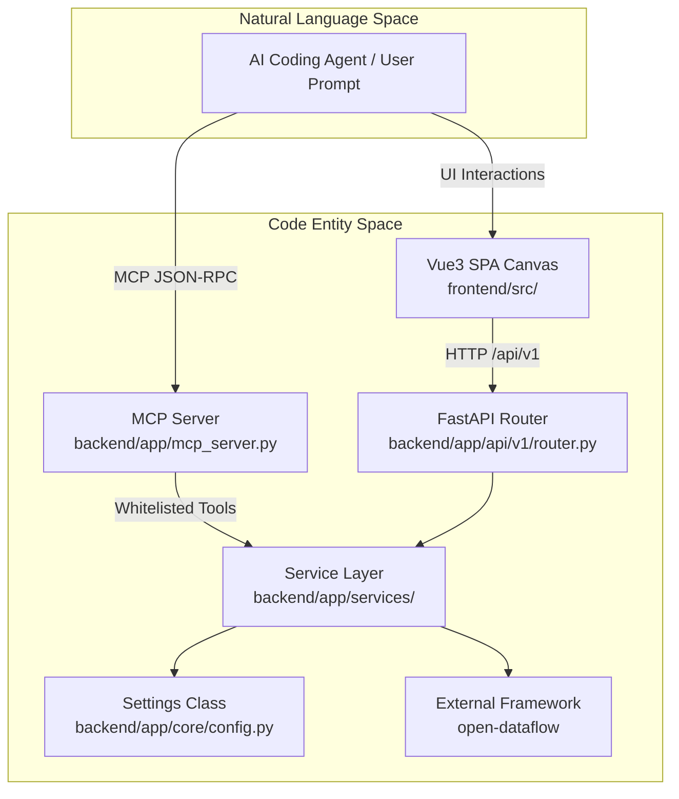
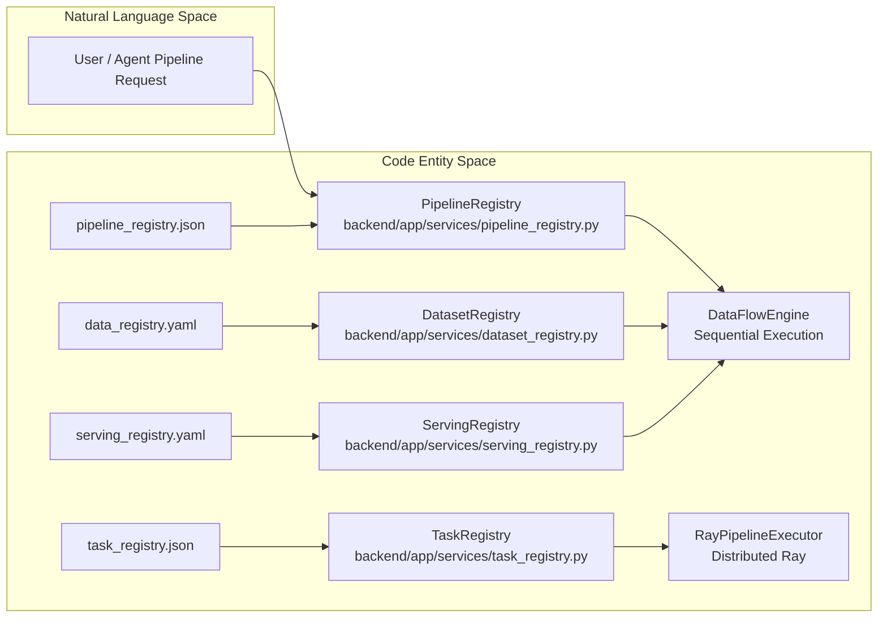

<!-- source: DeepWiki mcp.deepwiki.com · repo OpenDCAI/DataFlow-WebUI · page 1 Overview · fetched 2026-11-02 -->

# Overview

Relevant source files

The following files were used as context for generating this wiki page:

- [README.md](README.md)
- [README_zh.md](README_zh.md)
- [backend/app/api/v1/endpoints/datasets.py](backend/app/api/v1/endpoints/datasets.py)
- [backend/app/main.py](backend/app/main.py)
- [backend/app/schemas/dataset.py](backend/app/schemas/dataset.py)
- [backend/app/services/dataset_registry.py](backend/app/services/dataset_registry.py)
- [docs/architecture/overview.md](docs/architecture/overview.md)

DataFlow-WebUI (also referred to as **DataFlow-Harness**) is a full-stack platform combining a visual WebUI canvas, a Model Context Protocol (MCP) server, and agent-facing skills to build, run, and manage AI/ML data processing pipelines powered by the upstream `open-dataflow` framework [README.md:1-18]().

For detailed technical sub-topics, refer to the child pages:
- **Architecture Overview**: See [Architecture Overview](#1.1) for details on the Vue.js frontend (`frontend/`), FastAPI backend (`backend/app/main.py`), MCP server (`backend/app/mcp_server.py`), and agent skills layer (`skills/canonical/`) [docs/architecture/overview.md:1-25]().
- **Getting Started**: See [Getting Started](#1.2) for installation via `install.sh` profiles, prerequisites, and startup scripts (`scripts/start.sh`) [README.md:65-139]().
- **Configuration**: See [Configuration](#1.3) for the `Settings` class (`backend/app/core/config.py`), environment variables, and registry file paths [docs/architecture/overview.md:52-62]().

Sources: [README.md:1-22](), [backend/app/main.py:1-49](), [docs/architecture/overview.md:1-25]()

## Purpose and Deployment Profiles

The platform ships three independent deployment profiles (`webui`, `harness`, `skills`) defined in `installers/profiles/` to support visual canvas users, headless terminal agents, and pure skill rendering [README.md:19-38]():

| Profile | Description | Components Installed | Server Port |
|---|---|---|---|
| `webui` | Visual DAG canvas + backend + MCP | Python packages (`uv` / pip) + Node.js 20+ frontend (`frontend/dist`) | 8000 (`backend/app/main.py`) |
| `harness` | Backend + MCP, no browser UI | Python packages via `uv`, headless API & MCP server | 8000 (`backend/app/main.py`) |
| `skills` | Agent skills only | No package installation required (Python 3.9+ for skill generation) | None |

Sources: [README.md:26-38](), [backend/app/main.py:17-48]()

## System Architecture

The platform architecture bridges human visual interaction and AI coding agents to execution engines (`open-dataflow`) through a layered FastAPI application structure and MCP protocol handlers [docs/architecture/overview.md:1-24]().

### Component Boundaries and Code Entities

**Figure 1: Bridging Natural Language to Code Entities**

Sources: [backend/app/main.py:1-48](), [docs/architecture/overview.md:1-35]()

### Data Flow and Registry Architecture

**Figure 2: Registry and Execution Architecture**

Sources: [backend/app/services/dataset_registry.py:59-112](), [backend/app/core/config.py:18-31]()

## Summary of Child Pages

- **1.1 Architecture Overview**: Details the communication between Vue.js frontend, FastAPI backend (`backend/app/main.py`), MCP server, and agent skills layer, alongside the `webui`/`harness`/`skills` profile splits [docs/architecture/overview.md:1-25]().
- **1.2 Getting Started**: Covers prerequisites, installation using `install.sh`, environment activation, and `scripts/start.sh` execution [README.md:65-139]().
- **1.3 Configuration**: Explains the `Settings` class (`backend/app/core/config.py`), environment variable overrides, and file-based registry directories [docs/architecture/overview.md:52-62]().

Sources: [README.md:65-148](), [backend/app/main.py:1-49](), [docs/architecture/overview.md:1-62]()

---

