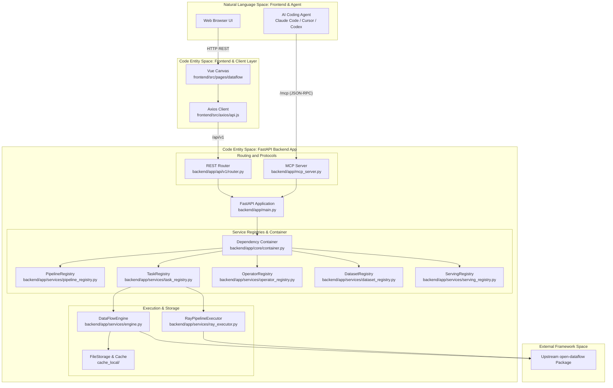
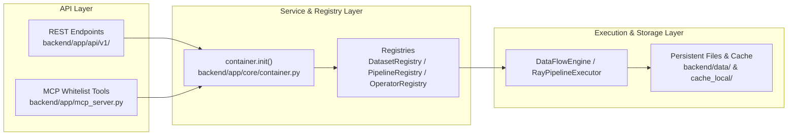
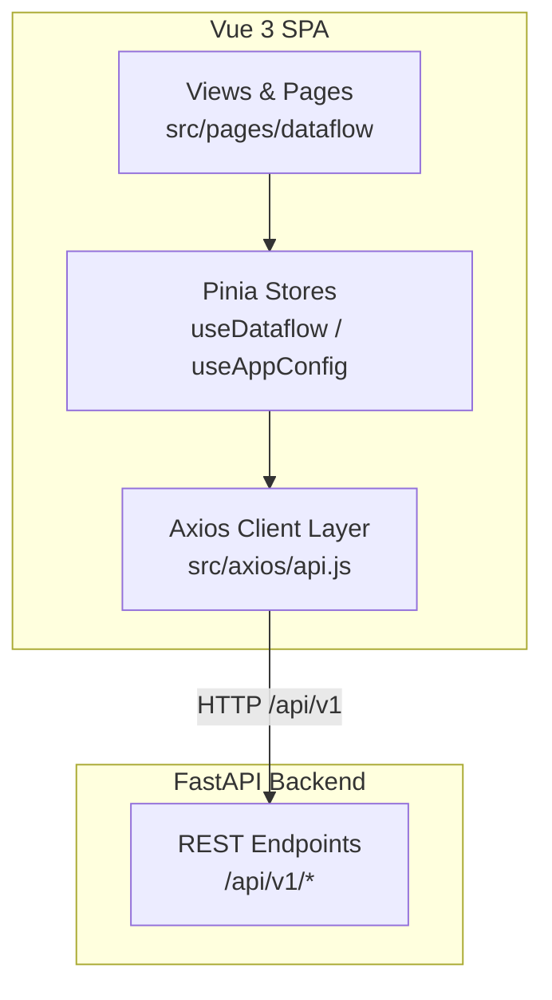

<!-- source: DeepWiki mcp.deepwiki.com · repo OpenDCAI/DataFlow-WebUI · page 1.1 Architecture Overview · fetched 2026-11-02 -->

# Architecture Overview

Relevant source files

The following files were used as context for generating this wiki page:

- [README.md](README.md)
- [README_zh.md](README_zh.md)
- [backend/app/api/v1/endpoints/datasets.py](backend/app/api/v1/endpoints/datasets.py)
- [backend/app/api/v1/endpoints/preferences.py](backend/app/api/v1/endpoints/preferences.py)
- [backend/app/api/v1/router.py](backend/app/api/v1/router.py)
- [backend/app/core/logger_setup.py](backend/app/core/logger_setup.py)
- [backend/app/main.py](backend/app/main.py)
- [backend/app/schemas/dataset.py](backend/app/schemas/dataset.py)
- [backend/app/schemas/preferences.py](backend/app/schemas/preferences.py)
- [backend/app/services/dataset_registry.py](backend/app/services/dataset_registry.py)
- [docs/architecture/overview.md](docs/architecture/overview.md)

## Purpose and Scope

This document provides a comprehensive overview of the DataFlow-Harness and DataFlow-WebUI system architecture, explaining how the frontend (`Vue.js`), backend (`FastAPI`), Model Context Protocol (`MCP`) server, and agent skills layer interact. It details the layered design (API endpoints, service layer, registry/storage layer) and the deployment profile split (`webui`, `harness`, `skills`).

For detailed configuration information, see [Configuration](#1.3). For core concepts like pipelines and operators, see [Core Concepts](#2). For API endpoint specifications, see [API Reference](#5).

Sources: [README.md:1-45](), [docs/architecture/overview.md:1-28]()

---

## Deployment Profiles: WebUI, Harness, and Skills

The codebase ships with three independent installation and runtime profiles. They share the same underlying backend and canonical skill sources but target different operational boundaries:

| Profile | Components Included | Runtime Requirements | Primary Use Case |
|---|---|---|---|
| `webui` | Visual DAG canvas (`frontend/`), FastAPI backend (`backend/`), MCP server (`backend/app/mcp_server.py`) | Python 3.10+, Node.js 20+, `uv` or `pip` | Full-stack visual pipeline authoring in a browser. |
| `harness` | FastAPI backend, MCP server, agent skills layer (no browser UI) | Python 3.10+ | Headless execution, agent-driven automation via terminal or IDE. |
| `skills` | Agent skills layer only (no server, no package installation) | Python 3.9+ (for generating skill files) | Pure agent instruction rendering without running a background server. |

Dependency direction is strictly one-way: `frontend → backend → open-dataflow`. Skills depend on nothing at build time; at runtime, MCP-aware skills interact with the FastAPI backend and its registered tools.

Sources: [README.md:19-36](), [docs/architecture/overview.md:5-28]()

---

## System Overview and Code Entity Mapping

The following diagram bridges the Natural Language Space (system layers) to the Code Entity Space (actual files and classes), illustrating how components communicate across HTTP REST, JSON-RPC (`/mcp`), and local module imports.

Sources: [backend/app/main.py:1-48](), [backend/app/api/v1/router.py:1-28](), [docs/architecture/overview.md:1-24]()

---

## Layered Backend Architecture

The backend follows a **three-tier layered service architecture** running under FastAPI (`backend/app/main.py`):

### 1. API and Protocol Endpoints Layer
- **REST API (`/api/v1`)**: Exposes standardized endpoints for pipelines, tasks, operators, datasets, servings, prompts, preferences, and database managers via `backend/app/api/v1/router.py` [backend/app/api/v1/router.py:1-28](). Responses adhere to the `ApiResponse` envelope schema.
- **MCP Server (`/mcp`)**: Mounted directly onto the FastAPI application before static asset catch-alls [backend/app/main.py:40-41](). It exposes a curated whitelist of JSON-RPC tools (`operation_id` mapped) that allow AI coding agents to inspect the operator catalog, validate pipelines, and commit changes [docs/architecture/overview.md:31-44]().

### 2. Service and Registry Layer
Managed centrally via `backend/app/core/container.py`, the service layer coordinates metadata operations:
- `PipelineRegistry`: Manages pipeline persistence and AST parsing via `PipelineFileAnalyzer`.
- `TaskRegistry`: Tracks execution state, logs, and process results [docs/architecture/overview.md:14]().
- `OperatorRegistry`: Discovers upstream operators and caches metadata (`ops.json`) [backend/main.py:61-68]().
- `DatasetRegistry`: Handles dataset registration, file scanning (`example_data/`), and format previews [backend/app/services/dataset_registry.py:59-112]().
- `ServingRegistry`: Manages LLM and embedding serving instances [docs/architecture/overview.md:14]().

### 3. Execution and Storage Layer
- `DataFlowEngine`: Orchestrates operator parameter decoding, prompt resolution, and sequential stepping.
- `RayPipelineExecutor`: Coordinates distributed or asynchronous task execution.
- **File-based Storage**: Persists state as JSON/YAML files under `backend/data/` and execution steps under `cache_local/` [docs/architecture/overview.md:54-62]().

Sources: [backend/app/main.py:1-48](), [backend/app/api/v1/router.py:1-28](), [backend/app/services/dataset_registry.py:59-112](), [docs/architecture/overview.md:1-50]()

---

## Frontend Application Architecture

The frontend is a Vue.js 3 Single Page Application (SPA) utilizing Vue Flow for visual canvas rendering.

- **Communication Rule**: The frontend talks to the backend exclusively over `/api/v1` via Axios. It never directly accesses Python modules or upstream `open-dataflow` internals [docs/architecture/overview.md:31-33]().
- **State Management**: Pinia stores (`useDataflow`, `useTheme`, `useAppConfig`) maintain reactive UI states, pipeline graph configurations, and user preferences.

Sources: [frontend/src/axios/api.js:1-50](), [docs/architecture/overview.md:31-35]()

---

## Configuration and Storage Ownership

System configuration and data persistence are cleanly separated across distinct ownership boundaries:

| Configuration / Data Category | Location Path | Description |
|---|---|---|
| Install-time settings & ports | `installers/config.sh` | Shell-based installer configuration [docs/architecture/overview.md:56](). |
| Backend runtime paths | `backend/app/core/config.py` | Defines `DATA_REGISTRY`, `TASK_REGISTRY`, `PIPELINE_REGISTRY`, `CACHE_DIR` [docs/architecture/overview.md:57](). |
| Project Agent Configuration | `.mcp.json`, `.cursor/`, `.codex/` | Project-level agent settings generated by `configure-agent` [docs/architecture/overview.md:58](). |
| Runtime Storage Data | `backend/data/`, `cache_local/` | Git-ignored persistent JSON/YAML records and step outputs [docs/architecture/overview.md:61](). |

Sources: [backend/app/core/config.py:1-35](), [docs/architecture/overview.md:52-62]()

---

