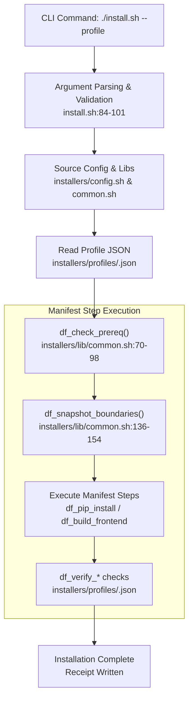
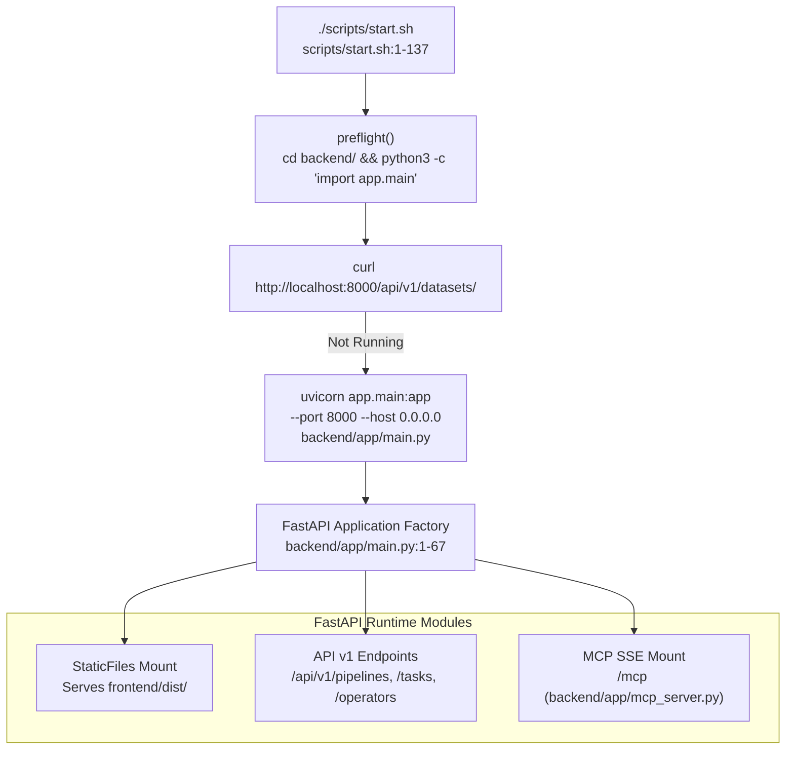

<!-- source: DeepWiki mcp.deepwiki.com · repo OpenDCAI/DataFlow-WebUI · page 1.2 Getting Started · fetched 2026-11-02 -->

# Getting Started

<details>
<summary>Relevant source files</summary>

The following files were used as context for generating this wiki page:

- [backend/README.md](backend/README.md)
- [backend/requirements.txt](backend/requirements.txt)
- [docs/profiles/harness.md](docs/profiles/harness.md)
- [frontend/README.md](frontend/README.md)
- [frontend/docs/README_zh.md](frontend/docs/README_zh.md)
- [frontend/docs/assets/logo.png](frontend/docs/assets/logo.png)
- [install.sh](install.sh)
- [installers/lib/common.sh](installers/lib/common.sh)
- [installers/profiles/harness.json](installers/profiles/harness.json)
- [installers/profiles/webui.json](installers/profiles/webui.json)
- [scripts/start.sh](scripts/start.sh)

</details>


## Purpose and Scope

This document provides technical instructions for installing, configuring, and running DataFlow-WebUI and DataFlow-Harness using the unified installation script (`install.sh`) with profile-based configurations (`harness`, `webui`, and `skills`) [install.sh:1-12] [installers/profiles/harness.json:1-10] [installers/profiles/webui.json:1-14]. It covers prerequisite validation, boundary snapshotting, backend startup via `scripts/start.sh`, frontend development servers, and a walkthrough for executing an initial data processing pipeline.

For system architecture details, see [Architecture Overview](#1.1). For runtime settings and environment variables, see [Configuration](#1.3).

---

## Installation via `install.sh` Profiles

The system uses a profile-driven installation model managed by `install.sh` and JSON manifests located in `installers/profiles/` [install.sh:1-16]. Depending on your requirements, you can install the complete WebUI stack or the backend-only harness.

### Profile Taxonomy

| Profile ID | Description | Installs | Does Not Install |
|------------|-------------|----------|------------------|
| `webui` | Full Visual DAG canvas + backend + MCP + skills | Python packages, open-dataflow, Node.js dependencies, frontend build artifacts (`frontend/dist/`), core data directory | Agent MCP configuration (handled separately via `configure-agent`) [installers/profiles/webui.json:1-18] |
| `harness` | Backend FastAPI + MCP server + validation + skills | Python packages, open-dataflow, core data directory, harness skills | Node.js, npm, frontend dependencies, or frontend build artifacts [installers/profiles/harness.json:1-21] |
| `skills` | Standalone agent skills only | Standalone agent workflow skills | Python packages, FastAPI server, or Node.js dependencies [install.sh:39-43] |

### Installation Execution Flow

The following diagram bridges the natural language installation command to the underlying shell functions and profile manifest JSON definitions in `installers/profiles/`:



**Sources:** [install.sh:1-101](), [installers/lib/common.sh:70-154](), [installers/profiles/harness.json:1-114](), [installers/profiles/webui.json:1-132]()

---

## Prerequisites

Before running the installer, verify that your target environment satisfies the required runtime dependencies:

| Prerequisite | Minimum Version | Verified By Check Command | Purpose |
|--------------|----------------|---------------------------|---------|
| **Python** | 3.10+ | `$DF_PYTHON --version` | Backend runtime & `open-dataflow` execution [installers/profiles/harness.json:25-32] |
| **Node.js** | 20+ | `node -v` | Required only for `webui` profile to build frontend assets [installers/profiles/webui.json:30-34] |
| **npm** | Latest | `npm -v` | Frontend dependency installation [installers/profiles/webui.json:36-39] |
| **uv / pip** | Latest | `uv --version` or `pip --version` | Python package manager (`uv` used by default) [install.sh:91-92] |

To install the harness profile on a machine without Node.js:
```bash
./install.sh --profile harness
```

To install the full webui profile:
```bash
./install.sh --profile webui
```

**Sources:** [backend/README.md:1-29](), [docs/profiles/harness.md:20-33](), [installers/profiles/harness.json:25-32](), [installers/profiles/webui.json:22-40]()

---

## Running Backend and Frontend Servers

### Backend Server Execution (`scripts/start.sh`)

The backend FastAPI server and MCP endpoint are managed via `scripts/start.sh`, which performs pre-flight import checks and manages daemon processes [scripts/start.sh:1-60].

```bash
# Start backend in foreground (Ctrl+C to stop)
./scripts/start.sh

# Start backend as a background daemon (PID written to .backend.pid)
./scripts/start.sh --daemon

# Check status or stop daemon
./scripts/start.sh --status
./scripts/start.sh --stop
```

The pre-flight check in `scripts/start.sh` attempts to import `app.main` using the designated Python interpreter (`$DF_PYTHON`) inside the `backend/` directory [scripts/start.sh:41-52]:

```bash
if ! ( cd "$BACKEND_DIR" && "$DF_PYTHON" -c "import app.main" ) >/dev/null 2>&1; then
  err "Cannot import app.main with '$DF_PYTHON'. Run ./install.sh --profile harness first."
  exit 1
fi
```

### Frontend Development Server

If you are developing frontend components under `frontend/src/`, you can run the Vite development server with hot-reloading:

```bash
cd frontend
npm install
npm run dev
```

The development server proxies API requests to the backend server running on port `8000` as configured in `frontend/vite.config.js` [frontend/README.md:113-136].

### Server Architecture & Startup Flow



**Sources:** [backend/README.md:35-55](), [frontend/README.md:113-158](), [scripts/start.sh:1-136](), [backend/app/main.py:1-69]()

---

## First Pipeline Walkthrough

Once the backend and frontend are running, you can create and execute your first data processing pipeline using either the WebUI canvas or the REST/MCP API.

### Walkthrough Steps

1. **Verify Operator Catalog**: Ensure the operator registry is initialized by querying the operator endpoints:
   ```bash
   curl -sf http://localhost:8000/api/v1/operators/categories
   ```
   *Expect categories such as `core_text`, `general_text`, and `reasoning` [docs/profiles/harness.md:105-116].*

2. **Access the Canvas**: Navigate to `http://localhost:8000/` in your browser [docs/profiles/harness.md:63].
3. **Create Pipeline**: Click **New Pipeline**, select an input dataset from `backend/data/` (or upload via `/api/v1/datasets/upload`), and drag processing operators onto the DAG canvas.
4. **Validate Pipeline**: Trigger static validation via `/api/v1/pipelines/validate`, which executes `PipelineFileAnalyzer` AST parsing and static checks [backend/README.md:3-4].
5. **Execute Task**: Run the pipeline asynchronously. Execution records, log streams, and operator progress are tracked via `TaskRegistry` and written to `backend/cache_local/` [docs/profiles/harness.md:72-74].

**Sources:** [backend/README.md:3-4](), [docs/profiles/harness.md:63-116](), [installers/profiles/webui.json:127-130]()

---

