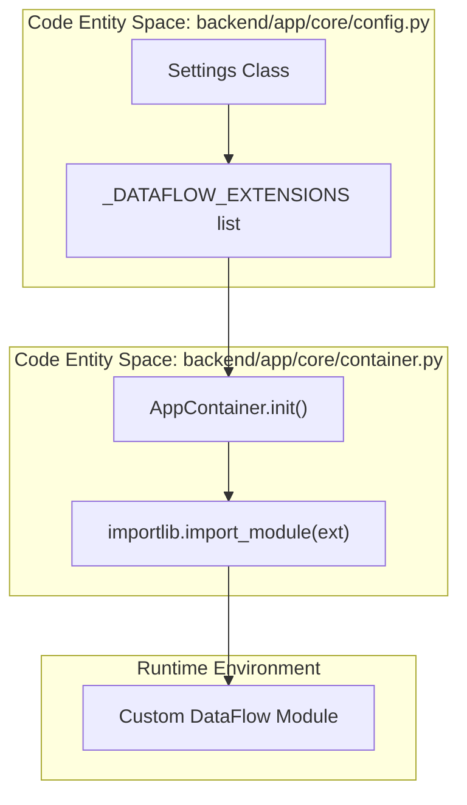
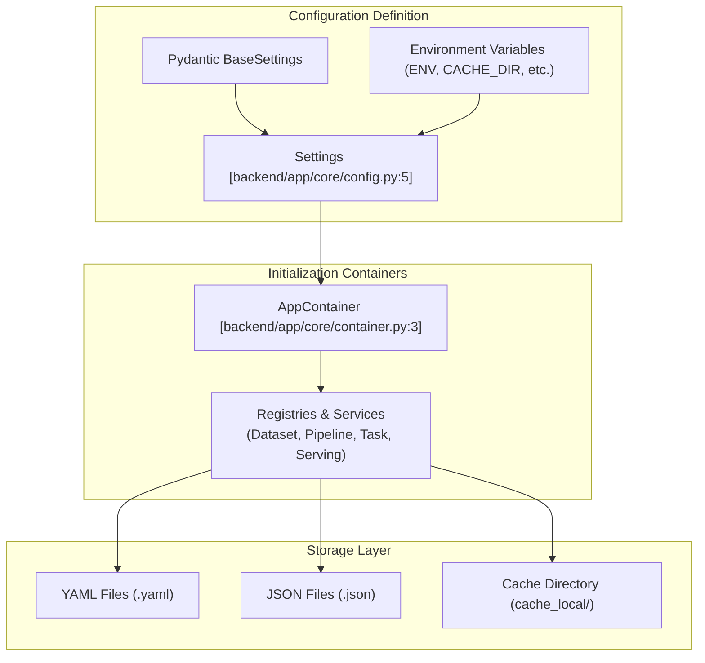
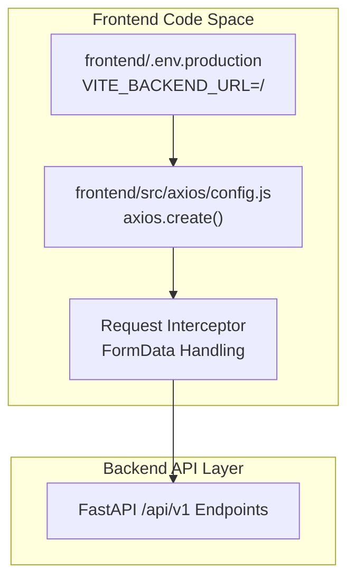

<!-- source: DeepWiki mcp.deepwiki.com · repo OpenDCAI/DataFlow-WebUI · page 1.3 Configuration · fetched 2026-11-02 -->

# Configuration

<details>
<summary>Relevant source files</summary>

The following files were used as context for generating this wiki page:

- [backend/app/api/v1/endpoints/text2sql_database.py](backend/app/api/v1/endpoints/text2sql_database.py)
- [backend/app/core/config.py](backend/app/core/config.py)
- [backend/app/core/container.py](backend/app/core/container.py)
- [backend/app/schemas/text2sql_database.py](backend/app/schemas/text2sql_database.py)
- [backend/app/services/text2sql_database_registry.py](backend/app/services/text2sql_database_registry.py)
- [frontend/.env.production](frontend/.env.production)
- [frontend/src/assets/nav/dbManager.svg](frontend/src/assets/nav/dbManager.svg)
- [frontend/src/axios/config.js](frontend/src/axios/config.js)
- [frontend/src/components/manage/mainFlow/panels/datasetPanel/preview/dataInfo.vue](frontend/src/components/manage/mainFlow/panels/datasetPanel/preview/dataInfo.vue)

</details>


This page explains the configuration system in DataFlow-WebUI, focusing on the `Settings` class (`backend/app/core/config.py`), environment configuration, registry file locations, cache directories, the preset pipeline whitelist, dynamic DataFlow extensions, and frontend Axios and environment configuration.

For information about the overall system architecture and how configuration fits into the broader system, see [Architecture Overview](#1.1). For details on how registries use these configuration paths, see [Pipeline Registry](#3.1), [Dataset Management](#3.5), and [Serving Management](#3.6).

---

## Settings Class

The backend uses a centralized `Settings` class inheriting from Pydantic's `BaseSettings` to manage all operational parameters and file locations [backend/app/core/config.py:5-34](). This class is instantiated as a global singleton `settings` object available across the application [backend/app/core/config.py:58]().

```python
class Settings(BaseSettings):
    ENV: str = "dev"
    CORS_ORIGINS: list[str] = [...]
    BASE_DIR: str = ...
    # Registry paths, cache dirs, whitelists, extensions
```

Sources: [backend/app/core/config.py:5-58]()

---

## Core Configuration Fields

The `Settings` class defines foundational parameters controlling environment behavior and runtime constraints:

| Field | Type | Default | Description |
|-------|------|---------|-------------|
| `ENV` | `str` | `"dev"` | Environment mode (`dev` or `production`) |
| `CORS_ORIGINS` | `list[str]` | `[]` | Allowed Cross-Origin Resource Sharing domains |
| `BASE_DIR` | `str` | Computed | Project root directory computed from `__file__` |
| `DEFAULT_SERVING_FILLING` | `bool` | `True` | Auto-fill missing fields in serving instances |

The project root `BASE_DIR` is derived by traversing three parent directories upward from `backend/app/core/config.py`: [backend/app/core/config.py:19]()

```python
BASE_DIR: str = os.path.dirname(os.path.dirname(os.path.dirname(os.path.abspath(__file__))))
```

Sources: [backend/app/core/config.py:6-33]()

---

## Registry File Paths

The persistence layer relies on explicit file paths mapped in the `Settings` class:

### Registry Configuration Fields

| Field | Path | Format | Purpose |
|-------|------|--------|---------|
| `DATA_REGISTRY` | `data/data_registry.yaml` | YAML | Dataset metadata storage |
| `PIPELINE_REGISTRY` | `data/pipeline_registry.json` | JSON | Pipeline definitions and configurations |
| `TASK_REGISTRY` | `data/task_registry.json` | JSON | Execution records and task status tracking |
| `SERVING_REGISTRY` | `data/serving_registry.yaml` | YAML | LLM and embedding serving configurations |
| `TEXT2SQL_DATABASE_REGISTRY` | `data/text2sql_database_registry.yaml` | YAML | SQLite database registrations for Text2SQL |
| `TEXT2SQL_DATABASE_MANAGER_REGISTRY` | `data/text2sql_database_manager_registry.yaml` | YAML | `DatabaseManager` class parameter setups |

Sources: [backend/app/core/config.py:21-26]()

---

## Directory Paths and Cache Layouts

Transient caches, logs, and compiled assets are mapped to dedicated directories:

| Field | Path | Purpose |
|-------|------|---------|
| `DATAFLOW_CORE_DIR` | `data/dataflow_core` | Core dataflow component storage |
| `OPS_JSON_PATH` | `data/ops.json` | Cached operator metadata catalog |
| `PREFERENCES_PATH` | `data/user_preferences.json` | User preference persistence cache |
| `SQLITE_DB_DIR` | `data/text2sql_dbs` | Storage directory for SQLite database files |
| `CACHE_DIR` | `cache_local` | Intermediate step outputs for pipeline executions |

During pipeline execution under `CACHE_DIR`, subdirectories are created as `{task_id}_output/` containing step files such as `dataflow_cache_step_N.jsonl`.

Sources: [backend/app/core/config.py:27-31]()

---

## Preset Pipeline Whitelist

The `Settings` class maintains a set whitelist (`_PRESET_PIPELINE_NAME_WHITELIST`) that restricts which built-in pipeline templates are exposed in the frontend template list [backend/app/core/config.py:36-52](). Only pipelines matching these names (e.g., `"Agentic Rag Pipeline"`, `"Chemistry Smiles"`, `"Text2Sql Pipeline Gen"`) are surfaced to the user interface canvas selector.

Sources: [backend/app/core/config.py:36-52]()

---

## DataFlow Extensions

The configuration supports plugging in custom pipeline extensions via `_DATAFLOW_EXTENSIONS` [backend/app/core/config.py:53-56](). During container initialization (`AppContainer.init()`), the system iterates through this list and dynamically imports each module using `importlib.import_module(ext)` [backend/app/core/container.py:33-39]().



Sources: [backend/app/core/config.py:53-56](), [backend/app/core/container.py:33-39]()

---

## Configuration Hierarchy and Loading Flow



Sources: [backend/app/core/config.py:5-34](), [backend/app/core/container.py:3-56]()

---

## Frontend Axios and Environment Configuration

The Vue 3 frontend configures HTTP requests via an Axios instance located at `frontend/src/axios/config.js` [frontend/src/axios/config.js:1-39](). 

### Base URL and Proxy Resolution
In development mode, requests are intercepted or proxied via Vite (`baseURL = ''`). In production mode, `ax.defaults.baseURL` falls back to `import.meta.env.VITE_BACKEND_URL` (defaulting to `/` as defined in `frontend/.env.production`) [frontend/src/axios/config.js:8-12](), [frontend/.env.production:1]().

### Request Interceptors
The Axios instance includes a request interceptor that handles `x-www-form-urlencoded` and `multipart/form-data` payloads by translating object configurations into native `FormData` instances [frontend/src/axios/config.js:14-33]().



Sources: [frontend/src/axios/config.js:1-39](), [frontend/.env.production:1]()

---

## Customization and Best Practices

- **Environment Variables**: Pydantic's `BaseSettings` automatically absorbs matching environment variables (e.g., `export CACHE_DIR=/mnt/cache`).
- **Path Construction**: Always construct paths relative to `settings.BASE_DIR` using `os.path.join()` to guarantee cross-platform compatibility.
- **Singleton Import**: Import the pre-instantiated `settings` object directly from `app.core.config` rather than re-instantiating `Settings()`.

Sources: [backend/app/core/config.py:1-58]()

---

