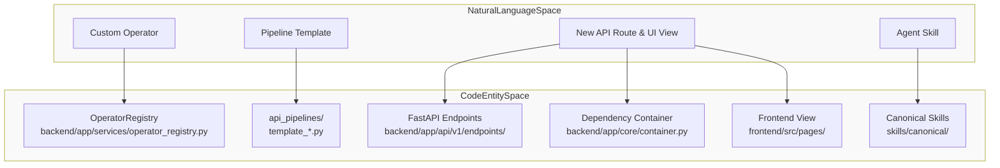
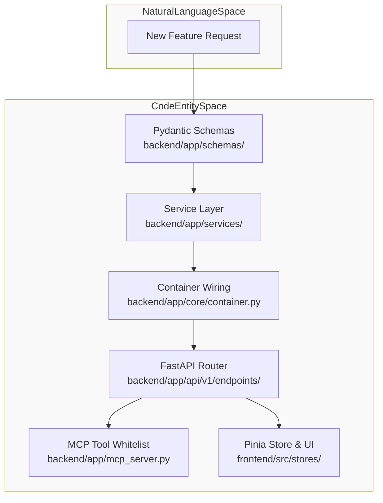

<!-- source: DeepWiki mcp.deepwiki.com · repo OpenDCAI/DataFlow-WebUI · page 10 Development Guide · fetched 2026-11-02 -->

# Development Guide

Relevant source files

The following files were used as context for generating this wiki page:

- [CLAUDE.md](CLAUDE.md)
- [backend/README.md](backend/README.md)
- [docs/profiles/harness.md](docs/profiles/harness.md)

This development guide provides high-level orientation for contributors extending the DataFlow-WebUI platform [backend/README.md:1-4](). As a single-user, local-first system combining a Vue.js canvas UI, a FastAPI backend, an MCP server, and agent skills [CLAUDE.md:3-7](), the codebase is organized around clear architectural layers and explicit registries [backend/README.md:63-77]().

This is a parent page. Detailed instructions for specific development tasks are maintained in the following child pages:
- **Adding New Operators** (#10.1) — Creating custom operators, parameter schemas, `ALLOWED_PROMPTS`, and registry integration.
- **Creating Pipeline Templates** (#10.2) — Authoring reusable pipelines under `api_pipelines/`, preset whitelists, and UI surfacing.
- **Extending the API and Frontend** (#10.3) — Adding FastAPI routers, service container wiring, and frontend views/routes.
- **Authoring Skills** (#10.4) — Editing canonical skills and running asset generation tools to support AI coding agents.

---

## Extension Architecture Overview

The following diagram bridges natural language concepts to the underlying code entities across the backend and frontend extension points:

**Sources:** [backend/README.md:63-77](), [backend/app/core/container.py:1-30]()

---

## 10.1 Adding New Operators

Custom data processing operators extend the underlying `open-dataflow` execution engine [backend/README.md:30-34](). Operators define initialization parameters, execution signatures (`run`), and allowed prompt templates. They are discovered dynamically via introspection and cached for the UI and MCP agents [backend/README.md:3-4]().

For detailed instructions on class structure, init/run parameter schemas, `ALLOWED_PROMPTS`, registration in `OPERATOR_REGISTRY`, dataflow setup extensions, and testing, see [Adding New Operators](#10.1).

**Sources:** [backend/README.md:30-34](), [backend/app/services/operator_registry.py:1-245]()

---

## 10.2 Creating Pipeline Templates

Reusable pipeline templates allow users to quickly instantiate complex data processing graphs [backend/README.md:76](). These templates reside in the `api_pipelines/` directory and are validated against the preset whitelist before surfacing as selectable templates in the canvas UI.

For details on authoring reusable pipeline templates, preset whitelists, file structures, and how templates surface in the UI, see [Creating Pipeline Templates](#10.2).

**Sources:** [backend/README.md:73-77]()

---

## 10.3 Extending the API and Frontend

Adding new capabilities to DataFlow-WebUI typically involves implementing FastAPI routers and services, binding them through the dependency injection container [backend/README.md:73-77](), and exposing corresponding views or panels in the Vue 3 frontend. 

The extension flow connecting natural language requirements to code elements is mapped below:

For detailed guides on adding routers, services, container bindings, Axios client integrations, and frontend views, see [Extending the API and Frontend](#10.3).

**Sources:** [backend/README.md:63-88](), [backend/app/core/container.py:1-30]()

---

## 10.4 Authoring Skills

DataFlow-WebUI supports AI coding agents via an MCP server and canonical skill definitions [backend/README.md:3-4](). Developers can edit canonical markdown source files under the skills tree and regenerate downstream agent assets without modifying generated outputs manually [docs/profiles/harness.md:1-15]().

For details on editing skills/canonical sources, running generation scripts, and passing CI validation checks, see [Authoring Skills](#10.4).

**Sources:** [backend/README.md:3-4](), [docs/profiles/harness.md:1-15]()

---

