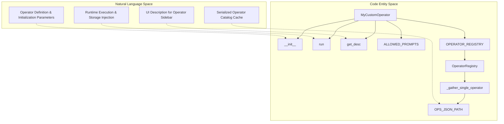
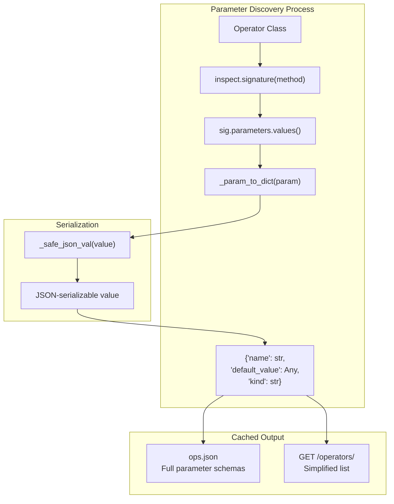
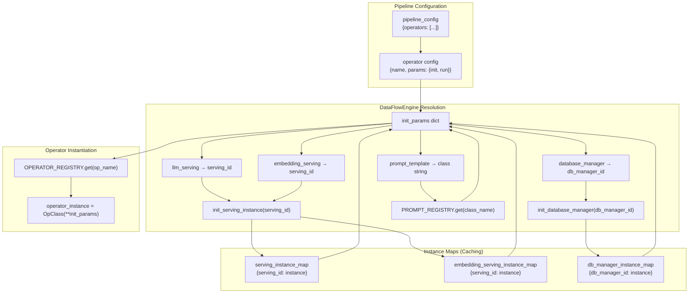
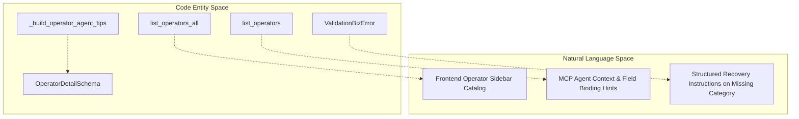
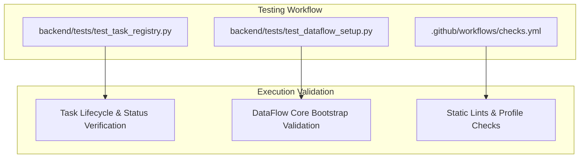

<!-- source: DeepWiki mcp.deepwiki.com · repo OpenDCAI/DataFlow-WebUI · page 10.1 Adding New Operators · fetched 2026-11-02 -->

# Adding New Operators

<details>
<summary>Relevant source files</summary>

The following files were used as context for generating this wiki page:

- [.github/workflows/checks.yml](.github/workflows/checks.yml)
- [backend/app/api/v1/endpoints/operators.py](backend/app/api/v1/endpoints/operators.py)
- [backend/app/core/dataflow_setup.py](backend/app/core/dataflow_setup.py)
- [backend/app/schemas/operator.py](backend/app/schemas/operator.py)
- [backend/app/services/operator_registry.py](backend/app/services/operator_registry.py)
- [backend/requirements-dev.txt](backend/requirements-dev.txt)
- [backend/tests/test_dataflow_setup.py](backend/tests/test_dataflow_setup.py)
- [backend/tests/test_task_registry.py](backend/tests/test_task_registry.py)

</details>


This guide explains how to create custom operators for the DataFlow-WebUI pipeline system. Operators are the fundamental processing units that transform data as it flows through a pipeline. For information about using existing operators in pipelines, see [Creating Pipeline Templates](#10.2). For details on the execution model, see [Execution Model](#2.4).

---

## Overview

Operators in DataFlow-WebUI are Python classes that implement specific data processing logic. The system automatically discovers operators through the `OPERATOR_REGISTRY`, introspects their parameters using Python's `inspect` module, and makes them available in the frontend pipeline editor and through agent-facing REST endpoints.

**Key concepts covered:**
- Operator class structure and required methods
- Parameter definitions (`__init__` vs `run`)
- Special parameter types for dependencies (LLM serving, prompts, database managers)
- Registration, automatic discovery, and schema generation
- Agent tips integration and testing

Sources: [backend/app/services/operator_registry.py:1-245](), [backend/app/services/dataflow_engine.py:1-776](), [backend/app/api/v1/endpoints/operators.py:1-66]()

---

## Operator Class Structure

### Base Requirements

All operators must be registered in `OPERATOR_REGISTRY` located in the `dataflow` core module. The registry uses module-level introspection to discover operators and build metadata caches.


*Diagram 1: Bridging Operator Definition Classes to Registry Code Entities*

Sources: [backend/app/services/operator_registry.py:1-140](), [backend/app/services/dataflow_engine.py:536-546]()

### Required Methods

#### 1. `__init__` Method

The `__init__` method defines **initialization parameters** - dependencies and configuration that remain constant throughout operator execution. These are set once when the operator is instantiated.

**Common initialization parameters:**
- `llm_serving`: LLM serving instance for API calls
- `embedding_serving`: Embedding model serving instance
- `prompt_template`: Prompt template class instance
- `database_manager`: Database manager for Text2SQL operations

```python
def __init__(
    self,
    llm_serving=None,
    prompt_template=None,
    custom_config=None
):
    """
    Initialize operator with dependencies.
    
    Parameters defined here are resolved by DataFlowEngine before execution.
    """
    self.llm_serving = llm_serving
    self.prompt_template = prompt_template
    self.custom_config = custom_config
```

Sources: [backend/app/services/dataflow_engine.py:465-528](), [backend/app/services/operator_registry.py:119-120]()

#### 2. `run` Method

The `run` method defines **execution parameters** - runtime inputs that vary per execution. The first parameter must be `storage`.

**Required parameter:**
- `storage`: FileStorage instance for reading input and writing output

**Optional runtime parameters:**
- `num_proc`: Number of processes for parallel execution
- `batch_size`: Batch size for processing
- `custom_runtime_param`: Any execution-specific configuration

```python
def run(self, storage, num_proc=1, batch_size=10):
    """
    Execute operator logic.
    
    Parameters:
        storage: FileStorage instance (automatically injected)
        num_proc: Runtime configuration parameter
        batch_size: Runtime configuration parameter
    """
    # Read input data
    data = storage.load()
    
    # Process data
    results = self._process_data(data, num_proc, batch_size)
    
    # Write output
    storage.write(results)
```

Sources: [backend/app/services/dataflow_engine.py:573-642](), [backend/app/services/operator_registry.py:120-121]()

#### 3. `get_desc` Method

The `get_desc` method provides a human-readable description for the UI. It should be defined as a `@staticmethod` and support multiple languages.

```python
@staticmethod
def get_desc(lang="zh"):
    """
    Return operator description for UI display.
    
    Parameters:
        lang: Language code ('zh' or 'en')
    
    Returns:
        str or list: Description text or list of description lines
    """
    if lang == "zh":
        return "这是一个自定义算子的描述"
    return "This is a custom operator description"
```

Sources: [backend/app/services/operator_registry.py:61-90](), [backend/app/services/operator_registry.py:176-181]()

### Class Attributes

#### ALLOWED_PROMPTS

The `ALLOWED_PROMPTS` class attribute specifies which prompt template classes can be used with this operator. If not defined, the operator doesn't accept prompts.

```python
from dataflow.prompts import GeneralQuestionFilterPrompt, CustomPrompt

class MyOperator:
    ALLOWED_PROMPTS = [GeneralQuestionFilterPrompt, CustomPrompt]
    
    def __init__(self, prompt_template=None):
        self.prompt_template = prompt_template
```

Sources: [backend/app/services/operator_registry.py:115-116](), [backend/app/services/operator_registry.py:184-185]()

---

## Parameter Introspection and Type System

### How Parameters Are Discovered

The `OperatorRegistry` service uses Python's `inspect` module to automatically extract parameter information from operator methods:



Sources: [backend/app/services/operator_registry.py:35-58](), [backend/app/services/operator_registry.py:202-234]()

### Parameter Extraction Logic

The system converts `inspect.Parameter` objects to JSON-serializable dictionaries:

| Parameter Field | Source | Handling |
|----------------|--------|----------|
| `name` | `Parameter.name` | Directly serialized |
| `default_value` | `Parameter.default` | Converted via `_safe_json_val()` |
| `kind` | `Parameter.kind.name` | String representation (e.g., `"POSITIONAL_OR_KEYWORD"`) |

**Special value handling:**
- `inspect.Parameter.empty` → `null` in JSON
- Callable/type objects → `str(value)`
- Non-serializable objects → `str(value)`

Sources: [backend/app/services/operator_registry.py:19-41]()

---

## Special Parameter Types and Dependency Resolution

### Overview of Dependency Injection

During pipeline execution, the `DataFlowEngine` resolves special parameter types by initializing dependencies and injecting instances into operator constructors:



Sources: [backend/app/services/dataflow_engine.py:438-566]()

### 1. LLM Serving (`llm_serving`)

When an `__init__` parameter is named `llm_serving`, the engine extracts the `serving_id`, retrieves configuration from `ServingRegistry`, sets API keys, instantiates the serving class, and injects the instance.

Sources: [backend/app/services/dataflow_engine.py:474-480](), [backend/app/services/dataflow_engine.py:73-129]()

### 2. Embedding Serving (`embedding_serving`)

Similar to `llm_serving`, but utilizes an embedding-specific instance map for embedding model serving instances.

Sources: [backend/app/services/dataflow_engine.py:482-488]()

### 3. Database Manager (`database_manager`)

For Text2SQL operations, the `database_manager` parameter provides access to SQLite and database manager instances.

Sources: [backend/app/services/dataflow_engine.py:490-501](), [backend/app/services/dataflow_engine.py:144-163]()

### 4. Prompt Template (`prompt_template`)

Prompt templates are resolved by extracting the class name and instantiating from `PROMPT_REGISTRY`.

Sources: [backend/app/services/dataflow_engine.py:503-512](), [backend/app/services/dataflow_engine.py:41-59]()

### 5. Storage (`storage`)

The `storage` parameter in `run()` is injected automatically by the engine at execution time via `storage.step()` before calling operator execution.

Sources: [backend/app/services/dataflow_engine.py:575-576]()

---

## Type Classification and Module Structure

### Operator Type Hierarchy

Operators are classified into a three-level hierarchy based on their module path (`dataflow.operators.<level_1>.<level_2>.<class_name>`).

Sources: [backend/app/services/operator_registry.py:99-113](), [backend/app/services/operator_registry.py:169-174]()

---

## Operator Registration, Discovery, and Agent Tips

### API Endpoints and Agent Guidance Integration

The system exposes operators via multiple API routes defined in `backend/app/api/v1/endpoints/operators.py` and structured via `backend/app/schemas/operator.py`. To assist MCP agents, operator details are enriched with dynamic tips and contextual hints.


*Diagram 2: Bridging Operator API Endpoints and Agent Guidance Metadata*

Sources: [backend/app/api/v1/endpoints/operators.py:32-130](), [backend/app/schemas/operator.py:38-57]()

---

## Complete Operator Example

Here's a complete example showing all components:

```python
from dataflow.prompts import GeneralQuestionFilterPrompt, CustomPrompt
from dataflow.utils.registry import OPERATOR_REGISTRY

class MyCustomOperator:
    """
    Custom operator for processing data with LLM assistance.
    """
    
    # Define allowed prompt templates
    ALLOWED_PROMPTS = [GeneralQuestionFilterPrompt, CustomPrompt]
    
    @staticmethod
    def get_desc(lang="zh"):
        """Provide UI description."""
        if lang == "zh":
            return [
                "自定义算子",
                "使用LLM处理数据",
                "支持批量处理和并行执行"
            ]
        return [
            "Custom Operator",
            "Process data with LLM assistance",
            "Supports batch and parallel processing"
        ]
    
    def __init__(
        self,
        llm_serving=None,
        prompt_template=None,
        max_retries=3
    ):
        """
        Initialize operator with dependencies.
        
        Parameters:
            llm_serving: LLM serving instance (resolved automatically)
            prompt_template: Prompt template class (resolved automatically)
            max_retries: Maximum retry attempts for failed requests
        """
        self.llm_serving = llm_serving
        self.prompt_template = prompt_template
        self.max_retries = max_retries
        
        # Validate dependencies
        if self.llm_serving is None:
            raise ValueError("llm_serving is required")
    
    def run(
        self,
        storage,
        num_proc=1,
        batch_size=10,
        temperature=0.7
    ):
        """
        Execute operator logic.
        
        Parameters:
            storage: FileStorage instance (injected automatically)
            num_proc: Number of parallel processes
            batch_size: Batch size for processing
            temperature: LLM temperature parameter
        """
        # Load input data from previous operator
        input_data = storage.load()
        
        # Process data
        results = []
        for item in input_data:
            # Use prompt template
            if self.prompt_template:
                prompt = self.prompt_template.format(item)
            else:
                prompt = item.get("text", "")
            
            # Call LLM
            response = self.llm_serving.request(
                prompt=prompt,
                temperature=temperature,
                max_retries=self.max_retries
            )
            
            results.append({
                "input": item,
                "output": response
            })
        
        # Write output for next operator
        storage.write(results)
```

Sources: [backend/app/services/operator_registry.py:92-139](), [backend/app/services/dataflow_engine.py:453-566]()

---

## Testing Your Operator

### Local Testing Strategy

Operators can be tested locally using `pytest` suites and backend endpoint assertions.



Sources: [backend/tests/test_task_registry.py:1-60](), [backend/tests/test_dataflow_setup.py:1-50](), [.github/workflows/checks.yml:1-79]()

### Cache File Structure

Operators write output to cache files in JSONL format under `cache_local/{task_id}_output/dataflow_cache_step_{N}.jsonl`.

Sources: [backend/app/services/dataflow_engine.py:416-421](), [backend/app/services/dataflow_engine.py:654-665]()

---

## Best Practices

1. **Parameter Naming Conventions**: Use exact dependency parameter names (`llm_serving`, `embedding_serving`, `database_manager`, `prompt_template`).
2. **Error Handling**: Raise descriptive exceptions caught by `DataFlowEngine` to update task states.
3. **Documentation**: Implement `get_desc()` supporting both Chinese and English languages.
4. **Testing**: Validate schema generation and execution behavior via pytest routines.

Sources: [backend/app/services/operator_registry.py:61-90](), [backend/app/services/dataflow_engine.py:673-689]()

---

