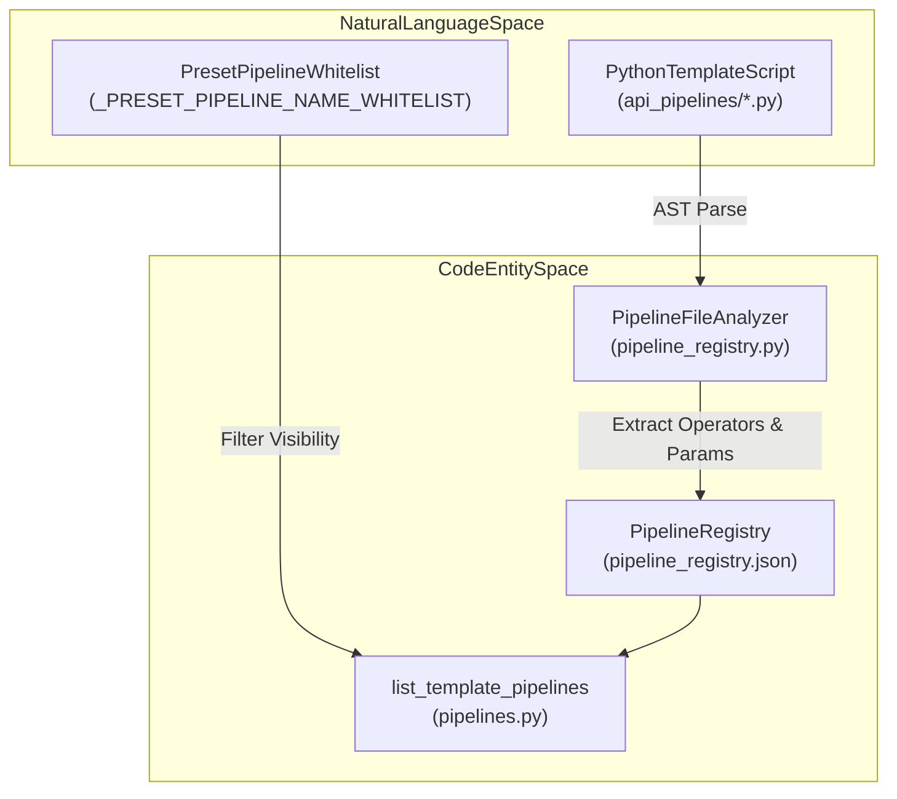
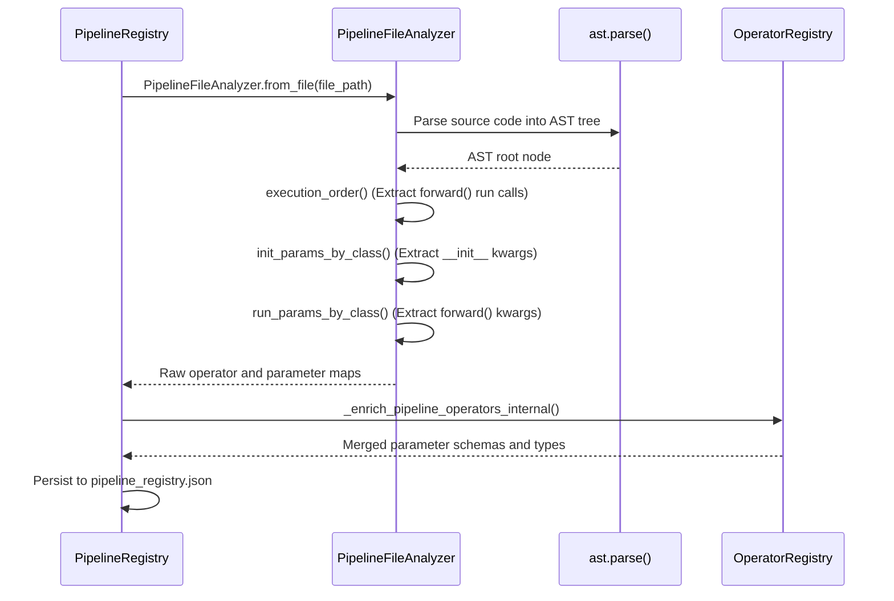
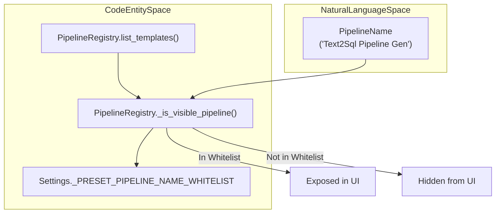

<!-- source: DeepWiki mcp.deepwiki.com · repo OpenDCAI/DataFlow-WebUI · page 10.2 Creating Pipeline Templates · fetched 2026-11-02 -->

# Creating Pipeline Templates

Relevant source files

The following files were used as context for generating this wiki page:

- [backend/app/api/v1/endpoints/pipelines.py](backend/app/api/v1/endpoints/pipelines.py)
- [backend/app/core/config.py](backend/app/core/config.py)
- [backend/app/schemas/pipelines.py](backend/app/schemas/pipelines.py)
- [backend/app/services/pipeline_registry.py](backend/app/services/pipeline_registry.py)
- [flatten_metadata_pipeline.json](flatten_metadata_pipeline.json)

## Purpose and Scope

This document details the architecture and implementation for authoring, discovering, registering, and exposing reusable pipeline templates in DataFlow-Harness and DataFlow-WebUI. Pipeline templates reside as executable Python code within the `api_pipelines/` directory. They are parsed statically via Abstract Syntax Trees (`PipelineFileAnalyzer`), enriched with parameter definitions from `OperatorRegistry`, filtered through the preset whitelist (`_PRESET_PIPELINE_NAME_WHITELIST`), and surfaced via the FastAPI endpoints (`/pipelines/templates`).

For broader pipeline data models, see [Pipelines](#2.1). For operator schemas and parameter mapping, see [Operators](#2.2). For task execution mechanisms, see [Task Registry and Execution](#3.2).

---

## Architecture of Pipeline Templates

Pipeline templates bridge declarative user interfaces with imperative Python code. A template file defines a class containing an `__init__` method (instantiating operators with initialization arguments) and a `forward()` method (orchestrating operator invocation order via `.run()` calls).

The backend automatically scans, parses, and converts these Python scripts into structured JSON configurations stored in `pipeline_registry.json`.

Sources: [backend/app/services/pipeline_registry.py:18-187](), [backend/app/core/config.py:35-52]()

---

## Template File Structure and Conventions

### Location and Naming
All preset pipeline templates are located under the core directory configured by `DATAFLOW_CORE_DIR`, specifically inside the `api_pipelines/` subfolder [backend/app/core/config.py:27](). 

File names must use snake_case naming (e.g., `text2sql_pipeline_gen.py`). The system converts these filenames into human-readable titles by stripping file extensions, replacing underscores with spaces, and applying title-casing (e.g., `Text2Sql Pipeline Gen`).

### Python Class Blueprint
Each template script defines a class containing:
1. **`__init__(self)`**: Instantiates processing operators and binds them to attributes (`self.xxx = OperatorClass(...)`).
2. **`forward(self, storage)`**: Executes the dataflow steps sequentially using `self.xxx.run(storage=storage)` separated by `storage.step()` calls.

Sources: [backend/app/services/pipeline_registry.py:18-91]()

---

## AST Parsing and Discovery Workflow

Instead of executing arbitrary code during discovery, the system uses Python's `ast` module via the `PipelineFileAnalyzer` class to inspect the source code safely.

### Key Analytical Methods
- `PipelineFileAnalyzer.execution_order()`: Scans the `forward` method for `self.xxx.run()` statements, returning an ordered list of operator class names [backend/app/services/pipeline_registry.py:35-47]().
- `PipelineFileAnalyzer.init_params_by_class()`: Extracts keyword arguments passed during operator instantiation inside `__init__` [backend/app/services/pipeline_registry.py:49-61]().
- `PipelineFileAnalyzer.run_params_by_class()`: Extracts keyword arguments passed directly to `.run()` calls inside `forward()` [backend/app/services/pipeline_registry.py:63-90]().

Sources: [backend/app/services/pipeline_registry.py:18-139]()

---

## Preset Whitelist and Visibility Filtering

Not all discovered template files are exposed to the WebUI canvas. The system restricts UI visibility using the `_PRESET_PIPELINE_NAME_WHITELIST` defined in settings.

The whitelist contains explicitly approved production templates, such as `"Agentic Rag Pipeline"`, `"Text2Sql Pipeline Gen"`, and `"Reasoning General Pipeline"` [backend/app/core/config.py:36-52](). Templates missing from this set remain unregistered or hidden from the default template picker.

Sources: [backend/app/core/config.py:35-52](), [backend/app/services/pipeline_registry.py:459-509]()

---

## API Endpoints for Templates

Templates are exposed via the `/pipelines` router endpoints [backend/app/api/v1/endpoints/pipelines.py:19]().

### Listing Templates
- **Route**: `GET /api/v1/pipelines/templates`
- **Handler**: `list_template_pipelines(request: Request)` [backend/app/api/v1/endpoints/pipelines.py:33-42]()
- **Functionality**: Queries `container.pipeline_registry.list_templates()` to return all registered pipelines tagged with `"template"` that pass the whitelist filter [backend/app/services/pipeline_registry.py:459-509]().

### Creating and Validating Custom Templates
- **Route**: `POST /api/v1/pipelines/`
- **Handler**: `create_pipeline(request: Request, payload: PipelineIn)` [backend/app/api/v1/endpoints/pipelines.py:44-62]()
- **Route**: `POST /api/v1/pipelines/validate`
- **Handler**: `validate_pipeline_config(payload: PipelineConfig)` [backend/app/api/v1/endpoints/pipelines.py:64-80]() — performs static field flow and serving reference checks [backend/app/schemas/pipelines.py:121-142]().

Sources: [backend/app/api/v1/endpoints/pipelines.py:33-80](), [backend/app/schemas/pipelines.py:70-142]()

---

