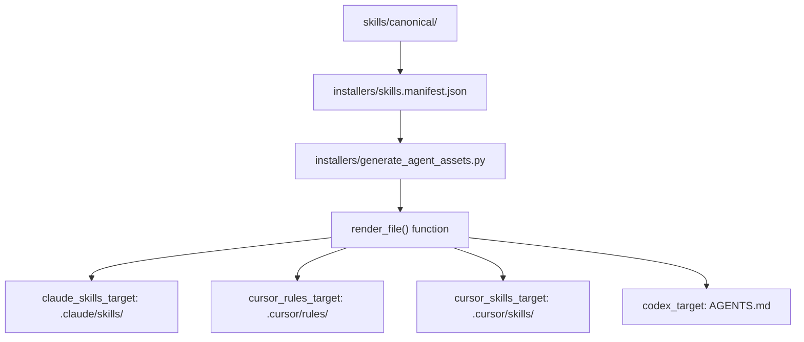
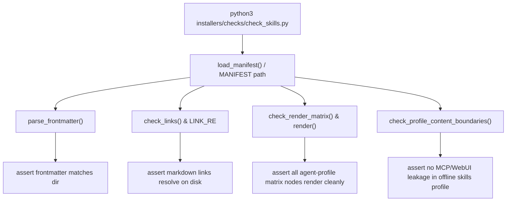

<!-- source: DeepWiki mcp.deepwiki.com · repo OpenDCAI/DataFlow-WebUI · page 10.4 Authoring Skills · fetched 2026-11-02 -->

# Authoring Skills

<details>
<summary>Relevant source files</summary>

The following files were used as context for generating this wiki page:

- [CLAUDE.md](CLAUDE.md)
- [docs/architecture/adr-001-source-of-truth.md](docs/architecture/adr-001-source-of-truth.md)
- [docs/migration/from-dataflow-skills.md](docs/migration/from-dataflow-skills.md)
- [docs/profiles/skills.md](docs/profiles/skills.md)
- [installers/checks/check_skills.py](installers/checks/check_skills.py)
- [installers/generate_agent_assets.py](installers/generate_agent_assets.py)
- [skills/canonical/dataflow-dev/SKILL.md](skills/canonical/dataflow-dev/SKILL.md)
- [skills/canonical/generating-dataflow-pipeline/SKILL.md](skills/canonical/generating-dataflow-pipeline/SKILL.md)

</details>


## Purpose and Scope

This page details the technical workflow for authoring, maintaining, and validating agent skills in DataFlow-WebUI. In accordance with architecture decision records (`[docs/architecture/adr-001-source-of-truth.md:1-130]()`), all agent skill instructions are maintained in a single hand-edited canonical location (`skills/canonical/`) and programmatically rendered into target-specific assets for Claude Code, Cursor, and Codex. Developers must never edit generated assets directly; changes must occur in canonical sources followed by execution of asset generation and validation scripts.

Sources: `[docs/architecture/adr-001-source-of-truth.md:1-130]()`, `[docs/profiles/skills.md:1-132]()`

---

## Canonical Architecture and Source of Truth

The DataFlow-WebUI repository enforces a strict single-source-of-truth policy for agent skills (`[docs/architecture/adr-001-source-of-truth.md:48-64]()`). Hand-edited markdown files, templates, and reference materials reside exclusively under `skills/canonical/`. 

The canonical directory structure contains:
- `generating-dataflow-pipeline/`: Core pipeline planning and code generation skill.
- `dataflow-dev/`: Developer assistant skill for operators, prompts, and diagnostics.
- `dataflow-operator-builder/`: Scaffolding skill for new operators.
- `prompt-template-builder/`: Reusable prompt template creation skill.
- `core_text/`: Vendored API reference documents providing operator signatures and parameters.

Natural language instructions are bridged to code entity generation through template manifests and rendering tools.

Diagram: Canonical Skill Expansion to Code Assets

Sources: `[docs/architecture/adr-001-source-of-truth.md:48-64]()`, `[installers/generate_agent_assets.py:1-50]()`

---

## Asset Generation Workflow

Agent assets are generated from canonical files via `[installers/generate_agent_assets.py]()`. The script loads the manifest defined in `installers/skills.manifest.json`, parses markdown files for conditional variables, injects generation banners, and outputs target-specific directory trees.

### Execution Commands

- **Regenerate Assets:**
  ```bash
  python3 installers/generate_agent_assets.py
  ```
- **CI Drift Check:**
  ```bash
  python3 installers/generate_agent_assets.py --check
  ```
  This command regenerates assets into a temporary directory and compares them against disk contents, exiting with code `1` if a generated file was manually modified (`[installers/generate_agent_assets.py:16-18]`).

### Render Implementation

Files ending with `.md` are processed through `[installers/lib/render.py]()` (imported by `[installers/generate_agent_assets.py:31]()`), which evaluates conditional directives based on active profiles (`webui`, `harness`, or `skills`) and MCP availability flags (`[installers/generate_agent_assets.py:85-88]()`). Non-markdown assets (such as template `.py` or `.json` files) are copied verbatim (`[installers/generate_agent_assets.py:36-62]()`).

For `SKILL.md` files, a strict banner is prepended immediately below the YAML frontmatter to warn developers against direct edits (`[installers/generate_agent_assets.py:40-82]()`):
```markdown
<!-- GENERATED FILE — DO NOT EDIT.
     Source: skills/canonical/...
     Regenerate: python3 installers/generate_agent_assets.py -->
```

Sources: `[installers/generate_agent_assets.py:1-108]`, `[docs/architecture/adr-001-source-of-truth.md:125-130]()`

---

## Conditional Templating and Profile Contexts

Canonical markdown files support inline conditional blocks to accommodate differences across deployment profiles without maintaining duplicate files (`[docs/architecture/adr-001-source-of-truth.md:66-78]`). 

### Supported Context Variables
- `profile`: Set to `webui`, `harness`, or `skills` (`[installers/generate_agent_assets.py:87]()`).
- `mcp`: Set to `yes` when `profile` is `webui` or `harness`, and `no` for the `skills` profile (`[installers/generate_agent_assets.py:87]()`).

### Example Conditional Directives
```markdown
<!-- @if mcp==yes -->
Call `validate_pipeline_config` before create/update.
<!-- @else -->
Use local `inspect.signature` to verify operator contracts.
<!-- @endif -->
```
This ensures that offline execution profiles (like `skills`) omit MCP tool instructions (`[skills/canonical/dataflow-dev/SKILL.md:45-49]()`, `[skills/canonical/generating-dataflow-pipeline/SKILL.md:65-68]()`).

Sources: `[installers/generate_agent_assets.py:85-88]()`, `[skills/canonical/dataflow-dev/SKILL.md:45-49]()`, `[skills/canonical/generating-dataflow-pipeline/SKILL.md:65-68]()`

---

## CI Validation and `check_skills.py`

Before committing changes, skill authors must run the validation suite to satisfy CI requirements (`[installers/checks/check_skills.py:1-176]()`).

### Validation Suite Checks

1. **Manifest and Disk Agreement**: Ensures every manifest entry corresponds to a canonical directory and vice versa (`[installers/checks/check_skills.py:4-8]()`).
2. **Frontmatter Validation**: Parses YAML frontmatter in every `SKILL.md` file using `parse_frontmatter()` to guarantee valid structure and matching `name` fields (`[installers/checks/check_skills.py:8-9]`, `[installers/checks/check_skills.py:48-68]()`).
3. **Relative Link and Path Resolution**: `check_links()` scans markdown link targets (`[text](target)`) and inline code paths (`CODE_PATH_RE`) to ensure referenced files exist on disk, catching broken references such as missing sibling directories (`[installers/checks/check_skills.py:10-12]`, `[installers/checks/check_skills.py:71-112]()`).
4. **Render Matrix Verification**: `check_render_matrix()` iterates over every agent and profile combination, executing `render()` to catch syntax or directive balancing errors (`[installers/checks/check_skills.py:14-16]`, `[installers/checks/check_skills.py:114-132]()`).
5. **Content Boundary Enforcement**: `check_profile_content_boundaries()` verifies that the standalone `skills` profile does not leak MCP, WebUI, or server-dependent terminology into offline packages (`[installers/checks/check_skills.py:134-176]()`).

Diagram: CI Validation Flow and Code Entity Association

Sources: `[installers/checks/check_skills.py:1-176]()`

---

## Authoring Checklist

When creating or editing skills, developers must follow this workflow:

1. Locate or create the source file within `skills/canonical/<skill-id>/SKILL.md`.
2. Apply edits using conditional directives (`<!-- @if ... -->`) if behavior differs between online (`webui`, `harness`) and offline (`skills`) profiles.
3. Run asset generation:
   ```bash
   python3 installers/generate_agent_assets.py
   ```
4. Run validation checks:
   ```bash
   python3 installers/generate_agent_assets.py --check
   python3 installers/checks/check_skills.py
   ```
5. Stage both the canonical changes and the newly generated target assets in Git.

Sources: `[docs/architecture/adr-001-source-of-truth.md:125-130]()`, `[installers/generate_agent_assets.py:11-18]()`, `[installers/checks/check_skills.py:1-20]()`

---

