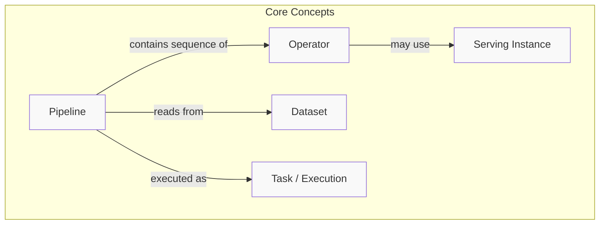

<!-- source: DeepWiki mcp.deepwiki.com · repo OpenDCAI/DataFlow-WebUI · page 2 Core Concepts · fetched 2026-11-02 -->

# Core Concepts

Relevant source files

The following files were used as context for generating this wiki page:

- [backend/app/api/v1/endpoints/operators.py](backend/app/api/v1/endpoints/operators.py)
- [backend/app/api/v1/endpoints/pipelines.py](backend/app/api/v1/endpoints/pipelines.py)
- [backend/app/schemas/operator.py](backend/app/schemas/operator.py)
- [backend/app/schemas/pipelines.py](backend/app/schemas/pipelines.py)
- [backend/app/services/operator_registry.py](backend/app/services/operator_registry.py)
- [backend/app/services/pipeline_registry.py](backend/app/services/pipeline_registry.py)

This page defines the fundamental concepts and terminology used throughout DataFlow-WebUI: pipelines, operators, datasets, servings, prompts, and the execution model. As a parent overview, this page outlines how these entities interact, while detailed technical specifications are documented in the respective child pages.

The platform coordinates several core entities to build, validate, and execute data processing workflows.

**Diagram: Core Concept Relationships**

Sources: [backend/app/schemas/pipelines.py:37-67]()

---

## 2.1. Pipelines

A **Pipeline** defines an ordered sequence of processing steps (`operators`) operating on an input dataset (`input_dataset`). Pipelines can be authored interactively through the web UI canvas, saved via REST endpoints, or loaded as preset templates from backend code definitions via AST parsing.

Static validation checks field flow compatibility, dataset schema alignment, and serving references before execution. For pipeline structure, templates, DAG semantics, and lifecycle management from creation through validation to execution, see [Pipelines](#2.1).

Sources: [backend/app/schemas/pipelines.py:55-67](), [backend/app/services/pipeline_registry.py:17-47]()

---

## 2.2. Operators

**Operators** represent discrete processing units that transform input data fields. They are organized in a multi-level taxonomy (`level_1` and `level_2`) and expose parameter schemas for initialization (`init`) and execution (`run`) derived via Python introspection.

Operators also declare allowed prompt templates and category guidance for AI agents. For operator types, schemas, discovery via `OPERATOR_REGISTRY`, and agent tips, see [Operators](#2.2).

Sources: [backend/app/services/operator_registry.py:108-139](), [backend/app/schemas/operator.py:38-57]()

---

## 2.3. Datasets

**Datasets** serve as the initial input sources for pipeline runs. The platform supports various data storage formats (JSON, JSONL, Parquet, CSV, and media assets), parsing metadata, scanning example directories, and extracting column headers for runtime validation.

For supported formats, metadata handling, scanning of example data, and column previews, see [Datasets](#2.3).

Sources: [backend/app/schemas/pipelines.py:50-54]()

---

## 2.4. Execution Model

The **Execution Model** manages task scheduling, tracking states (`queued`, `running`, `completed`, `failed`, `cancelled`), and coordinating synchronous execution or distributed workers (via Ray). 

It monitors operator-level execution progress and manages intermediate result caching in local storage directories. For execution lifecycles, task states, progress tracking, and result caching, see [Execution Model](#2.4).

Sources: [backend/app/schemas/pipelines.py:28-34](), [backend/app/schemas/pipelines.py:109-119]()

---

