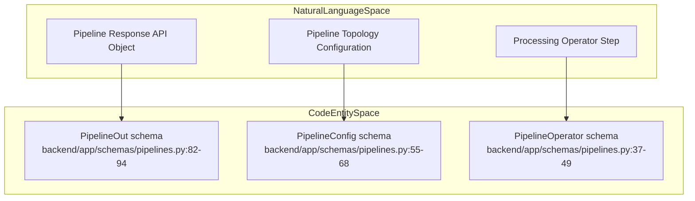

<!-- source: DeepWiki mcp.deepwiki.com · repo OpenDCAI/DataFlow-WebUI · page 2.1 Pipelines · fetched 2026-11-02 -->

# Pipelines

<details>
<summary>Relevant source files</summary>

The following files were used as context for generating this wiki page:

- [backend/app/api/v1/endpoints/pipelines.py](backend/app/api/v1/endpoints/pipelines.py)
- [backend/app/schemas/pipelines.py](backend/app/schemas/pipelines.py)
- [backend/app/services/pipeline_registry.py](backend/app/services/pipeline_registry.py)
- [backend/tests/test_pipeline_registry.py](backend/tests/test_pipeline_registry.py)
- [frontend/src/components/manage/mainFlow/panels/piplinePanel.vue](frontend/src/components/manage/mainFlow/panels/piplinePanel.vue)
- [frontend/src/js/i18n.js](frontend/src/js/i18n.js)
- [frontend/src/views/client/home/index.vue](frontend/src/views/client/home/index.vue)

</details>


This wiki page covers the technical architecture, data structures, templates, DAG semantics, and complete lifecycle of pipelines within the DataFlow-WebUI platform. A pipeline represents the fundamental unit of work orchestrating dataset inputs and sequential operator execution.

---

## 1. Overview and Scope

A pipeline in DataFlow-WebUI encapsulates an end-to-end data processing workflow consisting of an input data source, an ordered sequence of processing operators, and execution metadata. Pipelines are managed centrally through `PipelineRegistry` and persisted as JSON documents [`backend/app/services/pipeline_registry.py:1-15`](). They can originate either as pre-built template pipelines discovered from Python source files or as user-defined custom workflows created via the frontend canvas [`backend/app/api/v1/endpoints/pipelines.py:21-43`]().

Sources: `[backend/app/services/pipeline_registry.py:1-15]`, `[backend/app/api/v1/endpoints/pipelines.py:21-43]`

---

## 2. Pipeline Data Structure and Schemas

The data model for pipelines spans several Pydantic schemas defining the wrapper container, configuration state, operator sequence, and static validation results [`backend/app/schemas/pipelines.py:1-143`]().

### Core Schema (`PipelineOut`)
The complete pipeline object returned by API endpoints includes identifiers, human-readable names, nested configurations, tags, timestamps, and execution status [`backend/app/schemas/pipelines.py:82-94`]().

### Pipeline Configuration (`PipelineConfig`)
The configuration object houses the execution topology [`backend/app/schemas/pipelines.py:55-68`]`:
- `file_path`: String path pointing to source Python files for templates, or empty for user-created pipelines.
- `input_dataset`: Union of a dataset identifier string (`str`) or an explicit configuration object (`PipelineInputDataset`).
- `operators`: Ordered list of `PipelineOperator` instances determining execution sequence.

### Operator Structure (`PipelineOperator`)
Each operator entry specifies its class name from the operator registry, enriched parameter dictionaries for initialization and execution phases, and 2D canvas coordinates (`location`) [`backend/app/schemas/pipelines.py:37-49`]().

### Diagram: Natural Language Space to Code Entity Space (Pipeline Data Model)



Sources: `[backend/app/schemas/pipelines.py:37-94]`

---

## 3. Pipeline Types: Templates and User Pipelines

### Template Pipelines
Template pipelines are automatically discovered from Python files located in `dataflow_core/api_pipelines/`. They are marked with tags `["api", "template"]` and maintain a valid `file_path` reference [`backend/app/services/pipeline_registry.py:257-347`](). Only templates matching names in the system whitelist are exposed in the user interface [`backend/app/services/pipeline_registry.py:459-497`]().

### User-Created Pipelines
User pipelines are authored dynamically via the frontend canvas component (`piplinePanel.vue`) and submitted to `POST /pipelines` [`frontend/src/components/manage/mainFlow/panels/piplinePanel.vue:108-125`](). They contain empty `file_path` strings and arbitrary user-configured operator arrangements [`backend/app/schemas/pipelines.py:55-68`]().

Sources: `[backend/app/services/pipeline_registry.py:257-347]`, `[backend/app/services/pipeline_registry.py:459-497]`, `[backend/app/schemas/pipelines.py:55-68]`, `[frontend/src/components/manage/mainFlow/panels/piplinePanel.vue:108-125]`

---

## 4. Pipeline Lifecycle and Execution Flow

The pipeline lifecycle transitions from file discovery or creation through static validation to execution and teardown [`backend/app/services/pipeline_registry.py:257-347`]().

### Diagram: Natural Language Space to Code Entity Space (Lifecycle Execution)

```mermaid
graph LR
    subgraph "NaturalLanguageSpace"
        CreateRequest[""Create Pipeline Request""]
        StaticCheck[""Static Validation Check""]
        ExecutionTrigger[""Trigger Async Execution""]
    end

    subgraph "CodeEntitySpace"
        CreateRoute[""create_pipeline()<br/>backend/app/api/v1/endpoints/pipelines.py:44-61""]
        ValidateRoute[""validate_pipeline_config()<br/>backend/app/api/v1/endpoints/pipelines.py:70-80""]
        RegistryMethods[""PipelineRegistry persistence<br/>backend/app/services/pipeline_registry.py""]
    end

    CreateRequest --> CreateRoute
    CreateRoute --> RegistryMethods
    StaticCheck --> ValidateRoute
```

Sources: `[backend/app/api/v1/endpoints/pipelines.py:44-80]`, `[backend/app/services/pipeline_registry.py:1-15]`

---

## 5. DAG Semantics and Static Validation

Pipelines enforce directed acyclic graph (DAG) semantics implicitly through an ordered list of operators in `PipelineConfig` (`operators`) [`backend/app/schemas/pipelines.py:55-68`](). 

The `POST /pipelines/validate` endpoint triggers `validate_pipeline_config()` to evaluate schema integrity, dataset existence, field flow progression across sequential operators, prompt template bindings, and LLM serving references [`backend/app/api/v1/endpoints/pipelines.py:70-80`](). Validation returns a `PipelineValidationResult` containing structured `PipelineValidationIssue` elements categorized into errors and warnings, complete with repair hints [`backend/app/schemas/pipelines.py:121-143`]().

Sources: `[backend/app/schemas/pipelines.py:55-68]`, `[backend/app/schemas/pipelines.py:121-143]`, `[backend/app/api/v1/endpoints/pipelines.py:70-80]`

---

## 6. AST Parsing and File Analysis

Template pipelines are parsed statically using the `PipelineFileAnalyzer` class [`backend/app/services/pipeline_registry.py:18-23`](). 

The analyzer parses Python abstract syntax trees (AST) to extract:
1. **Execution Order**: Extracted from `forward()` method calls matching `self.xxx.run()` [`backend/app/services/pipeline_registry.py:35-47`]().
2. **Initialization Parameters**: Extracted from `__init__()` keyword arguments assigned to class attributes [`backend/app/services/pipeline_registry.py:49-61`]().
3. **Runtime Parameters**: Extracted from keyword arguments passed during `.run()` method invocations [`backend/app/services/pipeline_registry.py:63-91`]().

Sources: `[backend/app/services/pipeline_registry.py:18-91]`

---

## 7. API Reference Summary

The FastAPI router for pipelines is mounted under `/pipelines` and provides standard CRUD operations and validation helpers [`backend/app/api/v1/endpoints/pipelines.py:19-119`]().

| Endpoint | Method | Function Name | Description |
|---|---|---|---|
| `/pipelines/` | GET | `list_pipelines` | Returns all registered pipelines [`backend/app/api/v1/endpoints/pipelines.py:21-31`] |
| `/pipelines/templates` | GET | `list_template_pipelines` | Returns pre-built template pipelines [`backend/app/api/v1/endpoints/pipelines.py:33-43`] |
| `/pipelines/` | POST | `create_pipeline` | Creates a new pipeline configuration [`backend/app/api/v1/endpoints/pipelines.py:44-62`] |
| `/pipelines/validate` | POST | `validate_pipeline_config` | Performs static DAG and field validation [`backend/app/api/v1/endpoints/pipelines.py:64-80`] |
| `/pipelines/{pipeline_id}` | GET | `get_pipeline` | Fetches a single pipeline by UUID [`backend/app/api/v1/endpoints/pipelines.py:81-86`] |
| `/pipelines/{pipeline_id}` | PUT | `update_pipeline` | Updates an existing pipeline definition [`backend/app/api/v1/endpoints/pipelines.py:88-106`] |
| `/pipelines/{pipeline_id}` | DELETE | `delete_pipeline` | Deletes a pipeline from registry storage [`backend/app/api/v1/endpoints/pipelines.py:107-119`] |

Sources: `[backend/app/api/v1/endpoints/pipelines.py:19-119]`

---

