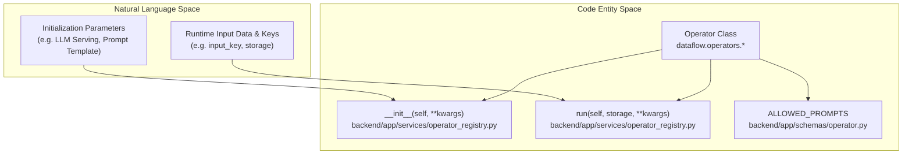
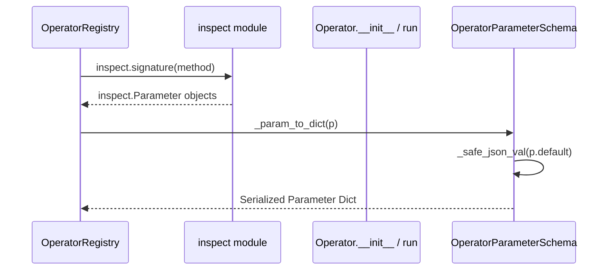
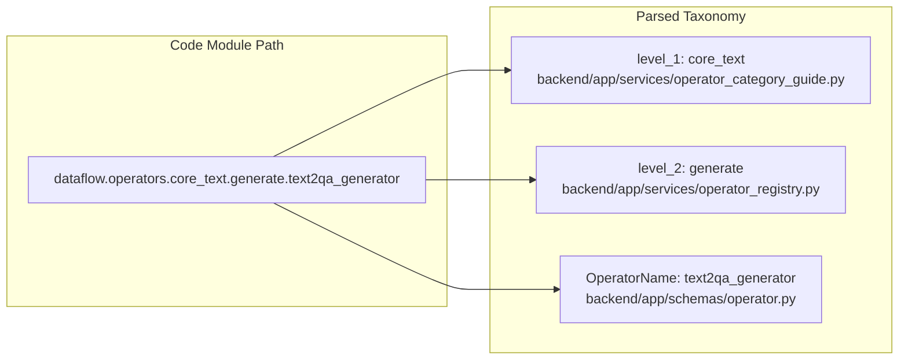
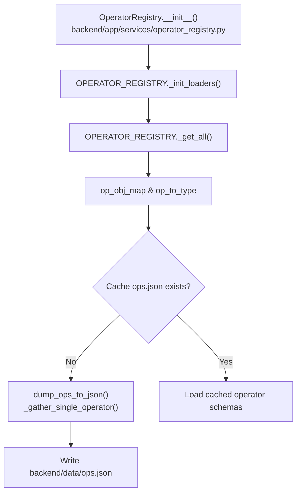
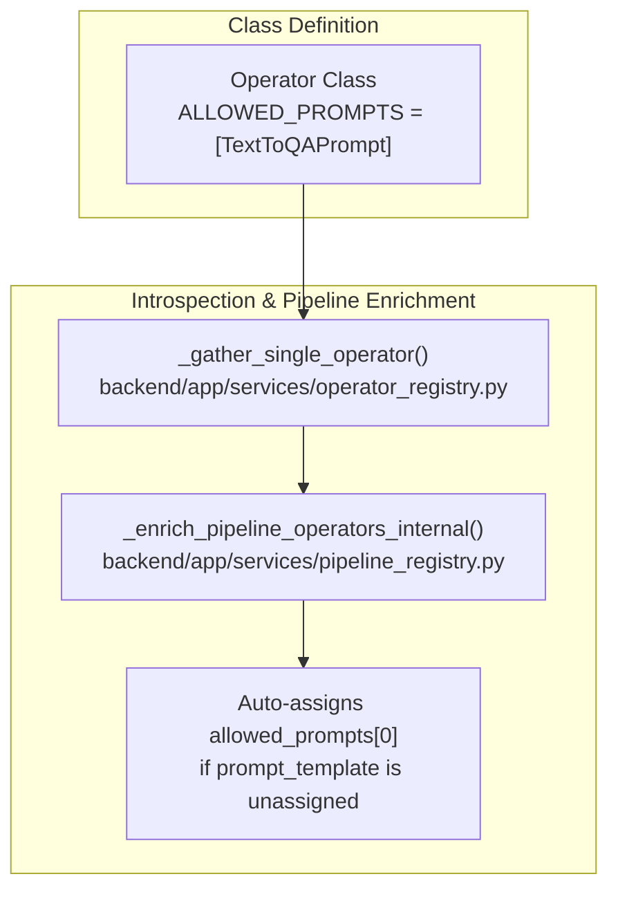
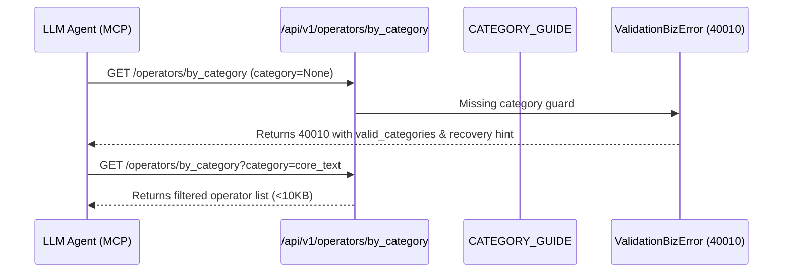

<!-- source: DeepWiki mcp.deepwiki.com · repo OpenDCAI/DataFlow-WebUI · page 2.2 Operators · fetched 2026-11-02 -->

# Operators

Relevant source files

The following files were used as context for generating this wiki page:

- [backend/app/api/v1/endpoints/agent.py](backend/app/api/v1/endpoints/agent.py)
- [backend/app/api/v1/endpoints/operators.py](backend/app/api/v1/endpoints/operators.py)
- [backend/app/mcp_server.py](backend/app/mcp_server.py)
- [backend/app/schemas/operator.py](backend/app/schemas/operator.py)
- [backend/app/services/agent_session.py](backend/app/services/agent_session.py)
- [backend/app/services/operator_category_guide.py](backend/app/services/operator_category_guide.py)
- [backend/app/services/operator_registry.py](backend/app/services/operator_registry.py)

## Purpose and Scope

This page covers the technical design and implementation of **Operators** in the DataFlow-WebUI / DataFlow-Harness platform. Operators represent the atomic execution steps within a data processing pipeline. Each operator is encapsulated as a self-contained Python class within the underlying `dataflow` engine packages, exposing explicit initialization (`__init__`) and execution (`run`) parameter signatures, prompt restrictions (`ALLOWED_PROMPTS`), and hierarchical category metadata.

This document details:
- The operator class structure and method signatures (`__init__`, `run`, static description helpers).
- The three-level taxonomy (`level_1` and `level_2` categories).
- Parameter introspection, schema generation, and JSON caching via `OperatorRegistry`.
- Prompt template restrictions and automatic pipeline enrichment.
- Category guidance mechanics (`CATEGORY_GUIDE`) and agent-facing endpoint validations.

---

## Operator Structure and Parameter Schemas

Operators are implemented as Python classes that inherit or conform to standard execution contracts. Every operator exposes two primary parameter phases: construction-time initialization parameters and execution-time runtime parameters.

**Sources:** `[backend/app/services/operator_registry.py:119-121]`, `[backend/app/schemas/operator.py:18-36]`

### Init and Run Parameters

- **Init Parameters (`__init__`)**: Configured when the operator is instantiated in a pipeline definition. These parameters remain static throughout execution and are stored in the pipeline configuration JSON. Common examples include `prompt_template`, `llm_serving`, `embedding_serving`, and `database_manager`.
- **Run Parameters (`run`)**: Evaluated dynamically when the operator processes records via `FileStorage`. Examples include `input_key`, `input_keys`, `output_key`, and `output_meta_key`.

**Sources:** `[backend/app/services/operator_registry.py:35-58]`, `[backend/app/schemas/operator.py:18-36]`

---

## Taxonomy and Hierarchy

Operators are organized in a multi-level taxonomy derived directly from their module import paths (`dataflow.operators.<level_1>.<level_2>.<operator_name>`).

| Taxonomy Level | Description | Code Representation / Example |
| :--- | :--- | :--- |
| `level_1` | Top-level semantic category | `core_text`, `general_text`, `text_sft`, `reasoning`, `code`, `knowledge_cleaning` |
| `level_2` | Functional subcategory | `generate`, `filter`, `transform`, `evaluator` |
| Concrete Name | Python class name | `Text2QAGenerator`, `CharNumberFilter`, `PandasOperator` |

**Sources:** `[backend/app/services/operator_registry.py:92-114]`, `[backend/app/services/operator_category_guide.py:15-34]`

---

## Discovery and Registration via OPERATOR_REGISTRY

The backend discovers and catalogs operators through `OperatorRegistry`, which interfaces with `OPERATOR_REGISTRY` and `PROMPT_REGISTRY` imported from the core `dataflow` package.

**Sources:** `[backend/app/services/operator_registry.py:144-162]`, `[backend/app/services/operator_registry.py:202-234]`

---

## Prompt Restrictions and ALLOWED_PROMPTS

Many generation operators restrict permissible prompt templates using the `ALLOWED_PROMPTS` class attribute. During operator schema generation, these class references are introspected and converted to string names.

**Sources:** `[backend/app/services/operator_registry.py:115-116]`, `[backend/app/services/pipeline_registry.py:813-816]`

---

## Category Guidance for Agents and MCP Integration

To prevent context window overflow when LLM coding agents interact with the catalog via the Model Context Protocol (`MCP`), operator retrieval is strictly category-scoped.

**Sources:** `[backend/app/api/v1/endpoints/operators.py:108-153]`, `[backend/app/services/operator_category_guide.py:15-34]`

The authoritative `CATEGORY_GUIDE` (`[backend/app/services/operator_category_guide.py:15-178]()`) governs agent behavior by defining `use_for`, `not_for`, and representative `examples` for each `level_1` category. Endpoints such as `list_operators` enforce category parameter validation, raising a `ValidationBizError` (`[backend/app/api/v1/endpoints/operators.py:135-153]()`) if an agent attempts to pull the full ~145-operator catalog without scope parameters.

---

---

