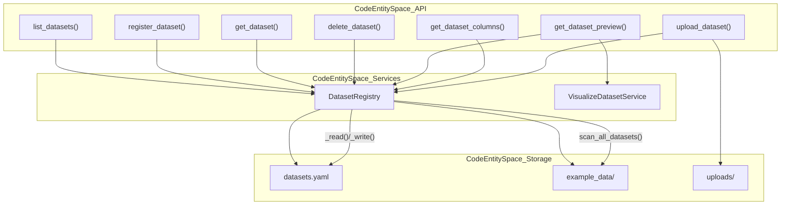

<!-- source: DeepWiki mcp.deepwiki.com · repo OpenDCAI/DataFlow-WebUI · page 2.3 Datasets · fetched 2026-11-02 -->

# Datasets

<details>
<summary>Relevant source files</summary>

The following files were used as context for generating this wiki page:

- [README-release-en.md](README-release-en.md)
- [README-release-zh.md](README-release-zh.md)
- [backend/app/api/v1/endpoints/datasets.py](backend/app/api/v1/endpoints/datasets.py)
- [backend/app/main.py](backend/app/main.py)
- [backend/app/schemas/dataset.py](backend/app/schemas/dataset.py)
- [backend/app/services/dataset_registry.py](backend/app/services/dataset_registry.py)
- [backend/tests/test_dataset_registry.py](backend/tests/test_dataset_registry.py)
- [backend/tests/test_text2sql_database_api.py](backend/tests/test_text2sql_database_api.py)
- [docs/RELEASE-PACKAGE.md](docs/RELEASE-PACKAGE.md)

</details>


## Purpose and Scope

This document explains datasets as input data sources in DataFlow-WebUI. It covers dataset metadata structure, supported file formats, registration mechanisms, automatic discovery, and visualization capabilities. For information about how datasets are used within pipeline execution, see [Execution Model](#2.4). For API-level details about dataset endpoints, see [Dataset Endpoints](#5.4). For implementation details of the dataset service layer, see [Dataset Management](#3.5).

Sources: [backend/app/services/dataset_registry.py:59-316]()

## What is a Dataset?

A dataset represents an input data source that pipelines process. Datasets are files on the filesystem that have been registered in the system through the `DatasetRegistry` class (`backend/app/services/dataset_registry.py`). Each dataset has:

- A unique identifier (MD5 hash of file path)
- Metadata (name, pipeline association, file type, file size, sample count)
- A physical file location (`root` path)
- File integrity tracking via content hash

Datasets serve as the entry point for pipeline execution. When a pipeline runs, it loads data from the specified dataset through the `FileStorage` abstraction.

Sources: [backend/app/services/dataset_registry.py:59-316]()

## Dataset Metadata Structure

Each dataset record contains the following fields defined in `DatasetIn` and `DatasetOut` schemas (`backend/app/schemas/dataset.py`):

| Field | Type | Description |
|-------|------|-------------|
| `id` | string | MD5 hash (first 10 chars) of the file path, used as unique identifier |
| `name` | string | Human-readable dataset name |
| `root` | string | Absolute file path to the dataset file |
| `pipeline` | string | Pipeline name this dataset is associated with (e.g., "uploaded", "text2sql") |
| `type` | string | File extension (e.g., "json", "jsonl", "csv", "parquet") |
| `hash` | string | MD5 hash of file contents for integrity verification |
| `file_size` | integer | File size in bytes |
| `num_samples` | integer | Number of entries/rows in the dataset |
| `added_at` | string | ISO timestamp of when the dataset was registered |
| `meta` | object | Additional metadata (extensible) |

The `id` is computed deterministically from the file path, ensuring that re-registering the same file path updates the existing record rather than creating a duplicate.

Sources: [backend/app/schemas/dataset.py:1-18](), [backend/app/services/dataset_registry.py:171-196]()

## Dataset Registry Architecture

The following diagram bridges the natural language conceptual space to the code entity space, illustrating how FastAPI endpoint functions in `backend/app/api/v1/endpoints/datasets.py` interact with backend service classes like `DatasetRegistry` and `VisualizeDatasetService` in `backend/app/services/dataset_registry.py`.



Sources: [backend/app/api/v1/endpoints/datasets.py:1-162](), [backend/app/services/dataset_registry.py:59-316]()

## Supported File Formats

DataFlow-WebUI supports multiple file formats for datasets, categorized by their capabilities:

### Pandas-Compatible Formats (Full Preview Support)

| Format | Extension | Read Function | Preview | Columns | Visualization |
|--------|-----------|---------------|---------|---------|---------------|
| CSV | `.csv` | `pd.read_csv` | ✓ | ✓ | ✓ |
| JSON | `.json` | `pd.read_json` | ✓ | ✓ | ✓ |
| JSONL | `.jsonl` | `pd.read_json(lines=True)` | ✓ | ✓ | ✓ |
| Parquet | `.parquet` | `pd.read_parquet` | ✓ | ✓ | ✓ |
| Excel | `.xlsx`, `.xls` | `pd.read_excel` | ✓ | ✓ | ✓ |
| Pickle | `.pkl`, `.pickle` | `pd.read_pickle` | ✗ | ✗ | ✓ |

### File-Type Formats (Direct Download)

| Format | Extension | Media Type | Use Case |
|--------|-----------|------------|----------|
| Text | `.txt` | `text/plain` | Plain text documents |
| Markdown | `.md` | `text/markdown` | Formatted documentation |
| JPEG | `.jpg`, `.jpeg` | `image/jpeg` | Image datasets |
| PNG | `.png` | `image/png` | Image datasets |
| PDF | `.pdf` | `application/pdf` | Document datasets |
| Word | `.doc`, `.docx` | `application/msword` | Document datasets |
| PowerPoint | `.ppt`, `.pptx` | `application/vnd.ms-powerpoint` | Presentation datasets |

The `VisualizeDatasetService` (`backend/app/services/dataset_registry.py`) maps file extensions to appropriate handlers in `pandas_read_func_map` and `media_type_map`.

Sources: [backend/app/services/dataset_registry.py:8-56]()

## Dataset Registration

Datasets can be registered through three mechanisms:

### 1. Manual Registration

Users can register a dataset by providing a `DatasetIn` payload (`backend/app/schemas/dataset.py`) with the file path via the `/` POST endpoint (`backend/app/api/v1/endpoints/datasets.py`).

The registration process:
1. Computes `id` from MD5 hash of `root` path [backend/app/services/dataset_registry.py:174]()
2. Verifies file exists and computes content hash [backend/app/services/dataset_registry.py:177]()
3. Calculates `file_size` using `os.path.getsize()` [backend/app/services/dataset_registry.py:180]()
4. Counts entries using `_count_file_entries()` [backend/app/services/dataset_registry.py:183]()
5. Extracts file type from extension [backend/app/services/dataset_registry.py:188]()
6. Stores timestamp [backend/app/services/dataset_registry.py:189]()
7. Writes to `datasets.yaml` [backend/app/services/dataset_registry.py:195]()

Sources: [backend/app/api/v1/endpoints/datasets.py:18-24](), [backend/app/services/dataset_registry.py:171-196]()

### 2. Automatic Scanning

The `DatasetRegistry.scan_all_datasets()` method automatically scans the `example_data/` directory on initialization:


The scanner:
- Walks through `DATAFLOW_CORE_DIR/example_data/` directory [backend/app/services/dataset_registry.py:73]()
- Iterates through each pipeline subdirectory [backend/app/services/dataset_registry.py:80-83]()
- Discovers all files recursively using `os.walk()` [backend/app/services/dataset_registry.py:86-88]()
- Creates dataset records with naming pattern `{pipeline_name}-{filename}` [backend/app/services/dataset_registry.py:90-95]()
- Registers each discovered file via `add_or_update()` [backend/app/services/dataset_registry.py:99]()
- Logs statistics for each pipeline [backend/app/services/dataset_registry.py:108-111]()

Sources: [backend/app/services/dataset_registry.py:66-112]()

### 3. File Upload

Users can upload files through the `upload_dataset` endpoint (`backend/app/api/v1/endpoints/datasets.py`), which:
1. Creates an `uploads/` directory under the data directory [backend/app/api/v1/endpoints/datasets.py:140-142]()
2. Saves the uploaded file [backend/app/api/v1/endpoints/datasets.py:145-147]()
3. Registers the dataset with `pipeline: "uploaded"` [backend/app/api/v1/endpoints/datasets.py:150-157]()

Sources: [backend/app/api/v1/endpoints/datasets.py:127-162]()

## Entry Counting Strategy

The `DatasetRegistry._count_file_entries()` method determines the number of samples in a dataset based on file type:

| File Type | Counting Strategy |
|-----------|-------------------|
| CSV, JSONL, TXT, LOG | Line count (`sum(1 for _ in f)`) |
| JSON | Length of list if array, key count if object, 1 if primitive |
| Other formats | Default to 1 entry |

Sources: [backend/app/services/dataset_registry.py:129-155]()

## Dataset Preview and Column Extraction

### Preview Mechanism

The `DatasetRegistry.preview()` method provides sample data for supported formats (JSON, JSONL, Parquet):

- **JSONL**: Reads line-by-line, parsing each as JSON [backend/app/services/dataset_registry.py:236-241]()
- **JSON**: Loads full file, slices if list [backend/app/services/dataset_registry.py:242-251]()
- **Parquet**: Uses `pd.read_parquet(nrows=num_lines)` [backend/app/services/dataset_registry.py:252-256]()

Sources: [backend/app/services/dataset_registry.py:211-261]()

### Column Extraction

The `DatasetRegistry.get_columns()` method extracts field names for structured formats:
- **JSONL**: Reads first line, extracts keys from parsed object [backend/app/services/dataset_registry.py:286-294]()
- **JSON**: Extracts keys from first list element or top-level object [backend/app/services/dataset_registry.py:295-306]()
- **Parquet**: Uses `pd.read_parquet(nrows=1)` and `df.columns` [backend/app/services/dataset_registry.py:307-311]()

Sources: [backend/app/services/dataset_registry.py:263-316]()

## Dataset Visualization Service

The `VisualizeDatasetService` class (`backend/app/services/dataset_registry.py`) provides two visualization paths:

1. **Pandas Visualization**: `VisualizeDatasetService.get_pandas_read_function()` validates file existence, selects the correct reader from `pandas_read_func_map`, reads the requested slice, and converts it to JSON (`orient="records"`) [backend/app/services/dataset_registry.py:32-45]().
2. **File-Type Visualization**: `VisualizeDatasetService.get_other_visualization_data()` maps non-tabular formats to media types for direct serving via `FileResponse` [backend/app/services/dataset_registry.py:50-56](), [backend/app/api/v1/endpoints/datasets.py:74-88]().

Sources: [backend/app/services/dataset_registry.py:8-56](), [backend/app/api/v1/endpoints/datasets.py:74-88]()

## Dataset Storage and Persistence

The `DatasetRegistry` uses YAML for human-readable, version-controllable storage:
- **File Location**: Configured via `settings.DATA_REGISTRY` [backend/app/services/dataset_registry.py:61]()
- **Initialization**: `_ensure()` creates file with empty structure if missing [backend/app/services/dataset_registry.py:115-119]()
- **Operations**: `_read()` and `_write()` handle serialization using `yaml.safe_load()` and `yaml.safe_dump()` [backend/app/services/dataset_registry.py:121-127]()

Sources: [backend/app/services/dataset_registry.py:61-127]()

## Dataset Lifecycle

```stateDiagram-v2
    [*] --> Discovered: scan_all_datasets()
    [*] --> Uploaded: upload_dataset()
    [*] --> Registered: register_dataset()
    
    Discovered --> InRegistry: add_or_update()
    Uploaded --> InRegistry
    Registered --> InRegistry
    
    state InRegistry {
        [*] --> Available
        Available --> Previewed: get_dataset_preview()
        Previewed --> Available
        Available --> Columns: get_dataset_columns()
        Columns --> Available
    }
    
    InRegistry --> UsedByPipeline: Pipeline references ds_id
    InRegistry --> Deleted: delete_dataset()
    Deleted --> [*]
```

Sources: [backend/app/services/dataset_registry.py:59-316](), [backend/app/api/v1/endpoints/datasets.py:1-162]()

## Integration with Pipeline Execution

Datasets connect to pipeline execution through the `input_dataset` field in pipeline configurations. When a pipeline executes, the `DataFlowEngine` resolves the dataset metadata from `DatasetRegistry`, initializes a `FileStorage` instance with the dataset's `root` path, and passes data to operators.

Sources: [backend/app/services/dataset_registry.py:59-316]()

---

