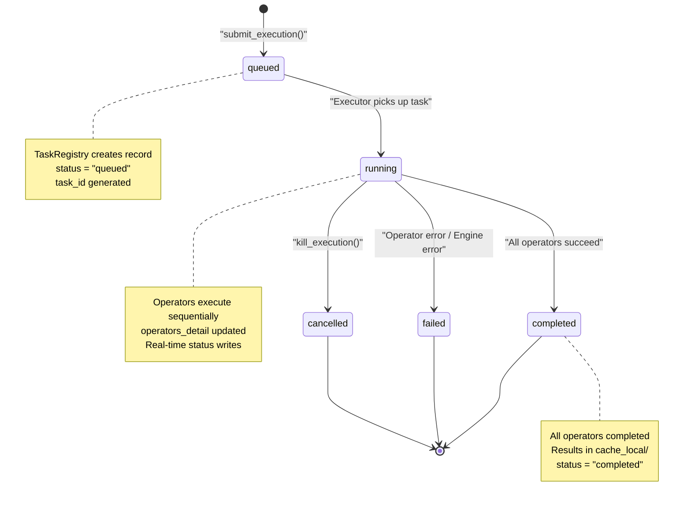
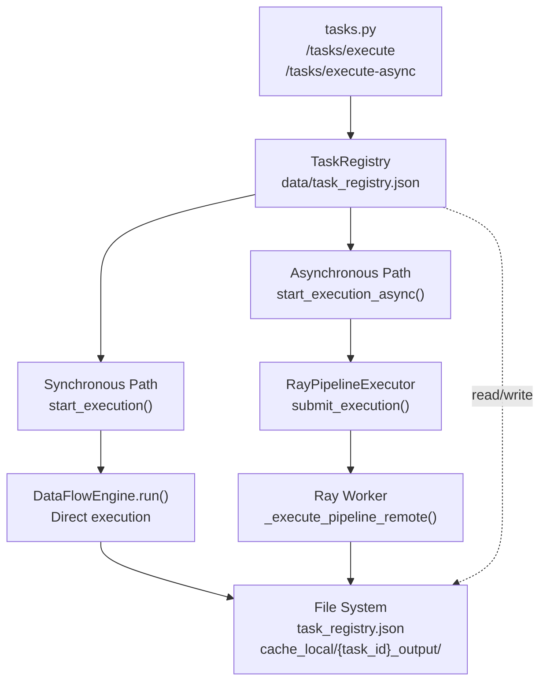
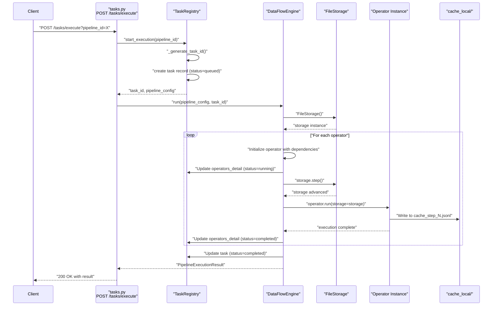
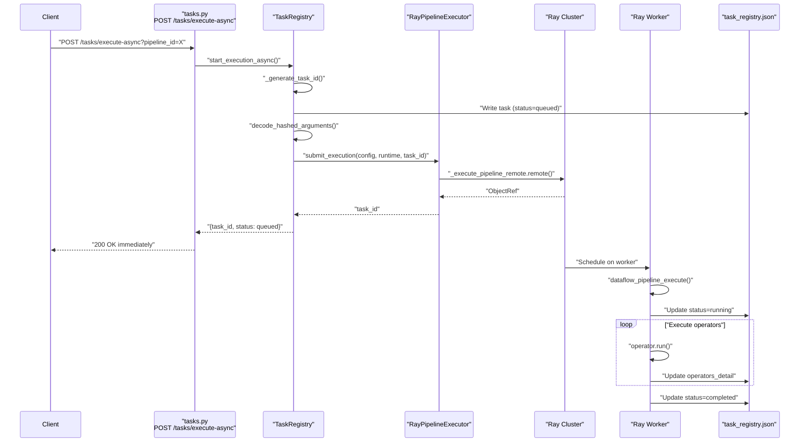

<!-- source: DeepWiki mcp.deepwiki.com · repo OpenDCAI/DataFlow-WebUI · page 2.4 Execution Model · fetched 2026-11-02 -->

# Execution Model

<details>
<summary>Relevant source files</summary>

The following files were used as context for generating this wiki page:

- [backend/app/api/v1/endpoints/tasks.py](backend/app/api/v1/endpoints/tasks.py)
- [backend/app/services/dataflow_engine.py](backend/app/services/dataflow_engine.py)
- [backend/app/services/param_coercion.py](backend/app/services/param_coercion.py)
- [backend/app/services/ray_pipeline_executor.py](backend/app/services/ray_pipeline_executor.py)
- [backend/app/services/task_registry.py](backend/app/services/task_registry.py)

</details>


This document explains how pipelines are executed in DataFlow-WebUI, covering the complete execution lifecycle from submission through completion. It describes the synchronous and asynchronous execution modes, the state machine governing execution status, and how results are tracked and retrieved. For information about pipeline structure and configuration, see [Pipelines](#2.1). For details on operator behavior, see [Operators](#2.2).

---

## Execution Lifecycle Overview

Pipeline execution follows a well-defined lifecycle managed by `TaskRegistry` [backend/app/services/task_registry.py:14-205]() and executed by either `DataFlowEngine` [backend/app/services/dataflow_engine.py:176-773]() (synchronous) or `RayPipelineExecutor` [backend/app/services/ray_pipeline_executor.py]() (asynchronous). The system tracks execution at both the pipeline level and the individual operator level, providing real-time status updates through a polling mechanism.

**State Transition Diagram**



Sources: [backend/app/services/task_registry.py:81-109](), [backend/app/services/task_registry.py:140-146]()

---

## Execution States

The system defines primary execution states managed across the backend services:

| State | Description | Transitions From | Transitions To |
|-------|-------------|------------------|----------------|
| `queued` | Task created, waiting to execute | Initial state | `running`, `cancelled` |
| `running` | Actively executing operators | `queued` | `completed`, `failed`, `cancelled` |
| `completed` | Successfully finished all operators | `running` | Terminal state |
| `failed` | Error during initialization or execution | `running` | Terminal state |
| `cancelled` | User terminated execution | `queued`, `running` | Terminal state |

Each execution task maintains status at two levels:

1. **Pipeline-level status**: The overall state of the entire execution managed by `TaskRegistry` [backend/app/services/task_registry.py:14-205]().
2. **Operator-level status**: Individual status for each operator stored in `operators_detail` [backend/app/services/ray_pipeline_executor.py:181-182]().

### Operator-Level Status

Each operator in the `operators_detail` dictionary tracks its own lifecycle:

```python
operators_detail[op_key] = {
    "name": str,           # Operator class name
    "index": int,          # Position in execution sequence
    "status": str,         # initializing/initialized/running/completed/failed/cancelled
    "started_at": str,     # ISO timestamp when operator starts
    "completed_at": str,   # ISO timestamp when operator finishes
    "sample_count": int,   # Number of samples processed
    "progress": str,       # Progress bar text (if available)
    "progress_percentage": float,  # Numeric progress (0-100)
    "error": str           # Error message if status=failed
}
```

Sources: [backend/app/services/ray_pipeline_executor.py:181-182](), [backend/app/services/task_registry.py:115-151]()

---

## Task Registry Coordination

The `TaskRegistry` [backend/app/services/task_registry.py:14-205]() serves as the central coordinator for all pipeline executions, persisting state to `task_registry.json`. It provides the interface between the API layer [backend/app/api/v1/endpoints/tasks.py:1-200]() and the execution engines.

**Task Registry Architecture**



Sources: [backend/app/services/task_registry.py:14-205](), [backend/app/api/v1/endpoints/tasks.py:1-200]()

### Task Record Structure

Each task stored in `task_registry.json` contains runtime states, execution outputs, and log mappings:

```json
{
  "tasks": {
    "abc123def456": {
      "task_id": "abc123def456",
      "pipeline_id": "my_pipeline",
      "pipeline_config": { /* full config snapshot */ },
      "status": "running",
      "output": {
        "operators_detail": { /* operator statuses */ },
        "operator_logs": { /* logs per operator */ },
        "execution_results": [ /* per-operator results */ ]
      },
      "logs": [ /* global execution logs */ ],
      "started_at": "2024-01-15T10:30:00",
      "completed_at": null
    }
  }
}
```

Sources: [backend/app/services/task_registry.py:81-109](), [backend/app/services/task_registry.py:115-151]()

---

## Synchronous Execution

Synchronous execution uses `DataFlowEngine` [backend/app/services/dataflow_engine.py:176-773]() to execute pipelines directly in the API request thread. This mode is simpler but blocks the caller until completion.

### Execution Flow



Sources: [backend/app/services/dataflow_engine.py:176-773](), [backend/app/services/task_registry.py:210-220]()

### DataFlowEngine Phases

The engine execution handles phases via `DataFlowEngine`:

1. **Storage Initialization**: Resolves dataset inputs using `FileStorage` [backend/app/services/dataflow_engine.py:3](), setting up task-specific output folders under `cache_local/`.
2. **Operator Initialization**: Resolves parameters using coercion logic [backend/app/services/param_coercion.py:99-146]() and maps serving instances (`APILLMServing_request` [backend/app/services/dataflow_engine.py:1]()), `DatabaseManager` [backend/app/services/dataflow_engine.py:2](), and prompt templates from `PROMPT_REGISTRY` [backend/app/services/dataflow_engine.py:5]().
3. **Sequential Execution**: Iterates over operators, invoking `step()` and running each operator instance [backend/app/services/dataflow_engine.py:176-773]().

Sources: [backend/app/services/dataflow_engine.py:1-314](), [backend/app/services/param_coercion.py:99-146]()

### Error Handling

Errors during execution are caught and wrapped in `DataFlowEngineError` [backend/app/services/dataflow_engine.py:28-44](), capturing stack traces, operator contexts, and original exceptions.

Sources: [backend/app/services/dataflow_engine.py:28-44]()

---

## Asynchronous Execution

Asynchronous execution uses Ray via `RayPipelineExecutor` to run pipelines in distributed worker processes.

### Async Execution Flow



Sources: [backend/app/services/ray_pipeline_executor.py:162-200](), [backend/app/services/task_registry.py:210-220]()

### Dependency Pre-Resolution

To avoid registry access issues in Ray worker processes, the main coordinator pre-resolves all configurations and parameters into a `dataflow_runtime` dictionary payload before remote invocation [backend/app/services/dataflow_engine.py:165-314]().

Sources: [backend/app/services/dataflow_engine.py:165-314]()

---

## Status Tracking and Monitoring

### Polling-Based Status Updates

The frontend client monitors task progress by polling `GET /execution/{task_id}/status` [backend/app/api/v1/endpoints/tasks.py:32-51](), which reads task statuses and operator granular metrics directly from `TaskRegistry`.

Sources: [backend/app/api/v1/endpoints/tasks.py:32-51](), [backend/app/services/task_registry.py:111-113]()

### Progress Bar Capture with LogStream

`LogStream` [backend/app/services/ray_pipeline_executor.py:45-97]() captures standard output streams in real-time, parsing `tqdm` progress indications, numeric percentages, and iteration rates to update `operators_detail` throttled to prevent excessive disk writes.

Sources: [backend/app/services/ray_pipeline_executor.py:45-97]()

---

## Result Storage and Retrieval

Execution outputs are serialized into JSONL files under `cache_local/{task_id}_output/` using `FileStorage` [backend/app/services/dataflow_engine.py:3]() stepping logic. Results can be queried via `GET /execution/{task_id}/result` [backend/app/api/v1/endpoints/tasks.py:58-85]() or downloaded via `GET /execution/{task_id}/download` [backend/app/api/v1/endpoints/tasks.py:118-187]().

Sources: [backend/app/services/dataflow_engine.py:3](), [backend/app/api/v1/endpoints/tasks.py:58-187]()

---

## Task Cancellation

Running tasks can be terminated using `TaskRegistry.kill_execution()` which signals `RayPipelineExecutor` to issue a forced `ray.cancel(..., force=True)` and transitions task and active operator states to `"cancelled"`.

Sources: [backend/app/services/task_registry.py:518-588](), [backend/app/services/ray_pipeline_executor.py:909-940]()

---

