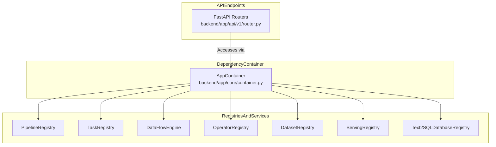

<!-- source: DeepWiki mcp.deepwiki.com · repo OpenDCAI/DataFlow-WebUI · page 3 Backend Services · fetched 2026-11-02 -->

# Backend Services

Relevant source files

The following files were used as context for generating this wiki page:

- [backend/app/api/v1/endpoints/datasets.py](backend/app/api/v1/endpoints/datasets.py)
- [backend/app/api/v1/endpoints/text2sql_database.py](backend/app/api/v1/endpoints/text2sql_database.py)
- [backend/app/core/container.py](backend/app/core/container.py)
- [backend/app/main.py](backend/app/main.py)
- [backend/app/schemas/dataset.py](backend/app/schemas/dataset.py)
- [backend/app/schemas/text2sql_database.py](backend/app/schemas/text2sql_database.py)
- [backend/app/services/dataset_registry.py](backend/app/services/dataset_registry.py)
- [backend/app/services/text2sql_database_registry.py](backend/app/services/text2sql_database_registry.py)

This section provides a high-level overview of the backend service layer and dependency container in `DataFlow-WebUI`. The service layer acts as the intermediary between FastAPI REST endpoints and the core execution engine, managing registries, persistent state, dependency injection, and pipeline execution orchestration.

For detailed technical specifications, implementation internals, and advanced usage of individual registries and services, please refer to the respective child pages linked throughout this document.

---

## Dependency Container and Architecture

The backend utilizes a centralized application container (`AppContainer`) defined in `backend/app/core/container.py` to instantiate and manage all registries and services in a controlled, deterministic order [backend/app/core/container.py:3-57](). This prevents circular imports and initialization race conditions between services like `DatasetRegistry`, `PipelineRegistry`, `OperatorRegistry`, and `TaskRegistry` [backend/app/core/container.py:4-44]().

**Sources:** [backend/app/core/container.py:3-57]()

---

## 3.1 Pipeline Registry

The `PipelineRegistry` manages pipeline definitions, JSON persistence, and automatic discovery of pipeline files from the `api_pipelines` directory [backend/app/services/pipeline_registry.py:1-232](). It uses `PipelineFileAnalyzer` to perform AST (Abstract Syntax Tree) parsing on Python pipeline definitions, extracting initialization parameters, run parameters, and operator execution sequences [backend/app/services/pipeline_registry.py:17-232](). It also performs static pipeline validation (checking field flow, serving references, and generating repair hints).

For details, see [Pipeline Registry](#3.1).

**Sources:** [backend/app/services/pipeline_registry.py:1-870]()

---

## 3.2 Task Registry and Execution

The `TaskRegistry` oversees the full lifecycle of pipeline executions, maintaining execution records, log collections, execution status updates, and statistics [backend/app/services/task_registry.py:1-152](). It coordinates with `RayPipelineExecutor` for distributed asynchronous tasks, handles task cancellation (`kill_execution`), and persists status updates to disk [backend/app/services/task_registry.py:436-588]().

For details, see [Task Registry and Execution](#3.2).

**Sources:** [backend/app/services/task_registry.py:1-588]()

---

## 3.3 DataFlow Engine

The `DataFlowEngine` serves as the primary orchestration engine for executing pipelines [backend/app/services/dataflow_engine.py:1-700](). It handles argument decoding, resolves dependencies such as LLM/embedding servings, database managers, and prompt templates, manages `FileStorage` step progression, coerces parameters, and catches execution exceptions [backend/app/services/dataflow_engine.py:68-200]().

For details, see [DataFlow Engine](#3.3).

**Sources:** [backend/app/services/dataflow_engine.py:1-700]()

---

## 3.4 Operator Registry

The `OperatorRegistry` discovers and reflects over available operators in the dataflow core library, caching their parameter schemas into `ops.{lang}.json` files [backend/app/services/operator_registry.py](). It provides categorical metadata, allowed prompt mappings, and parameter descriptions that are served to both the frontend UI and MCP agents [backend/app/services/pipeline_registry.py:747-870]().

For details, see [Operator Registry](#3.4).

**Sources:** [backend/app/services/operator_registry.py](), [backend/app/services/pipeline_registry.py:747-870]()

---

## 3.5 Dataset Management

The `DatasetRegistry` manages dataset metadata via YAML persistence (`datasets.yaml`) and automatically scans the `example_data` directory upon initialization [backend/app/services/dataset_registry.py:59-112](). It computes sample counts and file hashes, while `VisualizeDatasetService` handles dataframe previews across multiple file types (`json`, `jsonl`, `parquet`, `csv`) alongside file uploads [backend/app/services/dataset_registry.py:8-58](), [backend/app/api/v1/endpoints/datasets.py:1-162]().

For details, see [Dataset Management](#3.5).

**Sources:** [backend/app/services/dataset_registry.py:1-316](), [backend/app/api/v1/endpoints/datasets.py:1-162]()

---

## 3.6 Serving Management

The `ServingRegistry` manages configuration instances for LLM and embedding serving endpoints stored in YAML format [backend/app/services/serving_registry.py](). It provides serving class introspection, secure API key masking for API responses, and test generation utilities to verify connectivity with model providers [backend/app/services/dataflow_engine.py:73-143]().

For details, see [Serving Management](#3.6).

**Sources:** [backend/app/services/serving_registry.py](), [backend/app/services/dataflow_engine.py:73-143]()

---

## 3.7 Prompts, JSON Schemas and Preferences

Supporting registries such as `prompt_registry` and `user_prompt_registry` manage reusable prompt templates [backend/app/core/container.py:10-18](). The `json_schema_manager` handles saved JSON Schemas referenced via `schema_ref:` attributes in operators, and the preferences service stores user-specific UI or application preferences [backend/app/core/container.py:17]().

For details, see [Prompts, JSON Schemas and Preferences](#3.7).

**Sources:** [backend/app/core/container.py:3-57]()

---

## 3.8 Text2SQL Database Registry

The `Text2SQLDatabaseRegistry` and `Text2SQLDatabaseManagerRegistry` manage SQLite database uploads and database manager configurations [backend/app/services/text2sql_database_registry.py:40-346](). They store metadata in YAML files, maintain the SQLite database directory (`SQLITE_DB_DIR`), and construct `DatabaseManager` instances for Text2SQL operators [backend/app/services/text2sql_database_registry.py:169-178](), [backend/app/api/v1/endpoints/text2sql_database.py:1-197]().

For details, see [Text2SQL Database Registry](#3.8).

**Sources:** [backend/app/services/text2sql_database_registry.py:1-346](), [backend/app/api/v1/endpoints/text2sql_database.py:1-197]()

---

