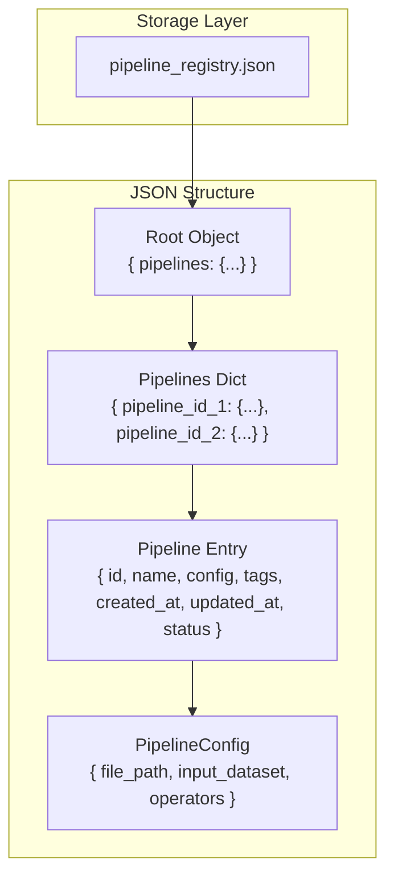
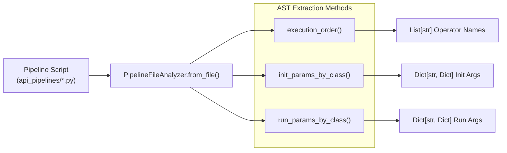
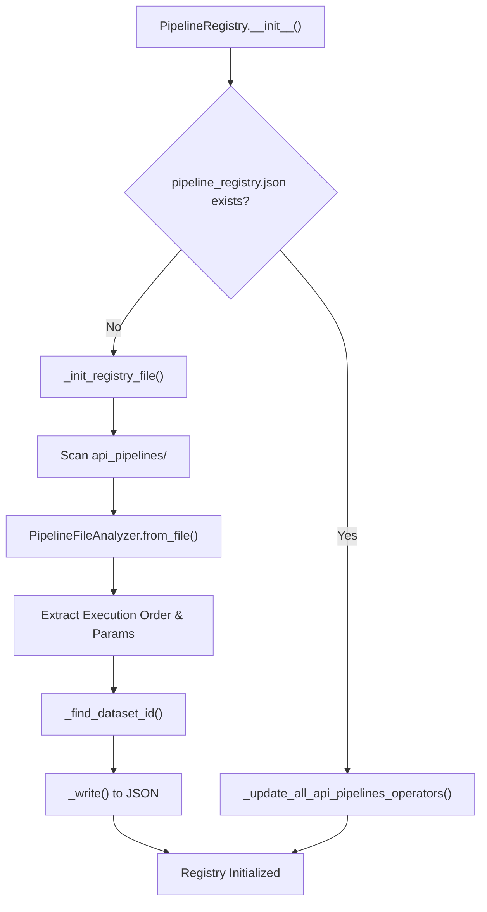
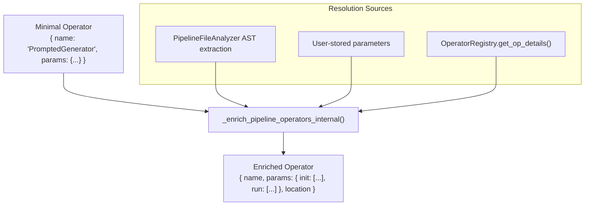
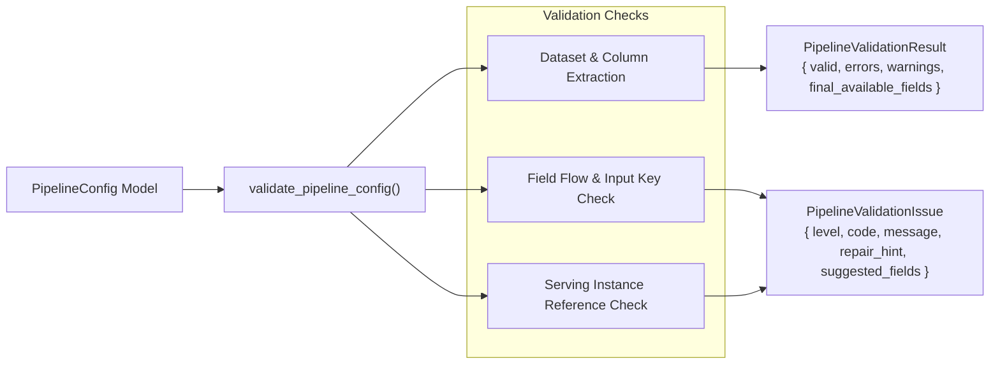

<!-- source: DeepWiki mcp.deepwiki.com · repo OpenDCAI/DataFlow-WebUI · page 3.1 Pipeline Registry · fetched 2026-11-02 -->

# Pipeline Registry

<details>
<summary>Relevant source files</summary>

The following files were used as context for generating this wiki page:

- [backend/app/api/v1/endpoints/pipelines.py](backend/app/api/v1/endpoints/pipelines.py)
- [backend/app/schemas/pipelines.py](backend/app/schemas/pipelines.py)
- [backend/app/services/pipeline_registry.py](backend/app/services/pipeline_registry.py)
- [backend/tests/test_pipeline_validation.py](backend/tests/test_pipeline_validation.py)

</details>


## Purpose and Scope

The **Pipeline Registry** (`PipelineRegistry`) is a core backend service responsible for managing pipeline metadata, automatic discovery of template pipelines from `dataflow_core/api_pipelines/`, enrichment of operator configurations, and static pipeline validation. It stores pipeline definitions as structured JSON data in `data/pipeline_registry.json`.

This document details the `PipelineRegistry` service class, its companion `PipelineFileAnalyzer` AST parsing utility (`[backend/app/services/pipeline_registry.py:19-187]()`), operator enrichment routines, and the static validation engine (`[backend/app/api/v1/endpoints/pipelines.py:64-80]()`, `[backend/tests/test_pipeline_validation.py:129-181]()`).

Sources: [backend/app/services/pipeline_registry.py:1-870](), [backend/app/api/v1/endpoints/pipelines.py:64-80]()

---

## Storage Architecture and JSON Persistence

The `PipelineRegistry` persists all pipeline metadata to a single JSON file located at `data/pipeline_registry.json`. 

### Storage File Structure


Sources: [backend/app/services/pipeline_registry.py:234-255]()

### Storage Methods

The registry uses internal methods to read and write state:
- `_read()`: Loads the entire registry dictionary from disk (`[backend/app/services/pipeline_registry.py:247-250]()`).
- `_write(data)`: Serializes and writes the dictionary back to disk (`[backend/app/services/pipeline_registry.py:252-255]()`).
- `_init_registry_file()`: Bootstraps the file if missing by scanning template pipelines (`[backend/app/services/pipeline_registry.py:257-347]()`).

Sources: [backend/app/services/pipeline_registry.py:234-255]()

---

## Pipeline File Analysis with `PipelineFileAnalyzer`

The `PipelineFileAnalyzer` dataclass (`[backend/app/services/pipeline_registry.py:18-28]`) uses Python's `ast` module to statically inspect pipeline script files without executing them.

### Analysis Workflow


Sources: [backend/app/services/pipeline_registry.py:19-90]()

### AST Parsing Helpers
- `_build_var_to_class_map()`: Maps instance variables in `__init__` (e.g., `self.my_op = MyOperator()`) to their class names (`[backend/app/services/pipeline_registry.py:103-126]()`).
- `_collect_run_calls()`: Traverses the `forward()` method to collect operator execution order via `self.xxx.run()` expressions (`[backend/app/services/pipeline_registry.py:128-140]()`).
- `_node_to_value()`: Recursively converts AST nodes into literal Python values or type references (`[backend/app/services/pipeline_registry.py:193-231]()`).

Sources: [backend/app/services/pipeline_registry.py:103-231]()

---

## Scanning `api_pipelines` and Template Management

On startup, `PipelineRegistry` scans the `dataflow_core/api_pipelines/` directory to discover and register built-in template pipelines.

### Initialization and Update Flow


Sources: [backend/app/services/pipeline_registry.py:234-457]()

### Template Whitelisting and Visibility
Templates are tagged with `["api", "template"]` (`[backend/app/services/pipeline_registry.py:313]()`). The `_is_visible_pipeline()` method filters template exposure using `_PRESET_PIPELINE_NAME_WHITELIST` (`[backend/app/services/pipeline_registry.py:459-509]()`).

Sources: [backend/app/services/pipeline_registry.py:459-509]()

---

## Operator Enrichment

Operator enrichment merges minimal operator definitions (`name` and `params`) with complete parameter schemas retrieved from `OperatorRegistry`.

### Enrichment Pipeline


Sources: [backend/app/services/pipeline_registry.py:747-869]()

Parameter priority follows a strict fallback cascade: Pipeline Python AST values take top precedence, followed by stored user overrides, and finally operator defaults (`[backend/app/services/pipeline_registry.py:804-845]`).

Sources: [backend/app/services/pipeline_registry.py:747-869]()

---

## Static Pipeline Validation

The static validation engine (`validate_pipeline_config()`, `[backend/app/api/v1/endpoints/pipelines.py:70-80]()`) inspects pipeline definitions before execution to detect configuration errors, missing input fields, invalid serving references, and field flow disruptions.

### Validation Architecture and Issues


Sources: [backend/app/schemas/pipelines.py:121-142](), [backend/tests/test_pipeline_validation.py:129-181]()

### Key Validation Checks and Repair Hints
1. **Missing Input Fields**: If an operator expects an input key (`input_key`) absent from the available dataset columns or prior operator outputs, `validate_pipeline_config()` flags a `missing_input_field` error (`[backend/tests/test_pipeline_validation.py:129-154]()`).
2. **Field Suggestions (Levenshtein/Similarity)**: When a field name typo occurs (e.g., `texts` instead of `text`), validation computes `suggested_fields` and provides a `repair_hint` (`[backend/tests/test_pipeline_validation.py:157-181]()`).
3. **Serving Reference Verification**: Validates that referenced `llm_serving` or embedding serving instances exist in `ServingRegistry` (`[backend/tests/test_pipeline_validation.py:109-115]()`).

Sources: [backend/app/schemas/pipelines.py:121-142](), [backend/tests/test_pipeline_validation.py:1-181]()

---

## CRUD Operations and API Endpoints

Pipelines are managed through REST endpoints defined in `[backend/app/api/v1/endpoints/pipelines.py]()` and backed by `PipelineRegistry` methods:

| Endpoint | Method | Registry Method | Description |
|---|---|---|---|
| `/api/v1/pipelines/` | `GET` | `list_pipelines()` | List all non-hidden registered pipelines (`[backend/app/api/v1/endpoints/pipelines.py:21-30]()`) |
| `/api/v1/pipelines/templates` | `GET` | `list_templates()` | List template pipelines (`[backend/app/api/v1/endpoints/pipelines.py:33-42]()`) |
| `/api/v1/pipelines/` | `POST` | `create_pipeline()` | Create and enrich a new pipeline (`[backend/app/api/v1/endpoints/pipelines.py:44-61]()`) |
| `/api/v1/pipelines/validate` | `POST` | `validate_pipeline_config()` | Perform static pipeline configuration validation (`[backend/app/api/v1/endpoints/pipelines.py:64-80]()`) |
| `/api/v1/pipelines/{id}` | `GET` | `get_pipeline()` | Get pipeline details by ID (`[backend/app/api/v1/endpoints/pipelines.py:81-86]()`) |
| `/api/v1/pipelines/{id}` | `PUT` | `update_pipeline()` | Update pipeline config and metadata (`[backend/app/api/v1/endpoints/pipelines.py:88-105]()`) |
| `/api/v1/pipelines/{id}` | `DELETE` | `delete_pipeline()` | Delete pipeline from registry (`[backend/app/api/v1/endpoints/pipelines.py:107-118]()`) |

Sources: [backend/app/api/v1/endpoints/pipelines.py:1-118](), [backend/app/services/pipeline_registry.py:540-744]()

---

## Data Models and Schemas

Core Pydantic models governing pipeline definitions and validation are defined in `[backend/app/schemas/pipelines.py]()`:
- `PipelineConfig`: Contains `file_path`, `input_dataset`, and `operators` list (`[backend/app/schemas/pipelines.py:55-68]()`).
- `PipelineIn` / `PipelineUpdateIn`: Request payloads for creation and updating (`[backend/app/schemas/pipelines.py:70-81]()`).
- `PipelineValidationIssue`: Structured error/warning item detailing `code`, `operator_name`, `field_name`, `suggested_fields`, and `repair_hint` (`[backend/app/schemas/pipelines.py:121-133]()`).
- `PipelineValidationResult`: Aggregated validation outcome including `valid`, `errors`, `warnings`, and `final_available_fields` (`[backend/app/schemas/pipelines.py:135-142]()`).

Sources: [backend/app/schemas/pipelines.py:1-142]()

---

## Integration Points and Container Registration

`PipelineRegistry` is instantiated as a singleton inside the dependency injection container:
```python
# In app/core/container.py
container.pipeline_registry = PipelineRegistry()
```
It integrates directly with `OperatorRegistry` for schema lookups, `DatasetRegistry` for input column inspection, and `ServingRegistry` for LLM serving verification.

Sources: [backend/app/services/pipeline_registry.py:12-13](), [backend/tests/test_pipeline_validation.py:13-115]()

---

