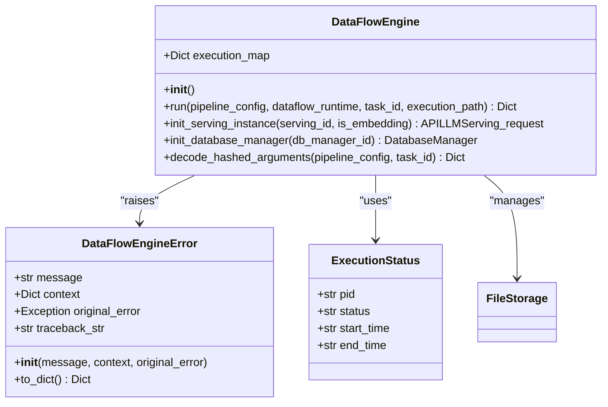
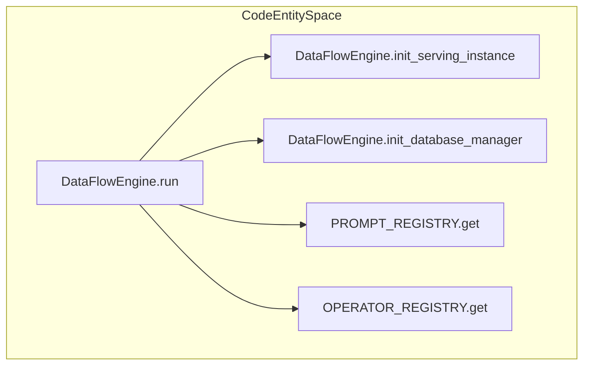
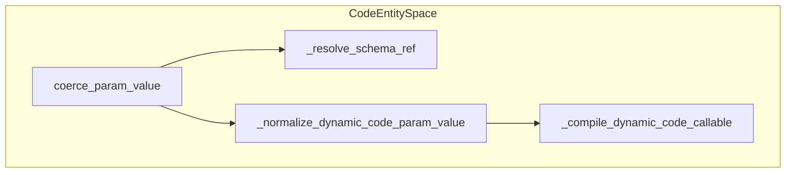
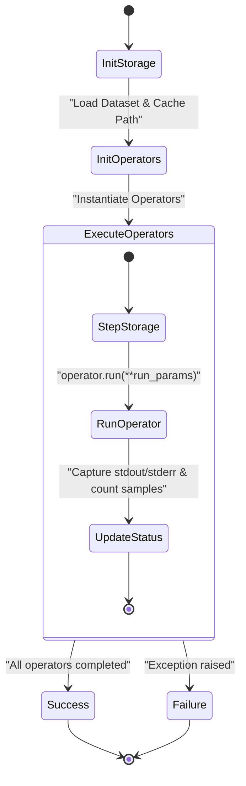

<!-- source: DeepWiki mcp.deepwiki.com · repo OpenDCAI/DataFlow-WebUI · page 3.3 DataFlow Engine · fetched 2026-11-02 -->

# DataFlow Engine

Relevant source files

The following files were used as context for generating this wiki page:

- [backend/app/services/dataflow_engine.py](backend/app/services/dataflow_engine.py)
- [backend/app/services/param_coercion.py](backend/app/services/param_coercion.py)
- [backend/app/services/ray_pipeline_executor.py](backend/app/services/ray_pipeline_executor.py)

## Purpose and Scope

The **DataFlow Engine** is the core execution orchestrator responsible for running AI/ML data processing pipelines in the DataFlow-WebUI backend. It coordinates argument decoding, serving, database-manager, and prompt dependency resolution, manages `FileStorage` step progression between operators, applies robust parameter coercion and dynamic code parameter compilation, and provides comprehensive execution tracking and error handling.

This document covers the internal implementation of `DataFlowEngine` [backend/app/services/dataflow_engine.py:176-789](), parameter coercion logic [backend/app/services/param_coercion.py:99-146](), and execution log streaming/monitoring [backend/app/services/ray_pipeline_executor.py:45-160]().

Sources: [backend/app/services/dataflow_engine.py:1-789](), [backend/app/services/param_coercion.py:99-146]()

---

## Overview and Class Structure

The `DataFlowEngine` class [backend/app/services/dataflow_engine.py:176-179]() serves as the central orchestrator. It executes pipelines sequentially or via distributed executors like `RayPipelineExecutor` [backend/app/services/ray_pipeline_executor.py:162-350]().

### Core Classes and Types

Sources: [backend/app/services/dataflow_engine.py:28-179]()

---

## Argument Decoding and `decode_hashed_arguments`

The engine pre-resolves pipeline configurations prior to execution using `decode_hashed_arguments` [backend/app/services/dataflow_engine.py:166-314](). This method parses operator inputs, handles hashed references, and prepares runtime dictionaries without instantiating heavy run-time resources (such as active LLM sessions or database pools).

Sources: [backend/app/services/dataflow_engine.py:166-314]()

---

## Dependency Resolution

`DataFlowEngine` resolves three major categories of runtime dependencies during operator setup:

1. **Serving Instances**: Initialized via `init_serving_instance` [backend/app/services/dataflow_engine.py:181-280](), mapping LLM or embedding configurations from `container.serving_registry` to client wrappers like `APILLMServing_request`.
2. **Prompt Templates**: Resolved via `PROMPT_REGISTRY` lookups, extracting class names using `extract_class_name` [backend/app/services/dataflow_engine.py:46-64]().
3. **Database Managers**: Initialized via `init_database_manager` [backend/app/services/dataflow_engine.py:282-314](), integrating Text2SQL database configurations from `container.text2sql_database_manager_registry`.

### Dependency Resolution Flow

Sources: [backend/app/services/dataflow_engine.py:181-314](), [backend/app/services/dataflow_engine.py:468-528]()

---

## Parameter Coercion and Dynamic Code Parameters

To support dynamic operators and UI-driven parameter inputs, the engine relies on parameter coercion and dynamic code normalization modules.

### Parameter Coercion (`coerce_param_value`)
The function `coerce_param_value` [backend/app/services/param_coercion.py:99-146]() enforces expected operator parameter types using Pydantic `TypeAdapter` validation (`validate_python` / `validate_json`), resolving `schema_ref:<id>` references through `_resolve_schema_ref` [backend/app/services/param_coercion.py:19-49](), and falling back to runtime defaults via `_fallback_coerce_by_default` [backend/app/services/param_coercion.py:57-97]().

### Dynamic Code Parameters
Operators accepting custom logic (such as filters or mappers defined via Python code) pass through `_normalize_dynamic_code_param_value` [backend/app/services/dataflow_engine.py:79-121]() and are compiled using `_compile_dynamic_code_callable` [backend/app/services/dataflow_engine.py:124-167](), supporting `lambda` expressions and `def` functions.

Sources: [backend/app/services/dataflow_engine.py:79-167](), [backend/app/services/param_coercion.py:19-146]()

---

## FileStorage Stepping and Execution Flow

The engine manages data persistence between operators using `FileStorage` [backend/app/services/dataflow_engine.py:384-436](). As the pipeline progresses through operators, `storage.step()` [backend/app/services/dataflow_engine.py:575]() advances the file pointers, writing sequential output cache files (`dataflow_cache_step_*.jsonl`) into the task cache directory.

Sources: [backend/app/services/dataflow_engine.py:384-689]()

---

## Error Handling and Logging

`DataFlowEngine` wraps execution anomalies in `DataFlowEngineError` [backend/app/services/dataflow_engine.py:28-44](), capturing contextual metadata (operator index, failure reason, and traceback). Real-time logs are captured via `LogStream` [backend/app/services/ray_pipeline_executor.py:45-98]() and written back via `update_execution_status` [backend/app/services/dataflow_engine.py:346-366]().

Sources: [backend/app/services/dataflow_engine.py:28-44](), [backend/app/services/dataflow_engine.py:346-366](), [backend/app/services/ray_pipeline_executor.py:45-98]()

---

