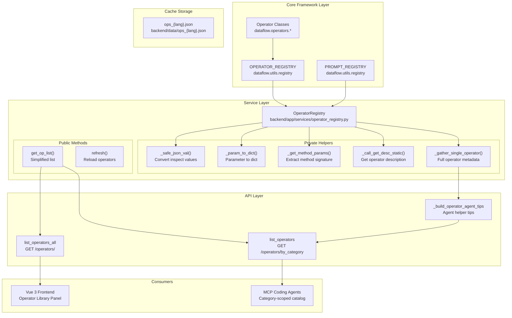
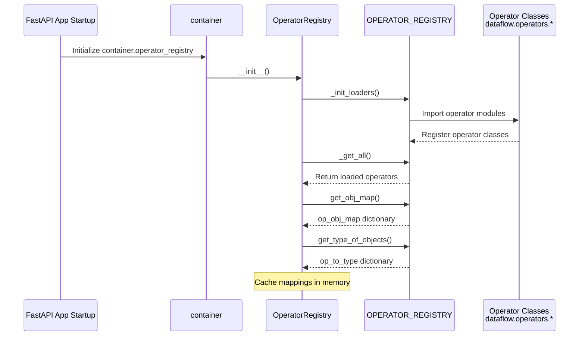
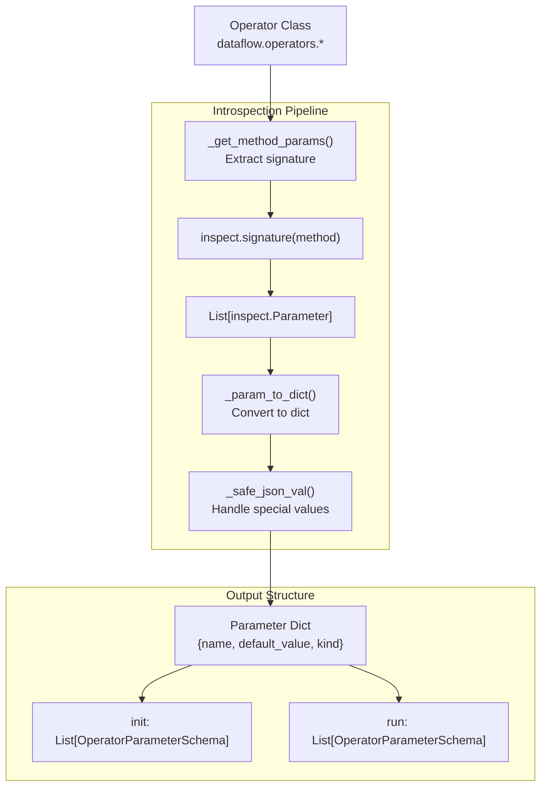
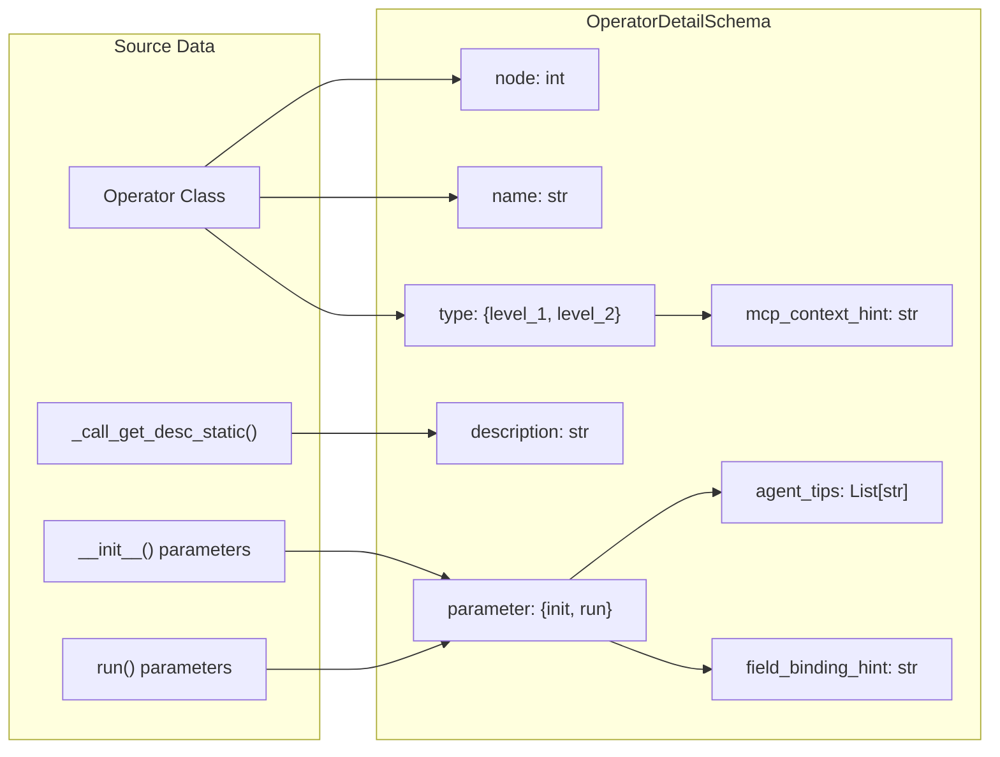
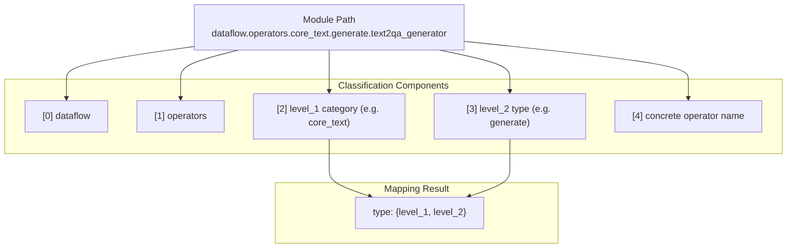
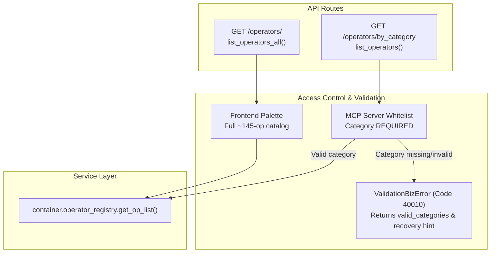
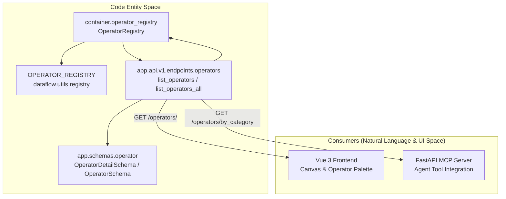

<!-- source: DeepWiki mcp.deepwiki.com · repo OpenDCAI/DataFlow-WebUI · page 3.4 Operator Registry · fetched 2026-11-02 -->

# Operator Registry

<details>
<summary>Relevant source files</summary>

The following files were used as context for generating this wiki page:

- [backend/app/api/v1/endpoints/operators.py](backend/app/api/v1/endpoints/operators.py)
- [backend/app/schemas/operator.py](backend/app/schemas/operator.py)
- [backend/app/services/operator_registry.py](backend/app/services/operator_registry.py)

</details>


## Purpose and Scope

The `OperatorRegistry` service is responsible for discovering, cataloging, and exposing metadata about all available operators in the DataFlow system [backend/app/services/operator_registry.py:144-162](). It uses Python introspection to extract parameter schemas from operator classes, caches the metadata for performance, and provides REST API endpoints (`/api/v1/operators`) for the frontend UI and Model Context Protocol (MCP) coding agents to query operator information [backend/app/services/operator_registry.py:1-253](), [backend/app/api/v1/endpoints/operators.py:1-315](). 

This service enables the frontend to dynamically populate the operator library panel and allows MCP agents to discover category-scoped operators without overflowing their context window [backend/app/api/v1/endpoints/operators.py:78-153](). For information about execution, see [DataFlow Engine](#3.3). For operator data models, see [Operator Data Models](#6.2).

Sources: [backend/app/services/operator_registry.py:1-253](), [backend/app/api/v1/endpoints/operators.py:1-315]()

---

## System Architecture

### Component Overview



Sources: [backend/app/services/operator_registry.py:1-253](), [backend/app/api/v1/endpoints/operators.py:1-66]()

---

## Initialization and Operator Discovery

### OperatorRegistry Initialization

The `OperatorRegistry` class initializes by loading all operators from the core framework's `OPERATOR_REGISTRY` [backend/app/services/operator_registry.py:144-162]().



The initialization process executes [backend/app/services/operator_registry.py:149-161]():
1. Triggering `_init_loaders()` on `OPERATOR_REGISTRY` to import all operator modules.
2. Invoking `_get_all()` to materialize operators.
3. Fetching `op_obj_map` (mapping operator names to classes) and `op_to_type` (mapping operator names to their module classification paths).

Sources: [backend/app/services/operator_registry.py:149-161]()

---

## Parameter Introspection

### Method Signature Extraction

The registry uses Python's `inspect` module to inspect operator constructors (`__init__`) and execution methods (`run`), converting runtime parameters into JSON-serializable dictionaries [backend/app/services/operator_registry.py:19-58]().



Key transformations implemented in `_safe_json_val()` [backend/app/services/operator_registry.py:19-33]():
- Converts `inspect.Parameter.empty` into `None` (JSON null).
- Converts types and callables into their string representations.
- Falls back to `str()` for non-JSON-serializable types.

Sources: [backend/app/services/operator_registry.py:19-58]()

---

## Operator Metadata Structure and Agent Hints

### Full Operator Metadata and Agent Guidance

The `_gather_single_operator()` function constructs metadata for each operator [backend/app/services/operator_registry.py:92-139](), while `_build_operator_agent_tips()` enriches operator details with LLM/MCP agent-specific hints [backend/app/api/v1/endpoints/operators.py:32-65]() defined in `OperatorDetailSchema` [backend/app/schemas/operator.py:38-57]().



Agent tips generated dynamically include warnings about `llm_serving` / `embedding_serving` dependencies, `prompt_template` usage, dynamic code parameters (`process_fn`, `filter_rules`), and input/output field binding conventions [backend/app/api/v1/endpoints/operators.py:32-65]().

Sources: [backend/app/services/operator_registry.py:92-139](), [backend/app/api/v1/endpoints/operators.py:32-65](), [backend/app/schemas/operator.py:38-57]()

---

## Type Classification System

### Three-Level Hierarchy

Operators are categorized via a three-level hierarchy parsed from their module import paths [backend/app/services/operator_registry.py:98-113]().



Extraction logic checks module components: `type1 = parts[2]` and `type2 = parts[3]` if available [backend/app/services/operator_registry.py:100-113]().

Sources: [backend/app/services/operator_registry.py:98-113]()

---

## API Endpoints and MCP Context Protection

### Operator Endpoints Architecture

DataFlow-WebUI provides two primary operator listing endpoints with distinct access policies for the frontend UI vs. MCP coding agents [backend/app/api/v1/endpoints/operators.py:68-153]().



**MCP Guard Mechanism**:
- `list_operators_all` (`GET /operators/`) returns the full operator catalog for the frontend operator library sidebar [backend/app/api/v1/endpoints/operators.py:78-97]().
- `list_operators` (`GET /operators/by_category`, operation ID `list_operators`) requires a `category` parameter [backend/app/api/v1/endpoints/operators.py:108-153](). If called without a category or with `'all'` / `'unknown'`, it raises a `ValidationBizError` (code `40010`) containing `valid_categories` and a `next_action` hint, preventing MCP agents from flooding their context window with ~145 operators [backend/app/api/v1/endpoints/operators.py:135-153]().

Sources: [backend/app/api/v1/endpoints/operators.py:68-160]()

---

## Description Extraction

### Staticmethod Invocation

Descriptions are retrieved by invoking `get_desc(lang=lang)` as a staticmethod on operator classes [backend/app/services/operator_registry.py:61-90]().

```mermaid
graph TB
    OpClass["Operator Class"]
    
    subgraph "Reflection Check"
        get_dict["cls.__dict__.get('get_desc')"]
        check_static["isinstance(func_obj, staticmethod)?"]
        inspect_params["inspect.signature(fn).parameters"]
    end
    
    subgraph "Invocations"
        fn_lang["fn(lang)"]
        fn_self_lang["fn(None, lang)"]
        fallback["Return fallback string"]
    end
    
    OpClass --> get_dict
    get_dict --> check_static
    check_static -->|No| fallback
    check_static -->|Yes| inspect_params
    
    inspect_params -->|['lang']| fn_lang
    inspect_params -->|['self', 'lang']| fn_self_lang
    inspect_params -->|Mismatch| fallback
```

Sources: [backend/app/services/operator_registry.py:61-90]()

---

## Configuration and Caching

### File Paths and Storage

The cache file path is resolved via application settings [backend/app/services/operator_registry.py:7-14]():
- `BACKEND_DIR`: `Path(__file__).parent.parent.parent` [backend/app/services/operator_registry.py:12]()
- `OPS_JSON_PATH`: `BACKEND_DIR / settings.OPS_JSON_PATH` [backend/app/services/operator_registry.py:13]()
- `RESOURCE_DIR`: `OPS_JSON_PATH.parent` [backend/app/services/operator_registry.py:14]()

Sources: [backend/app/services/operator_registry.py:7-14]()

---

## Integration with Services and Data Flow

### End-to-End Service Interaction



Sources: [backend/app/services/operator_registry.py:1-253](), [backend/app/api/v1/endpoints/operators.py:1-160](), [backend/app/schemas/operator.py:1-82]()

---

