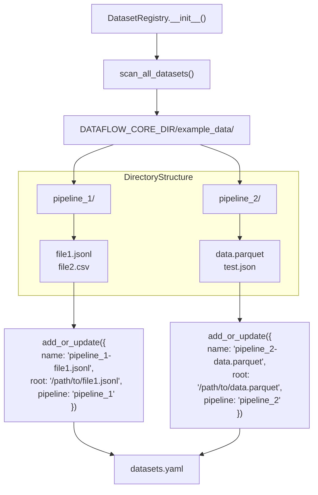
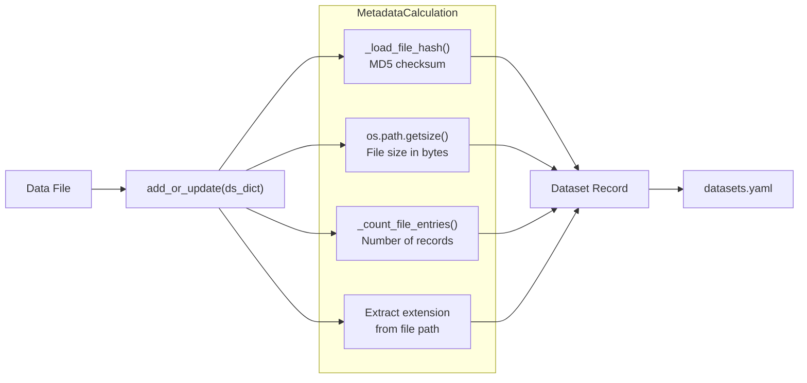
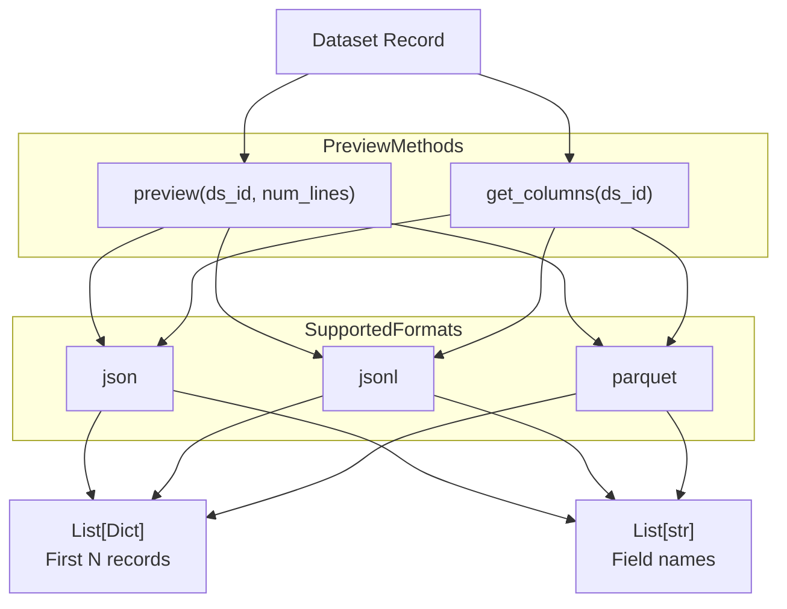
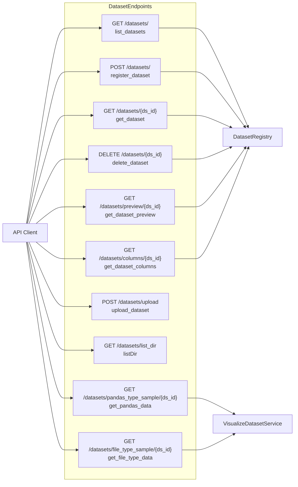
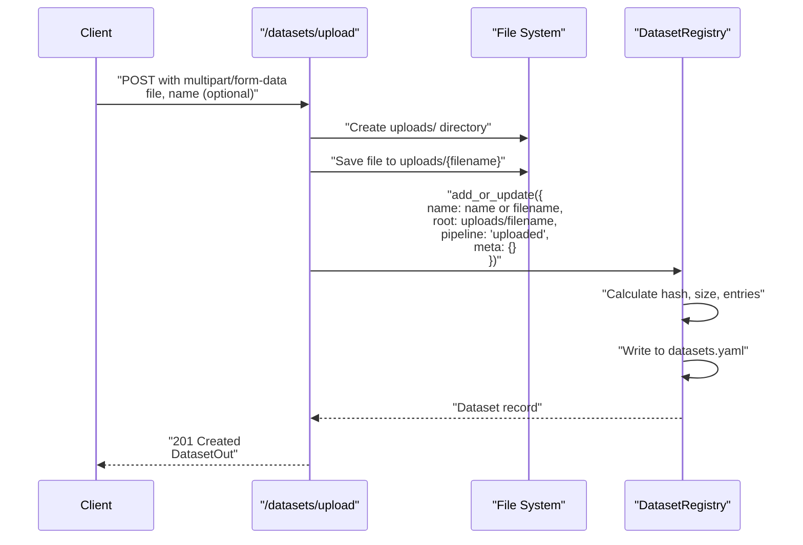
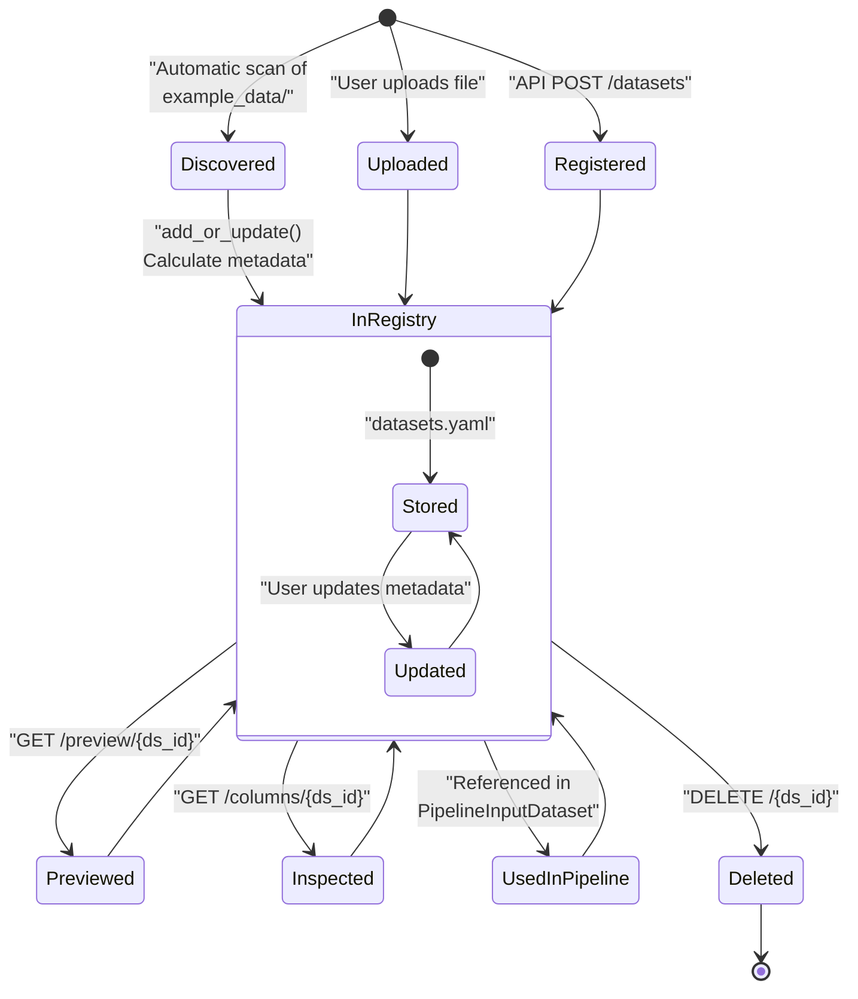

<!-- source: DeepWiki mcp.deepwiki.com · repo OpenDCAI/DataFlow-WebUI · page 3.5 Dataset Management · fetched 2026-11-02 -->

# Dataset Management

<details>
<summary>Relevant source files</summary>

The following files were used as context for generating this wiki page:

- [backend/app/api/v1/endpoints/datasets.py](backend/app/api/v1/endpoints/datasets.py)
- [backend/app/main.py](backend/app/main.py)
- [backend/app/schemas/dataset.py](backend/app/schemas/dataset.py)
- [backend/app/services/dataset_registry.py](backend/app/services/dataset_registry.py)

</details>


## Purpose and Scope

This document describes the Dataset Management subsystem, which handles registration, storage, and visualization of datasets used as inputs to pipelines. The system provides automatic discovery of datasets from the `example_data` directory, metadata storage in YAML format, and preview functionality for supported file formats.

For information about how datasets are used during pipeline execution, see [DataFlow Engine](#3.3). For details on the REST API endpoints, see [Dataset Endpoints](#5.4).

Sources: [backend/app/services/dataset_registry.py:59-316](), [backend/app/api/v1/endpoints/datasets.py:1-162]()

---

## System Overview

The Dataset Management subsystem consists of three main components:

| Component | Class | Responsibility |
|-----------|-------|----------------|
| **Storage** | `DatasetRegistry` | Manages dataset metadata in YAML, automatic scanning, CRUD operations |
| **Visualization** | `VisualizeDatasetService` | Provides data preview and format-specific reading capabilities |
| **API Layer** | `/datasets` endpoints | Exposes REST API for dataset operations |

Datasets are stored as metadata records that reference actual data files on disk. The system calculates and tracks file hashes, sizes, and entry counts automatically. Supported formats include JSON, JSONL, Parquet, CSV, Excel, and various media types.

Sources: [backend/app/services/dataset_registry.py:59-316](), [backend/app/api/v1/endpoints/datasets.py:1-162]()

---

## DatasetRegistry Service

### Storage Format and Location

`DatasetRegistry` persists dataset metadata to a YAML file at the path specified by `settings.DATA_REGISTRY` (typically `data/datasets.yaml`). The structure follows this schema:

```yaml
datasets:
  abc123def4:  # MD5 hash of file path (first 10 chars)
    id: abc123def4
    name: "example-data.jsonl"
    root: "/path/to/file.jsonl"
    pipeline: "text_classification"
    type: "jsonl"
    hash: "file_md5_hash"
    file_size: 12345
    num_samples: 100
    added_at: "2024-01-01T12:00:00"
    meta: {}
```

The `id` field is generated by hashing the file path, ensuring that the same file always gets the same ID. This allows `add_or_update()` to function as an upsert operation.

Sources: [backend/app/services/dataset_registry.py:115-128](), [backend/app/services/dataset_registry.py:171-196]()

---

### Automatic Dataset Scanning

During initialization, `DatasetRegistry` automatically scans the `DATAFLOW_CORE_DIR/example_data` directory to discover and register all datasets:



The scanner walks through each pipeline directory, creating dataset records with names in the format `{pipeline_name}-{filename}`. This happens automatically when the registry is instantiated with `scan=True` (default behavior).

Sources: [backend/app/services/dataset_registry.py:60-113]()

---

### Dataset Metadata Calculation

When registering or updating a dataset, `DatasetRegistry` automatically computes several metadata fields:



#### Entry Counting Logic

The `_count_file_entries()` method uses format-specific strategies:

| Format | Counting Strategy |
|--------|------------------|
| `csv`, `jsonl`, `txt`, `log` | Line count |
| `json` | If list: `len(data)`, if dict: `len(data.keys())`, else: `1` |
| Other formats | Defaults to `1` entry |

Sources: [backend/app/services/dataset_registry.py:129-156](), [backend/app/services/dataset_registry.py:163-169](), [backend/app/services/dataset_registry.py:171-196]()

---

## Dataset Operations

### Registration and Updates

The `add_or_update()` method provides upsert functionality. When called, it:

1. Generates a stable ID from the file path hash
2. Verifies the file exists at the specified path
3. Computes metadata (hash, size, entry count)
4. Extracts file type from extension
5. Stores or updates the record in YAML

```python
# Example usage from API
ds_dict = {
    "name": "my_dataset",
    "root": "/path/to/data.jsonl",
    "pipeline": "custom_pipeline",
    "meta": {"description": "Custom dataset"}
}
dataset_record = container.dataset_registry.add_or_update(ds_dict)
```

If the file doesn't exist, a `FileNotFoundError` is raised.

Sources: [backend/app/services/dataset_registry.py:171-196]()

---

### Retrieval and Listing

The registry provides two retrieval methods:

| Method | Description | Returns |
|--------|-------------|---------|
| `list()` | Returns all registered datasets | `List[Dict]` with full metadata |
| `get(ds_id)` | Returns a single dataset by ID | `Dict` or `None` if not found |

Both methods read directly from the YAML file, ensuring consistency with the persisted state.

Sources: [backend/app/services/dataset_registry.py:157-161](), [backend/app/services/dataset_registry.py:198-199]()

---

### Deletion

The `remove(ds_id)` method deletes a dataset record from the registry. Note that this only removes the metadata entry; it does not delete the actual data file from disk.

Sources: [backend/app/services/dataset_registry.py:59-316]()

---

## Dataset Visualization

### VisualizeDatasetService

`VisualizeDatasetService` provides format-specific data reading capabilities for previewing datasets in the UI. It maintains two mapping dictionaries:

#### Pandas Read Function Map

```python
pandas_read_func_map = {
    "csv": pd.read_csv,
    "excel": pd.read_excel,
    "json": pd.read_json,
    "parquet": pd.read_parquet,
    "pickle": pd.read_pickle,
    "jsonl": lambda path: pd.read_json(path, lines=True),
}
```

#### Media Type Map

```python
media_type_map = {
    "txt": "text/plain",
    "md": "text/markdown",
    "jpg": "image/jpeg",
    "png": "image/png",
    "pdf": "application/pdf",
    "doc": "application/msword",
    "docx": "application/vnd.openxmlformats-officedocument.wordprocessingml.document",
    # ... more types
}
```

Sources: [backend/app/services/dataset_registry.py:8-56]()

---

### Preview and Column Extraction

The registry provides methods for inspecting dataset contents and extracting column information.



Sources: [backend/app/services/dataset_registry.py:59-316]()

---

## API Endpoints

The `/datasets` router exposes REST endpoints for managing datasets, checking directory structures, fetching previews, and performing file uploads.



### Key Endpoint Details

| Endpoint | Method | Purpose | Returns |
|----------|--------|---------|---------|
| `/` | GET | List all datasets | `List[DatasetOut]` with metadata |
| `/` | POST | Register/update dataset | `DatasetOut` |
| `/{ds_id}` | GET | Get single dataset | `DatasetOut` |
| `/{ds_id}` | DELETE | Remove dataset | Success message |
| `/preview/{ds_id}` | GET | Get first N records | `List[Dict]` |
| `/columns/{ds_id}` | GET | Get column names | `List[str]` |
| `/upload` | POST | Upload file and register | `DatasetOut` |
| `/list_dir` | GET | List directory contents | `List[Dict]` with name/is_dir |
| `/pandas_type_sample/{ds_id}` | GET | Pandas-readable preview (JSON string) | `str` |
| `/file_type_sample/{ds_id}` | GET | Download file with media type | `FileResponse` |

Sources: [backend/app/api/v1/endpoints/datasets.py:1-162]()

---

## File Upload Workflow

The upload endpoint provides a way to add datasets via file upload rather than by referencing existing files:



The uploaded files are stored in a dedicated `uploads/` directory adjacent to `datasets.yaml`. The pipeline field is set to `"uploaded"` to distinguish user-uploaded datasets from scanned example data.

Sources: [backend/app/api/v1/endpoints/datasets.py:127-162]()

---

## Dataset Lifecycle Diagram



Sources: [backend/app/services/dataset_registry.py:59-316](), [backend/app/api/v1/endpoints/datasets.py:1-162]()

---

