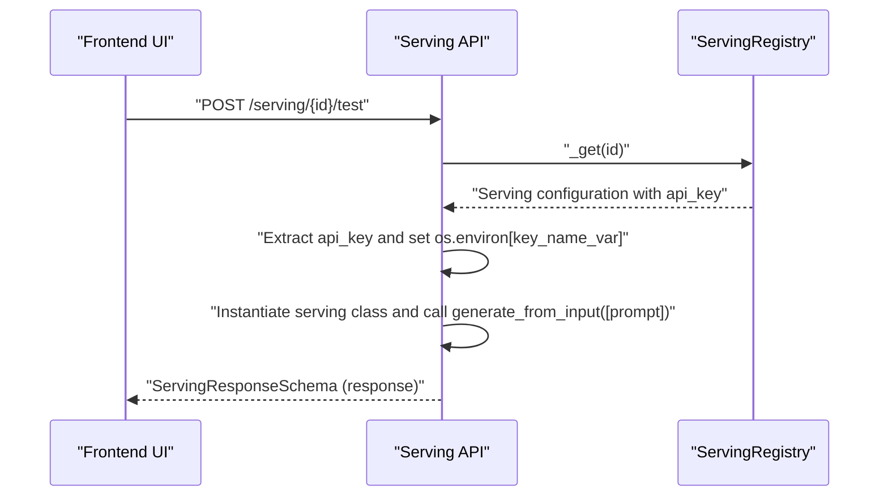

<!-- source: DeepWiki mcp.deepwiki.com · repo OpenDCAI/DataFlow-WebUI · page 3.6 Serving Management · fetched 2026-11-02 -->

# Serving Management

<details>
<summary>Relevant source files</summary>

The following files were used as context for generating this wiki page:

- [backend/app/api/v1/endpoints/serving.py](backend/app/api/v1/endpoints/serving.py)
- [backend/app/schemas/serving.py](backend/app/schemas/serving.py)
- [backend/app/services/serving_registry.py](backend/app/services/serving_registry.py)

</details>


The Serving Management system provides backend services for managing LLM and embedding serving instances (`ServingRegistry`) used by operators during pipeline execution. This page documents the `ServingRegistry` class, serving class introspection (`get_serving_classes()`), API key masking (`_mask_key`), YAML persistence (`serving_registry.yaml`), and configuration testing capabilities.

For API endpoint documentation, see [Serving Endpoints](#5.5). For the frontend UI component, see [Management Views and Panels](#4.4).

---

## Overview

The serving management system consists of three primary components:

| Component | Purpose | Code Entity / Storage |
|-----------|---------|-----------------------|
| `ServingRegistry` | Manages serving instance configurations and CRUD operations | `backend/app/services/serving_registry.py:26-98()` |
| `SERVING_CLS_REGISTRY` | Registry of available serving classes (`APILLMServing_request`) | `backend/app/services/serving_registry.py:22-23()` |
| Serving API Endpoints | REST API for serving operations and key masking | `backend/app/api/v1/endpoints/serving.py:28-180()` |

The system specializes in managing API-based LLM serving instances with special handling for API keys, masking security, and dynamic parameter resolution.

**Sources:** [backend/app/services/serving_registry.py:1-157](), [backend/app/api/v1/endpoints/serving.py:1-263]()

---

## System Architecture

```mermaid
graph TB
    subgraph "API Layer"
        ListInstances["list_serving_instances()<br/>backend/app/api/v1/endpoints/serving.py"]
        ListClasses["list_serving_classes()<br/>backend/app/api/v1/endpoints/serving.py"]
        GetDetail["get_serving_detail()<br/>backend/app/api/v1/endpoints/serving.py"]
        CreateInstance["create_serving_instance()<br/>backend/app/api/v1/endpoints/serving.py"]
        UpdateInstance["update_serving_instance()<br/>backend/app/api/v1/endpoints/serving.py"]
        DeleteInstance["delete_serving_instance()<br/>backend/app/api/v1/endpoints/serving.py"]
    end
    
    subgraph "Service Layer"
        ServingRegistry["ServingRegistry<br/>backend/app/services/serving_registry.py"]
        
        ServingRegistry --> GetAll["_get_all()"]
        ServingRegistry --> Get["_get(id)"]
        ServingRegistry --> Set["_set(name, cls_name, params)"]
        ServingRegistry --> Update["_update(id, ...)"]
        ServingRegistry --> Delete["_delete(id)"]
        ServingRegistry --> GetClasses["get_serving_classes()"]
    end
    
    subgraph "Core Framework"
        SERVING_CLS_REGISTRY["SERVING_CLS_REGISTRY<br/>backend/app/services/serving_registry.py"]
        ServingModule["dataflow.serving module"]
        
        SERVING_CLS_REGISTRY --> ServingModule
    end
    
    subgraph "Storage"
        YAMLFile["serving_registry.yaml<br/>YAML persistence"]
    end
    
    ListInstances --> GetAll
    ListClasses --> GetClasses
    GetDetail --> Get
    CreateInstance --> Set
    UpdateInstance --> Update
    DeleteInstance --> Delete
    
    GetAll --> YAMLFile
    Get --> YAMLFile
    Set --> YAMLFile
    Update --> YAMLFile
    Delete --> YAMLFile
    
    GetClasses --> SERVING_CLS_REGISTRY
```



**Architecture Notes:**

- **API Layer**: FastAPI endpoints expose serving management operations and mask API keys via `_mask_key` [backend/app/api/v1/endpoints/serving.py:23-26]().
- **Service Layer**: `ServingRegistry` handles YAML persistence and class reflection.
- **Core Framework**: `SERVING_CLS_REGISTRY` maps class names like `APILLMServing_request` to runtime Python classes.
- **Storage**: `serving_registry.yaml` stores instance definitions.

**Sources:** [backend/app/api/v1/endpoints/serving.py:1-263](), [backend/app/services/serving_registry.py:1-157]()

---

## ServingRegistry Class

The `ServingRegistry` class manages serving instance metadata and provides CRUD operations. It is instantiated via dependency injection through the container pattern.

### Initialization

```python
class ServingRegistry:
    def __init__(self, path: str | None = None):
        self.path = path or settings.SERVING_REGISTRY
        self._ensure()
```

The registry ensures the YAML file exists on initialization [backend/app/services/serving_registry.py:26-30](), creating an empty file via `_ensure()` if necessary [backend/app/services/serving_registry.py:32-35]().

**Sources:** [backend/app/services/serving_registry.py:26-35]()

### YAML Storage Format

The `serving_registry.yaml` file stores serving instances in the following structure:

```yaml
{id1}:
  name: "APILLMServing_1"
  cls_name: "APILLMServing_request"
  params:
    - name: "model"
      type: "str"
      default_value: "gpt-3.5-turbo"
      value: "gpt-4"
      required: true
    - name: "api_key"
      type: "str"
      value: "sk-..."
      required: true
```

**Field Descriptions:**

| Field | Type | Description |
|-------|------|-------------|
| `id` | string | 16-character hex string generated by `os.urandom(8).hex()` [backend/app/services/serving_registry.py:52]() |
| `name` | string | User-defined instance name |
| `cls_name` | string | Serving class name from `SERVING_CLS_REGISTRY` [backend/app/services/serving_registry.py:22-23]() |
| `params` | list | Parameter configurations (`ServingParamSchema`) [backend/app/schemas/serving.py:4-11]() |

**Sources:** [backend/app/services/serving_registry.py:6-17](), [backend/app/services/serving_registry.py:48-58]()

### CRUD Operations

#### Creating Instances

The `_set()` method creates a new serving instance [backend/app/services/serving_registry.py:50-60](). The create endpoint merges user-provided parameters with class defaults before storage.

#### Reading and Masking Instances

`_get(id)` retrieves specific instances [backend/app/services/serving_registry.py:42-48](), while `list_serving_instances()` retrieves all items [backend/app/api/v1/endpoints/serving.py:33-63](). Sensitive keys undergo masking via `_mask_key(key)`:

```python
def _mask_key(key: str) -> str:
    if not key or len(key) <= 8:
        return "****"
    return key[:3] + "****" + key[-4:]
```

**Sources:** [backend/app/api/v1/endpoints/serving.py:23-27](), [backend/app/services/serving_registry.py:37-48]()

#### Updating Instances

The `_update()` method supports partial updates [backend/app/services/serving_registry.py:62-89](). 
- `name` can be updated.
- `cls_name` is immutable and raises `ValueError` if modified [backend/app/services/serving_registry.py:69-70]().
- `params` updates merge with existing parameters, preserving metadata while updating values [backend/app/services/serving_registry.py:71-85]().

#### Deleting Instances

```python
def _delete(self, id: str) -> bool:
    data = self._get_all()
    if id not in data:
        return False
    del data[id]
    with open(self.path, 'w') as f:
        yaml.dump(data, f)
    return True
```

**Sources:** [backend/app/services/serving_registry.py:91-98](), [backend/app/api/v1/endpoints/serving.py:163-179]()

---

## Serving Class Discovery

### SERVING_CLS_REGISTRY

The `SERVING_CLS_REGISTRY` maps class names to serving class objects [backend/app/services/serving_registry.py:22-23]():

```python
SERVING_MODULE = importlib.import_module("dataflow.serving")
SERVING_MODULE_ALL = ["APILLMServing_request"]
SERVING_CLS_REGISTRY = dict(zip(SERVING_MODULE_ALL,
                               [getattr(SERVING_MODULE, cls_name) 
                                for cls_name in SERVING_MODULE_ALL]))
```

**Sources:** [backend/app/services/serving_registry.py:18-23]()

### Parameter Schema Introspection

The `get_serving_classes()` method uses Python's `inspect` module to extract parameter schemas from class `__init__` methods [backend/app/services/serving_registry.py:100-157](). It records parameter names, type annotations, default values, and requirement flags.

**Sources:** [backend/app/services/serving_registry.py:100-157]()

---

## API Key Handling and Testing



**Testing Workflow:**
1. The test endpoint retrieves the instance configuration via `container.serving_registry._get(id)` [backend/app/api/v1/endpoints/serving.py:208-263]().
2. Injects the API key into `os.environ` [backend/app/api/v1/endpoints/serving.py:224-245]().
3. Instantiates the serving class from `SERVING_CLS_REGISTRY` and executes a test generation prompt [backend/app/api/v1/endpoints/serving.py:246-263]().

**Sources:** [backend/app/api/v1/endpoints/serving.py:208-263](), [backend/app/schemas/serving.py:38-39]()

---

