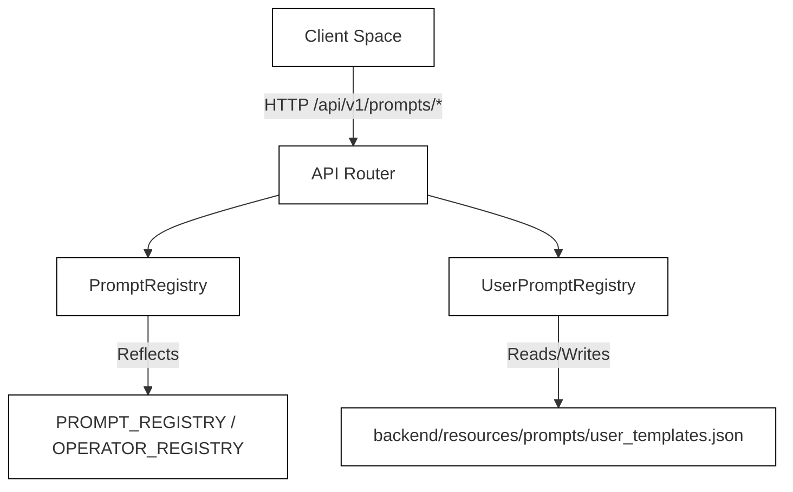
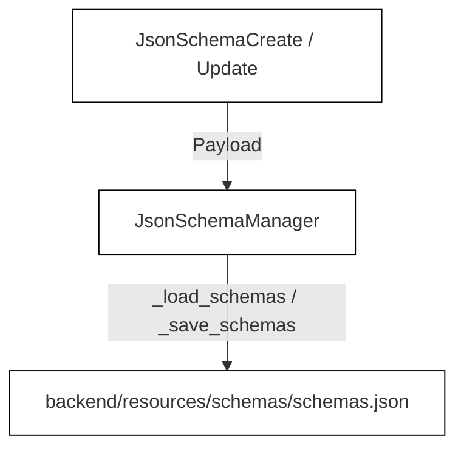
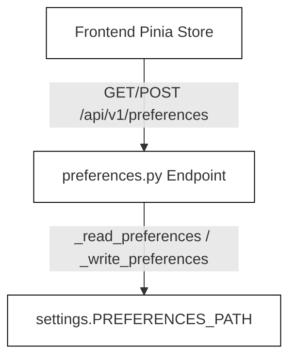

<!-- source: DeepWiki mcp.deepwiki.com · repo OpenDCAI/DataFlow-WebUI · page 3.7 Prompts, JSON Schemas and Preferences · fetched 2026-11-02 -->

# Prompts, JSON Schemas and Preferences

Relevant source files

The following files were used as context for generating this wiki page:

- [backend/app/api/v1/endpoints/preferences.py](backend/app/api/v1/endpoints/preferences.py)
- [backend/app/api/v1/endpoints/prompts.py](backend/app/api/v1/endpoints/prompts.py)
- [backend/app/api/v1/router.py](backend/app/api/v1/router.py)
- [backend/app/core/logger_setup.py](backend/app/core/logger_setup.py)
- [backend/app/schemas/json_schema.py](backend/app/schemas/json_schema.py)
- [backend/app/schemas/preferences.py](backend/app/schemas/preferences.py)
- [backend/app/schemas/prompt.py](backend/app/schemas/prompt.py)
- [backend/app/services/json_schema_manager.py](backend/app/services/json_schema_manager.py)
- [backend/app/services/prompt_registry.py](backend/app/services/prompt_registry.py)
- [backend/app/services/user_prompt_registry.py](backend/app/services/user_prompt_registry.py)

This page covers the supporting registries and managers within the DataFlow-WebUI backend service layer: `prompt_registry` and `user_prompt_registry` for prompt templates, `json_schema_manager` for saved JSON schemas referenced via `schema_ref:`, and the preferences service for global user configuration.

---

## 1. Prompt Registries (`PromptRegistry` & `UserPromptRegistry`)

The platform implements a dual approach to prompts:
1. **Built-in Prompts (`PromptRegistry`)**: Leverages DataFlow's core `PROMPT_REGISTRY` and `OPERATOR_REGISTRY` to inspect built-in prompt classes, their parameters, operator mappings, and source code [backend/app/services/prompt_registry.py:56-65]().
2. **User-Defined Prompt Templates (`UserPromptRegistry`)**: Manages custom f-string prompt templates persisted locally under the resource directory, decoupled from the core framework [backend/app/services/user_prompt_registry.py:1-23]().

### Data Flow & Architecture

*Sources: [backend/app/api/v1/endpoints/prompts.py:20-145](), [backend/app/services/prompt_registry.py:56-65](), [backend/app/services/user_prompt_registry.py:34-36]()*

### Core Functions & Implementation

- **`PromptRegistry`**: Inspects operator classes for `ALLOWED_PROMPTS`, extracts method signatures via `inspect.signature`, and retrieves docstrings and class source code [backend/app/services/prompt_registry.py:69-166]().
- **`UserPromptRegistry`**: Performs CRUD operations on user templates stored in `user_templates.json` [backend/app/services/user_prompt_registry.py:73-156](). It supports variable extraction using regular expressions and safe inline template rendering via `render_template` [backend/app/services/user_prompt_registry.py:38-70]().

---

## 2. JSON Schema Manager (`JsonSchemaManager`)

The `JsonSchemaManager` provides persistent storage and lifecycle management for JSON schemas used across operator configurations and validation references (`schema_ref:`).

### Storage & Data Model

Stored locally at `backend/resources/schemas/schemas.json` [backend/app/services/json_schema_manager.py:10-13](), each schema entry is tracked with a unique identifier (`schema_xxxxxxx`), schema body, and optional example payload.

*Sources: [backend/app/services/json_schema_manager.py:16-49](), [backend/app/schemas/json_schema.py:6-20]()*

### Key Methods

- `create(name, description, schema, example)`: Generates an 8-character hex UUID (`schema_...`), records timestamps, and persists to disk [backend/app/services/json_schema_manager.py:51-71]().
- `update(schema_id, **kwargs)`: Selectively updates fields (`name`, `description`, `schema`, `example`) and updates `updated_at` [backend/app/services/json_schema_manager.py:81-104]().
- `delete(schema_id)` / `delete_by_name(name)`: Removes records and syncs storage [backend/app/services/json_schema_manager.py:106-123]().

---

## 3. Preferences Service

Global user interface and operational preferences are managed via lightweight JSON storage configured by `settings.PREFERENCES_PATH` [backend/app/api/v1/endpoints/preferences.py:8-10]().

### API Endpoints & State Flow

*Sources: [backend/app/api/v1/endpoints/preferences.py:13-59](), [backend/app/schemas/preferences.py:5-13]()*

The schema (`UserPreferences`) enforces typed configurations for UI localization and theme selection:
- `language`: Literal `"zh"` or `"en"` [backend/app/schemas/preferences.py:8-10]()
- `theme`: Literal `"light"` or `"dark"` [backend/app/schemas/preferences.py:11-13]()

---

## Summary of Associated Files

| Component | Service Class / Module | Storage Path | Key Schemas |
| :--- | :--- | :--- | :--- |
| **Built-in Prompts** | `PromptRegistry` [backend/app/services/prompt_registry.py:56]() | N/A (Reflection) | `GetPromptSchema`, `PromptInfoOut` [backend/app/schemas/prompt.py:4-35]() |
| **User Prompts** | `UserPromptRegistry` [backend/app/services/user_prompt_registry.py:73]() | `backend/resources/prompts/user_templates.json` [backend/app/services/user_prompt_registry.py:36]() | `UserPromptTemplateOut` [backend/app/schemas/prompt.py:66]() |
| **JSON Schemas** | `JsonSchemaManager` [backend/app/services/json_schema_manager.py:16]() | `backend/resources/schemas/schemas.json` [backend/app/services/json_schema_manager.py:13]() | `JsonSchemaOut` [backend/app/schemas/json_schema.py:22]() |
| **Preferences** | Endpoints [backend/app/api/v1/endpoints/preferences.py:13]() | `settings.PREFERENCES_PATH` [backend/app/api/v1/endpoints/preferences.py:16]() | `UserPreferences` [backend/app/schemas/preferences.py:5]() |

*Sources: [backend/app/services/prompt_registry.py:56](), [backend/app/services/user_prompt_registry.py:36-73](), [backend/app/services/json_schema_manager.py:13-16](), [backend/app/api/v1/endpoints/preferences.py:13-16]()*

---

