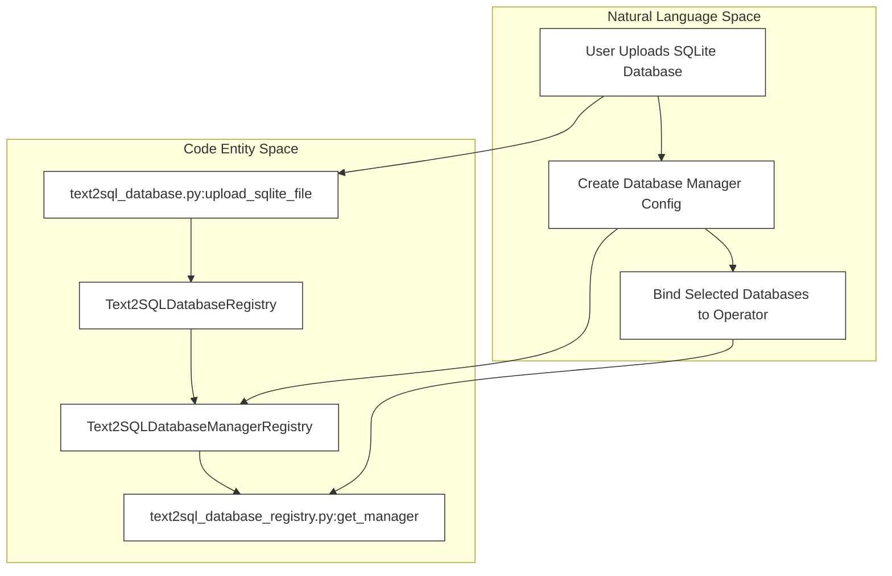
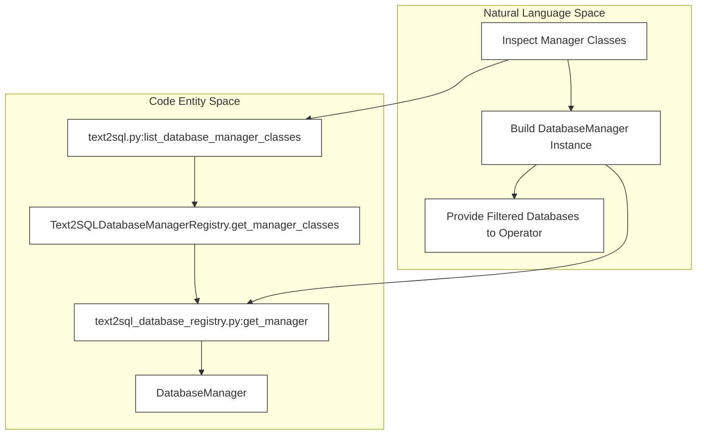

<!-- source: DeepWiki mcp.deepwiki.com · repo OpenDCAI/DataFlow-WebUI · page 3.8 Text2SQL Database Registry · fetched 2026-11-02 -->

# Text2SQL Database Registry

Relevant source files

The following files were used as context for generating this wiki page:

- [README-release-en.md](README-release-en.md)
- [README-release-zh.md](README-release-zh.md)
- [backend/app/api/v1/endpoints/text2sql_database.py](backend/app/api/v1/endpoints/text2sql_database.py)
- [backend/app/core/container.py](backend/app/core/container.py)
- [backend/app/schemas/text2sql_database.py](backend/app/schemas/text2sql_database.py)
- [backend/app/services/text2sql_database_registry.py](backend/app/services/text2sql_database_registry.py)
- [backend/tests/test_dataset_registry.py](backend/tests/test_dataset_registry.py)
- [backend/tests/test_text2sql_database_api.py](backend/tests/test_text2sql_database_api.py)
- [docs/RELEASE-PACKAGE.md](docs/RELEASE-PACKAGE.md)

## Purpose and Scope
This section details the Text2SQL database and database-manager registries within the DataFlow-WebUI backend. It covers SQLite database file persistence, security validation, metadata management via YAML configurations, REST API endpoints under `/api/v1/text2sql_database` and `/api/v1/text2sql_database_manager`, and how `DatabaseManager` instances are constructed for use by operators [backend/app/services/text2sql_database_registry.py:1-211](), [backend/app/api/v1/endpoints/text2sql_database.py:1-197]().

---

## 1. Registries Architecture and Storage Layout
The Text2SQL subsystem relies on two primary registry services managed by the application container [backend/app/core/container.py:14-15]():
1. `Text2SQLDatabaseRegistry`: Manages uploaded SQLite database files, ensuring validation, safe disk storage, and metadata persistence in a YAML registry file [backend/app/services/text2sql_database_registry.py:40-178]().
2. `Text2SQLDatabaseManagerRegistry`: Manages configurations for `DatabaseManager` instances, which select and expose subsets of registered databases for pipeline operators [backend/app/services/text2sql_database_registry.py:180-211]().

*Sources: [backend/app/core/container.py:14-15](), [backend/app/services/text2sql_database_registry.py:40-211](), [backend/app/api/v1/endpoints/text2sql_database.py:57-85]() *

---

## 2. SQLite File Validation and Sanitization
When a user uploads a SQLite database file, `Text2SQLDatabaseRegistry.upload_sqlite_file` performs rigorous checks to prevent path traversal, invalid file types, and non-SQLite content [backend/app/services/text2sql_database_registry.py:102-154]().

- **Filename Sanitization**: `_safe_filename` extracts the base name and strips dangerous characters using regular expressions, allowing only alphanumeric characters, dots, underscores, and hyphens [backend/app/services/text2sql_database_registry.py:23-26]().
- **Extension Enforcement**: Uploaded files must end with `.db`, `.sqlite`, or `.sqlite3` [backend/app/services/text2sql_database_registry.py:115-116]().
- **Binary Header Verification**: `_validate_sqlite_file` opens the file in binary mode and verifies that the first 16 bytes match the SQLite format header: `SQLite format 3\x00` [backend/app/services/text2sql_database_registry.py:95-100]().
- **Duplicate Prevention**: The file's base name (excluding extension) acts as the `db_id`. Uploading a duplicate `db_id` is explicitly rejected [backend/app/services/text2sql_database_registry.py:118-122]().

Sources: [backend/app/services/text2sql_database_registry.py:23-154](), [backend/tests/test_text2sql_database_api.py:99-152]()

---

## 3. DatabaseManager Introspection and Construction
`Text2SQLDatabaseManagerRegistry` handles CRUD operations for database manager profiles [backend/app/services/text2sql_database_registry.py:180-211](). It interfaces with the `dataflow.utils.text2sql.database_manager` module to inspect available manager classes and their initialization parameters [backend/app/services/text2sql_database_registry.py:12-21]().

*Sources: [backend/app/services/text2sql_database_registry.py:12-21](), [backend/app/services/text2sql_database_registry.py:169-178](), [backend/app/api/v1/endpoints/text2sql_database.py:120-130]() *

The `get_manager` method on `Text2SQLDatabaseRegistry` initializes the underlying `DatabaseManager` pointing to `sqlite_root`, and filters the available databases based on the provided list of `selected_db_ids` [backend/app/services/text2sql_database_registry.py:169-178]().

Sources: [backend/app/services/text2sql_database_registry.py:12-21](), [backend/app/services/text2sql_database_registry.py:169-178](), [backend/app/api/v1/endpoints/text2sql_database.py:120-130]()

---

## 4. API Endpoints and Routing
The Text2SQL endpoints are split into two routers mounted under `/api/v1/text2sql_database` and `/api/v1/text2sql_database_manager` [backend/app/api/v1/endpoints/text2sql_database.py:16-17]().

| Endpoint Route | HTTP Method | Description | Source Reference |
| :--- | :--- | :--- | :--- |
| `/api/v1/text2sql_database/` | `GET` | Lists all uploaded SQLite databases (excluding raw filesystem paths). | [backend/app/api/v1/endpoints/text2sql_database.py:20-35]() |
| `/api/v1/text2sql_database/{db_id}` | `GET` | Retrieves detailed metadata for a specific database. | [backend/app/api/v1/endpoints/text2sql_database.py:38-54]() |
| `/api/v1/text2sql_database/upload` | `POST` | Uploads and registers a new SQLite database file. | [backend/app/api/v1/endpoints/text2sql_database.py:57-85]() |
| `/api/v1/text2sql_database/{db_id}` | `DELETE` | Deletes a registered database and removes its file from disk. | [backend/app/api/v1/endpoints/text2sql_database.py:87-103]() |
| `/api/v1/text2sql_database_manager/` | `GET` | Lists all saved `DatabaseManager` configurations. | [backend/app/api/v1/endpoints/text2sql_database.py:105-116]() |
| `/api/v1/text2sql_database_manager/classes`| `GET` | Returns introspection data for available `DatabaseManager` classes and parameters. | [backend/app/api/v1/endpoints/text2sql_database.py:119-130]() |
| `/api/v1/text2sql_database_manager/` | `POST` | Creates a new `DatabaseManager` configuration with selected database IDs. | [backend/app/api/v1/endpoints/text2sql_database.py:151-178]() |

Sources: [backend/app/api/v1/endpoints/text2sql_database.py:16-178]()

---

## 5. Pydantic Schemas
Data validation and response serialization are governed by schemas defined in `backend/app/schemas/text2sql_database.py`:
- `Text2SQLDatabaseSchema`: Represents database metadata (`id`, `name`, `file_name`, `uploaded_at`, `size`, `description`) [backend/app/schemas/text2sql_database.py:5-12]().
- `Text2SQLDatabaseManagerCreateSchema`: Validates creation payloads, requiring `name`, `cls_name`, `db_type`, and a list of `selected_db_ids` [backend/app/schemas/text2sql_database.py:26-31]().
- `Text2SQLDatabaseManagerClassSchema`: Exposes class introspection results including initialization parameters (`params`) [backend/app/schemas/text2sql_database.py:44-47]().

Sources: [backend/app/schemas/text2sql_database.py:1-48]()

---

