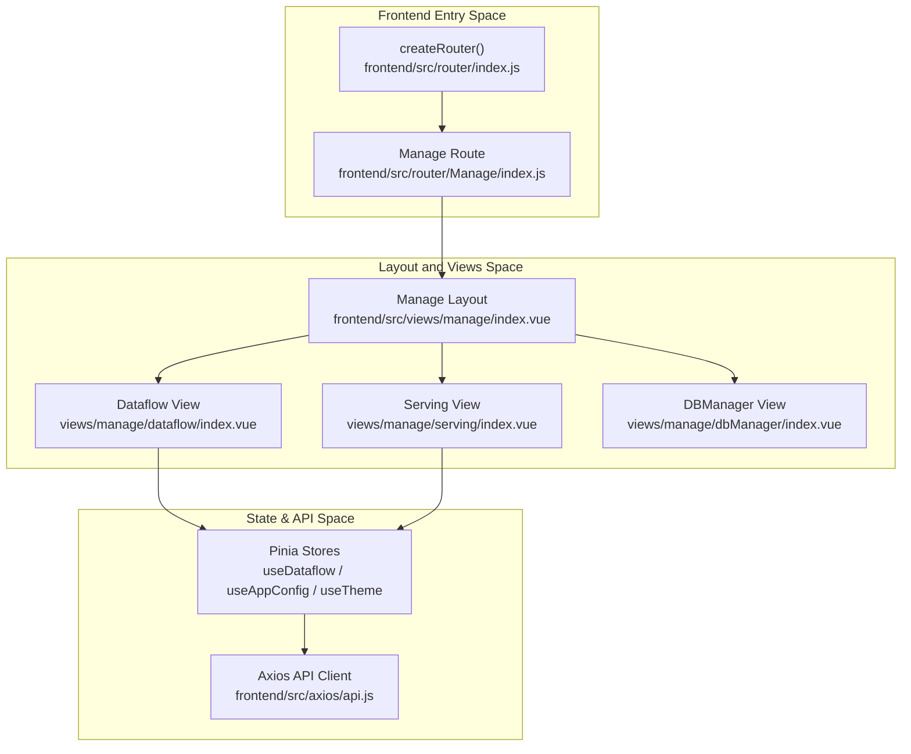

<!-- source: DeepWiki mcp.deepwiki.com · repo OpenDCAI/DataFlow-WebUI · page 4 Frontend Application · fetched 2026-11-02 -->

# Frontend Application

Relevant source files

The following files were used as context for generating this wiki page:

- [frontend/package.json](frontend/package.json)
- [frontend/public/favicon.ico](frontend/public/favicon.ico)
- [frontend/src/assets/logo/logo.ico](frontend/src/assets/logo/logo.ico)
- [frontend/src/components/manage/mainFlow/nodes/baseNode.vue](frontend/src/components/manage/mainFlow/nodes/baseNode.vue)
- [frontend/src/components/manage/mainFlow/panels/datasetPanel/commonDataset/index.vue](frontend/src/components/manage/mainFlow/panels/datasetPanel/commonDataset/index.vue)
- [frontend/src/router/Manage/index.js](frontend/src/router/Manage/index.js)
- [frontend/src/router/index.js](frontend/src/router/index.js)
- [frontend/src/style/dataflow.scss](frontend/src/style/dataflow.scss)
- [frontend/src/views/manage/index.vue](frontend/src/views/manage/index.vue)
- [frontend/yarn.lock](frontend/yarn.lock)

## Purpose and Scope

The frontend application provides the web-based graphical user interface for DataFlow-WebUI, built as a single-page application (SPA) using Vue 3, Vite, and Vue Flow. It enables users to visually construct, configure, execute, and monitor AI/ML data processing pipelines, as well as manage supporting resources like datasets, LLM serving instances, prompt templates, and database connections. 

As a PARENT wiki page, this document outlines the high-level architecture, build tooling, routing, and component layout of the frontend. Deep technical details are delegated to specialized child pages:
- For canvas layout, operator placement, and execution monitoring, see [Main Pipeline Editor](#4.1).
- For Vue Flow node components, edge synchronization, and rendering hooks, see [Pipeline Visualization](#4.2).
- For the generated Axios client and data models, see [API Client Layer](#4.3).
- For management views and side panels, see [Management Views and Panels](#4.4).
- For Pinia stores, localization, and global state, see [State Management](#4.5).

Sources: [frontend/package.json:1-42](), [frontend/src/router/index.js:1-31]()

## Build Tooling, Routing, and Architecture Overview

The frontend codebase is located in the `frontend/` directory and is built with **Vite 5** [frontend/package.json:40-40](), leveraging **Vue 3** [frontend/package.json:29-29]() and **Pinia** [frontend/package.json:28-28]() for state management. Routing is handled by **Vue Router 4** [frontend/package.json:30-30]() using hash history modes [frontend/src/router/index.js:1-10](). 

The application architecture separates client views (`/`) from management workspaces (`/m`), which host the core data preparation canvas, serving manager, DB manager, and prompt manager [frontend/src/router/Manage/index.js:1-66]().

Sources: [frontend/src/router/index.js:1-31](), [frontend/src/router/Manage/index.js:1-66](), [frontend/src/views/manage/index.vue:1-166]()

---

## 4.1. Main Pipeline Editor

The main pipeline editor is hosted at `views/manage/dataflow/index.vue` and serves as the primary workspace for designing DAGs. It manages the Vue Flow canvas layout, operator drop zones, topological sorting (`sortPipeline`), persistence, and execution lifecycle polling. It also integrates resizable panels for task logs and AI chat assistance.

For full details on canvas mechanics, DAG validation, and execution controls, see [Main Pipeline Editor](#4.1).

Sources: [frontend/src/router/Manage/index.js:9-12]()

---

## 4.2. Pipeline Visualization

Pipeline visualization relies on **Vue Flow** integration (`@vue-flow/core`) to render interactive nodes and edges. Custom node components such as `baseNode.vue` handle structured headers, status badges, port handles, and deletion triggers. Business hooks like `usePipelineOperation` and `useEdgeSync` handle automatic parameter edge wiring and rendering state.

For implementation specifics on node types, handles, and styling, see [Pipeline Visualization](#4.2).

Sources: [frontend/src/components/manage/mainFlow/nodes/baseNode.vue:1-122]()

---

## 4.3. API Client Layer

Communication with the FastAPI backend is mediated through an Axios-based generated client layer (`frontend/src/axios/api.js` and `frontend/src/axios/model.js`). This layer exposes type-safe class wrappers for datasets, operators, tasks, pipelines, and serving instances, complete with promise envelopes, error interceptors, and upload progress tracking.

For detailed method signatures, request/response envelopes, and data models, see [API Client Layer](#4.3).

Sources: [frontend/package.json:12-12]()

---

## 4.4. Management Views and Panels

Beyond the primary canvas, the frontend provides non-canvas management interfaces mounted under `/m/`. These include the Serving Manager, DB Manager, Prompt Manager, JSON Schema Manager, Data Visualization, and Settings views. Side panels like `commonDataset/index.vue` allow users to inspect database schemas, upload files, and preview records before injecting them into pipelines.

For an inventory of auxiliary views and side panels, see [Management Views and Panels](#4.4).

Sources: [frontend/src/views/manage/index.vue:61-128](), [frontend/src/components/manage/mainFlow/panels/datasetPanel/commonDataset/index.vue:1-68]()

---

## 4.5. State Management

Global state across the Vue application is coordinated via Pinia stores. Key stores include `useDataflow` (managing datasets, active pipelines, and operator catalogs), `useAppConfig` (handling internationalization/localization strings via `local()`), and `useTheme` (controlling dark/light themes, accent colors, and gradients). Global hooks and event buses bridge components with the API layer.

For details on store architecture and state reactivity, see [State Management](#4.5).

Sources: [frontend/src/views/manage/index.vue:38-40](), [frontend/src/components/manage/mainFlow/panels/datasetPanel/commonDataset/index.vue:71-74]()

---

