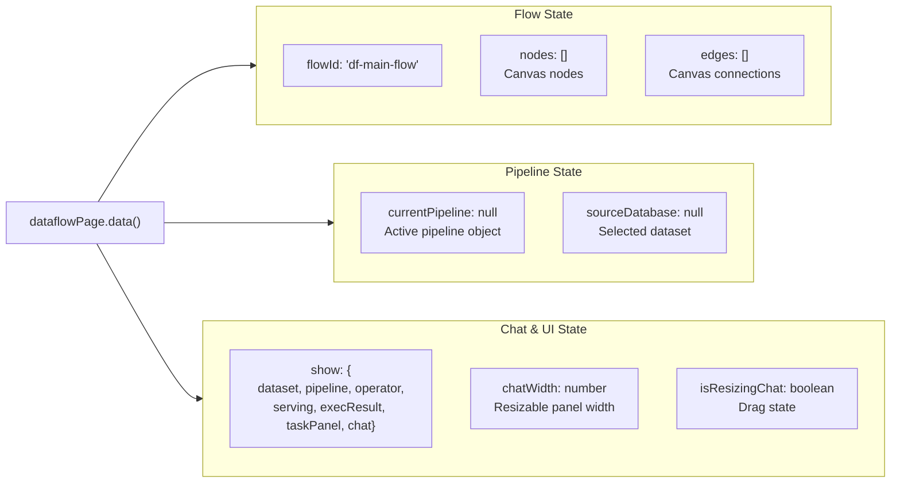
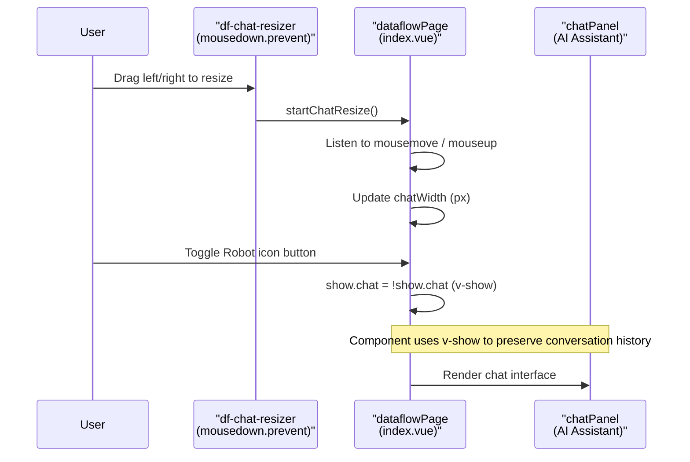
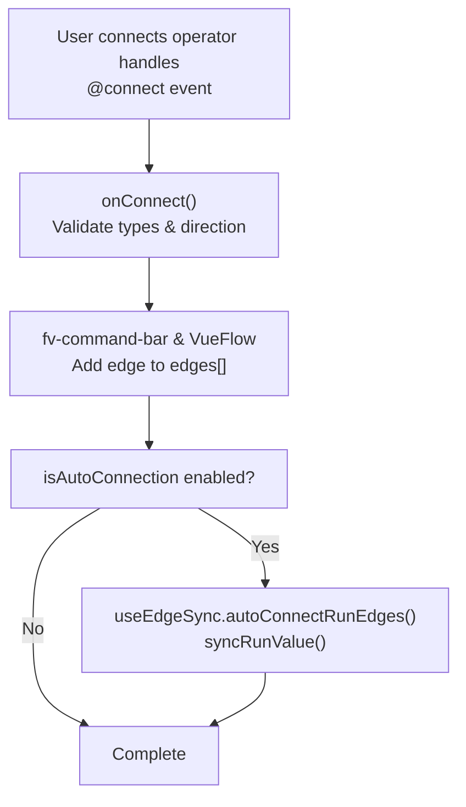

<!-- source: DeepWiki mcp.deepwiki.com · repo OpenDCAI/DataFlow-WebUI · page 4.1 Main Pipeline Editor · fetched 2026-11-02 -->

# Main Pipeline Editor

Relevant source files

The following files were used as context for generating this wiki page:

- [frontend/src/components/manage/mainFlow/pipeline/index.vue](frontend/src/components/manage/mainFlow/pipeline/index.vue)
- [frontend/src/components/manage/mainFlow/tools/currentPipelineBlock.vue](frontend/src/components/manage/mainFlow/tools/currentPipelineBlock.vue)
- [frontend/src/stores/dataflow.js](frontend/src/stores/dataflow.js)
- [frontend/src/views/manage/dataflow/index.vue](frontend/src/views/manage/dataflow/index.vue)

## Purpose and Scope

The Main Pipeline Editor is the primary user interface for creating, configuring, and executing data processing pipelines in DataFlow-WebUI. This page documents the `dataflowPage` component located at [frontend/src/views/manage/dataflow/index.vue:1-97](), which provides a visual canvas for building directed acyclic graphs (DAGs) of operators, connecting them to datasets, monitoring execution in real-time, and interacting with the resizable AI assistant chat panel.

This page covers the editor's UI components, user interactions, state management, execution workflows, and AI chat panel integration. For backend pipeline execution details, see [2.4](). For the Vue Flow rendering logic, see [4.2](). For API communication details, see [4.3]().

Sources: [frontend/src/views/manage/dataflow/index.vue:1-97]()

---

## Component Architecture

The `dataflowPage` component acts as an orchestrator, managing multiple sub-components and coordinating between the visual canvas, modal panels, execution tools, and the AI chat panel.

### Component Hierarchy

```mermaid
graph TB
    DataflowPage["dataflowPage<br/>(index.vue)"]
    
    subgraph Canvas["Canvas Area"]
        MainFlow["mainFlow<br/>Vue Flow canvas"]
        OperatorNode["operatorNode<br/>Operator visual nodes"]
        DatabaseNode["databaseNode<br/>Dataset source node"]
    end
    
    subgraph Panels["Modal Panels & Chat"]
        PipelinePanel["pipelinePanel<br/>Pipeline selection/creation"]
        DatasetPanel["datasetPanel<br/>Dataset picker"]
        OperatorPanel["operatorPanel<br/>Operator library"]
        ExecResultPanel["execResultPanel<br/>Execution results viewer"]
        TaskPanel["taskPanel<br/>Task history"]
        ChatPanel["chatPanel<br/>AI assistant chat view"]
    end
    
    subgraph ControlUI["Control Interface"]
        CommandBar["fv-command-bar<br/>Action toolbar"]
        CurrentPipeline["currentPipelineBlock<br/>Pipeline info display"]
        ChatResizer["df-chat-resizer<br/>Resize handle"]
    end
    
    subgraph Hooks["Business Logic & Stores"]
        PipelineOp["usePipelineOperation<br/>addPipelineNode()<br/>renderPipeline()"]
        EdgeSync["useEdgeSync<br/>syncRunValue()<br/>autoConnectRunEdges()"]
        DataflowStore["useDataflow<br/>Pinia store"]
    end
    
    DataflowPage --> MainFlow
    DataflowPage --> PipelinePanel
    DataflowPage --> DatasetPanel
    DataflowPage --> OperatorPanel
    DataflowPage --> ExecResultPanel
    DataflowPage --> TaskPanel
    DataflowPage --> ChatPanel
    DataflowPage --> CommandBar
    DataflowPage --> CurrentPipeline
    DataflowPage --> ChatResizer
    
    MainFlow --> OperatorNode
    MainFlow --> DatabaseNode
    
    DataflowPage --> PipelineOp
    DataflowPage --> EdgeSync
    DataflowPage --> DataflowStore
    MainFlow --> PipelineOp
```

Sources: [frontend/src/views/manage/dataflow/index.vue:1-97](), [frontend/src/stores/dataflow.js:1-115]()

### Component Registration and Layout

The main component layout establishes a flexible grid structure containing the pipeline management drawer, the central Vue Flow canvas, control toolbars, and the resizable AI chat interface on the right.

Sources: [frontend/src/views/manage/dataflow/index.vue:1-97]()

---

## Data Model and State

The component maintains reactive state for managing UI visibility, execution tracking, chat drawer dimensions, and canvas elements.

### Core Data Properties

Sources: [frontend/src/views/manage/dataflow/index.vue:85-97]()

Sources: [frontend/src/views/manage/dataflow/index.vue:1-97]()

---

## AI Assistant Chat Panel Integration

The AI Assistant integration allows natural language interaction directly alongside the pipeline editor. It is rendered inside a resizable side container (`df-chat-container`) controlled by visibility flags and a dedicated resizing handle.

### Chat Panel Architecture and Interaction

### Chat Panel Features
- **Persistence via `v-show`**: The chat panel uses `v-show` instead of `v-if` [frontend/src/views/manage/dataflow/index.vue:86](), ensuring that the component remains mounted and conversation history is retained when toggling visibility.
- **Resizable Width**: A dedicated handle (`df-chat-resizer`) [frontend/src/views/manage/dataflow/index.vue:89-94]() captures mouse events to dynamically adjust the width of the chat container.

Sources: [frontend/src/views/manage/dataflow/index.vue:85-96]()

---

## Command Bar Interface

The command bar provides primary control actions, navigation triggers, and operational switches via `fv-command-bar`.

### Command Bar Actions & Right-Side Controls

- **Dataset Selection Button**: Opens dataset panel [frontend/src/views/manage/dataflow/index.vue:7]()
- **Pipeline Sidebar Toggle**: Opens pipeline list [frontend/src/views/manage/dataflow/index.vue:3-5]()
- **Auto Connection Switch**: Toggles `isAutoConnectionModel` [frontend/src/views/manage/dataflow/index.vue:27-32]()
- **Serving Button**: Configures LLM serving instances [frontend/src/views/manage/dataflow/index.vue:33-45]()
- **Save & Run Button**: Persists and executes the active pipeline configuration [frontend/src/views/manage/dataflow/index.vue:46-58]()
- **Stop Execution Button**: Cancels running tasks via `stopExecution()` [frontend/src/views/manage/dataflow/index.vue:59-64]()
- **AI Assistant Button**: Toggles `show.chat` visibility [frontend/src/views/manage/dataflow/index.vue:70-77]()

Sources: [frontend/src/views/manage/dataflow/index.vue:11-83]()

---

## Canvas Operations and Edge Synchronization

The canvas uses `mainFlow` and Vue Flow to manage nodes, data edges (`node`), and run parameter binding edges (`run_key`).

### Edge Connection & Auto-Sync Mapping

Sources: [frontend/src/views/manage/dataflow/index.vue:6-10](), [frontend/src/stores/dataflow.js:1-115]()

---

## Pipeline Lifecycle and Execution Monitoring

Pipelines progress through saving, validation, topological sorting via `sortPipeline()`, and asynchronous execution monitored through polling.

### Execution State Lifecycle

- **Idle**: Ready for user inputs and parameter edits.
- **Validating / Saving**: Serializes DAG structure and persists via backend API endpoints.
- **Running**: Triggers backend execution tasks and polls execution status.
- **Completed / Failed**: Updates UI locks and displays results via `execResultPanel` or download links.

Sources: [frontend/src/views/manage/dataflow/index.vue:3-10](), [frontend/src/components/manage/mainFlow/tools/currentPipelineBlock.vue:1-27]()

Sources: [frontend/src/views/manage/dataflow/index.vue:1-97](), [frontend/src/components/manage/mainFlow/tools/currentPipelineBlock.vue:1-27]()

---

