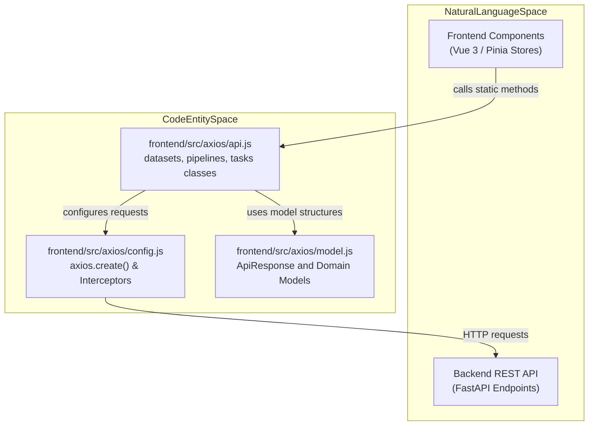
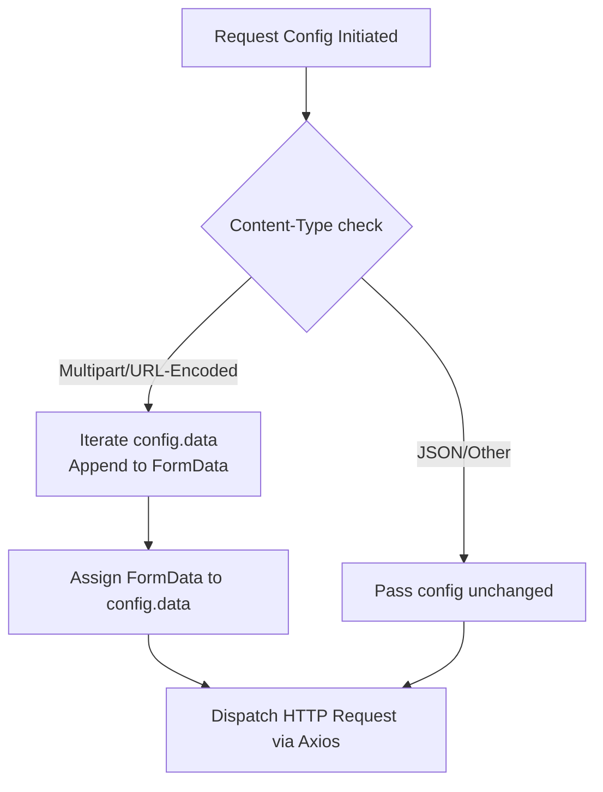
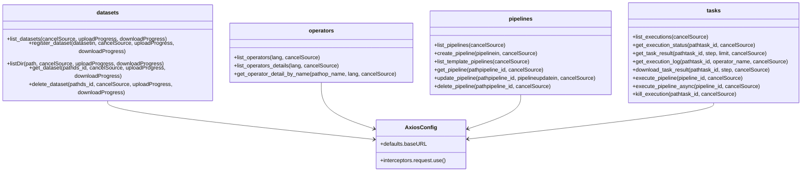
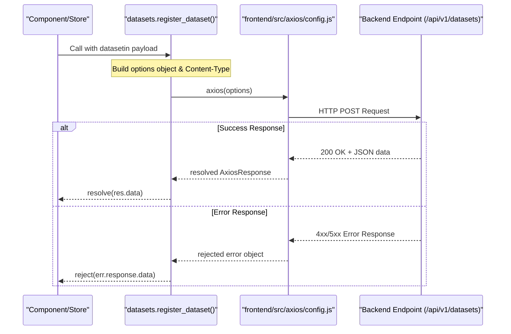
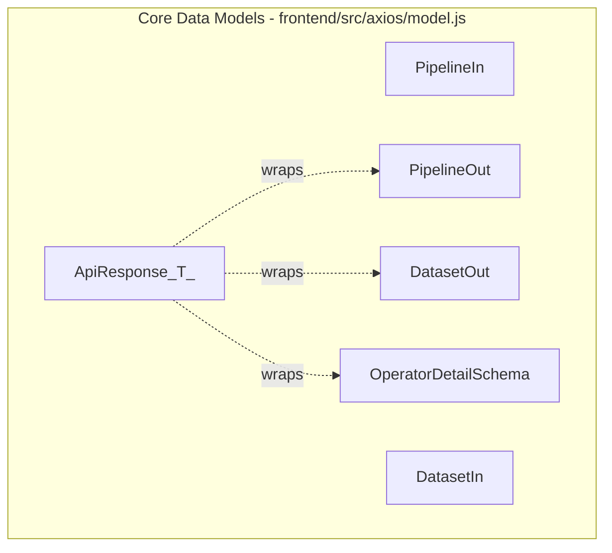

<!-- source: DeepWiki mcp.deepwiki.com · repo OpenDCAI/DataFlow-WebUI · page 4.3 API Client Layer · fetched 2026-11-02 -->

# API Client Layer

Relevant source files

The following files were used as context for generating this wiki page:

- [frontend/.env.production](frontend/.env.production)
- [frontend/src/assets/nav/dbManager.svg](frontend/src/assets/nav/dbManager.svg)
- [frontend/src/axios/api.js](frontend/src/axios/api.js)
- [frontend/src/axios/config.js](frontend/src/axios/config.js)
- [frontend/src/axios/model.js](frontend/src/axios/model.js)
- [frontend/src/components/manage/mainFlow/panels/datasetPanel/preview/dataInfo.vue](frontend/src/components/manage/mainFlow/panels/datasetPanel/preview/dataInfo.vue)

## Purpose and Scope

The API Client Layer provides a typed, Promise-based HTTP communication interface between the Vue.js frontend and FastAPI backend. This layer abstracts all backend API interactions into static class methods organized by resource type, with comprehensive request/response schemas defined in TypeScript-compatible model classes.

This document covers the structure and usage of the Axios-based API client located in [frontend/src/axios/api.js](), configured via [frontend/src/axios/config.js](), and typed through [frontend/src/axios/model.js](). For information about how the API client is consumed by components, see [State Management](#4.5). For backend API endpoint specifications, see [API Reference](#5).

Sources: [frontend/src/axios/api.js:1-3009](), [frontend/src/axios/config.js:1-39](), [frontend/src/axios/model.js:1-1980]()

---

## Architecture Overview

The API client layer consists of core configuration, generated resource methods, and model schemas:

| File | Purpose | Lines of Code |
|------|---------|---------------|
| `frontend/src/axios/config.js` | Axios instance setup, baseURL handling, and request interceptors | ~40 |
| `frontend/src/axios/api.js` | API method definitions organized by resource type | ~3000 |
| `frontend/src/axios/model.js` | TypeScript-compatible data model classes and response wrappers | ~1980 |

Each API resource (datasets, operators, pipelines, tasks, serving, etc.) is represented as a static class containing methods that map 1:1 to backend REST endpoints.

Title: "Natural Language to Code Entity Mapping: API Client Layer Architecture"

Sources: [frontend/src/axios/api.js:1-3009](), [frontend/src/axios/config.js:1-39](), [frontend/src/axios/model.js:1-1980]()

---

## Axios Configuration and Interceptors

The base Axios instance is initialized in [frontend/src/axios/config.js]() [frontend/src/axios/config.js:3-3](). It dynamically configures `baseURL` depending on whether the application is running in production (`import.meta.env.MODE == 'production'`) or development mode [frontend/src/axios/config.js:8-12](). In development, requests are proxied via Vite to the backend, keeping `baseURL` empty [frontend/src/axios/config.js:10-12]().

A request interceptor handles automatic `FormData` serialization when `Content-Type` headers include `x-www-form-urlencoded` or `multipart/form-data` [frontend/src/axios/config.js:14-33]().

Title: "Request Interceptor Pipeline Flow"

Sources: [frontend/src/axios/config.js:1-39]()

---

## API Resource Classes

The API client organizes methods into nine static classes, each representing a distinct backend resource type:

### Class Structure

Title: "Code Entity Relationships for API Resource Classes"

Sources: [frontend/src/axios/api.js:11-3007](), [frontend/src/axios/config.js:1-39]()

---

### Endpoint to Backend Mapping

Each API class method maps directly to a backend REST endpoint:

| Class | Method | HTTP Method | Backend Endpoint |
|-------|--------|-------------|------------------|
| `datasets` | `list_datasets()` | GET | `/api/v1/datasets/` |
| `datasets` | `register_dataset()` | POST | `/api/v1/datasets/` |
| `datasets` | `get_dataset()` | GET | `/api/v1/datasets/{ds_id}` |
| `datasets` | `upload_dataset()` | POST | `/api/v1/datasets/upload` |
| `operators` | `list_operators()` | GET | `/api/v1/operators/` |
| `operators` | `list_operators_details()` | GET | `/api/v1/operators/details` |
| `pipelines` | `list_pipelines()` | GET | `/api/v1/pipelines/` |
| `pipelines` | `create_pipeline()` | POST | `/api/v1/pipelines/` |
| `pipelines` | `update_pipeline()` | PUT | `/api/v1/pipelines/{pipeline_id}` |
| `tasks` | `execute_pipeline_async()` | POST | `/api/v1/tasks/execute-async` |
| `tasks` | `get_execution_status()` | GET | `/api/v1/tasks/execution/{task_id}/status` |
| `tasks` | `get_task_result()` | GET | `/api/v1/tasks/execution/{task_id}/result` |

Sources: [frontend/src/axios/api.js:531-607](), [frontend/src/axios/api.js:770-790](), [frontend/src/axios/api.js:1584-1628]()

---

## Request Handling Pattern

All API methods follow a consistent request handling pattern implemented as asynchronous functions returning Promises:

Title: "Sequence Diagram for API Request Execution"

Sources: [frontend/src/axios/api.js:19-111](), [frontend/src/axios/config.js:1-39]()

---

## Data Model Schemas

The [frontend/src/axios/model.js]() file contains TypeScript-compatible class definitions representing request/response schemas:

Title: "Data Model Schema Hierarchy"

Sources: [frontend/src/axios/model.js:1-1980]()

---

## Response Handling and Error Handling

The API client implements two response handling strategies based on content type (`json` vs `blob`) [frontend/src/axios/api.js:40-49](), and a three-level error rejection model (structured API errors, HTTP response objects, and network errors) [frontend/src/axios/api.js:50-59](). Components receive structured error payloads thrown from the Promise rejection catch blocks.

Sources: [frontend/src/axios/api.js:40-59]()

---

## Summary Table

### Complete API Resource Method Reference

| Resource Class | Method Count | Primary Use Cases |
|----------------|--------------|-------------------|
| `datasets` | 9 | Dataset CRUD, preview, column inspection, file upload [frontend/src/axios/api.js:11-3188]() |
| `operators` | 3 | Operator discovery, schema introspection [frontend/src/axios/api.js:1-3188]() |
| `pipelines` | 6 | Pipeline CRUD, template listing [frontend/src/axios/api.js:1-3188]() |
| `tasks` | 8 | Pipeline execution, status monitoring, result retrieval [frontend/src/axios/api.js:1-3188]() |
| `serving` | 7 | LLM serving instance management, testing [frontend/src/axios/api.js:1-3188]() |

Sources: [frontend/src/axios/api.js:1-3188](), [frontend/src/axios/model.js:1-2075]()

---

