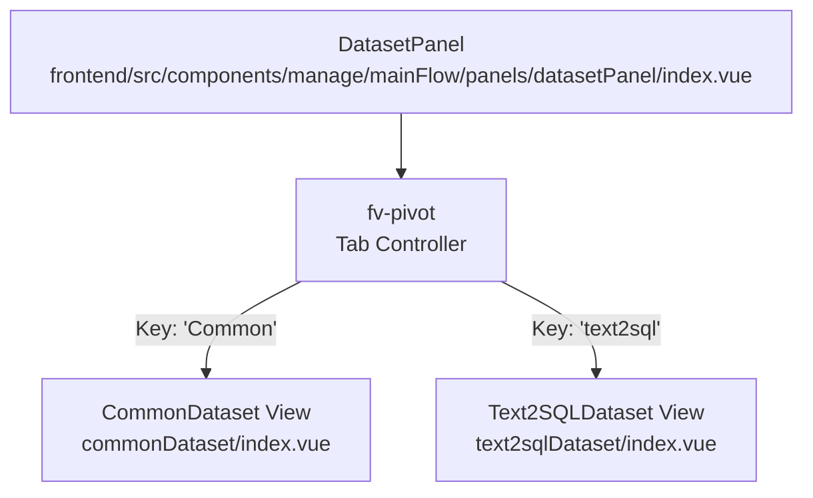
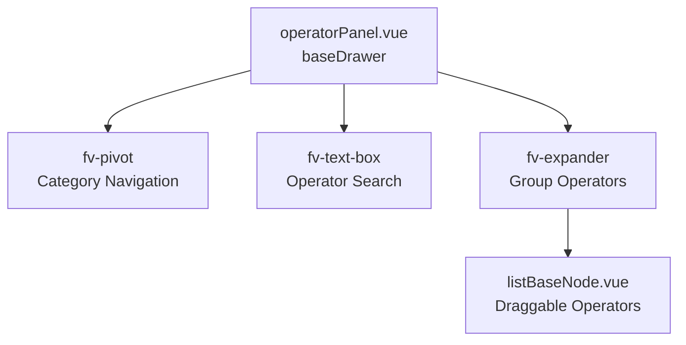
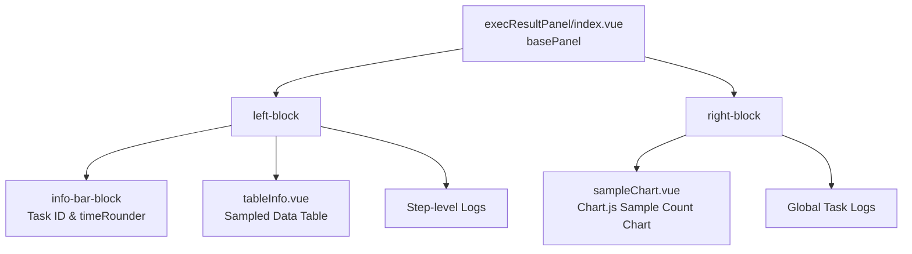

<!-- source: DeepWiki mcp.deepwiki.com · repo OpenDCAI/DataFlow-WebUI · page 4.4 Management Views and Panels · fetched 2026-11-02 -->

# Management Views and Panels

Relevant source files

The following files were used as context for generating this wiki page:

- [backend/app/api/v1/endpoints/json_schemas.py](backend/app/api/v1/endpoints/json_schemas.py)
- [frontend/src/assets/flow/database.svg](frontend/src/assets/flow/database.svg)
- [frontend/src/assets/flow/pipeline.svg](frontend/src/assets/flow/pipeline.svg)
- [frontend/src/assets/flow/save.svg](frontend/src/assets/flow/save.svg)
- [frontend/src/components/general/basePanel.vue](frontend/src/components/general/basePanel.vue)
- [frontend/src/components/manage/mainFlow/panels/datasetPanel/index.vue](frontend/src/components/manage/mainFlow/panels/datasetPanel/index.vue)
- [frontend/src/components/manage/mainFlow/panels/datasetPanel/text2sqlDataset/index.vue](frontend/src/components/manage/mainFlow/panels/datasetPanel/text2sqlDataset/index.vue)
- [frontend/src/components/manage/mainFlow/panels/execResultPanel/index.vue](frontend/src/components/manage/mainFlow/panels/execResultPanel/index.vue)
- [frontend/src/components/manage/mainFlow/panels/execResultPanel/preview/sampleChart.vue](frontend/src/components/manage/mainFlow/panels/execResultPanel/preview/sampleChart.vue)
- [frontend/src/components/manage/mainFlow/panels/operatorPanel.vue](frontend/src/components/manage/mainFlow/panels/operatorPanel.vue)
- [frontend/src/components/manage/mainFlow/panels/taskPanel.vue](frontend/src/components/manage/mainFlow/panels/taskPanel.vue)
- [frontend/src/views/manage/dbManager/index.vue](frontend/src/views/manage/dbManager/index.vue)
- [frontend/src/views/manage/prompts/index.vue](frontend/src/views/manage/prompts/index.vue)
- [frontend/src/views/manage/schemas/index.vue](frontend/src/views/manage/schemas/index.vue)
- [frontend/src/views/manage/serving/index.vue](frontend/src/views/manage/serving/index.vue)
- [frontend/src/views/manage/settings/index.vue](frontend/src/views/manage/settings/index.vue)
- [frontend/vite.config.js](frontend/vite.config.js)

Non-canvas views and side panels provide the administrative, configuration, and inspection interfaces in the DataFlow-WebUI frontend. These components manage serving instances, datasets, operators, tasks, execution results, JSON schemas, prompt templates, application preferences, and database managers.

---

## 1. Serving Management UI

The Serving Management UI ([frontend/src/views/manage/serving/index.vue:1-573]()) provides a web interface for managing LLM serving instances. Users can create, edit, delete, and test serving configurations through a collapsible panel interface. The component handles parameter type conversion, validates inputs, and implements a locking mechanism to prevent concurrent operations.

For backend serving management details, see [Serving Management](#3.6). For REST API endpoints used by this component, see [Serving Endpoints](#5.5).

```mermaid
graph TB
    ServingPage["ServingPage Component<br/>frontend/src/views/manage/serving/index.vue"]
    
    subgraph "Component Data"
        CreateProps["createProps<br/>Available serving classes"]
        ChoosenClsItem["choosenClsItem<br/>Selected class for new serving"]
        ServingName["servingName<br/>Name input for new serving"]
        ServingList["servingList<br/>Existing serving instances"]
        DefaultValues["defaultValues<br/>Type-based defaults"]
        FormatValues["formatValues<br/>Type converters"]
        Show["show.add<br/>Toggle add panel"]
        Lock["lock<br/>{add, edit, test, delete}"]
    end
    
    subgraph "Pinia Stores"
        AppConfig["useAppConfig<br/>local() localization"]
        Theme["useTheme<br/>theme, color, gradient"]
        Dataflow["useDataflow<br/>getServingList()"]
    end
    
    subgraph "API Client"
        ServingAPI["$api.serving"]
        ListClasses["list_serving_classes()"]
        CreateInstance["create_serving_instance()"]
        UpdateInstance["update_serving_instance()"]
        DeleteInstance["delete_serving_instance()"]
        TestInstance["test_serving_instance()"]
    end
    
    ServingPage --> CreateProps
    ServingPage --> ChoosenClsItem
    ServingPage --> ServingName
    ServingPage --> ServingList
    ServingPage --> DefaultValues
    ServingPage --> FormatValues
    ServingPage --> Show
    ServingPage --> Lock
    
    ServingPage --> AppConfig
    ServingPage --> Theme
    ServingPage --> Dataflow
    
    ServingPage --> ServingAPI
    ServingAPI --> ListClasses
    ServingAPI --> CreateInstance
    ServingAPI --> UpdateInstance
    ServingAPI --> DeleteInstance
    ServingAPI --> TestInstance
```

Sources: [frontend/src/views/manage/serving/index.vue:1-573]()

---

## 2. Dataset and Text2SQL Dataset Panels

The dataset management panel (`datasetPanel`, [frontend/src/components/manage/mainFlow/panels/datasetPanel/index.vue:1-101]()) acts as a unified hub for browsing and registering data sources. It features an `fv-pivot` component that switches between Common Datasets and Text2SQL Databases.

The Text2SQL dataset panel (`text2sqlDataset`, [frontend/src/components/manage/mainFlow/panels/datasetPanel/text2sqlDataset/index.vue:1-333]()) provides file upload capabilities for SQLite databases (`.db`, `.sqlite`), metadata configuration (database name and description), table inspection, and removal workflows.

Sources: [frontend/src/components/manage/mainFlow/panels/datasetPanel/index.vue:1-101](), [frontend/src/components/manage/mainFlow/panels/datasetPanel/text2sqlDataset/index.vue:1-333]()

---

## 3. Operator Panel

The Operator Panel (`operatorPanel`, [frontend/src/components/manage/mainFlow/panels/operatorPanel.vue:1-289]()) renders as a side drawer listing available operators categorized by functional type (Parser, Filter, Generate, Evaluate, Refine, All).

Operators are filterable via search inputs and pivot tabs, and support HTML5 drag-and-drop interactions (`dragstart`) to place nodes onto the pipeline canvas [frontend/src/components/manage/mainFlow/panels/operatorPanel.vue:32-33]().

Sources: [frontend/src/components/manage/mainFlow/panels/operatorPanel.vue:1-289]()

---

## 4. Task and Execution Result Panels

### Task Panel
The Task Panel (`taskPanel`, [frontend/src/components/manage/mainFlow/panels/taskPanel.vue:1-124]()) retrieves and lists asynchronous task records associated with the active pipeline (`pipeline_id`). Each entry displays the task ID, completion timestamp, status indicator, and a view trigger button.

### Execution Result Panel
The Execution Result Panel (`execResultPanel`, [frontend/src/components/manage/mainFlow/panels/execResultPanel/index.vue:1-289]()) presents detailed debugging and output information for a completed or running task.

Sample counts per step are rendered using Chart.js in `sampleChart.vue` [frontend/src/components/manage/mainFlow/panels/execResultPanel/preview/sampleChart.vue:1-168](), combining bar and line datasets for intuitive flow inspection.

Sources: [frontend/src/components/manage/mainFlow/panels/taskPanel.vue:1-124](), [frontend/src/components/manage/mainFlow/panels/execResultPanel/index.vue:1-289](), [frontend/src/components/manage/mainFlow/panels/execResultPanel/preview/sampleChart.vue:1-168]()

---

## 5. Supporting Management Views (Schemas, Prompts, Settings, and DB Manager)

### Settings View
The Settings View ([frontend/src/views/manage/settings/index.vue:1-295]()) offers user preference configuration for interface language (`en` / `cn`) and theme mode (`light` / `dark`), synchronizing changes immediately with the backend via `/api/v1/preferences` [frontend/src/views/manage/settings/index.vue:109-112]().

### DB Manager View
The DB Manager View ([frontend/src/views/manage/dbManager/index.vue:1-571]()) administers database manager instances, allowing operators to bind multiple Text2SQL dataset sources (`selected_db_ids`) for text-to-SQL generation and validation pipelines [frontend/src/views/manage/dbManager/index.vue:51-54]().

### Schemas and Prompts Views
- **JSON Schema Manager ([frontend/src/views/manage/schemas/index.vue:1-727]()):** Provides schema creation, JSON validation, formatting helpers, and example data editors referenced via `schema_ref`.
- **Prompts View ([frontend/src/views/manage/prompts/index.vue]()):** Manages prompt templates for generation operators.

Sources: [frontend/src/views/manage/settings/index.vue:1-295](), [frontend/src/views/manage/dbManager/index.vue:1-571](), [frontend/src/views/manage/schemas/index.vue:1-727]()

---

