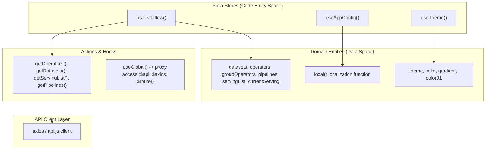
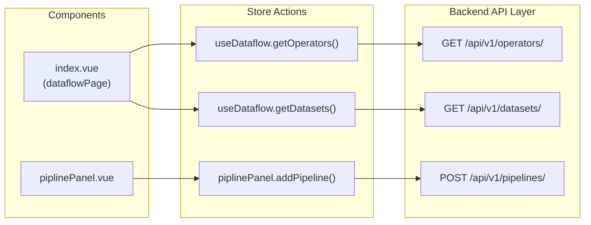
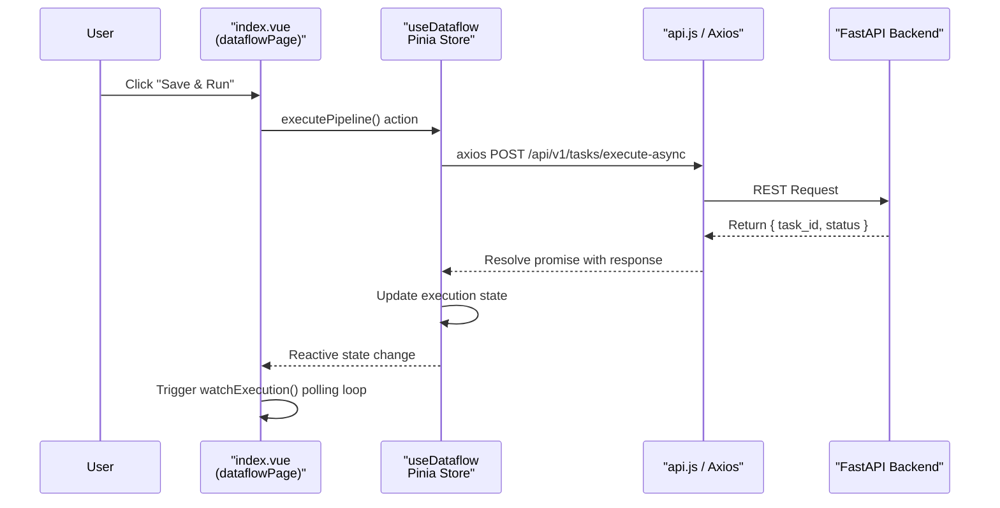

<!-- source: DeepWiki mcp.deepwiki.com · repo OpenDCAI/DataFlow-WebUI · page 4.5 State Management · fetched 2026-11-02 -->

# State Management

Relevant source files

The following files were used as context for generating this wiki page:

- [backend/tests/test_pipeline_registry.py](backend/tests/test_pipeline_registry.py)
- [frontend/src/assets/nav/dataflow.svg](frontend/src/assets/nav/dataflow.svg)
- [frontend/src/components/manage/mainFlow/panels/piplinePanel.vue](frontend/src/components/manage/mainFlow/panels/piplinePanel.vue)
- [frontend/src/hooks/general/useGlobal.js](frontend/src/hooks/general/useGlobal.js)
- [frontend/src/js/i18n.js](frontend/src/js/i18n.js)
- [frontend/src/stores/dataflow.js](frontend/src/stores/dataflow.js)
- [frontend/src/stores/theme.js](frontend/src/stores/theme.js)
- [frontend/src/style/global.scss](frontend/src/style/global.scss)
- [frontend/src/views/client/home/index.vue](frontend/src/views/client/home/index.vue)
- [frontend/src/views/manage/dataflow/index.vue](frontend/src/views/manage/dataflow/index.vue)

## Purpose and Scope

This page details the frontend state management architecture of DataFlow-WebUI, centered around **Pinia** stores (`useDataflow`, `useAppConfig`, `useTheme`), global composition hooks (`useGlobal`), internationalization (`i18n`), and reactive data flow between Vue 3 components, stores, and the REST API layer.

---

## Store Architecture Overview

Global state is segregated into three specialized Pinia stores managed via composition API syntax: `useDataflow` [frontend/src/stores/dataflow.js:6](), `useAppConfig`, and `useTheme` [frontend/src/stores/theme.js:5]().

*Diagram 1: Store Architecture and Data Separation*

**Sources:** [frontend/src/stores/dataflow.js:6-174](), [frontend/src/stores/theme.js:5-60](), [frontend/src/hooks/general/useGlobal.js:4-22]()

---

## `useDataflow` Store

The `useDataflow` store [frontend/src/stores/dataflow.js:6]() acts as the core domain store for pipelines, operators, datasets, text2sql databases, and serving instances.

### State Properties & Actions

* **`operators` / `groupOperators`**: Populated by `getOperators(lang)` [frontend/src/stores/dataflow.js:73-115] which queries `proxy.$api.operators.list_operators(lang)` and organizes operators into category groups (`level_1` and `level_2`).
* **`datasets`**: Fetched via `getDatasets()` [frontend/src/stores/dataflow.js:131-149] interacting with `proxy.$api.datasets.list_datasets()`.
* **`text2sqlDatasets`**: Managed by `getText2SqlDatasets()` [frontend/src/stores/dataflow.js:151-162] via `proxy.$api.text2sql_database.list_databases()`.
* **`servingList` / `currentServing`**: Managed by `getServingList()` [frontend/src/stores/dataflow.js:164-174] via `proxy.$api.serving.list_serving_instances_api_v1_serving__get()`.

*Diagram 2: Component-Store-API Interaction Flow*

**Sources:** [frontend/src/stores/dataflow.js:6-174](), [frontend/src/components/manage/mainFlow/panels/piplinePanel.vue:88-153]()

---

## `useAppConfig` and Internationalization (`i18n`)

The `useAppConfig` store handles global configuration state, specifically exposing the localization translation function `local()`.

### Localization Mechanics
* Translation dictionary strings reside in `frontend/src/js/i18n.js` [frontend/src/js/i18n.js:1-261], covering keys for UI labels (e.g., `"Confirm"`, `"Delete"`, `"New Pipeline"`).
* Components consume `local` via Pinia's `mapState(useAppConfig, ['local'])` [frontend/src/components/manage/mainFlow/panels/piplinePanel.vue:76].

**Sources:** [frontend/src/js/i18n.js:1-261](), [frontend/src/components/manage/mainFlow/panels/piplinePanel.vue:76]()

---

## `useTheme` Store

The `useTheme` store [frontend/src/stores/theme.js:5]() manages visual styling properties, dark/light modes, and dynamic color transformations via `onecolor`.

### State and Computed Properties
* **`theme`**: Computed string representing current mode (`'light'` or `'dark'`) [frontend/src/stores/theme.js:7-13].
* **`color`**: Primary theme color (`rgba(81, 99, 209, 1)`) [frontend/src/stores/theme.js:6-14].
* **`gradient`**: Computed CSS gradient string derived from `themeColor` using HSL transformations [frontend/src/stores/theme.js:20-33].

**Sources:** [frontend/src/stores/theme.js:5-60]()

---

## Global Hooks (`useGlobal`)

The `useGlobal` composition hook [frontend/src/hooks/general/useGlobal.js:4-22] provides a standardized wrapper around Vue's `getCurrentInstance()` to expose global Vue prototype properties inside setup functions.

### Exposed Properties
* `$api`, `$axios`, `$router`, `$Go`, `$Back`, `$Jump`, `$Guid`, `$infoBox`, `$barWarning` [frontend/src/hooks/general/useGlobal.js:13-21].

**Sources:** [frontend/src/hooks/general/useGlobal.js:4-22]()

---

## Data Flow Architecture and Synchronization

Data flows unidirectionally from user interactions in views (`dataflow/index.vue`) [frontend/src/views/manage/dataflow/index.vue:1-97] into Pinia actions, through Axios API clients, back to store states, and reactively down into computed properties and UI components.

*Diagram 3: Execution Trigger Sequence and Data Flow*

**Sources:** [frontend/src/views/manage/dataflow/index.vue:52-58](), [frontend/src/stores/dataflow.js:6-174]()

---

