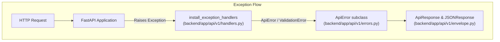
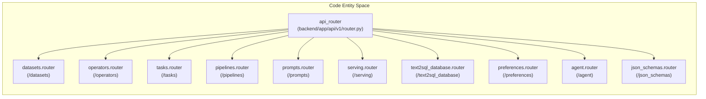

<!-- source: DeepWiki mcp.deepwiki.com · repo OpenDCAI/DataFlow-WebUI · page 5 API Reference · fetched 2026-11-02 -->

# API Reference

<details>
<summary>Relevant source files</summary>

The following files were used as context for generating this wiki page:

- [backend/Makefile](backend/Makefile)
- [backend/app/api/v1/endpoints/preferences.py](backend/app/api/v1/endpoints/preferences.py)
- [backend/app/api/v1/envelope.py](backend/app/api/v1/envelope.py)
- [backend/app/api/v1/errors.py](backend/app/api/v1/errors.py)
- [backend/app/api/v1/handlers.py](backend/app/api/v1/handlers.py)
- [backend/app/api/v1/resp.py](backend/app/api/v1/resp.py)
- [backend/app/api/v1/router.py](backend/app/api/v1/router.py)
- [backend/app/core/logger_setup.py](backend/app/core/logger_setup.py)
- [backend/app/schemas/preferences.py](backend/app/schemas/preferences.py)

</details>


This page provides a high-level reference for the REST API under `/api/v1` exposed by the FastAPI backend [backend/app/api/v1/router.py:1-28](). The API follows RESTful conventions and uses JSON for request and response bodies, wrapped in a standard response envelope structure defined by `ApiResponse` [backend/app/api/v1/envelope.py:6-11](). 

As a parent page, this document outlines core API conventions, error handling mechanisms, router organization, and links to detailed child pages for each resource domain.

---

## Response Envelope Conventions

All API endpoints wrap their payloads in a consistent response envelope (`ApiResponse`), providing uniform status codes, messages, data payloads, and metadata [backend/app/api/v1/envelope.py:6-11](). Helper functions such as `ok()` simplify returning successful responses [backend/app/api/v1/resp.py:5-6]().

```typescript
{
  "success": boolean,    // True if successful
  "code": number,        // Business error code (0 for success)
  "message": string,     // Human-readable message
  "data": T,             // Response payload
  "meta": object         // Optional metadata (e.g., pagination or HTTP status)
}
```

**Sources:** [backend/app/api/v1/envelope.py:1-11](), [backend/app/api/v1/resp.py:1-15]()

---

## Error Handling and Exception Management

The application installs custom exception handlers on the FastAPI instance to catch business errors (`ApiError`), validation errors (`RequestValidationError`), HTTP exceptions (`StarletteHTTPException`), and unhandled exceptions [backend/app/api/v1/handlers.py:20-77](). 

Standard business errors are defined in `app.api.v1.errors` with specific subclasses like `NotFoundError`, `ConflictError`, and `ValidationBizError` [backend/app/api/v1/errors.py:4-21](). Non-MCP protocol paths are caught and returned inside the standard `ApiResponse` structure [backend/app/api/v1/handlers.py:12-77]().



**Sources:** [backend/app/api/v1/handlers.py:20-77](), [backend/app/api/v1/errors.py:4-21]()

---

## Router Organization

The top-level API router (`api_router`) mounted at `/api/v1` aggregates routers across multiple resource domains, including datasets, operators, tasks, pipelines, prompts, serving instances, text2sql databases, preferences, agent sessions, and JSON schemas [backend/app/api/v1/router.py:14-26]().



**Sources:** [backend/app/api/v1/router.py:1-28]()

---

## Per-Resource API Endpoints

For detailed documentation, parameter schemas, and request/response examples, refer to the following child pages:

- **Pipeline Endpoints**: Documenting `/pipelines` endpoints such as listing, template loading, creation, validation, fetching, updates, and deletion [backend/app/api/v1/router.py:19](). For details, see [Pipeline Endpoints](#5.1).
- **Task Execution Endpoints**: Documenting `/tasks` and execution endpoints for sync/async runs, status polling, result retrieval, log streams, file downloads, statistics, and task cancellation [backend/app/api/v1/router.py:18](). For details, see [Task Execution Endpoints](#5.2).
- **Operator Endpoints**: Documenting `/operators` endpoints for listing, categorizing, retrieving operator details, category recommendations, and handling validation scoping [backend/app/api/v1/router.py:17](). For details, see [Operator Endpoints](#5.3).
- **Dataset Endpoints**: Documenting `/datasets` endpoints for dataset registration, directory scanning, previewing, column extraction, sample loading, and file uploads [backend/app/api/v1/router.py:16](). For details, see [Dataset Endpoints](#5.4).
- **Serving Endpoints**: Documenting `/serving` endpoints for listing model instances and classes, CRUD operations, key masking, and test generation [backend/app/api/v1/router.py:21](). For details, see [Serving Endpoints](#5.5).
- **Agent, Prompt and Schema Endpoints**: Documenting `/agent` chat sessions, `/prompts`, `/json_schemas`, `/preferences`, and `/text2sql_database` routes [backend/app/api/v1/router.py:9-12,20,22,24,26](). For details, see [Agent, Prompt and Schema Endpoints](#5.6).

**Sources:** [backend/app/api/v1/router.py:1-28](), [backend/app/api/v1/endpoints/preferences.py:11-60](), [backend/app/schemas/preferences.py:5-13]()

---

