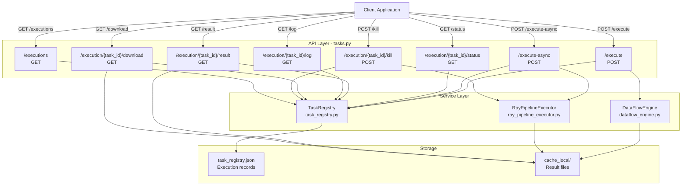
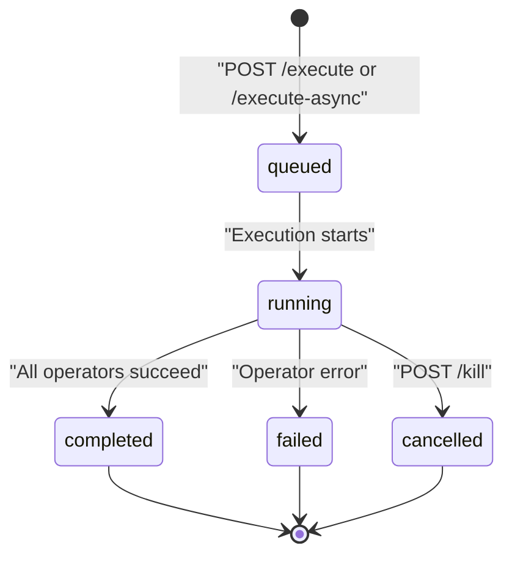
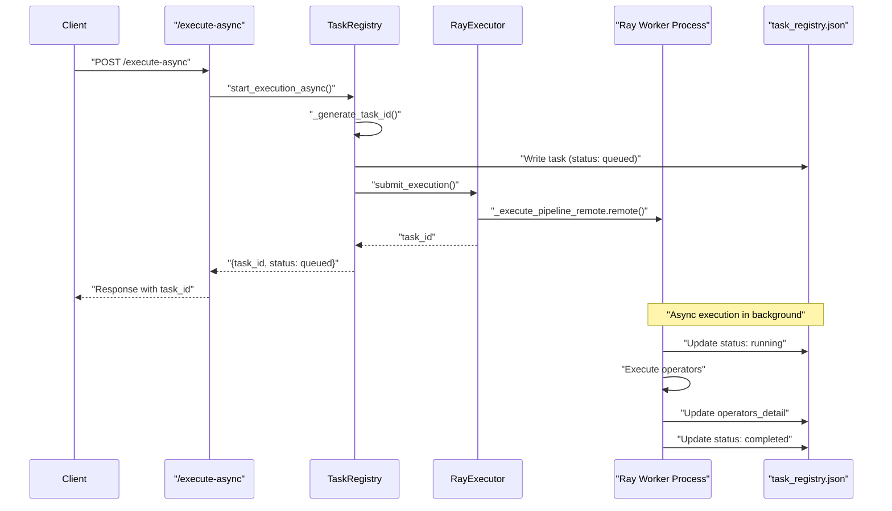
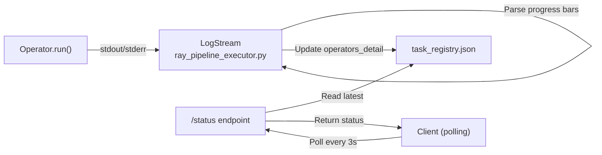
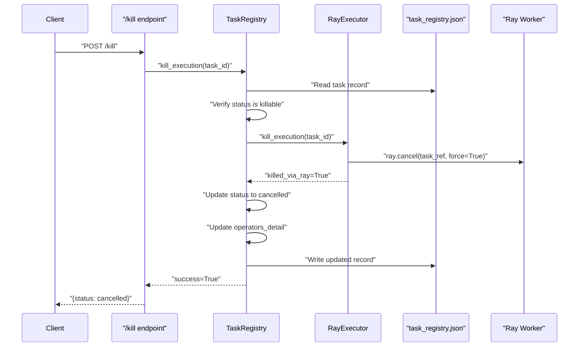
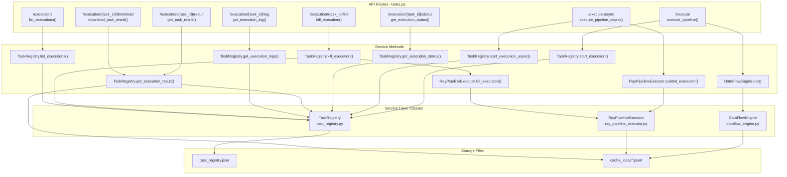

<!-- source: DeepWiki mcp.deepwiki.com · repo OpenDCAI/DataFlow-WebUI · page 5.2 Task Execution Endpoints · fetched 2026-11-02 -->

# Task Execution Endpoints

<details>
<summary>Relevant source files</summary>

The following files were used as context for generating this wiki page:

- [backend/app/api/v1/endpoints/tasks.py](backend/app/api/v1/endpoints/tasks.py)
- [backend/app/services/task_registry.py](backend/app/services/task_registry.py)

</details>


This document provides comprehensive reference documentation for all task execution API endpoints in the DataFlow-WebUI system. These endpoints enable clients to execute pipelines, monitor execution progress, retrieve results, and manage running tasks.

**Scope**: This page covers the REST API endpoints under the `/tasks` route prefix. For information about pipeline definition and configuration, see [Pipeline Endpoints](#5.1). For details on the underlying execution engine, see [DataFlow Engine](#3.3) and [Distributed Execution with Ray](#7.1).

---

## Overview

The task execution API provides both synchronous and asynchronous pipeline execution capabilities. All endpoints are defined in [backend/app/api/v1/endpoints/tasks.py]() and delegate to [TaskRegistry](backend/app/services/task_registry.py) for execution management and state tracking.

### Execution Flow Architecture



Sources: [backend/app/api/v1/endpoints/tasks.py](), [backend/app/services/task_registry.py](), [backend/app/services/dataflow_engine.py](), [backend/app/services/ray_pipeline_executor.py]()

---

## Execution Lifecycle States

All task executions progress through a defined set of states tracked by the `ExecutionStatus` enum:

| Status | Description | Transitions To |
|--------|-------------|----------------|
| `queued` | Task created, waiting for execution to begin | `running` |
| `running` | Pipeline is actively executing operators | `completed`, `failed`, `cancelled` |
| `completed` | All operators executed successfully | (terminal) |
| `failed` | Execution stopped due to error | (terminal) |
| `cancelled` | User terminated execution via kill endpoint | (terminal) |

Sources: [backend/app/schemas/pipelines.py:28-34]()



Sources: [backend/app/schemas/pipelines.py:28-34](), [backend/app/services/task_registry.py:140-145]()

---

## Pipeline Execution Endpoints

### POST /execute - Synchronous Execution

Executes a pipeline synchronously, blocking until completion. Returns the complete execution result including all operator outputs and logs.

**Route**: `POST /tasks/execute`

**Parameters**:
| Parameter | Type | Location | Required | Description |
|-----------|------|----------|----------|-------------|
| `pipeline_id` | string | query | Yes | ID of the pipeline to execute |

**Request Example**:
```http
POST /api/v1/tasks/execute?pipeline_id=abc123
```

**Response Schema** (`PipelineExecutionResult`):
```json
{
  "code": 200,
  "message": "Pipeline execution completed",
  "data": {
    "task_id": "a1b2c3d4e5f6",
    "pipeline_id": "abc123",
    "pipeline_config": {},
    "status": "completed",
    "output": {
      "operators_executed": 3,
      "operators_detail": {},
      "operator_logs": {},
      "execution_results": [],
      "success": true
    },
    "logs": [],
    "started_at": "2024-01-15T10:30:00",
    "completed_at": "2024-01-15T10:35:00"
  }
}
```

**Implementation Flow**:
1. Endpoint validates `pipeline_id` exists in `PipelineRegistry` [backend/app/services/task_registry.py:213-217]()
2. Calls `TaskRegistry.start_execution()` to create task record with status `queued` [backend/app/services/task_registry.py:210-211]()
3. Calls `DataFlowEngine.run()` which executes operators sequentially
4. Engine updates task record in real-time during execution
5. Returns complete result when execution finishes

Sources: [backend/app/api/v1/endpoints/tasks.py](), [backend/app/services/task_registry.py:210-243](), [backend/app/schemas/pipelines.py:109-118]()

---

### POST /execute-async - Asynchronous Execution

Submits a pipeline for asynchronous execution using Ray. Returns immediately with a `task_id` for status polling.

**Route**: `POST /tasks/execute-async`

**Parameters**:
| Parameter | Type | Location | Required | Description |
|-----------|------|----------|----------|-------------|
| `pipeline_id` | string | query | Yes | ID of the pipeline to execute |

**Request Example**:
```http
POST /api/v1/tasks/execute-async?pipeline_id=abc123
```

**Response Schema**:
```json
{
  "code": 200,
  "message": "Success",
  "data": {
    "task_id": "a1b2c3d4e5f6",
    "status": "queued",
    "message": "Pipeline execution submitted to Ray"
  }
}
```

**Implementation Flow**:



Sources: [backend/app/api/v1/endpoints/tasks.py](), [backend/app/services/task_registry.py:436-516](), [backend/app/services/ray_pipeline_executor.py:827-877]()

**Key Differences from Synchronous Execution**:
- Returns immediately without waiting for completion
- Execution runs in Ray worker process (requires Ray cluster)
- Task status tracked via `task_registry.json` file [backend/app/services/task_registry.py:44-53]()
- Client must poll `/execution/{task_id}/status` for progress

Sources: [backend/app/services/ray_pipeline_executor.py:670-708](), [backend/app/services/ray_pipeline_executor.py:710-825]()

---

## Status and Monitoring Endpoints

### GET /execution/{task_id}/status - Execution Status

Retrieves detailed execution status including operator-level progress and logs.

**Route**: `GET /tasks/execution/{task_id}/status`

**Parameters**:
| Parameter | Type | Location | Required | Description |
|-----------|------|----------|----------|-------------|
| `task_id` | string | path | Yes | Unique task identifier |

**Request Example**:
```http
GET /api/v1/tasks/execution/a1b2c3d4e5f6/status
```

**Response Schema**:
```json
{
  "code": 200,
  "data": {
    "task_id": "a1b2c3d4e5f6",
    "pipeline_id": "abc123",
    "pipeline_config": {},
    "status": "running",
    "operators_detail": {
      "OperatorName_0": {
        "name": "OperatorName",
        "index": 0,
        "status": "completed",
        "started_at": "2024-01-15T10:30:00",
        "completed_at": "2024-01-15T10:32:00",
        "sample_count": 1000,
        "progress": "100%|██████████| 1000/1000 [00:05<00:00, 200.00it/s]",
        "progress_percentage": 100.0
      }
    },
    "operator_logs": {},
    "logs": [],
    "started_at": "2024-01-15T10:30:00",
    "completed_at": null
  }
}
```

**Operator Status Fields**:

| Field | Type | Description |
|-------|------|-------------|
| `name` | string | Operator class name |
| `index` | integer | Position in pipeline execution sequence (0-based) |
| `status` | string | One of: `initializing`, `initialized`, `running`, `completed`, `failed`, `cancelled` |
| `started_at` | string | ISO timestamp when operator execution began |
| `completed_at` | string | ISO timestamp when operator finished (if applicable) |
| `sample_count` | integer | Number of records processed (if available) |
| `progress` | string | Human-readable progress description (e.g., tqdm output) |
| `progress_percentage` | float | Numeric progress percentage (0-100) |
| `error` | string | Error message (only if status is `failed`) |

Sources: [backend/app/api/v1/endpoints/tasks.py:32-56](), [backend/app/services/task_registry.py]()

**Real-Time Progress Tracking**:

The `operators_detail` object is updated in real-time during execution via the `LogStream` class, which captures stdout/stderr and parses progress bars:



Sources: [backend/app/services/ray_pipeline_executor.py:41-94](), [backend/app/services/ray_pipeline_executor.py:118-156](), [backend/app/services/ray_pipeline_executor.py:464-468]()

---

### GET /execution/{task_id}/log - Execution Logs

Retrieves logs for a task execution, optionally filtered by operator.

**Route**: `GET /tasks/execution/{task_id}/log`

**Parameters**:
| Parameter | Type | Location | Required | Description |
|-----------|------|----------|----------|-------------|
| `task_id` | string | path | Yes | Unique task identifier |
| `operator_name` | string | query | No | Filter logs for specific operator |

**Request Examples**:
```http
GET /api/v1/tasks/execution/a1b2c3d4e5f6/log
GET /api/v1/tasks/execution/a1b2c3d4e5f6/log?operator_name=TextFilter_0
```

**Response Schema**:
```json
{
  "code": 200,
  "data": [
    "[2024-01-15T10:30:00] Starting pipeline execution",
    "[2024-01-15T10:30:01] Initializing operator: TextFilter",
    "[2024-01-15T10:30:05] TextFilter completed successfully"
  ]
}
```

**Implementation Details**:
- Without `operator_name`: Returns global pipeline logs from `execution_data["logs"]`
- With `operator_name`: Returns operator-specific logs from `execution_data["output"]["operator_logs"][operator_name]`
- Logs are progressively appended during execution via `add_log()` function

Sources: [backend/app/api/v1/endpoints/tasks.py:87-115](), [backend/app/services/task_registry.py](), [backend/app/services/ray_pipeline_executor.py:203-210]()

---

### GET /execution/{task_id}/result - Execution Results

Retrieves execution results with sample data from a specific pipeline step.

**Route**: `GET /tasks/execution/{task_id}/result`

**Parameters**:
| Parameter | Type | Location | Required | Description |
|-----------|------|----------|----------|-------------|
| `task_id` | string | path | Yes | Unique task identifier |
| `step` | integer | query | No | Operator index (0-based). If omitted, returns last completed step |
| `limit` | integer | query | No | Number of sample records to return (default: 5) |

**Request Example**:
```http
GET /api/v1/tasks/execution/a1b2c3d4e5f6/result?step=1&limit=10
```

**Response Schema**:
```json
{
  "code": 200,
  "data": {
    "task_id": "a1b2c3d4e5f6",
    "pipeline_id": "abc123",
    "status": "running",
    "step": 1,
    "operator_name": "TextFilter",
    "operator_status": "completed",
    "sample_data": [
      {"text": "example 1", "score": 0.95}
    ],
    "sample_count": 1,
    "total_count": 1000,
    "file_exists": true,
    "cache_file": "/path/to/cache_local/dataflow_cache_step_step1.jsonl"
  }
}
```

Sources: [backend/app/api/v1/endpoints/tasks.py:58-84](), [backend/app/services/task_registry.py]()

---

### GET /execution/{task_id}/download - Download Result File

Downloads the complete result file for a specific pipeline step as a `.jsonl` file.

**Route**: `GET /tasks/execution/{task_id}/download`

**Parameters**:
| Parameter | Type | Location | Required | Description |
|-----------|------|----------|----------|-------------|
| `task_id` | string | path | Yes | Unique task identifier |
| `step` | integer | query | No | Operator index (0-based). If omitted, downloads last completed step |

**Request Example**:
```http
GET /api/v1/tasks/execution/a1b2c3d4e5f6/download?step=2
```

**Response**: File download with headers:
```http
HTTP/1.1 200 OK
Content-Type: application/jsonl
Content-Disposition: attachment; filename="a1b2c3d4e5f6_OperatorName_step3.jsonl"
```

Sources: [backend/app/api/v1/endpoints/tasks.py:118-192](), [backend/app/core/config.py]()

---

## Control Endpoints

### POST /execution/{task_id}/kill - Terminate Execution

Terminates a running pipeline execution by cancelling the Ray task and updating status to `cancelled`.

**Route**: `POST /tasks/execution/{task_id}/kill`

**Parameters**:
| Parameter | Type | Location | Required | Description |
|-----------|------|----------|----------|-------------|
| `task_id` | string | path | Yes | Unique task identifier |

**Request Example**:
```http
POST /api/v1/tasks/execution/a1b2c3d4e5f6/kill
```

**Response Schema**:
```json
{
  "code": 200,
  "data": {
    "task_id": "a1b2c3d4e5f6",
    "status": "cancelled",
    "message": "Task successfully killed"
  }
}
```

**Implementation Flow**:



Sources: [backend/app/api/v1/endpoints/tasks.py](), [backend/app/services/task_registry.py:518-588](), [backend/app/services/ray_pipeline_executor.py:909-940]()

---

## Query Endpoints

### GET /executions - List All Executions

Retrieves all task execution records sorted by creation time (most recent first).

**Route**: `GET /tasks/executions`

**Parameters**: None

**Request Example**:
```http
GET /api/v1/tasks/executions
```

Sources: [backend/app/api/v1/endpoints/tasks.py:23-30](), [backend/app/services/task_registry.py:61-79]()

---

## Data Models Reference

### ExecutionStatus Enum

Defines the lifecycle states for task execution.

Sources: [backend/app/schemas/pipelines.py:28-34]()

```python
class ExecutionStatus(str, Enum):
    queued = "queued"
    running = "running"
    completed = "completed"
    failed = "failed"
    cancelled = "cancelled"
```

---

## Endpoint Summary Table

| Method | Route | Operation ID | Purpose | Blocking |
|--------|-------|--------------|---------|----------|
| POST | `/execute` | `execute_pipeline` | Execute pipeline synchronously | Yes |
| POST | `/execute-async` | `execute_pipeline_async` | Submit pipeline to Ray for async execution | No |
| GET | `/executions` | `list_executions` | List all execution records | No |
| GET | `/execution/{task_id}/status` | `get_execution_status` | Get detailed execution status with operator progress | No |
| GET | `/execution/{task_id}/result` | `get_task_result` | Get execution results with sample data | No |
| GET | `/execution/{task_id}/log` | `get_execution_log` | Get execution logs (global or operator-specific) | No |
| GET | `/execution/{task_id}/download` | `download_task_result` | Download complete result file for a step | No |
| POST | `/execution/{task_id}/kill` | `kill_execution` | Terminate running execution | No |

Sources: [backend/app/api/v1/endpoints/tasks.py:1-353]()

---

## Code Entity Mapping

This diagram maps API endpoints to their underlying implementation classes and storage files:



Sources: [backend/app/api/v1/endpoints/tasks.py](), [backend/app/services/task_registry.py](), [backend/app/services/dataflow_engine.py](), [backend/app/services/ray_pipeline_executor.py]()

---

