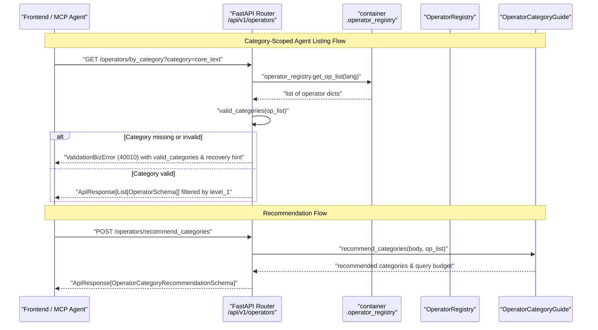
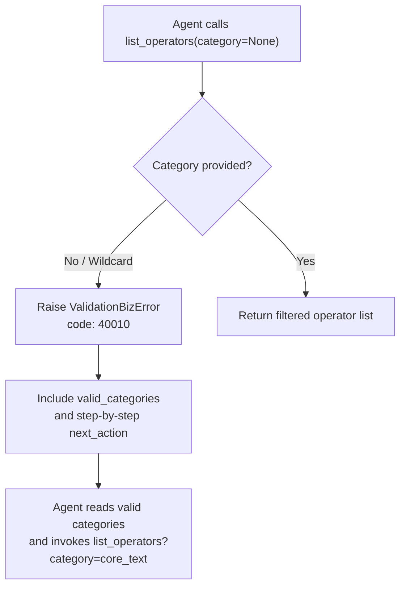
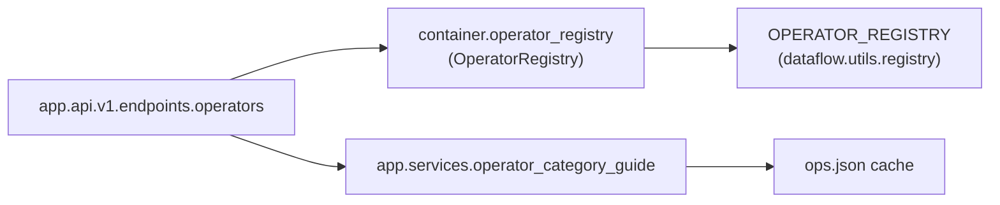

<!-- source: DeepWiki mcp.deepwiki.com · repo OpenDCAI/DataFlow-WebUI · page 5.3 Operator Endpoints · fetched 2026-11-02 -->

# Operator Endpoints

<details>
<summary>Relevant source files</summary>

The following files were used as context for generating this wiki page:

- [backend/app/api/v1/endpoints/operators.py](backend/app/api/v1/endpoints/operators.py)
- [backend/app/schemas/operator.py](backend/app/schemas/operator.py)
- [backend/app/services/operator_registry.py](backend/app/services/operator_registry.py)
- [backend/tests/test_operators_mcp_context.py](backend/tests/test_operators_mcp_context.py)

</details>


This page documents the REST API endpoints under `/api/v1/operators` for operator discovery, introspection, category filtering, recommendation, and AI agent scoping. The operator endpoints enable the frontend operator palette and provide structured, context-bounded operator catalogs and recommendation metadata for MCP agents.

For information about executing pipelines containing these operators, see [Task Execution Endpoints](#5.2). For details on how operators are discovered and reflected in the backend, see [Operator Registry](#3.4).

---

## Overview

The `/operators` router defines endpoints for full listing, category-scoped listing, operator details, and category recommendations:

| Endpoint | Purpose | Response Type | Target Consumer |
|----------|---------|---------------|-----------------|
| `GET /operators/` | Return all registered operators (full ~145-op catalog) | `ApiResponse[List[OperatorSchema]]` | Web UI operator sidebar |
| `GET /operators/by_category` | Return operators within a single category (`category` required) | `ApiResponse[List[OperatorSchema]]` | MCP Agents (whilested) |
| `GET /operators/categories` | Return valid top-level operator categories with metadata | `ApiResponse[List[Any]]` | Web UI & Agents |
| `GET /operators/details` | Return full operator catalog with parameter schemas | `OperatorDetailsResponseSchema` | Web UI introspection / Docs |
| `GET /operators/details/{op_name}` | Return single operator detailed metadata | `ApiResponse[OperatorDetailSchema]` | Web UI / Agents |
| `POST /operators/recommend_categories` | Recommend top-level categories based on task description | `ApiResponse[OperatorCategoryRecommendationSchema]` | MCP Agents |

All endpoints support localization via the `lang` query parameter (default: `"zh"`).

**Sources:** [backend/app/api/v1/endpoints/operators.py:68-245]()

---

## Endpoint Request/Response Flow



**Sources:** [backend/app/api/v1/endpoints/operators.py:108-230](), [backend/app/services/operator_category_guide.py:1-100]()

---

## Detailed Endpoint Reference

### GET /operators/

Returns a simplified list of all registered operators across the entire framework.

- **Operation ID:** `list_operators_all`
- **Scope:** Restricted from MCP server configuration to prevent agents from loading the full ~145-operator catalog into context. Used primarily by the Vue frontend's operator sidebar [backend/app/api/v1/endpoints/operators.py:72-85]().
- **Parameters:**
  - `lang` (str, default `"zh"`): Language code.
  - `category` (str, optional): Optional level-1 category filter.
- **Response:** `ApiResponse[List[OperatorSchema]]`

**Sources:** [backend/app/api/v1/endpoints/operators.py:68-97]()

---

### GET /operators/by_category

Returns registered operators within a single top-level category. `category` is **required**.

- **Operation ID:** `list_operators`
- **Scope:** Agent-facing variant exposed via MCP [backend/app/api/v1/endpoints/operators.py:102-130]().
- **Validation BizError (`40010`):** If `category` is omitted, `all`, `*`, `unknown`, or `any`, the endpoint raises a structured `ValidationBizError` containing valid categories and next actions so agents can recover [backend/app/api/v1/endpoints/operators.py:135-153](). If an unknown category is passed, `difflib` suggestions are returned [backend/app/api/v1/endpoints/operators.py:155-170]().
- **Parameters:**
  - `category` (str, required): One of the `level_1` categories (e.g., `core_text`, `reasoning`).
  - `lang` (str, default `"zh"`).
- **Response:** `ApiResponse[List[OperatorSchema]]`

**Sources:** [backend/app/api/v1/endpoints/operators.py:99-175]()

---

### GET /operators/categories

Returns the list of valid top-level categories, descriptions, and usage guidance.

- **Operation ID:** `list_operator_categories`
- **Parameters:**
  - `lang` (str, default `"zh"`).
- **Response:** List of category metadata structures used by agents to select a domain before calling `list_operators`.

**Sources:** [backend/app/api/v1/endpoints/operators.py:177-195]()

---

### GET /operators/details/{op_name}

Retrieves detailed information, parameter schemas, and injected agent tips for a single operator by name.

- **Operation ID:** `get_operator_detail_by_name`
- **Parameters:**
  - `op_name` (str, path parameter, required): Exact name of the operator.
  - `lang` (str, default `"zh"`).
- **Injected Agent Metadata:** The response appends `agent_tips`, `field_binding_hint`, and `mcp_context_hint` to assist LLM agents in binding parameters correctly (e.g., warning about `llm_serving`, `prompt_template`, `input_key`, and dynamic lambda strings) [backend/app/api/v1/endpoints/operators.py:32-65]().
- **Response:** `ApiResponse[OperatorDetailSchema]`

**Sources:** [backend/app/api/v1/endpoints/operators.py:32-65](), [backend/app/api/v1/endpoints/operators.py:197-230]()

---

### POST /operators/recommend_categories

Analyzes a task description and dataset columns to recommend the most relevant top-level operator categories.

- **Operation ID:** `recommend_operator_categories`
- **Request Body:** `OperatorCategoryRecommendationRequest` (requires `task_description`, optional `dataset_columns`, `max_categories` bounded between 1 and 3) [backend/app/schemas/operator.py:65-69]().
- **Response:** `ApiResponse[OperatorCategoryRecommendationSchema]` containing recommended categories, scores, reasons, and a `query_budget` [backend/app/schemas/operator.py:71-76]().

**Sources:** [backend/app/api/v1/endpoints/operators.py:232-245](), [backend/app/schemas/operator.py:59-76]()

---

## ValidationBizError Scoping for Agents

When agents interact with the `/operators` endpoints via MCP, preventing context window overflow is critical. The `ValidationBizError` class is used to enforce strict category scoping:



**Sources:** [backend/app/api/v1/endpoints/operators.py:135-153](), [backend/tests/test_operators_mcp_context.py:70-81]()

---

## Data Models and Schemas

### OperatorSchema and OperatorDetailSchema

```python
class OperatorSchema(BaseModel):
    name: str
    type: Dict[str, str]
    allowed_prompts: Optional[List[str]] = []
    description: Optional[str] = None

class OperatorDetailSchema(OperatorSchema):
    node: int
    parameter: ParameterGroupsSchema
    required: str
    depends_on: List[Any]
    mode: str
    agent_tips: Optional[List[str]] = []
    field_binding_hint: Optional[str] = None
    mcp_context_hint: Optional[str] = None
```

**Sources:** [backend/app/schemas/operator.py:7-56]()

---

## Service Layer Integration

The operator endpoints rely on `OperatorRegistry` (for reflection and caching) and `OperatorCategoryGuide` (for agent recommendations and category metadata):



**Sources:** [backend/app/api/v1/endpoints/operators.py:21-28](), [backend/app/services/operator_registry.py:144-161]()

---

