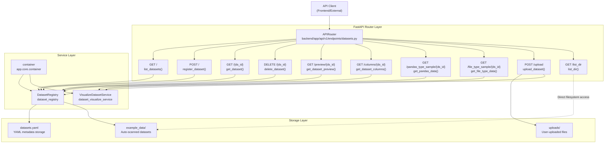
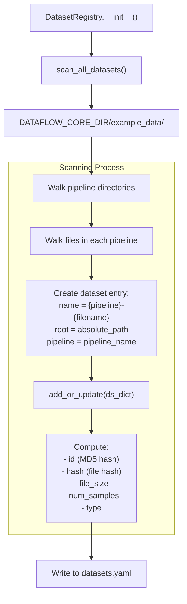
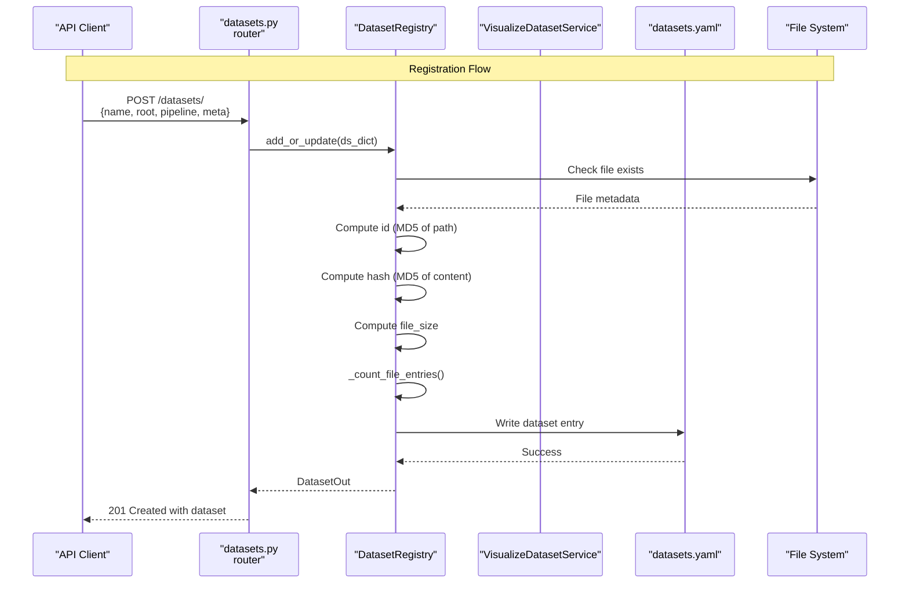

<!-- source: DeepWiki mcp.deepwiki.com · repo OpenDCAI/DataFlow-WebUI · page 5.4 Dataset Endpoints · fetched 2026-11-02 -->

# Dataset Endpoints

Relevant source files

The following files were used as context for generating this wiki page:

- [backend/app/api/v1/endpoints/datasets.py](backend/app/api/v1/endpoints/datasets.py)
- [backend/app/main.py](backend/app/main.py)
- [backend/app/schemas/dataset.py](backend/app/schemas/dataset.py)
- [backend/app/services/dataset_registry.py](backend/app/services/dataset_registry.py)

## Purpose and Scope

This document provides comprehensive technical documentation for all dataset-related REST API endpoints exposed at `/api/v1/datasets` (`backend/app/api/v1/endpoints/datasets.py`). These endpoints enable discovery, registration, management, preview, and visualization of datasets within the DataFlow system. Datasets serve as input sources for pipeline execution and are managed through the `DatasetRegistry` and `VisualizeDatasetService` classes, with metadata persisted in YAML format.

For information about how datasets are referenced in pipeline configurations, see [Pipelines](#2.1). For details on the underlying service layer implementation, see [Dataset Management](#3.5).

---

## Endpoint Architecture Overview

The dataset endpoints follow a layered architecture where the FastAPI router delegates to the `DatasetRegistry` service for metadata operations and the `VisualizeDatasetService` for preview/visualization functionality. All dataset metadata is persisted via YAML with automatic file scanning from the `example_data` directory.

Sources: `[backend/app/api/v1/endpoints/datasets.py:1-162]()`, `[backend/app/services/dataset_registry.py:59-316]()`

---

## Supported File Formats

The dataset system supports multiple file formats with different capabilities for preview and visualization handled via `VisualizeDatasetService.pandas_read_func_map` and `media_type_map`:

| Format | Extension | Preview Support | Column Extraction | Pandas Visualization | Use Case |
|--------|-----------|----------------|-------------------|---------------------|----------|
| JSON | `.json` | ✅ Yes | ✅ Yes | ✅ Yes | Structured data, single objects or arrays |
| JSON Lines | `.jsonl` | ✅ Yes | ✅ Yes | ✅ Yes | Streaming data, large datasets |
| Parquet | `.parquet` | ✅ Yes | ✅ Yes | ✅ Yes | Columnar storage, efficient compression |
| CSV | `.csv` | ❌ No | ❌ No | ✅ Yes | Tabular data |
| Excel | `.excel` | ❌ No | ❌ No | ✅ Yes | Spreadsheet data |
| Pickle | `.pickle` | ❌ No | ❌ No | ✅ Yes | Serialized Python objects |
| Text | `.txt` | ❌ No | ❌ No | ❌ No | Plain text |
| Image | `.jpg`, `.png`, `.gif` | ❌ No | ❌ No | ❌ No | Image data |
| Documents | `.pdf`, `.doc`, `.docx`, `.ppt`, `.pptx` | ❌ No | ❌ No | ❌ No | Document files |

Sources: `[backend/app/services/dataset_registry.py:10-30]()`, `[backend/app/services/dataset_registry.py:229-230]`, `[backend/app/services/dataset_registry.py:280-281]`

---

## Dataset Schemas (`DatasetIn` and `DatasetOut`)

Dataset payloads and responses are governed by Pydantic models defined in `backend/app/schemas/dataset.py`:

- `DatasetIn`: Base input model requiring `name`, `root`, `pipeline`, and optional `meta` dictionary `[backend/app/schemas/dataset.py:5-13]()`.
- `DatasetOut`: Extended model inheriting from `DatasetIn` that adds `id`, `num_samples`, `file_size`, and `hash` `[backend/app/schemas/dataset.py:14-18]()`.

| Field | Type | Description | Generated By |
|-------|------|-------------|--------------|
| `id` | `string` | MD5 hash of file path (first 10 characters) | `DatasetRegistry.add_or_update()` `[backend/app/services/dataset_registry.py:174]()` |
| `name` | `string` | Human-readable dataset name | User or auto-generated |
| `root` | `string` | Absolute file path to dataset file | User provided |
| `pipeline` | `string` | Associated pipeline name or "uploaded" | User or scan process |
| `type` | `string` | File extension (lowercase) | Extracted from `root` |
| `hash` | `string` | MD5 hash of file contents | `_load_file_hash()` `[backend/app/services/dataset_registry.py:163]()` |
| `file_size` | `integer` | File size in bytes | `os.path.getsize()` |
| `num_samples` | `integer` | Number of entries/lines in file | `_count_file_entries()` `[backend/app/services/dataset_registry.py:129]()` |
| `meta` | `object` | Additional user-defined metadata | User provided |

Sources: `[backend/app/schemas/dataset.py:1-18]()`, `[backend/app/services/dataset_registry.py:171-196]()`

---

## Endpoint Reference

### List All Datasets
- **Route:** `GET /` (`list_datasets`) `[backend/app/api/v1/endpoints/datasets.py:13-16]()`
- **Description:** Returns a list of all registered datasets via `container.dataset_registry.list()` `[backend/app/services/dataset_registry.py:157-161]()`.
- **Response Model:** `ApiResponse[list[DatasetOut]]`

### Register or Update Dataset
- **Route:** `POST /` (`register_dataset`) `[backend/app/api/v1/endpoints/datasets.py:18-24]()`
- **Description:** Registers or updates a dataset based on its root path. Computes file hash, size, and entry count.
- **Request Body:** `DatasetIn` `[backend/app/schemas/dataset.py:5-13]()`
- **Response Model:** `ApiResponse[DatasetOut]` `[backend/app/schemas/dataset.py:14-18]()`

### List Directory Contents
- **Route:** `GET /list_dir` (`listDir`) `[backend/app/api/v1/endpoints/datasets.py:26-43]()`
- **Description:** Lists files in a given directory path and checks if they are directories, sorting directories first.
- **Query Parameters:** `path: str` `[backend/app/api/v1/endpoints/datasets.py:27]()`
- **Response Model:** `ApiResponse[list[dict]]`

### Get Dataset by ID
- **Route:** `GET /{ds_id}` (`get_dataset`) `[backend/app/api/v1/endpoints/datasets.py:45-50]()`
- **Description:** Retrieves dataset metadata by MD5 ID prefix. Raises `404` if not found.
- **Response Model:** `ApiResponse[DatasetOut]`

### Delete Dataset
- **Route:** `DELETE /{ds_id}` (`delete_dataset`) `[backend/app/api/v1/endpoints/datasets.py:52-58]()`
- **Description:** Removes a dataset metadata record from the registry (does not delete the physical file).
- **Response Model:** `ApiResponse[dict]`

### Preview Dataset Content
- **Route:** `GET /preview/{ds_id}` (`get_dataset_preview`) `[backend/app/api/v1/endpoints/datasets.py:90-107]()`
- **Description:** Returns preview records (default `num_lines=5`) for supported formats (JSON, JSONL, Parquet).
- **Response Model:** `ApiResponse[list[dict]]`

### Get Dataset Columns
- **Route:** `GET /columns/{ds_id}` (`get_dataset_columns`) `[backend/app/api/v1/endpoints/datasets.py:109-125]()`
- **Description:** Extracts column names from JSON, JSONL, or Parquet datasets.
- **Response Model:** `ApiResponse[list[str]]`

### Upload Dataset File
- **Route:** `POST /upload` (`upload_dataset`) `[backend/app/api/v1/endpoints/datasets.py:127-162]()`
- **Description:** Uploads a file via multipart form-data, saves it under the `uploads/` directory, and registers it automatically with `pipeline="uploaded"`.
- **Response Model:** `ApiResponse[DatasetOut]`

Sources: `[backend/app/api/v1/endpoints/datasets.py:1-162]()`

---

## Visualization Endpoints

### Pandas-Based Visualization
- **Route:** `GET /pandas_type_sample/{ds_id}` (`get_pandas_data`) `[backend/app/api/v1/endpoints/datasets.py:62-70]()`
- **Parameters:** `ds_id`, `start: int = 0`, `end: int = 5` `[backend/app/api/v1/endpoints/datasets.py:63]()`
- **Implementation:** Delegates to `VisualizeDatasetService.get_pandas_read_function(ds, start, end)`, returning a JSON string of records serialized via pandas `[backend/app/services/dataset_registry.py:32-45]()`.

### File-Based Visualization
- **Route:** `GET /file_type_sample/{ds_id}` (`get_file_type_data`) `[backend/app/api/v1/endpoints/datasets.py:74-88]()`
- **Implementation:** Uses `VisualizeDatasetService.get_other_visualization_data(ds)` to retrieve the file path and mapped media type, returning a FastAPI `FileResponse` `[backend/app/services/dataset_registry.py:50-56]()`.

Sources: `[backend/app/api/v1/endpoints/datasets.py:62-88]()`, `[backend/app/services/dataset_registry.py:8-56]()`

---

## Automatic Dataset Discovery

The `DatasetRegistry` automatically scans `DATAFLOW_CORE_DIR/example_data` on initialization to discover and register example datasets `[backend/app/services/dataset_registry.py:66-112]()`.

Sources: `[backend/app/services/dataset_registry.py:60-112]()`

---

## Data Flow Diagram

Sources: `[backend/app/api/v1/endpoints/datasets.py:18-24]()`, `[backend/app/services/dataset_registry.py:171-196]()`

---

## Entry Count Calculation

`DatasetRegistry._count_file_entries(file_path)` calculates sample counts based on extension:
- `csv`, `jsonl`, `txt`, `log`: Line counting iterator `[backend/app/services/dataset_registry.py:135-138]()`.
- `json`: Loaded via `json.load()`, returning list length or dict key count `[backend/app/services/dataset_registry.py:139-149]()`.
- Other types: Defaults to `1` `[backend/app/services/dataset_registry.py:150-152]()`.

Sources: `[backend/app/services/dataset_registry.py:129-155]()`

---

