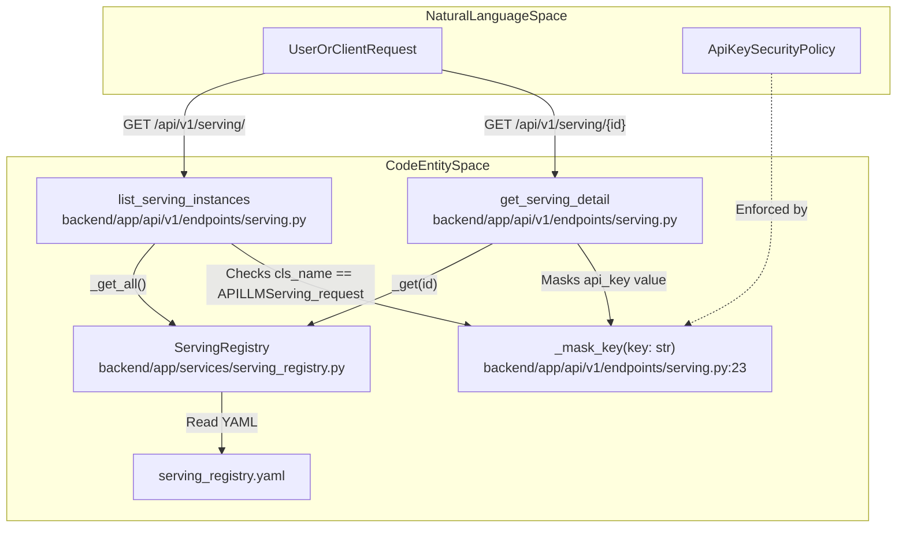
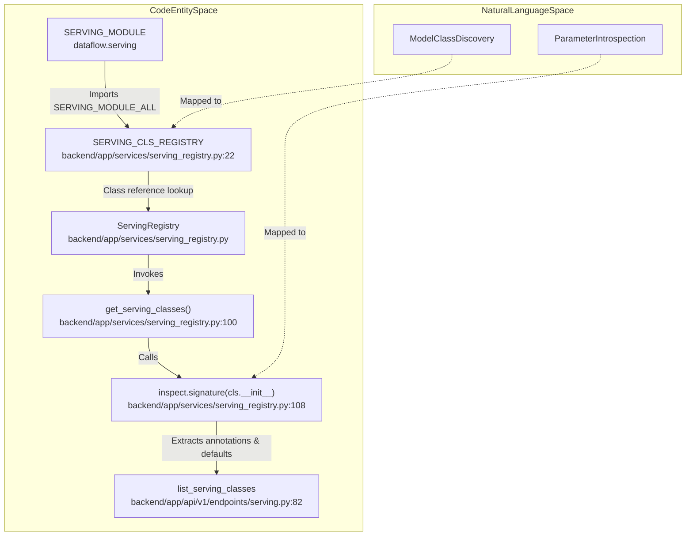

<!-- source: DeepWiki mcp.deepwiki.com · repo OpenDCAI/DataFlow-WebUI · page 5.5 Serving Endpoints · fetched 2026-11-02 -->

# Serving Endpoints

<details>
<summary>Relevant source files</summary>

The following files were used as context for generating this wiki page:

- [backend/app/api/v1/endpoints/serving.py](backend/app/api/v1/endpoints/serving.py)
- [backend/app/schemas/serving.py](backend/app/schemas/serving.py)
- [backend/app/services/serving_registry.py](backend/app/services/serving_registry.py)

</details>


This document provides a comprehensive technical reference for the `/serving` REST API endpoints (`backend/app/api/v1/endpoints/serving.py`) that manage LLM serving instances. These endpoints enable creation, retrieval, updating, deletion, and testing of serving configurations used by operators in pipeline execution.

For information about the underlying `ServingRegistry` service implementation, see [3.6](). For details about how serving instances are used during pipeline execution, see [3.3]().

---

## Overview

The serving endpoints manage LLM serving instances, which provide language model capabilities to operators during pipeline execution via `APILLMServing_request` (`backend/app/services/serving_registry.py`). All endpoints are prefixed with `/api/v1/serving` and tagged as `"serving"` in the FastAPI router configuration.

Sources: `[backend/app/api/v1/endpoints/serving.py:20-21]`, `[backend/app/services/serving_registry.py:18-24]()`

---

## Endpoint Summary

| Method | Path | Operation ID | Purpose |
|--------|------|--------------|---------|
| GET | `/` | `list_serving` | List all serving instances with masked API keys |
| GET | `/plural_alias` | `list_servings` | Backward-compatible alias for `list_serving` |
| GET | `/classes` | `list_serving_classes` | List available serving classes via introspection |
| GET | `/{id}` | `get_serving_detail` | Get specific serving instance configuration |
| POST | `/` | `create_serving_instance` | Create new serving instance in the registry |
| PUT | `/{id}` | `update_serving_instance` | Update serving instance parameters |
| DELETE | `/{id}` | `delete_serving_instance` | Delete serving instance by identifier |

Sources: `[backend/app/api/v1/endpoints/serving.py:28-180]()`

---

## Serving Data Models and Schemas

Request and response payloads are validated and serialized using Pydantic models defined in `backend/app/schemas/serving.py`.

### ServingParamSchema
Defines individual parameter configurations (`[backend/app/schemas/serving.py:4-11]()`).
- `name`: `str` — Parameter name.
- `type`: `Optional[str]` — Parameter type annotation (e.g., `"str"`, `"int"`).
- `default_value`: `Any` — Default value derived from class introspection.
- `value`: `Any` — User-supplied value.
- `required`: `Optional[bool]` — Indicates if the parameter is mandatory.
- `masked`: `Optional[bool]` — Indicates if the value has been masked.

### ServingDetailSchema & ServingClassSchema
- `ServingDetailSchema` combines query and creation attributes to represent a full instance (`[backend/app/schemas/serving.py:25-26]()`).
- `ServingClassSchema` exposes available `cls_name` strings and their respective `params` list (`[backend/app/schemas/serving.py:28-31]()`).

Sources: `[backend/app/schemas/serving.py:1-38]()`

---

## Endpoint Details

### GET `/` - List Serving Instances
Returns all registered serving instances from `ServingRegistry._get_all()`. For `APILLMServing_request` items, sensitive API keys are masked using `_mask_key()`.

Response Model: `ApiResponse[List[ServingDetailSchema]]`

Sources: `[backend/app/api/v1/endpoints/serving.py:28-65]()`

### GET `/classes` - List Serving Classes
Introspects registered serving classes in `SERVING_CLS_REGISTRY` via `ServingRegistry.get_serving_classes()` to return available initialization parameters.

Response Model: `ApiResponse[List[ServingClassSchema]]`

Sources: `[backend/app/api/v1/endpoints/serving.py:76-96]`, `[backend/app/services/serving_registry.py:100-157]()`

### GET `/{id}` - Get Serving Detail
Retrieves a single serving instance by its 16-character hex `id` using `ServingRegistry._get(id)`. Masks API keys if applicable.

Sources: `[backend/app/api/v1/endpoints/serving.py:99-126]()`

### POST `/` - Create Serving Instance
Creates a new serving instance via `ServingRegistry._set()`, persisting entries to `serving_registry.yaml`.

Sources: `[backend/app/api/v1/endpoints/serving.py:181-196]`, `[backend/app/services/serving_registry.py:50-60]()`

### PUT `/{id}` - Update Serving Instance
Updates parameters for an existing instance via `ServingRegistry._update()`. Note that `cls_name` modifications are explicitly rejected with an exception (`[backend/app/services/serving_registry.py:69-70]()`).

Sources: `[backend/app/api/v1/endpoints/serving.py:128-161]`, `[backend/app/services/serving_registry.py:62-89]()`

### DELETE `/{id}` - Delete Serving Instance
Removes the specified instance from the YAML storage via `ServingRegistry._delete()`.

Sources: `[backend/app/api/v1/endpoints/serving.py:163-179]`, `[backend/app/services/serving_registry.py:91-98]()`

---

## Security Architecture: Key Masking and Code Entity Mapping

To prevent accidental exposure of credentials in API responses, the backend applies `_mask_key()` to `api_key` parameter values when serving GET requests.



Sources: `[backend/app/api/v1/endpoints/serving.py:23-27]`, `[backend/app/api/v1/endpoints/serving.py:33-63]`, `[backend/app/api/v1/endpoints/serving.py:105-124]()`

---

## Serving Class Discovery and Introspection

The backend dynamically inspects Python classes imported from `dataflow.serving` via `ServingRegistry.get_serving_classes()`.



Sources: `[backend/app/services/serving_registry.py:18-24]`, `[backend/app/services/serving_registry.py:100-157]`, `[backend/app/api/v1/endpoints/serving.py:82-96]()`

---

## Storage Format and Registry Integration

Serving instances are serialized to YAML at the path defined by `settings.SERVING_REGISTRY`. 

```yaml
a1b2c3d4e5f6g7h8:
  name: "APILLMServing_1"
  cls_name: "APILLMServing_request"
  params:
    - name: "base_url"
      type: "str"
      default_value: null
      value: "https://api.openai.com/v1"
      required: true
    - name: "api_key"
      type: "str"
      default_value: ""
      value: "sk-..."
      required: true
```

Sources: `[backend/app/services/serving_registry.py:1-17]`, `[backend/app/services/serving_registry.py:28-36]()`

---

