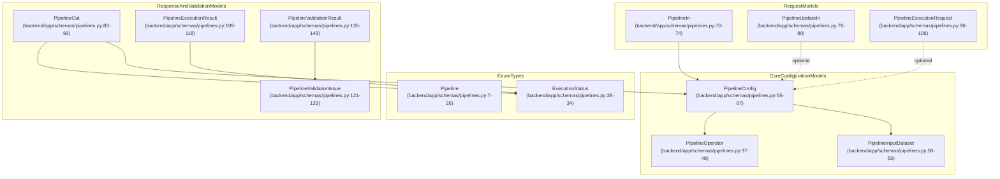
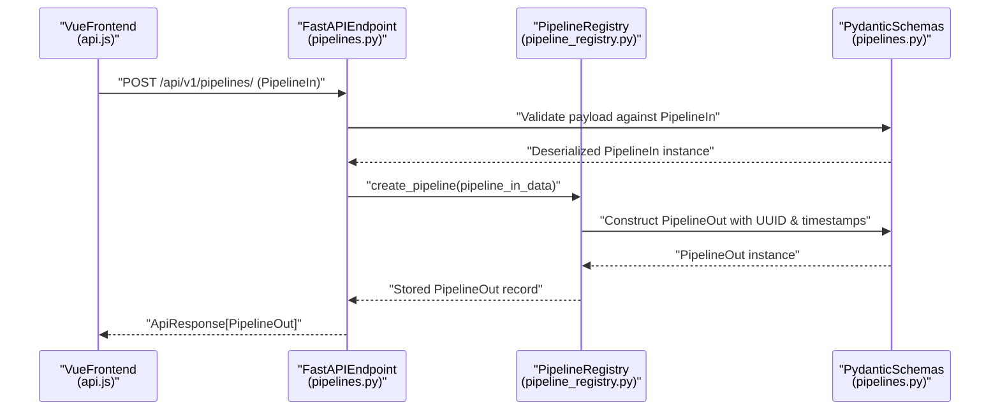

<!-- source: DeepWiki mcp.deepwiki.com · repo OpenDCAI/DataFlow-WebUI · page 6.1 Pipeline Data Models · fetched 2026-11-02 -->

# Pipeline Data Models

<details>
<summary>Relevant source files</summary>

The following files were used as context for generating this wiki page:

- [backend/app/api/v1/endpoints/pipelines.py](backend/app/api/v1/endpoints/pipelines.py)
- [backend/app/schemas/pipelines.py](backend/app/schemas/pipelines.py)
- [backend/app/services/pipeline_registry.py](backend/app/services/pipeline_registry.py)

</details>


This document provides a comprehensive technical reference for all Pydantic data models related to pipelines in DataFlow-WebUI. These schemas define the exact structure for pipeline configurations, operator sequences, input datasets, API request/response payloads, execution requests/results, and static validation diagnostic issues. They act as the strict serialization and validation contract shared between the Vue.js frontend canvas, the FastAPI REST backend (`backend/app/api/v1/endpoints/pipelines.py`), and the execution services.

For operator-specific structural parameters, see [Operator Data Models](#6.2). For API endpoint routing implementations, see [Pipeline Endpoints](#5.1) and [Task Execution Endpoints](#5.2).

---

## Model Hierarchy Overview

The following diagram bridges natural language configuration concepts to their underlying Pydantic code entities (`[backend/app/schemas/pipelines.py:37-142]()`), showing how pipeline components compose and relate during API serialization and backend processing:



**Sources:** [backend/app/schemas/pipelines.py:7-142]()

---

## Enum Types

### Pipeline Type Enum

The `Pipeline` enum (`[backend/app/schemas/pipelines.py:7-26]()`) defines categories of pipeline types available in the system. These tags help organize and classify pipelines by their domain or use case.

| Enum Value | Description |
|------------|-------------|
| `undefined` | Default/uncategorized pipeline |
| `agentic_rag` | Agentic Retrieval-Augmented Generation pipelines |
| `chemistry` | Chemistry domain pipelines |
| `code` | Code processing pipelines |
| `conversation` | Conversational AI pipelines |
| `core_speech` | Speech processing core pipelines |
| `db` | Database-related pipelines |
| `core_text` | Text processing core pipelines |
| `core_vision` | Vision processing core pipelines |
| `general_text` | General text processing pipelines |
| `knowledge_cleaning` | Knowledge base cleaning pipelines |
| `text2sql` | Text-to-SQL generation pipelines |
| `reasoning` | Reasoning task pipelines |
| `code_generation` | Code generation pipelines |
| `translation` | Translation task pipelines |
| `text_pt` | Text pre-training pipelines |
| `text_sft` | Text supervised fine-tuning pipelines |

**Sources:** [backend/app/schemas/pipelines.py:7-26]()

### ExecutionStatus Enum

The `ExecutionStatus` enum (`[backend/app/schemas/pipelines.py:28-34]()`) tracks the lifecycle state of pipeline executions. These states are used by both `PipelineOut` and `PipelineExecutionResult` models.

| Status | Description |
|--------|-------------|
| `queued` | Execution has been submitted but not yet started |
| `running` | Pipeline is currently executing |
| `completed` | Execution finished successfully |
| `failed` | Execution encountered an error and terminated |
| `cancelled` | User manually terminated the execution |

**Sources:** [backend/app/schemas/pipelines.py:28-34]()

---

## Core Configuration Models

### PipelineOperator

The `PipelineOperator` model (`[backend/app/schemas/pipelines.py:37-48]()`) represents a single processing step (operator) within a pipeline canvas graph.

| Field | Type | Required | Default | Description |
|-------|------|----------|---------|-------------|
| `name` | `str` | Yes | - | Operator class name from `OPERATOR_REGISTRY` |
| `params` | `Any` | No | `{}` | Operator-specific parameter configuration |
| `location` | `tuple[float, float]` | No | `(0, 0)` | Canvas position as `(x, y)` coordinate values |

**Example:**
```json
{
  "name": "ContentExtractorOp",
  "params": {
    "init_params": {"llm_serving": "openai-gpt4"},
    "run_params": {"field": "content"}
  },
  "location": [250, 150]
}
```

**Sources:** [backend/app/schemas/pipelines.py:37-48]()

### PipelineInputDataset

The `PipelineInputDataset` model (`[backend/app/schemas/pipelines.py:50-53]()`) represents the input dataset configuration node on the frontend canvas.

| Field | Type | Required | Default | Description |
|-------|------|----------|---------|-------------|
| `id` | `str` | Yes | - | Dataset identifier from `DatasetRegistry` |
| `location` | `tuple[float, float]` | No | `(0, 0)` | Canvas position as `(x, y)` coordinates |

**Example:**
```json
{
  "id": "example_conversations",
  "location": [50, 150]
}
```

**Sources:** [backend/app/schemas/pipelines.py:50-53]()

### PipelineConfig

The `PipelineConfig` model (`[backend/app/schemas/pipelines.py:55-67]`) defines the complete logical configuration of a pipeline graph, linking input data sources to sequential operator steps.

| Field | Type | Required | Description |
|-------|------|----------|-------------|
| `file_path` | `str` | Yes | Path to the pipeline Python file (relative to `api_pipelines/`) |
| `input_dataset` | `Union[str, PipelineInputDataset]` | Yes | Dataset ID string or full dataset configuration object |
| `operators` | `List[PipelineOperator]` | No (defaults to `[]`) | Ordered list of operators to execute sequentially |

**Sources:** [backend/app/schemas/pipelines.py:55-67]()

---

## Request and Response Models

### PipelineIn and PipelineUpdateIn

`PipelineIn` (`[backend/app/schemas/pipelines.py:70-74]()`) and `PipelineUpdateIn` (`[backend/app/schemas/pipelines.py:76-80]()`) manage payload validation for creation and partial updates via `POST /api/v1/pipelines/` and `PUT /api/v1/pipelines/{pipeline_id}` endpoints (`[backend/app/api/v1/endpoints/pipelines.py:44-105]()`).

| Field | Type (`PipelineIn`) | Type (`PipelineUpdateIn`) | Description |
|-------|--------------------|-------------------------|-------------|
| `name` | `str` (Required) | `Optional[str]` | Human-readable pipeline name |
| `config` | `PipelineConfig` (Required) | `Optional[PipelineConfig]` | Pipeline logical configuration |
| `tags` | `List[str]` (Default: `[]`) | `Optional[List[str]]` | Classification tag list |

**Sources:** [backend/app/schemas/pipelines.py:70-80](), [backend/app/api/v1/endpoints/pipelines.py:44-105]()

### PipelineOut

The `PipelineOut` model (`[backend/app/schemas/pipelines.py:82-93]()`) represents the fully enriched pipeline record returned by registry query endpoints (`[backend/app/api/v1/endpoints/pipelines.py:21-86]()`).

| Field | Type | Description |
|-------|------|-------------|
| `id` | `str` | System-generated unique identifier (UUID) |
| `name` | `str` | Pipeline name |
| `config` | `PipelineConfig` | Complete pipeline configuration |
| `tags` | `List[str]` | Classification tags |
| `created_at` | `str` | ISO 8601 timestamp of creation |
| `updated_at` | `str` | ISO 8601 timestamp of last modification |
| `status` | `ExecutionStatus` | Current execution status enum value |

**Sources:** [backend/app/schemas/pipelines.py:82-93](), [backend/app/api/v1/endpoints/pipelines.py:21-86]()

---

## Execution and Validation Models

### PipelineExecutionRequest & Result

- **`PipelineExecutionRequest`** (`[backend/app/schemas/pipelines.py:96-106]()`): Accepts either a stored `pipeline_id` or an ad-hoc `config` payload for execution.
- **`PipelineExecutionResult`** (`[backend/app/schemas/pipelines.py:109-118]()`): Captures execution output, execution logs list, task identifier, and start/completion timestamps.

**Sources:** [backend/app/schemas/pipelines.py:96-118]()

### Pipeline Validation Models

The static analysis engine checks operator fields, prompt templates, and dataset schemas, returning `PipelineValidationResult` containing a list of `PipelineValidationIssue` diagnostic objects (`[backend/app/schemas/pipelines.py:121-142]()`).

| Model | Key Fields | Description |
|-------|------------|-------------|
| `PipelineValidationIssue` | `level`, `code`, `message`, `operator_index`, `operator_name`, `param_name`, `field_name`, `available_fields`, `suggested_fields`, `repair_hint` | Detailed individual warning or error issue with field auto-correction hints |
| `PipelineValidationResult` | `valid`, `errors`, `warnings`, `dataset_id`, `available_input_fields`, `final_available_fields` | Aggregated static check outcome and field flow propagation tracking |

**Sources:** [backend/app/schemas/pipelines.py:121-142]()

---

## Model Processing Data Flow

The following diagram illustrates code entity interactions when data models traverse through `pipeline_registry.py` and `pipelines.py`:



**Sources:** [backend/app/api/v1/endpoints/pipelines.py:44-55](), [backend/app/schemas/pipelines.py:70-93](), [backend/app/services/pipeline_registry.py:1-25]()

---

## Model Summary Table

| Model Name | Module Location | Primary Responsibility |
|------------|-----------------|------------------------|
| `Pipeline` | `app.schemas.pipelines` | Enum of domain classification tags |
| `ExecutionStatus` | `app.schemas.pipelines` | Enum of run lifecycle states |
| `PipelineOperator` | `app.schemas.pipelines` | Individual operator config & canvas pos |
| `PipelineInputDataset` | `app.schemas.pipelines` | Input source id & canvas pos |
| `PipelineConfig` | `app.schemas.pipelines` | Complete DAG operators + dataset config |
| `PipelineIn` | `app.schemas.pipelines` | Creation request payload validation |
| `PipelineUpdateIn` | `app.schemas.pipelines` | Partial update request payload validation |
| `PipelineOut` | `app.schemas.pipelines` | Full persisted pipeline response structure |
| `PipelineExecutionRequest` | `app.schemas.pipelines` | Task trigger specification payload |
| `PipelineExecutionResult` | `app.schemas.pipelines` | Task status, logs, and execution outputs |
| `PipelineValidationIssue` | `app.schemas.pipelines` | Static check issue & repair suggestion |
| `PipelineValidationResult` | `app.schemas.pipelines` | Static check aggregate status & field flow |

**Sources:** [backend/app/schemas/pipelines.py:1-142]()

---

