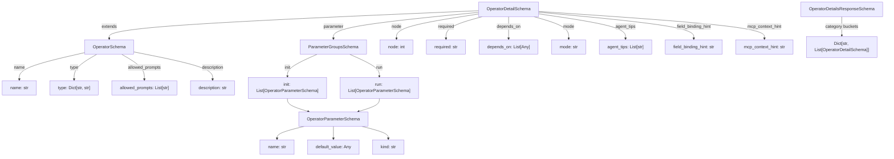
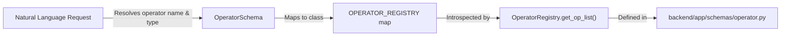
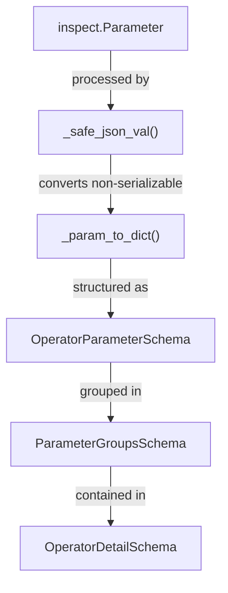
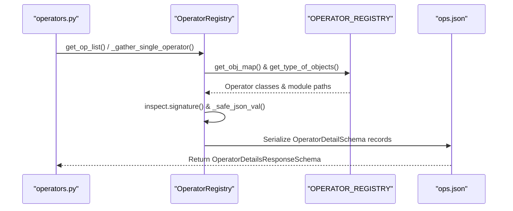

<!-- source: DeepWiki mcp.deepwiki.com · repo OpenDCAI/DataFlow-WebUI · page 6.2 Operator Data Models · fetched 2026-11-02 -->

# Operator Data Models

Relevant source files

The following files were used as context for generating this wiki page:

- [backend/app/api/v1/endpoints/operators.py](backend/app/api/v1/endpoints/operators.py)
- [backend/app/schemas/operator.py](backend/app/schemas/operator.py)
- [backend/app/services/operator_registry.py](backend/app/services/operator_registry.py)

## Purpose and Scope

This document details the Pydantic data models and schemas used to represent operator metadata throughout the DataFlow-WebUI system. These schemas define the structure of operator information exposed through API endpoints, stored in cache files, consumed by the frontend, and utilized by MCP agents for tool discovery and validation.

For conceptual information about what operators are and how they function, see [Operators](#2.2). For details on how the `OperatorRegistry` service introspects operator classes and generates this metadata, see [Operator Registry](#3.4). For API endpoint specifications that return these schemas, see [Operator Endpoints](#5.3).

---

## Schema Hierarchy Overview

The operator data models form a nested hierarchy that captures operator metadata at different levels of detail. The system provides simplified schemas for listing operations, detailed schemas for complete operator specifications, and category recommendation schemas for agent-assisted workflows.

### Schema Structure Diagram

Sources: [backend/app/schemas/operator.py:1-82]()

---

## OperatorSchema (Simplified)

`OperatorSchema` provides a lightweight representation of an operator, used by the `GET /operators` endpoint for listing operations. This schema omits detailed parameter information to reduce payload size.

### Schema Definition

| Field | Type | Description |
|-------|------|-------------|
| `name` | `str` | Unique operator identifier (e.g., `"text2qa_generator"`) |
| `type` | `Dict[str, str]` | Two-level classification: `{"level_1": "core_text", "level_2": "generate"}` |
| `allowed_prompts` | `List[str]` | Names of prompt templates this operator accepts (e.g., `["TextToQAPrompt"]`) |
| `description` | `str` | Human-readable operator description, obtained via `get_desc()` method |

### Natural Language to Code Entity Mapping

Sources: [backend/app/schemas/operator.py:6-13](), [backend/app/services/operator_registry.py:173-199]()

---

## OperatorParameterSchema and ParameterGroupsSchema

`OperatorParameterSchema` represents a single parameter in an operator's `__init__` or `run` method, derived from Python's `inspect.Parameter`. `ParameterGroupsSchema` groups these parameters by method context (`init` vs `run`).

### Schema Definition

| Schema | Field | Type | Description |
|--------|-------|------+-------------|
| `OperatorParameterSchema` | `name` | `str` | Parameter name (e.g., `"llm_serving"`) |
| | `default_value` | `Any` | Default value or `None` if no default |
| | `kind` | `str` | Parameter kind (e.g., `"POSITIONAL_OR_KEYWORD"`) |
| `ParameterGroupsSchema` | `init` | `List[OperatorParameterSchema]` | Constructor parameter specs |
| | `run` | `List[OperatorParameterSchema]` | Execution parameter specs |

### Introspection and Safe JSON Conversion

Sources: [backend/app/schemas/operator.py:18-36](), [backend/app/services/operator_registry.py:19-41]()

---

## OperatorDetailSchema

`OperatorDetailSchema` provides complete operator specifications, including parameter details, type classification, description, and agent-specific assistance hints (`agent_tips`, `field_binding_hint`, `mcp_context_hint`).

### Schema Definition

| Field | Type | Description |
|-------|------|-------------|
| `node` | `int` | Sequential display index |
| `name` | `str` | Operator identifier |
| `type` | `Dict[str, str]` | Two-level type classification |
| `allowed_prompts` | `List[str]` | Allowed prompt template names |
| `description` | `str` | Full operator description |
| `parameter` | `ParameterGroupsSchema` | Complete parameter specifications (`init` and `run`) |
| `required` | `str` | Required dependencies (reserved) |
| `depends_on` | `List[Any]` | Operator dependencies (reserved) |
| `mode` | `str` | Execution mode (reserved) |
| `agent_tips` | `List[str]` | Agent-facing guidance rules |
| `field_binding_hint` | `str` | Input/output column mapping hint |
| `mcp_context_hint` | `str` | Context window conservation hint |

Sources: [backend/app/schemas/operator.py:38-57](), [backend/app/api/v1/endpoints/operators.py:32-65]()

---

## Category Recommendation Schemas

To assist MCP agents in selecting correct operator categories without overloading the context window with the entire ~145-operator catalog, the system provides recommendation structures.

### Schema Structure

| Schema | Field | Type | Description |
|--------|-------|------+-------------|
| `OperatorCategoryRecommendationRequest` | `task_description` | `str` | Description of the user's data processing task |
| | `dataset_columns` | `List[str]` | Available dataset columns |
| | `max_categories` | `int` | Maximum recommended categories (1-3) |
| `OperatorCategoryRecommendationSchema` | `recommended_categories` | `List[OperatorCategoryRecommendationItem]` | Scored categories with reasoning |
| | `avoid_categories` | `List[OperatorCategoryRecommendationItem]` | Categories to avoid |
| | `next_action` | `str` | Suggested next tool call step |
| | `query_budget` | `Dict[str, Any]` | Token/query budget tracking metrics |

Sources: [backend/app/schemas/operator.py:59-76]()

---

## Schema Generation and Caching Flow

Operator metadata schemas are generated by introspecting classes registered in `OPERATOR_REGISTRY` and caching them via `OperatorRegistry`.

Sources: [backend/app/services/operator_registry.py:92-162](), [backend/app/api/v1/endpoints/operators.py:78-132]()

---

