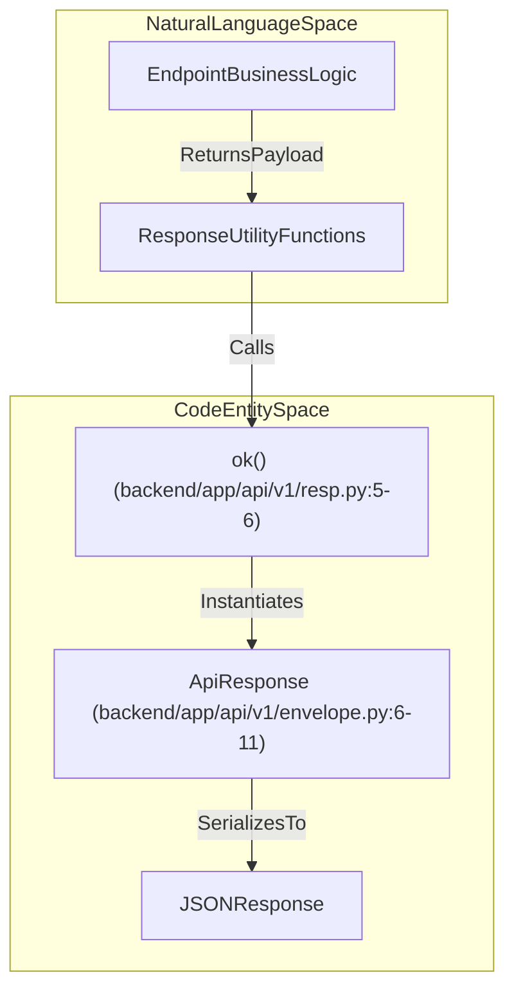
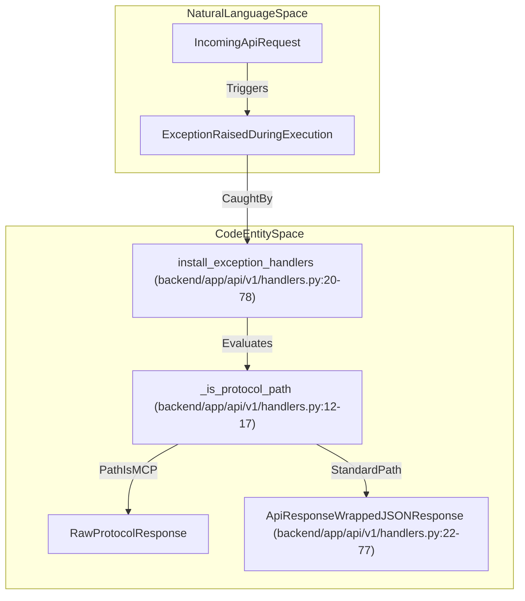

<!-- source: DeepWiki mcp.deepwiki.com · repo OpenDCAI/DataFlow-WebUI · page 6.3 API Envelope and Error Handling · fetched 2026-11-02 -->

# API Envelope and Error Handling

Relevant source files

The following files were used as context for generating this wiki page:

- [backend/Makefile](backend/Makefile)
- [backend/app/api/v1/endpoints/preferences.py](backend/app/api/v1/endpoints/preferences.py)
- [backend/app/api/v1/envelope.py](backend/app/api/v1/envelope.py)
- [backend/app/api/v1/errors.py](backend/app/api/v1/errors.py)
- [backend/app/api/v1/handlers.py](backend/app/api/v1/handlers.py)
- [backend/app/api/v1/resp.py](backend/app/api/v1/resp.py)
- [backend/app/api/v1/router.py](backend/app/api/v1/router.py)
- [backend/app/core/logger_setup.py](backend/app/core/logger_setup.py)
- [backend/app/schemas/preferences.py](backend/app/schemas/preferences.py)

## Purpose and Scope
This page covers section 6.3 of the DataFlow-WebUI architecture, detailing the `resp`, `envelope`, `errors`, and `handlers` modules under `backend/app/api/v1/`, alongside the application logging configuration found in `backend/app/core/logger_setup.py`. It explains the standard JSON response envelope structure, business error taxonomy, global exception handling strategies (including MCP protocol path exemptions), and structured logging setup.

---

## 1. Standard Response Envelope
To maintain a consistent contract between the FastAPI backend and the Vue 3 frontend, all standard API responses are wrapped in a generic envelope defined by `ApiResponse` [backend/app/api/v1/envelope.py:6-11]().

The envelope contains the following core fields:
- `success`: A boolean indicator (`true` or `false`) denoting whether the request succeeded [backend/app/api/v1/envelope.py:7]().
- `code`: An integer business status code where `0` indicates success, and non-zero values correspond to domain-specific error codes [backend/app/api/v1/envelope.py:8]().
- `message`: A human-readable description (defaulting to `"OK"`) [backend/app/api/v1/envelope.py:9]().
- `data`: The payload containing the requested resource or result, typed generically [backend/app/api/v1/envelope.py:10]().
- `meta`: An optional dictionary for metadata such as pagination or environmental hints [backend/app/api/v1/envelope.py:11]().

Helper functions in `backend/app/api/v1/resp.py` simplify response generation across endpoints:
- `ok()`: Wraps payload data into a successful `ApiResponse` with HTTP 200 [backend/app/api/v1/resp.py:5-6]().
- `created()`: Serializes a success response for resource creation [backend/app/api/v1/resp.py:8-12]().
- `no_content()`: Returns an empty content response [backend/app/api/v1/resp.py:14-15]().

Sources: `backend/app/api/v1/envelope.py`, `backend/app/api/v1/resp.py`

---

## 2. Business Error Hierarchy
Domain-specific exceptions are modeled as a hierarchy extending from a base `ApiError` class in `backend/app/api/v1/errors.py`. Each exception defines a message, business error code, intended HTTP status code, and optional error payload data [backend/app/api/v1/errors.py:4-10]().

The predefined error classes include:
- `ApiError`: The base class for all operational and business logic failures [backend/app/api/v1/errors.py:4-10]().
- `NotFoundError`: Raised when a requested entity (such as a pipeline, dataset, or serving instance) does not exist, mapping to HTTP 404 with code `40401` [backend/app/api/v1/errors.py:11-13]().
- `ConflictError`: Raised upon resource conflicts or duplicate registrations, mapping to HTTP 409 with code `40901` [backend/app/api/v1/errors.py:15-17]().
- `ValidationBizError`: Raised when input parameters or workflow schemas fail business validation checks, mapping to HTTP 400 with code `40001` [backend/app/api/v1/errors.py:19-21]().

Sources: `backend/app/api/v1/errors.py`

---

## 3. Global Exception Handling and Protocol Routing
Global exception handlers are registered onto the FastAPI application instance via `install_exception_handlers()` in `backend/app/api/v1/handlers.py` [backend/app/api/v1/handlers.py:20-77](). 

### Protocol Path Exemption
Certain components—such as the Model Context Protocol (MCP) server mounted at `/mcp`—implement their own wire protocols (e.g., JSON-RPC 2.0 over SSE). The helper function `_is_protocol_path()` checks if the request URL starts with `/mcp` [backend/app/api/v1/handlers.py:12-17](). If true, the exception handlers bypass the standard WebUI `ApiResponse` envelope to prevent wire-protocol schema validation errors on the client side [backend/app/api/v1/handlers.py:36,52,68]().

### Exception Mapping
For standard WebUI routes:
- `ApiError`: Caught and converted into an `ApiResponse` payload with `success=False`, preserving the custom error `code`, `message`, and `data` [backend/app/api/v1/handlers.py:22-32]().
- `RequestValidationError`: Handled by returning code `42200` with validation error details [backend/app/api/v1/handlers.py:34-48]().
- `StarletteHTTPException`: Mapped to a structured error envelope using the HTTP status code multiplied by 100 [backend/app/api/v1/handlers.py:50-64]().
- Unhandled `Exception`: Caught as a fallback, returning code `50000` with an internal error message [backend/app/api/v1/handlers.py:66-77]().

Note that standard WebUI error responses consistently return HTTP status `200 OK` at the transport layer while communicating business and operational failures via `success: false` and the internal `code` field in the envelope body, whereas HTTP headers and metadata retain the original status [backend/app/api/v1/handlers.py:22-77]().

Sources: `backend/app/api/v1/handlers.py`

---

## 4. Logging Setup with Loguru
Logging is configured via the `loguru` library in `backend/app/core/logger_setup.py` [backend/app/core/logger_setup.py:1-19](). 

The `setup_logging()` function removes default handlers and attaches a custom stdout handler with colored output formatting, timestamp tracking, module names, function names, and line numbers at the `INFO` level [backend/app/core/logger_setup.py:4-13](). The `get_logger()` helper provides a compatible interface for modules across the backend application [backend/app/core/logger_setup.py:15-18]().

Sources: `backend/app/core/logger_setup.py`

---

