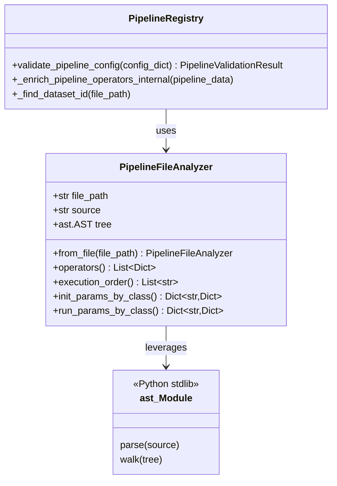
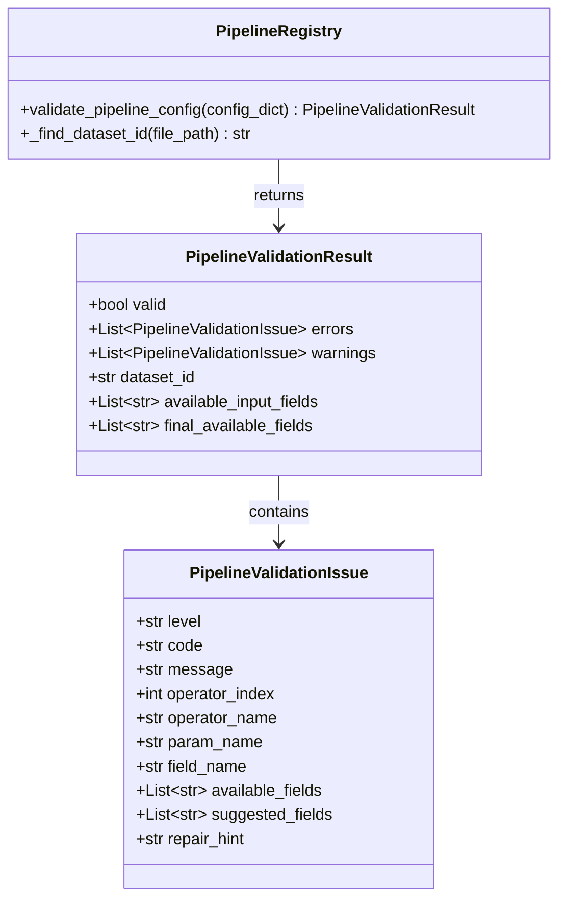
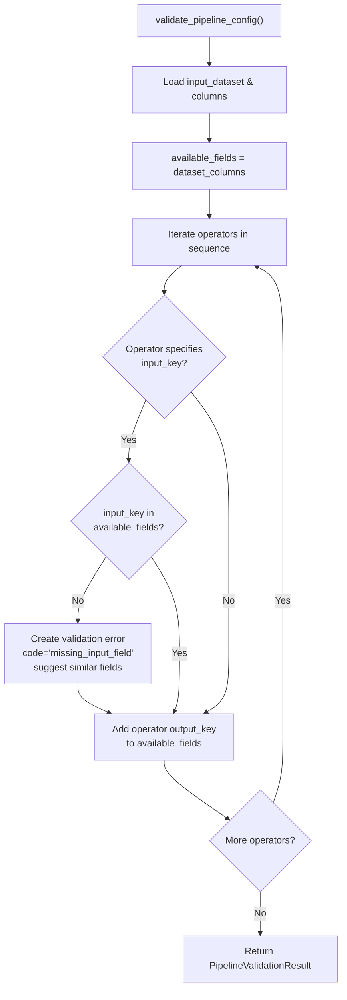
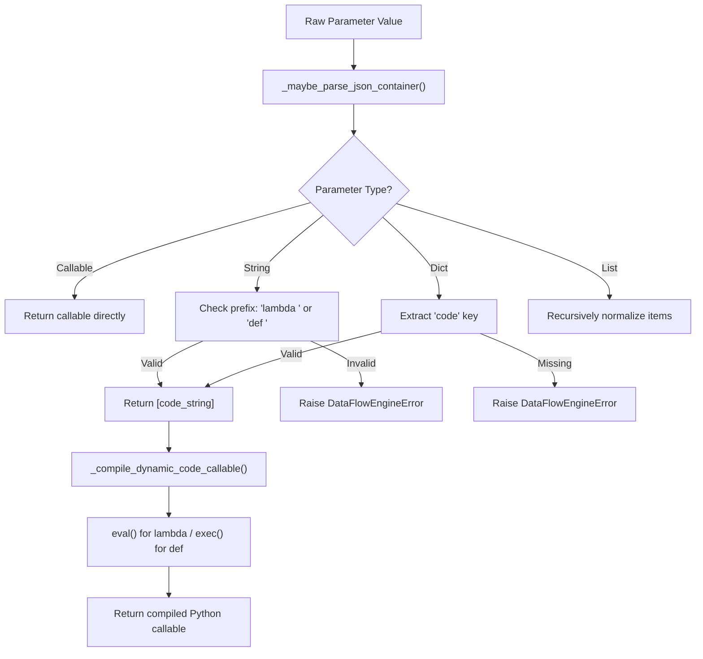
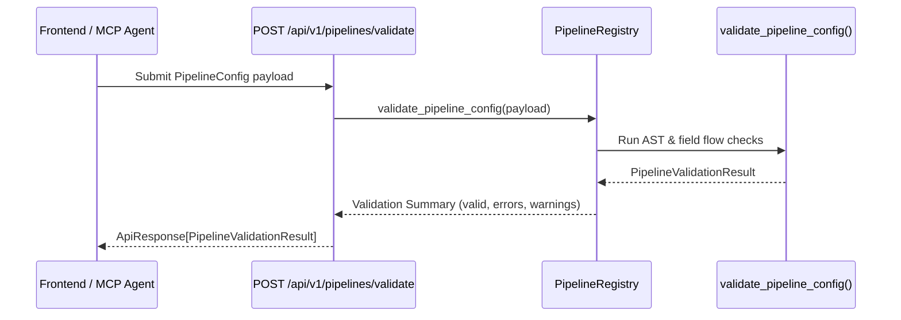

<!-- source: DeepWiki mcp.deepwiki.com · repo OpenDCAI/DataFlow-WebUI · page 7.2 Pipeline File Analysis and Validation · fetched 2026-11-02 -->

# Pipeline File Analysis and Validation

Relevant source files

The following files were used as context for generating this wiki page:

- [backend/app/api/v1/endpoints/pipelines.py](backend/app/api/v1/endpoints/pipelines.py)
- [backend/app/schemas/pipelines.py](backend/app/schemas/pipelines.py)
- [backend/app/services/dataflow_engine.py](backend/app/services/dataflow_engine.py)
- [backend/app/services/param_coercion.py](backend/app/services/param_coercion.py)
- [backend/app/services/pipeline_registry.py](backend/app/services/pipeline_registry.py)
- [backend/app/services/ray_pipeline_executor.py](backend/app/services/ray_pipeline_executor.py)
- [backend/tests/test_pipeline_validation.py](backend/tests/test_pipeline_validation.py)

## Overview
The pipeline file analysis and validation system combines Python Abstract Syntax Tree (AST) parsing via `PipelineFileAnalyzer` with static validation checks (`validate_pipeline_config`) to ensure pipeline correctness before execution. It automatically discovers pipelines in `api_pipelines/`, tracks field flow across operator sequences, verifies serving instance references, and validates dynamic code parameters and JSON schema references.

Sources: [backend/app/services/pipeline_registry.py:17-231](), [backend/app/api/v1/endpoints/pipelines.py:64-80]()

---

## PipelineFileAnalyzer Class Structure

**PipelineFileAnalyzer Attributes:**

| Attribute | Type | Description |
|-----------|------|-------------|
| `file_path` | `str` | Absolute path to the pipeline Python file |
| `source` | `str` | Raw source code content |
| `tree` | `ast.AST` | Parsed AST representation |

Sources: [backend/app/services/pipeline_registry.py:17-27]()

---

## Execution Order and Parameter Extraction

The analyzer parses method bodies within pipeline class definitions:
- **`execution_order()`**: Extracts operator class names in the order they appear via `self.xxx.run()` inside `forward()` [backend/app/services/pipeline_registry.py:35-47]().
- **`init_params_by_class()`**: Extracts keyword arguments passed to operator constructors in `__init__` [backend/app/services/pipeline_registry.py:49-61]().
- **`run_params_by_class()`**: Extracts keyword arguments passed to `.run()` calls in `forward()` [backend/app/services/pipeline_registry.py:63-90]().

Sources: [backend/app/services/pipeline_registry.py:35-90]()

---

## Pipeline Static Validation (`validate_pipeline_config`)

The `PipelineRegistry.validate_pipeline_config()` method performs static analysis on pipeline configurations without running them [backend/app/services/pipeline_registry.py:460-538](). It validates dataset accessibility, tracks field evolution across operators, verifies serving references, and checks parameter schemas.

Sources: [backend/app/services/pipeline_registry.py:460-538](), [backend/app/schemas/pipelines.py:121-142]()

### Field Flow and Missing Field Detection

During validation, the engine simulates field propagation. If an operator requires an `input_key` or references a field not present in the current available fields, it generates a `missing_input_field` error with `suggested_fields` (using string similarity) and `repair_hint`.

Sources: [backend/app/services/pipeline_registry.py:460-538](), [backend/tests/test_pipeline_validation.py:129-181]()

---

## Dynamic Code Parameters and Coercion

DataFlow supports dynamic code parameters (such as `lambda` functions or custom `def` blocks) in operator initialization or run parameters. The backend processes these through `_normalize_dynamic_code_param_value` and `_compile_dynamic_code_callable` in `DataFlowEngine`. Additionally, string references prefixed with `schema_ref:` are dereferenced to saved JSON schemas via `_resolve_schema_ref`.

Sources: [backend/app/services/dataflow_engine.py:67-167](), [backend/app/services/param_coercion.py:19-145]()

---

## API Endpoint Integration (`/validate`)

The `/pipelines/validate` REST endpoint exposes static validation capabilities to the frontend and MCP agents.

Sources: [backend/app/api/v1/endpoints/pipelines.py:64-80](), [backend/app/schemas/pipelines.py:135-142]()

---

