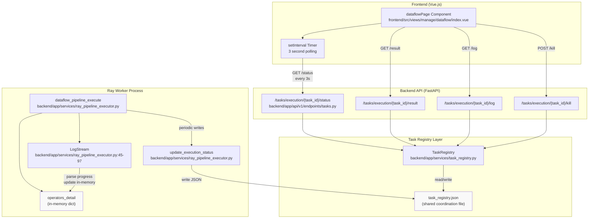
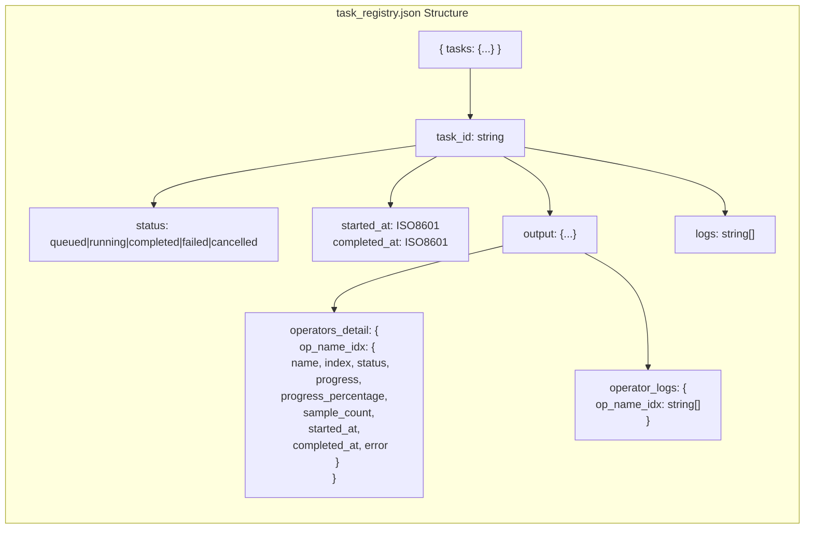
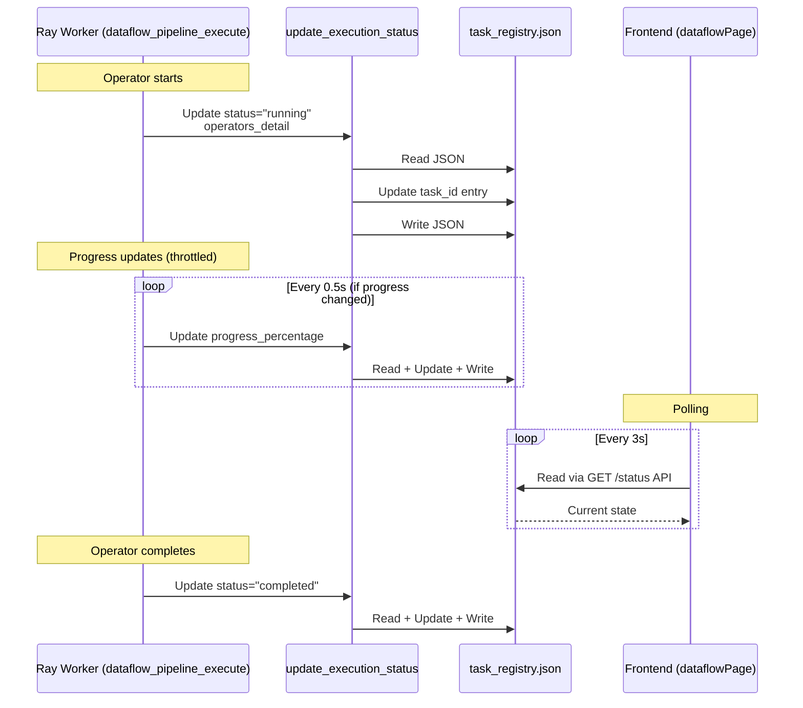
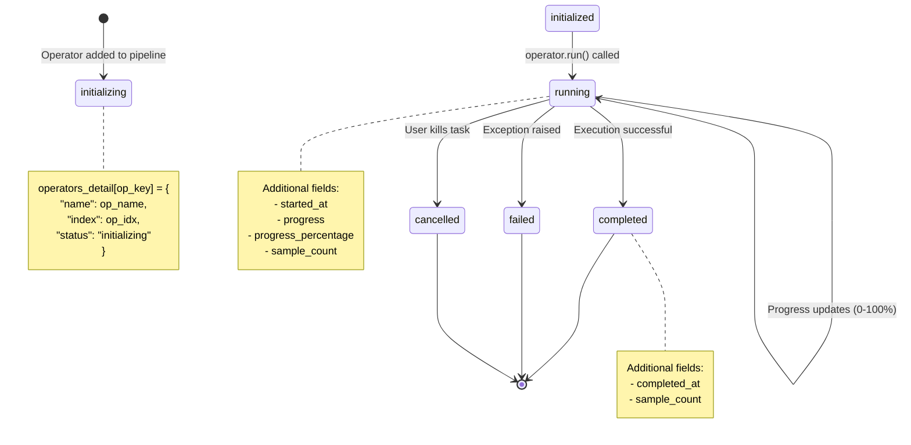
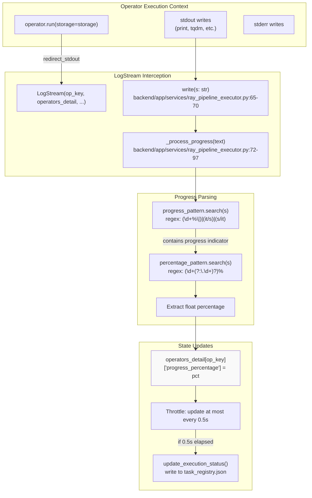
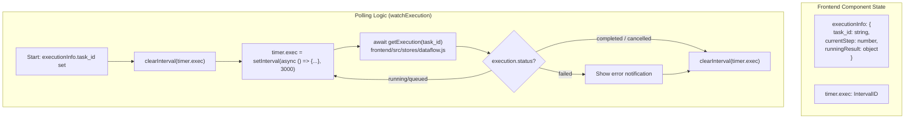
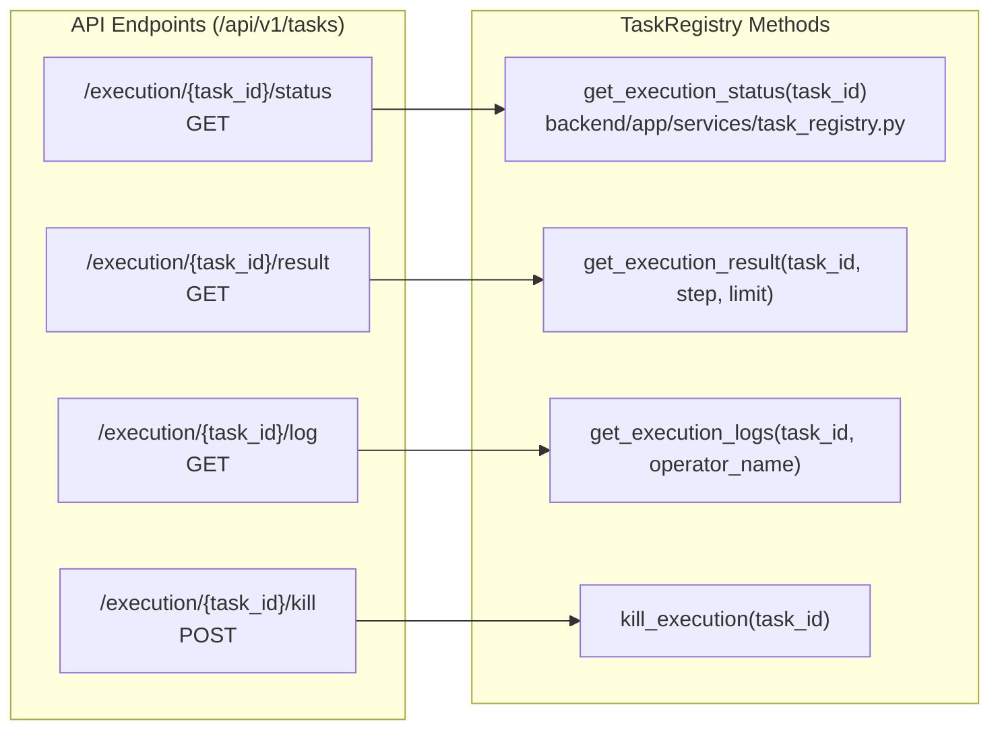

<!-- source: DeepWiki mcp.deepwiki.com · repo OpenDCAI/DataFlow-WebUI · page 7.3 Real-time Execution Monitoring · fetched 2026-11-02 -->

# Real-time Execution Monitoring

Relevant source files

The following files were used as context for generating this wiki page:

- [backend/app/services/dataflow_engine.py](backend/app/services/dataflow_engine.py)
- [backend/app/services/param_coercion.py](backend/app/services/param_coercion.py)
- [backend/app/services/ray_pipeline_executor.py](backend/app/services/ray_pipeline_executor.py)
- [frontend/src/assets/flow/operator.svg](frontend/src/assets/flow/operator.svg)
- [frontend/src/assets/flow/task.svg](frontend/src/assets/flow/task.svg)
- [frontend/src/components/manage/mainFlow/panels/execResultPanel/index.vue](frontend/src/components/manage/mainFlow/panels/execResultPanel/index.vue)
- [frontend/src/components/manage/mainFlow/panels/execResultPanel/preview/sampleChart.vue](frontend/src/components/manage/mainFlow/panels/execResultPanel/preview/sampleChart.vue)
- [frontend/src/components/manage/mainFlow/panels/taskPanel.vue](frontend/src/components/manage/mainFlow/panels/taskPanel.vue)
- [frontend/src/components/manage/mainFlow/pipeline/execLabel.vue](frontend/src/components/manage/mainFlow/pipeline/execLabel.vue)

## Purpose and Scope

This document explains the real-time execution monitoring system in DataFlow-WebUI. The system enables users to track pipeline execution progress as it happens, providing operator-level status updates, progress percentages, logs, and the ability to stop running pipelines.

For information about pipeline execution mechanics, see [Task Registry and Execution](#3.2). For distributed execution with Ray, see [Distributed Execution with Ray](#7.1). For storage and caching of results, see [Storage and Caching](#7.4).

---

## Monitoring Architecture Overview

The monitoring system uses a **polling-based architecture** with **file-based coordination** between the frontend, backend API, and Ray workers. The frontend polls status endpoints periodically, while Ray workers update a shared JSON file with execution progress via `update_execution_status` inside `backend/app/services/ray_pipeline_executor.py`.

**Key Design Decisions:**

| Aspect | Choice | Rationale |
|--------|--------|-----------|
| **Communication Pattern** | Polling (not WebSocket) | Simplicity; avoids connection management |
| **Coordination Mechanism** | File-based (JSON) | Simple, debuggable, survives process crashes |
| **Update Frequency** | 3 seconds | Balance between responsiveness and load |
| **Progress Capture** | Custom `LogStream` | Real-time progress bar parsing without buffering delays |

Sources: `frontend/src/views/manage/dataflow/index.vue:680-707](), [backend/app/services/ray_pipeline_executor.py:45-97](), [backend/app/services/task_registry.py:259-293]()

---

## File-Based Coordination Mechanism

The system uses `task_registry.json` as a shared coordination file between the main process and Ray workers. This file serves as the single source of truth for execution state.

### Registry File Structure

Sources: `backend/app/services/ray_pipeline_executor.py:180-200]()

### Update Mechanism

The `update_execution_status` function in the Ray worker writes updates to the file:

Sources: `backend/app/services/ray_pipeline_executor.py:180-200](), [backend/app/services/ray_pipeline_executor.py:461-468](), [backend/app/services/ray_pipeline_executor.py:541-561]()

---

## Operator-Level Status Tracking

Each operator's execution is tracked individually using the `operators_detail` dictionary. This enables fine-grained progress visibility in the UI.

### Operator Status Lifecycle

Sources: `backend/app/services/ray_pipeline_executor.py:177](), [backend/app/services/ray_pipeline_executor.py:254-259](), [backend/app/services/ray_pipeline_executor.py:461-542]()

### Operator Detail Schema

| Field | Type | Description | When Set |
|-------|------|-------------|----------|
| `name` | `string` | Operator class name | Initialization |
| `index` | `int` | Position in pipeline (0-based) | Initialization |
| `status` | `string` | Current status (see states above) | Throughout lifecycle |
| `started_at` | `string` | ISO8601 timestamp | When `operator.run()` starts |
| `completed_at` | `string` | ISO8601 timestamp | When operator finishes |
| `progress` | `string` | Last progress bar line (e.g., "45%\|███▌  \|") | During execution (from stdout) |
| `progress_percentage` | `float` | Numeric percentage (0-100) | During execution (parsed from progress) |
| `sample_count` | `int` | Number of samples processed | After completion (from cache file) |
| `error` | `string` | Error message | On failure |

Sources: `backend/app/services/ray_pipeline_executor.py:177-182]()

---

## LogStream: Real-Time Progress Capture

The `LogStream` class (`backend/app/services/ray_pipeline_executor.py:45-97`) is a custom `io.StringIO` subclass that intercepts stdout/stderr during operator execution. It parses progress bars in real-time and updates the execution status without waiting for buffering.

### LogStream Architecture

Sources: `backend/app/services/ray_pipeline_executor.py:45-97]()

### Progress Parsing Logic

The `LogStream` uses two regex patterns (`backend/app/services/ray_pipeline_executor.py:62-63`) to detect and extract progress:

- **Pattern 1 (Progress Indicator):** `re.compile(r'(\d+%\|)|(it/s)|(s/it)')`
- **Pattern 2 (Percentage):** `re.compile(r'(\d+(?:\.\d+)?)%')`

Post-processing is handled by `parse_and_clean_logs` (`backend/app/services/ray_pipeline_executor.py:122-159`), which cleans up duplicate carriage returns and extracts the final percentage.

Sources: `backend/app/services/ray_pipeline_executor.py:41-94](), [backend/app/services/ray_pipeline_executor.py:122-159]()

---

## Frontend Polling Mechanism

The frontend component polls the backend API every 3 seconds to retrieve execution status updates and refresh the UI (`frontend/src/views/manage/dataflow/index.vue`). Panels such as `taskPanel.vue` and `execResultPanel/index.vue` display these results alongside `sampleChart.vue`.

### Polling Implementation

Sources: `frontend/src/views/manage/dataflow/index.vue:681-706]()

---

## Monitoring API Endpoints

The backend provides RESTful endpoints under `backend/app/api/v1/endpoints/tasks.py` for the frontend to query execution state.

### Endpoint Summary

Sources: `backend/app/api/v1/endpoints/tasks.py:1-343](), [backend/app/services/task_registry.py:259-434]()

---

## Error Handling and Edge Cases

If a Ray worker crashes or encounters errors during execution:
1. `DataFlowEngineError` catches structured exceptions `[backend/app/services/ray_pipeline_executor.py:27-43]()`.
2. Stale execution states are flagged in `task_registry.json`.
3. Missing cache files are handled gracefully by checking step directories sequentially `[backend/app/services/task_registry.py:380-403]()`.

Sources: `backend/app/services/ray_pipe_executor.py:27-43](), [backend/app/services/task_registry.py:380-403]()

---

