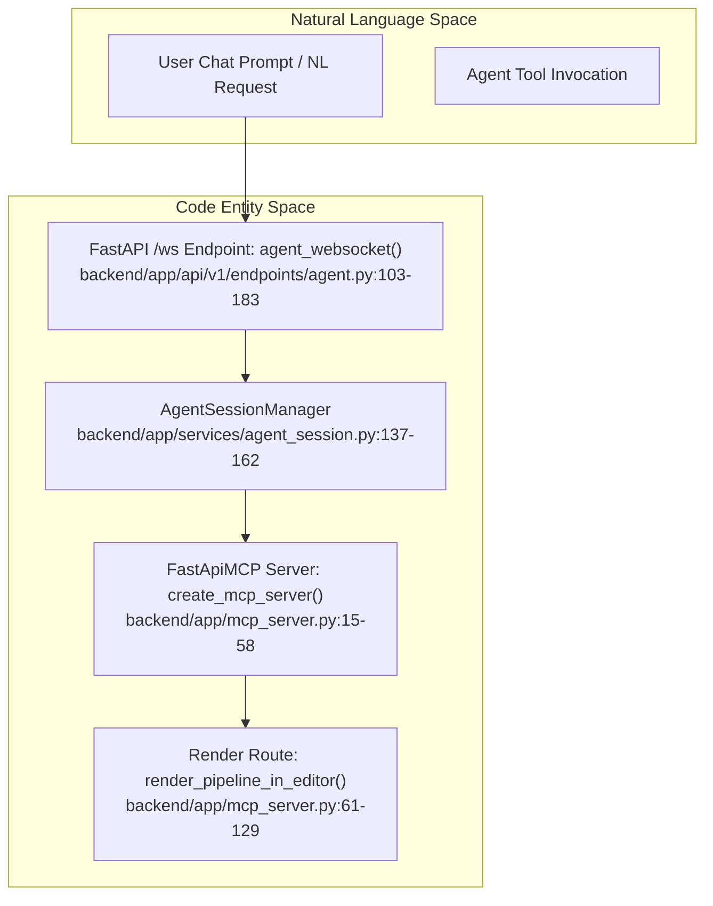
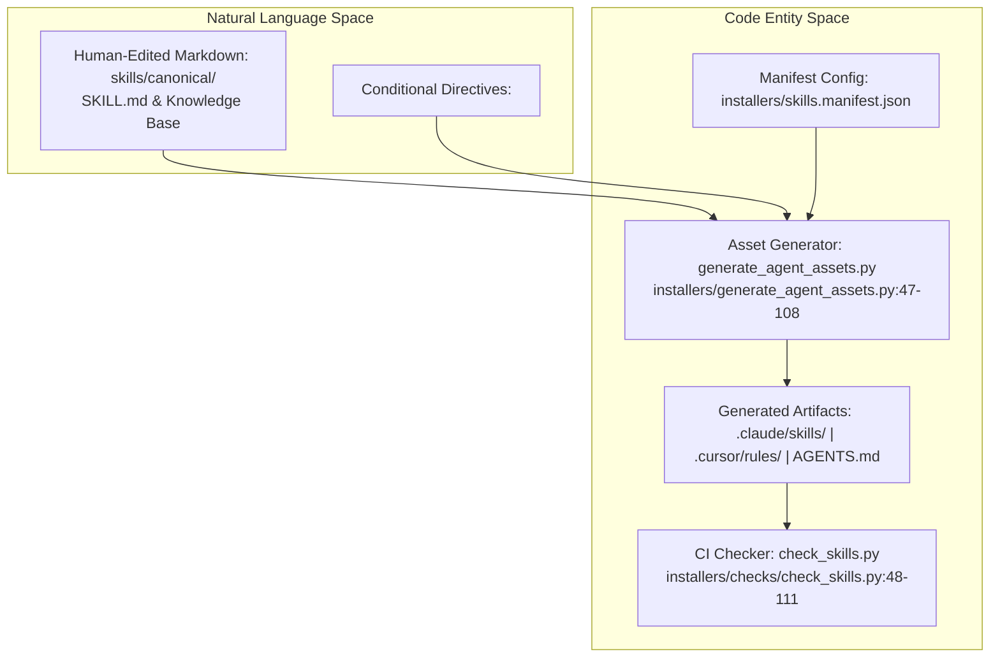

<!-- source: DeepWiki mcp.deepwiki.com · repo OpenDCAI/DataFlow-WebUI · page 8 Agents, Skills and MCP · fetched 2026-11-02 -->

# Agents, Skills and MCP

Relevant source files

The following files were used as context for generating this wiki page:

- [CLAUDE.md](CLAUDE.md)
- [backend/app/api/v1/endpoints/agent.py](backend/app/api/v1/endpoints/agent.py)
- [backend/app/mcp_server.py](backend/app/mcp_server.py)
- [backend/app/services/agent_session.py](backend/app/services/agent_session.py)
- [backend/app/services/operator_category_guide.py](backend/app/services/operator_category_guide.py)
- [docs/architecture/adr-001-source-of-truth.md](docs/architecture/adr-001-source-of-truth.md)
- [docs/migration/from-dataflow-skills.md](docs/migration/from-dataflow-skills.md)
- [docs/profiles/skills.md](docs/profiles/skills.md)
- [installers/checks/check_skills.py](installers/checks/check_skills.py)
- [installers/generate_agent_assets.py](installers/generate_agent_assets.py)
- [skills/canonical/dataflow-dev/SKILL.md](skills/canonical/dataflow-dev/SKILL.md)
- [skills/canonical/generating-dataflow-pipeline/SKILL.md](skills/canonical/generating-dataflow-pipeline/SKILL.md)

## Purpose and Scope

This page provides a high-level overview of the agent-facing layer in DataFlow-WebUI. This layer bridges natural language coding agents with the underlying pipeline execution engine, operator registry, and FastAPI backend. It encompasses three core pillars:
1. The **Model Context Protocol (MCP) Server** and real-time agent session management [backend/app/mcp_server.py:15-58]().
2. **Agent Adapters and Configuration** supporting Claude Code, Cursor, and Codex [backend/app/services/agent_session.py:137-162]().
3. The **Canonical Skills System**, which establishes `skills/canonical/` as the single source of truth for agent capabilities [docs/architecture/adr-001-source-of-truth.md:50-64]().

As a parent page, this document outlines architectural relationships and summarizes each sub-topic. For deep technical details, implementation specifics, and configuration guides, follow the links to the respective child pages.

---

## 1. MCP Server and Agent Sessions

The MCP server exposes DataFlow's backend capabilities as standardized Model Context Protocol tools [backend/app/mcp_server.py:1-58](). Mounted on FastAPI at `/mcp`, it utilizes `fastapi_mcp` to wrap a strict whitelist of read and write endpoints—including operator category discovery, operator retrieval, dataset column inspection, pipeline validation, and pipeline creation [backend/app/mcp_server.py:25-52](). 

A custom route, `render_pipeline_in_editor`, is registered alongside standard endpoints to allow agents to push generated or modified pipeline configurations directly into active frontend DAG editors via WebSocket broadcasting [backend/app/mcp_server.py:61-129](). Concurrently, `AgentSessionManager` maintains sub-processes for coding agents, serializing history to disk and streaming events back to the Vue 3 frontend Chat Panel [backend/app/api/v1/endpoints/agent.py:103-183](), [backend/app/services/agent_session.py:137-162]().

### Natural Language Space to Code Entity Space: Agent Execution Flow

*Figure 8.1: Mapping natural language chat interactions to backend FastAPI routing, session management, and MCP tool execution.*

For details, see [MCP Server and Agent Sessions](#8.1).

**Sources:**
- `backend/app/mcp_server.py:15-129`
- `backend/app/api/v1/endpoints/agent.py:103-183`
- `backend/app/services/agent_session.py:137-162`

---

## 2. Agent Adapters and Configuration

To support multiple coding assistants (Claude Code, Cursor, and Codex), the backend abstracts process invocation and event stream normalization into modular agent adapters under `backend/app/services/agents/`. These adapters translate CLI output streams into unified WebSocket events (`text_chunk`, `tool_call_start`, `tool_call_end`) consumed by the frontend [backend/app/api/v1/endpoints/agent.py:14-32]().

Configuration and environment wiring are automated via the installation script (`install.sh`), which features a `configure-agent` subcommand. This script generates or updates agent-specific configuration files—such as `.mcp.json` for Claude Code, `.cursor/mcp.json` for Cursor, and `config.toml`—ensuring that external coding tools can discover the local DataFlow MCP server and inherit proper security boundaries and environment variables [docs/profiles/skills.md:36-60]().

For details, see [Agent Adapters and Configuration](#8.2).

**Sources:**
- `backend/app/services/agent_session.py:24-44`
- `docs/profiles/skills.md:36-60`

---

## 3. Canonical Skills System

The canonical skills system solves the problem of documentation drift across multiple agent ecosystems. Under `skills/canonical/`, human maintainers edit skill definitions and reference materials exactly once [docs/architecture/adr-001-source-of-truth.md:50-64](). 

A build script, `installers/generate_agent_assets.py`, reads the manifest (`installers/skills.manifest.json`) and renders these canonical sources into agent-specific formats—including Claude skill packages (`.claude/skills/`), Cursor rules (`.cursor/rules/*.mdc`), and Codex routing documents (`AGENTS.md`) [installers/generate_agent_assets.py:47-108](). Conditional directives (e.g., `<!-- @if mcp==yes -->`) allow a single markdown file to tailor its guidance depending on whether the agent is operating in an online WebUI/harness profile or an offline skills profile [installers/generate_agent_assets.py:85-88](). Continuous integration enforces consistency via `installers/checks/check_skills.py`, which validates frontmatter, link integrity, and drift-free generation [installers/checks/check_skills.py:48-111]().

### Natural Language Space to Code Entity Space: Canonical Asset Generation

*Figure 8.2: Mapping human canonical markdown authoring to automated asset generation and CI link validation code entities.*

For details, see [Canonical Skills System](#8.3).

**Sources:**
- `docs/architecture/adr-001-source-of-truth.md:50-64`
- `installers/generate_agent_assets.py:47-108`
- `installers/checks/check_skills.py:48-111`
- `docs/profiles/skills.md:36-64`

---

