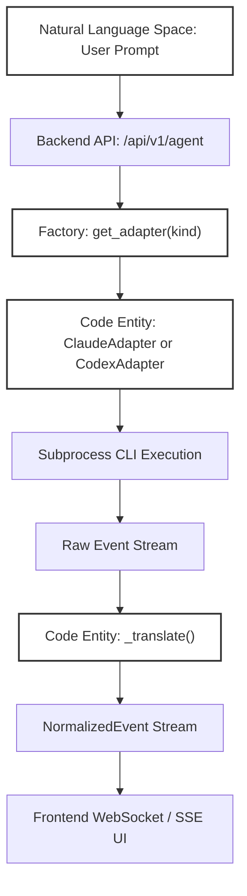
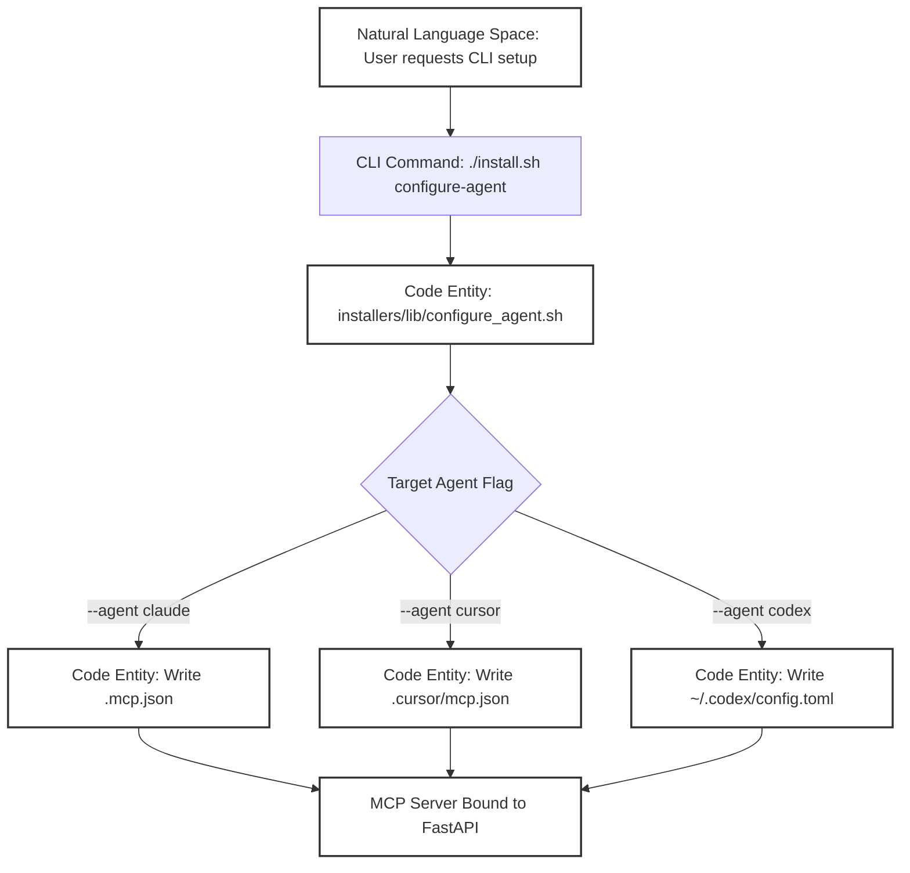

<!-- source: DeepWiki mcp.deepwiki.com · repo OpenDCAI/DataFlow-WebUI · page 8.2 Agent Adapters and Configuration · fetched 2026-11-02 -->

# Agent Adapters and Configuration

<details>
<summary>Relevant source files</summary>

The following files were used as context for generating this wiki page:

- [AGENT_SETUP.md](AGENT_SETUP.md)
- [backend/app/services/agents/base.py](backend/app/services/agents/base.py)
- [backend/app/services/agents/codex_adapter.py](backend/app/services/agents/codex_adapter.py)
- [backend/app/services/agents/cursor_adapter.py](backend/app/services/agents/cursor_adapter.py)
- [backend/app/services/agents/factory.py](backend/app/services/agents/factory.py)
- [docs/README.md](docs/README.md)
- [docs/agents/SETUP.md](docs/agents/SETUP.md)
- [docs/architecture/adr-002-package-managers.md](docs/architecture/adr-002-package-managers.md)
- [docs/install-claude-code.md](docs/install-claude-code.md)

</details>


This page documents the agent adapter layer (`backend/app/services/agents/`) within DataFlow-WebUI. It covers the abstract `AgentAdapter` interface, concrete implementations for Claude Code (`ClaudeAdapter`) and OpenAI Codex (`CodexAdapter`), the factory and environment resolution logic, and how configuration tools like `install.sh configure-agent` set up Model Context Protocol (MCP) bindings for `.mcp.json`, `.cursor/mcp.json`, and `config.toml`.

---

## 1. Agent Abstraction and Base Interface

The DataFlow-WebUI backend interacts with external coding agent CLIs by wrapping them as asynchronous subprocesses and normalizing their event streams into a unified format called `NormalizedEvent`. 

### The `AgentAdapter` Base Class
Defined in `backend/app/services/agents/base.py`, `AgentAdapter` is an abstract base class that establishes the contract for any agent integration:

```python
class AgentAdapter(abc.ABC):
    kind: str = ""

    def __init__(
        self,
        *,
        cli_path: str,
        webui_root: Path,
        mcp_config_path: Path,
        system_prompt: str,
        allowed_tools: str,
    ) -> None:
        ...
```
[backend/app/services/agents/base.py:43-61]()

### Normalized Events
The communication protocol between the backend and the frontend WebSocket or streaming HTTP endpoints relies on `NormalizedEvent` dictionaries (`backend/app/services/agents/base.py:4-9`):
- `{"type": "session", "session_id": "..."}`: Emitted once per turn to track conversation identifiers.
- `{"type": "text_chunk", "content": "..."}`: Streamed chunks of assistant text response.
- `{"type": "tool_call_start", "tool_use_id": "...", "name": "...", "input_preview": "..."}`: Triggered when the agent invokes an MCP tool.
- `{"type": "tool_call_end", "tool_use_id": "...", "is_error": bool, "output_preview": "..."}`: Triggered upon tool completion.
- `{"type": "error", "message": "..."}`: Adapter-level failure notifications.
- `{"type": "done"}`: Signals turn completion.

### Supported Agent Kinds
The backend explicitly manages headless subprocesses for **Claude** and **Codex** (`backend/app/services/agents/base.py:30`):
```python
AGENT_KINDS = ("claude", "codex")
DEFAULT_AGENT = "claude"
```
*Note on Cursor:* Cursor is intentionally excluded from headless backend subprocess spawning (`backend/app/services/agents/base.py:22-29`). Cursor users connect their local Cursor IDE directly to DataFlow's MCP server via `.cursor/mcp.json`, rendering pipelines back into the WebUI. The `CursorAdapter` implementation is retained in the codebase for API parity and experimental uses, but is omitted from factory registration.


*Diagram 1: Data Flow from Natural Language Prompt to Normalized Events.*

**Sources:** `backend/app/services/agents/base.py:1-89`

---

## 2. Concrete Adapters

### Claude Adapter (`ClaudeAdapter`)
`ClaudeAdapter` drives the Claude Code CLI (`claude`). It invokes the CLI in streaming JSON mode, appending system prompts using `--append-system-prompt`, passing allowed tool lists, and handling project-scoped MCP configurations via `--mcp-config`.

### Codex Adapter (`CodexAdapter`)
`CodexAdapter` (`backend/app/services/agents/codex_adapter.py`) manages OpenAI Codex CLI execution in headless mode (`codex exec`) (`backend/app/services/agents/codex_adapter.py:76-82`). 
- **System Prompt Delivery:** Because `codex exec` lacks a dedicated system prompt flag in headless mode, the adapter embeds harness rules directly into the user message (`backend/app/services/agents/codex_adapter.py:38-44`).
- **Sandbox & Auth:** It launches with `--sandbox workspace-write` for auto-approval and inherits runtime environment variables (`OPENAI_API_KEY`, `DATAFLOW_CODEX_CLI`, etc.) (`backend/app/services/agents/codex_adapter.py:79, 87`).

### Cursor Adapter (`CursorAdapter`)
`CursorAdapter` (`backend/app/services/agents/cursor_adapter.py`) wraps `cursor-agent` in print mode (`--print --output-format stream-json --force`) (`backend/app/services/agents/cursor_adapter.py:74-80`). It maps `assistant`, `system`, and `tool_call` chunk types into `NormalizedEvent` records (`backend/app/services/agents/cursor_adapter.py:133-181`).

**Sources:** `backend/app/services/agents/codex_adapter.py:1-192`, `backend/app/services/agents/cursor_adapter.py:1-191`

---

## 3. Factory and Configuration Resolution

The agent factory module (`backend/app/services/agents/factory.py`) resolves CLI paths and agent preferences dynamically using environment variables and input normalizers.

### Key Functions
- `normalize_agent_kind(kind: str | None) -> str`: Normalizes the requested agent name, falling back to the `DATAFLOW_DEFAULT_AGENT` environment variable or defaulting to `claude` (`backend/app/services/agents/factory.py:31-41`).
- `resolve_cli_path(kind: str) -> str`: Resolves the executable path from environment overrides (`DATAFLOW_CLAUDE_CLI`, `DATAFLOW_CODEX_CLI`) or defaults to standard binary names (`backend/app/services/agents/factory.py:20-28`).
- `get_adapter(...) -> AgentAdapter`: Instantiates either `ClaudeAdapter` or `CodexAdapter` based on the normalized kind (`backend/app/services/agents/factory.py:43-69`).

**Sources:** `backend/app/services/agents/factory.py:1-69`

---

## 4. Agent Configuration and MCP Writing (`install.sh configure-agent`)

Configuring agents to recognize DataFlow's Model Context Protocol (MCP) server is handled separately from package installation via `./install.sh configure-agent` (as detailed in `docs/agents/SETUP.md`).

### Configuration Files Written
Depending on the target agent and scope (`--scope project` vs `--scope user`), the installer generates or updates:
1. **`.mcp.json`**: Project-scoped configuration used by Claude Code and general MCP clients.
2. **`.cursor/mcp.json`**: Workspace-scoped configuration for Cursor IDE integration.
3. **`~/.codex/config.toml`**: User-scoped configuration for Codex, which requires user-level writing since Codex does not support project-local configurations (`docs/agents/SETUP.md:71-74`).


*Diagram 2: Configuration Writing and MCP Server Registration Flow.*

### Security Boundaries
- **No API Keys in Files:** The installer and agent adapters never write API keys to disk. Credentials must be exported as environment variables (`OPENAI_API_KEY`, `ANTHROPIC_API_KEY`) at runtime (`docs/agents/SETUP.md:75-78`).
- **Scope Defaults:** `--scope project` is the default, restricting modifications to the local repository directory. `--scope user` modifies home directory files (`~/.claude/` or `~/.codex/config.toml`) and requires explicit human consent (`docs/agents/SETUP.md:68-74`).

**Sources:** `AGENT_SETUP.md:1-31`, `docs/agents/SETUP.md:1-163`

---

