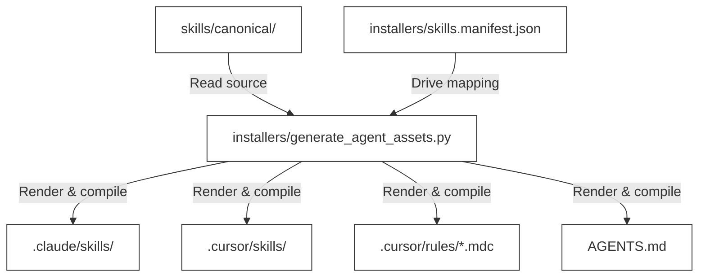

<!-- source: DeepWiki mcp.deepwiki.com · repo OpenDCAI/DataFlow-WebUI · page 8.3 Canonical Skills System · fetched 2026-11-02 -->

# Canonical Skills System

<details>
<summary>Relevant source files</summary>

The following files were used as context for generating this wiki page:

- [docs/architecture/adr-001-source-of-truth.md](docs/architecture/adr-001-source-of-truth.md)
- [docs/migration/from-dataflow-skills.md](docs/migration/from-dataflow-skills.md)
- [docs/profiles/skills.md](docs/profiles/skills.md)
- [installers/checks/check_skills.py](installers/checks/check_skills.py)
- [installers/generate_agent_assets.py](installers/generate_agent_assets.py)
- [installers/lib/steps.sh](installers/lib/steps.sh)
- [skills/canonical/dataflow-dev/SKILL.md](skills/canonical/dataflow-dev/SKILL.md)
- [skills/canonical/generating-dataflow-pipeline/SKILL.md](skills/canonical/generating-dataflow-pipeline/SKILL.md)

</details>


The Canonical Skills System serves as the architectural foundation for agent-assisted DataFlow development [docs/architecture/adr-001-source-of-truth.md:1-4]. Governed by ADR-001, the system establishes `skills/canonical/` as the single hand-edited source of truth for all coding agent instructions, operator references, and scaffolding tools [docs/architecture/adr-001-source-of-truth.md:50-51]. It eliminates cross-repository and multi-file drift by centralizing content and deriving all downstream agent formats (`.claude/skills/`, `.cursor/skills/`, `.cursor/rules/`, and `AGENTS.md`) via automated compilation [docs/architecture/adr-001-source-of-truth.md:50-64].

Sources: `docs/architecture/adr-001-source-of-truth.md:1-64`

---

## 1. Canonical Layout and the Skills Manifest

The canonical skill store resides under `skills/canonical/` and contains five distinct skill packages alongside shared core reference files [docs/architecture/adr-001-source-of-truth.md:54-59]:

*   `generating-dataflow-pipeline/`: Guides coding agents through target analysis, sample JSONL inspection, operator priority rules, and runnable pipeline code generation [docs/profiles/skills.md:42].
*   `dataflow-dev/`: Acts as a developer context loader for creating operators, diagnosing runtime errors, reviewing code, and syncing knowledge bases [docs/profiles/skills.md:43].
*   `dataflow-operator-builder/`: Scaffolds custom operators, including class inheritance, CLI wrappers, and unit tests [docs/profiles/skills.md:44].
*   `prompt-template-builder/`: Facilitates authoring and registering reusable `prompt_template` classes [docs/profiles/skills.md:45].
*   `core_text/`: Provides an extensive per-operator API reference library consumed by pipeline generation workflows [docs/profiles/skills.md:46].

The composition, agent compatibility, and scoping of these skills are cataloged in `installers/skills.manifest.json`. The manifest defines structural mappings, invocation flags, and target file globs.


*Figure 8.3.1: Natural Language Space to Code Entity Space mapping execution for agent asset generation.*

Sources: `docs/profiles/skills.md:38-47`, `docs/architecture/adr-001-source-of-truth.md:50-64`, `installers/generate_agent_assets.py:33-35`

---

## 2. Conditional Directives and Template Rendering

To support different deployment profiles (`webui`, `harness`, and `skills`) without maintaining duplicate files, canonical Markdown files use conditional preprocessor directives [docs/architecture/adr-001-source-of-truth.md:66-78]. 

The rendering engine processes tags such as `<!-- @if mcp==yes -->` and `<!-- @if profile==webui -->` based on runtime context dictionaries built by `profile_context(profile)` in `installers/generate_agent_assets.py` [installers/generate_agent_assets.py:85-88]:

```python
def profile_context(profile: str) -> dict:
    """MCP guidance is only correct where an MCP server actually exists."""
    return {"profile": profile, "mcp": "yes" if profile in ("webui", "harness") else "no"}
```
*[installers/generate_agent_assets.py:85-88]()

When the profile is set to `skills`, MCP-specific instructions (such as calling `validate_pipeline_config` or querying `get_operator_detail_by_name`) are stripped out. When the profile is `webui` or `harness`, those instructions are retained, ensuring that offline and online agent behaviors remain consistent with the active environment [docs/architecture/adr-001-source-of-truth.md:66-78].

Sources: `docs/architecture/adr-001-source-of-truth.md:66-78`, `installers/generate_agent_assets.py:85-88`

---

## 3. Asset Generation via `generate_agent_assets.py`

Asset compilation is executed through `installers/generate_agent_assets.py` [installers/generate_agent_assets.py:1-18]. The script parses `installers/skills.manifest.json`, loads canonical skill packages, evaluates conditional templates using `installers/lib/render.py`, and distributes files to their respective target agent directories [installers/generate_agent_assets.py:30-108].

```mermaid
graph TD
    loadManifest[""load_manifest() in installers/generate_agent_assets.py""] --> iterFiles[""iter_skill_files() in installers/generate_agent_assets.py""]
    iterFiles --> renderFile[""render_file() in installers/generate_agent_assets.py""]
    renderFile --> checkSuffix{""Renderable .md?""}
    checkSuffix -->|Yes| applyRender[""render() in installers/lib/render.py""]
    applyRender --> addBanner[""GENERATED_BANNER injection""]
    checkSuffix -->|No| copyFile[""shutil.copy2() binary copy""]
    addBanner --> writeTarget[""Write to target agent directory""]
    copyFile --> writeTarget

    classDef default fill:#fff,stroke:#333,stroke-width:1px;
```
*Figure 8.3.2: Asset Generation execution pipeline from canonical source to target agent packages.*

Key functions involved in asset generation include:
*   `load_manifest()`: Reads `installers/skills.manifest.json` [installers/generate_agent_assets.py:47-49].
*   `render_file()`: Inspects file suffixes, invokes the rendering engine, and prepends `GENERATED_BANNER` to generated `SKILL.md` files [installers/generate_agent_assets.py:58-83].
*   `generate_cursor_rules()`: Builds thin Cursor rules (`.cursor/rules/*.mdc`) equipped with appropriate globs and `alwaysApply` flags [installers/generate_agent_assets.py:133-157].

Sources: `installers/generate_agent_assets.py:33-157`

---

## 4. Quality Assurance and Linting via `check_skills.py`

To prevent documentation drift, broken relative links, and invalid conditional blocks, the CI pipeline runs `installers/checks/check_skills.py` [docs/architecture/adr-001-source-of-truth.md:128-130, installers/checks/check_skills.py:1-19]. 

The linter performs five validation checks on every build [installers/checks/check_skills.py:4-16]:
1.  **Manifest and Disk Agreement**: Ensures every skill declared in `installers/skills.manifest.json` has a corresponding directory in `skills/canonical/` and vice versa [installers/checks/check_skills.py:4-7].
2.  **YAML Frontmatter Validation**: Parses frontmatter headers using `parse_frontmatter()` to verify required fields like `name` [installers/checks/check_skills.py:48-68].
3.  **Link and Reference Resolution**: Uses `check_links()` with regular expressions (`LINK_RE` and `CODE_PATH_RE`) to ensure all relative paths and sibling references (`../core_text/`) resolve correctly on disk [installers/checks/check_skills.py:35-112].
4.  **Render Matrix Validation**: Iterates over all permutations of agents and profiles (`webui`, `harness`, `skills`) via `check_render_matrix()` to guarantee that conditional blocks never raise a `RenderError` [installers/checks/check_skills.py:114-132].
5.  **Profile Content Boundaries**: Enforces boundary rules with `check_profile_content_boundaries()`, verifying that offline profiles (`skills`) do not instruct agents to access online systems like MCP or the WebUI Serving Manager [installers/checks/check_skills.py:134-176].

```mermaid
graph TD
    ci[""CI Pipeline Execution""] --> runCheck[""python3 installers/checks/check_skills.py""]
    runCheck --> parseFM[""parse_frontmatter() in check_skills.py""]
    runCheck --> chkLinks[""check_links() in check_skills.py""]
    runCheck --> chkMatrix[""check_render_matrix() in check_skills.py""]
    runCheck --> chkBound[""check_profile_content_boundaries() in check_skills.py""]
    parseFM -->|"Fail on syntax"| err[""Exit Code 1 (Drift/Error)""]
    chkLinks -->|"Fail on broken link"| err
    chkMatrix -->|"Fail on render error"| err
    chkBound -->|"Fail on boundary leak"| err
    runCheck -->|"All checks pass"| success[""Exit Code 0 (Passed)""]

    classDef default fill:#fff,stroke:#333,stroke-width:1px;
```
*Figure 8.3.3: Skill validation and CI enforcement workflow bridging code validation entities.*

Sources: `installers/checks/check_skills.py:1-176`, `docs/architecture/adr-001-source-of-truth.md:128-130`

---

